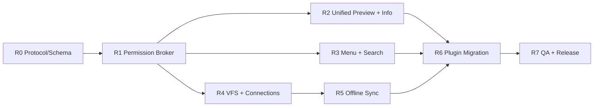

# Fiex Roadmap — 待实施事项

> 本文是**待办事项清单**，不是版本发布说明、已经完成的功能列表或过去/现在对比。所有复选框默认未完成，只有合并实现 PR、对应测试通过后才能勾选。目标架构以 `docs/plugins/` 中的设计文档为准；目标 Manifest v2 / Native IPC 3.0 / UI Bridge 2.0 尚需落地。没有工期承诺。
>
> **三个实施仓库**：`fiex`（Core / Desktop / UI）、`fiex-sdk`（Rust SDK / UI SDK）、`fiex-official-plugins`（官方插件）。涉及公共合同变化时需同步更新三仓和相关 CI。

## 实施优先级与路线

| 优先级 | 阶段 | 核心目标 | 依赖 |
|---|---|---|---|
| P0 | R0 · 协议基线 | JSON Schema / SDK 类型生成 / Mock Contract Test | 无 |
| P0 | R1 · 文件权限与 Core Broker | File/Folder 细粒度权限、统一事件后按需资源请求、操作 Scope、文件/网络/句柄安全 | R0 |
| P0 | R2 · 统一 Preview / Info Provider | **所有内置预览和元数据与第三方插件使用同一 Provider 接口** | R0 + R1 的授权框架 |
| P0 | R3 · 动态菜单与搜索 | 菜单 RPC Provider、局部搜索、Everything 路径限制 | R0 + R1 |
| P1 | R4 · VFS 与 Connection | 自动生成 mount、连接生命周期、远端资源引用统一 | R1 |
| P1 | R5 · 按需缓存与双向同步 | 稳定文件身份、离线副本、原子上传、冲突解决 | R4 |
| P1 | R6 · 其他扩展点迁移 | 主题、装饰、钩子、工具栏、面板、设置及官方插件 | R0–R5 按需 |
| P1 | R7 · 最终验收与发布 | 跨平台隔离、超大文件、完整契约测试、删除 legacy | R0–R6 |



## Manifest 分类与 Core 来源拆分原则

`surfaces` 放拥有固定 UI 集成位置的 Connection、Toolbar、ContextMenus、Search、Preview、Info、Decorations、Settings。Connection 只出现在添加连接 + 和侧边栏，插件负责点击后的导航；**不自动挂载**，网盘必须另行声明 `providers.vfs[]`。`providers` 放显式 VFS View 和文件生命周期 Hooks。Panel 在运行时通过 IPC 创建；Themes 在 `surfaces.themes[]` 注册。

**不能仅改 Registry/接口名字**。物理拆分 `src-tauri/src/plugins/info.rs`：`info/mod.rs` 只调度；`metadata.rs`（`core.info.metadata`）、`audio.rs`（`core.info.audio`）、`video.rs`（`core.info.video`）各自实现；`Preview.tsx` 只负责容器，独立的 `TextPreview`、`ImagePreview`、`AudioPreview`、`VideoPreview`、`PdfPreview` 和 `FallbackPreview` 分别注册到同一 PreviewRegistry。

## R0 · 合同先行（P0）

- [ ] R0-01：为 Manifest、Native IPC、UI Bridge、`PreviewProvider`、`InfoProvider` 和跨进程 `ResourceRef` 建立可机检 JSON Schema。
- [ ] R0-02：Core 的 IPC Schema 是传输协议单一事实来源；Core 内置 Provider 和从插件 IPC 解码的数据使用相同业务类型，UI 只生成需要的传输类型，SDK 不强制公开 Preview/Info 专有对象。
- [ ] R0-03：在 Core 建立内置适配器、Mock Plugin 适配器、假 ResourceBroker 的一致性测试夹具。
- [ ] R0-04：Manifest 顶层仅保留 `surfaces`（Connection/Toolbar/ContextMenus/Search/Preview/Info/Decorations/Settings/Themes）与 `providers`（VFS/Hooks）等声明；**禁止静态 panels[]、panelId**，旧 contributions/capabilities 等字段拒绝解析。
- [ ] R0-05：整理所有 RPC、UI Bridge、Manifest Contribution 的方法清单，增删接口强制更新文档与测试。

**验收**：Schema ↔ SDK ↔ Core 之间有自动编译与契约测试；不存在文档已定义却完全未注册的公开 API。

## 最新确定的唯一事件资源交互

```text
Manifest 注册事件
→ 用户操作/切换目录
→ Core 通知插件 (Session + opaque refs，无 metadata)
→ 插件通过统一 IPC 申请所需文件/目录资源
→ 独立 PermissionPolicy 检查已批准权限、会话作用域及响应数据
→ Core 返回数据或 PermissionDenied
→ 插件返回业务结果，Core 创建 UI
```

不设计 Metadata Push/Pull 双通道。文件/文件夹仅使用一项 `permissions.metadata.enabled`，其余读写/创建/删除操作权限仍然按真实资源类型区分。右键菜单 resolve 阶段可申请当前所选对象的 stat；执行文件读写仍需后续用户动作及对应授权。

## R1 · 权限与资源访问（P0）

- [ ] R1-01：单独 `permissions.metadata.enabled` 统一控制文件与目录元数据；其余 `permissions.files.*`、`permissions.folders.*` 分别控制对象操作，权限均为带 enabled 的对象。
- [ ] R1-02：文件权限支持 `read/write/create/delete/rename`；目录独立支持 `read/create/delete/rename`；文件和目录元数据统一使用唯一 `permissions.metadata.enabled`；区分创建文件与创建文件夹、删除文件与删除目录。
- [ ] R1-03：Menu/Preview/Info/Decoration 事件只通知 `SessionId + opaque ResourceRef`，**绝不随事件自动发送 Metadata**；插件在事件回调中用通用 `host.fs.stat/list/openRead` 申请资源，独立 PermissionPolicy 审核请求和 Core 返回内容。
- [ ] R1-04：所有 `host.fs.stat` 请求都使用唯一 `permissions.metadata.enabled` + 本次 EventScope/OperationScope/TaskScope；右键 resolve 可读所选项 metadata，Decoration 可读本次可见成员 metadata；均不允许无关资源；不再设 Push/Pull 不同路径。
- [ ] R1-05：文件、网络、共享缓冲、任务、进程执行操作统一经过独立 Broker，按用户最终确认行为发放作用域；句柄绑定操作/进程身份并能取消/撤销。
- [ ] R1-06：为 Preview/Info 提供 Core 管理的安全限额只读流和受控资源 URL；大文件不一次性加载、base64 或复制给 iframe。
- [ ] R1-07：为本地/Connection/VFS 提供不可伪造 `ResourceRef` 与会话生命周期；验证符号链接、TOCTOU、资源身份变更和路径逃逸。

**验收**：事件只有 opaque ref；插件申请本次所选 metadata 才经审核返回，未授权返回 PermissionDenied；第三方不能对未经选中的对象主动 stat；视频/PDF 大文件可流式读且关闭预览会回收句柄。

- [ ] R1-08：新增独立 PermissionPolicy/AuthorizationGateway（推荐单独 Rust workspace crate）实现 `audit_output` 与 `authorize_call`，Core 不散写每个 Surface 的字段审核；嵌套 entries/selection 必须经过 Scope+权限审查。
- [ ] R1-09：`surfaces.decorations:true` 只订阅每次目录切换；通知只含当前目录及已显示成员 opaque refs。插件用通用 `host.fs.stat`（可优化为 batch）按需申请成员 metadata；有统一 metadata 授权及当前可见 Scope 才能得到属性并生成逐项 Decoration。

## R2 · 内置与插件统一 Preview / Info（P0，重点）

目标详见 [统一 Provider 接口设计](docs/plugins/08-UNIFIED-PREVIEW-INFO.md)。要求**内置与插件用完全相同的数据合同和调度路径**，内置为进程内 Adapter，第三方为受权限限制的 IPC / sandbox Adapter；不是要求内置组件运行于插件进程。

### R2-A · 统一预览注册与展示

- [ ] R2-01：创建 `PreviewRegistry / PreviewProvider`，注册内置和第三方 `PreviewDescriptor`（`id/title/extensions?/mimeTypes?/priority?/supportsDirectories?`），匹配优先级统一。
- [ ] R2-02：将文本/代码高亮拆为 `core.preview.text` 内置 Provider，含 256 KiB 等有界内容读取、语言检测和高亮，脱离 `Preview.tsx` 的文本条件分支。
- [ ] R2-03：将图片拆为 `core.preview.image`，统一资源代理、异步加载、尺寸适配和失败回退。
- [ ] R2-04：将音频拆为 `core.preview.audio`，将视频拆为 `core.preview.video`，分别负责流式播放和清理。
- [ ] R2-05：将 PDF 拆为 `core.preview.pdf`，统一有界/范围读取，支持原有 PDF 功能。
- [ ] R2-06：将目录/未知格式的展示实现为不可完全禁用的 `core.preview.fallback`。
- [ ] R2-07：第三方预览和多个内置 Preview 进入同一个 Registry；外部预览在本次 `preview.open` 事件中动态返回 View/PanelSpec，不能通过 Manifest 固定 `panelId`。
- [ ] R2-08：`Preview.tsx` 最终只管理宿主 Modal/导航/快捷键/生命周期，内部渲染改为 `PreviewHost` 统一分发，移除按格式硬编码的多路条件分支。
- [ ] R2-08A：物理拆分 Text/Image/Audio/Video/Pdf/Fallback 各预览组件及单独测试；PreviewHost 不再根据 MIME 分支选择渲染。
- [ ] R2-09：修复“内置文本/图片/音视频只列在候选外，却不能正常与插件同台排序”的逻辑；所有内置和插件能参加排序，按类型/扩展/MIME 匹配。

### R2-B · 统一 Info 注册与显示

- [ ] R2-10：创建 `InfoRegistry / InfoProvider`，规定唯一回包结构 `InfoResponse { sections: [{id,title,rows:[{label,value}]}] }`，Core 与插件严格一致。
- [ ] R2-10A：物理拆分 `src-tauri/src/plugins/info.rs` → `info/mod.rs`（仅 Registry 编排）、`metadata.rs`、`audio.rs`、`video.rs`、`types.rs`，三个内置 Provider 分别测试、排序、超时、失败隔离。
- [ ] R2-11：将普通文件基本属性（名称/类型、大小、位置、创建/修改时间、只读、符号链接）迁移为 `core.info.metadata`，不再由 `FileInfoDialog.tsx` 自己组装。
- [ ] R2-12：将 lofty 音频元数据解析迁移为 `core.info.audio`，输出相同 `InfoResponse`；读取媒体文件数据时按照内容读取的安全规则进行限额与 Scope 检查。
- [ ] R2-13：将 MP4 / Matroska 视频元数据迁移为 `core.info.video`，输出相同 `InfoResponse`，保留容器、码流、时长、分辨率等。
- [ ] R2-14：第三方 `surfaces.info[]` 改为和内置 Provider **完全一致的请求/响应合同**，统一上下文为 `ResourceRef + sessionId`（事件不附带 metadata）；删除旧 `path → rows` 形式。
- [ ] R2-15：`FileInfoDialog.tsx` 只消费 `sections[]`，统一展示区块，移除 `basicRows`、硬编码插件 ID 和不同 source 的特殊 UI 路径。
- [ ] R2-16：`src-tauri/src/plugins/info.rs` 只负责 InfoRegistry/Adapter 编排；基础文件、媒体探测与第三方聚合不再分两套调用代码。
- [ ] R2-17：本地、`fiex://` 连接、Git VFS、离线副本都可走同一 Info 路由；不因是虚拟文件而无条件返回空数组。
- [ ] R2-18：多个 Info 区块并发聚合、稳定排序、单个超时/取消/失败隔离；无 HTML 注入、无重复读取。

### R2-C · SDK、隔离与验收

- [ ] R2-19：Preview/Info 业务类型以 Core 公共协议模块为唯一来源；内置 Provider 直接构造统一 Rust 对象，插件通过通用 IPC 返回 JSON，Core 反序列化为**同一对象类型**；Rust SDK 不要求导出这些专用类型。
- [ ] R2-20：Preview/Info 事件只给 `ref/sessionId`；插件自行申请 `host.fs.stat`/文件流，独立 PermissionPolicy 审核请求/响应；媒体解析需 `files.read.enabled`，不能用 metadata 权限代替。
- [ ] R2-21：用内置图片、文本高亮、音频、视频、PDF、基础文件 Info、音频 Info、视频 Info、第三方 Preview/Info 的相同 mock contract fixtures 做测试。
- [ ] R2-22：覆盖无扩展名、伪 MIME、错误编码、大于 5 GiB 文件、缺少权限、切换文件时取消、插件崩溃、资源临时不可用、视频音频停止播放。
- [ ] R2-23：删除 Preview/Info 重复代码与旧的插件专用渲染/错误格式；保持 UI 体验、性能和键盘交互不回退。

**R2 的完成条件**：`Preview.tsx` 不再拥有格式分支；`FileInfoDialog.tsx` 不再手写基本属性；Core 的原生媒体 Info 与第三方 Info 真正进入一套 Registry 和 `InfoResponse`；第三方插件不获得比用户确认操作更广的文件访问。

## R3 · 动态右键菜单、局部搜索与运行时 Panel（P0）

- [ ] R3-00：删除 Manifest 静态 `panels[]`、`panelId`、Panel contribution；实现 `host.ui.open` 与 PanelSpec，插件可在有效用户交互时指定包内 HTML 或有界运行时 HTML，Core 负责 sandbox、CSP、size/focus/session。
- [ ] R3-00A：Toolbar、ContextMenu（仅 execute 后）、Preview、Info（仅明确点击操作）、Search（仅点击结果/操作）、Connection（用户添加/管理时）等 UI Surface 均可通过相同 PanelHost 打开面板；不可从 `contextMenu.resolve/info.resolve/search.query`、decorations 刷新或后台触发。
- [ ] R3-00B：Core 签发不可伪造 `interactionId`，Panel 创建时验证插件身份/触发入口/有效期；用户关闭、切换或撤权时回收 UI 会话及绑定句柄。


- [ ] R3-01：`surfaces.contextMenus:true` 注册动态 Provider，每次右键 Core 向每个已启用插件发送一次 `contextMenu.resolve`。
- [ ] R3-02：右键 `resolve` 只返回 `action/submenu/separator` 扁平项；删除 `when`、`children`、`type:panel`。点击 action 后插件才可调用统一的 `host.ui.open`。
- [ ] R3-03：点击前验证 MenuSession、item 所属插件和当前选择，执行时单独创建 OperationScope。
- [ ] R3-04：删除 `surfaces.search[].scope`，仅将用户当前 root 传给 `search.query`，所有 Provider 必须按该目录限制搜索。
- [ ] R3-05：Everything 允许依赖全局索引，但查询本身要带路径过滤，Core 对返回结果二次校验路径边界。
- [ ] R3-06：添加查询超时、取消、批量结果限制与性能基准，UI 不因插件阻塞。

## R4 · VFS 与 Connection（P1）

- [ ] R4-00：点击 Connection 加号和侧栏条目分别触发 `connection.create/open`，插件决定导航目标，Core 校验该 NavigationIntent；不因注册或保存 Connection 自动创建 VFS。
- [ ] R4-00A：网盘同时注册 `surfaces.connections[]` 和 `providers.vfs[]`，VFS Broker 能按操作暴露读/写流及挂载，Git 历史可仅声明只读 VFS。


- [ ] R4-01：统一 Core MountRegistry，Connection 不创建挂载；独立声明 `providers.vfs[]` 并经 VFS IPC 请求，Core 才分配 `fiex://mount/<id>/`。网盘同时注册 Connection UI 与 VFS 文件树。
- [ ] R4-02：Git 只读 VFS、网盘可写 VFS 使用同一个 Core mount 命名和 ResourceRef 模型，不通过 Connection 规则推导文件树能力。
- [ ] R4-03：文件 stat、列表分页、只读流、NodeId、版本快照及挂载生命周期同一 Broker。
- [ ] R4-04：实现每连接实例的独立凭据、断连/禁用/卸载时资源撤销；不在插件 Manifest 声明缓存和冲突策略。

## R5 · 云盘按需缓存与双向同步（P1）

- [ ] R5-01：首次打开按需下载、始终保留在本地、释放本地空间、离线读写与重连同步。
- [ ] R5-02：下载基于远端 revision 锁定和分块校验，避免不同版本的数据混拼。
- [ ] R5-03：上传基于内容不可变快照和 Provider 可保证的 CAS；弱 CAS 明确标注并保守处理。
- [ ] R5-04：冲突检测、双版本保留、用户解决、断电恢复、长时间任务取消及后台不阻塞 UI。
- [ ] R5-05：WebDAV、Google Drive、OpenList、SMB 等官方连接通过独立 Provider 测试。

## R6 · 其他扩展点及官方插件（P1）

- [ ] R6-01：Manifest 分为 `surfaces`（固定 UI 插槽，含 Connection/Themes）和 `providers`（VFS/Hooks）；Panel 为通用运行时 UI 服务，所有插件迁移到基于交互的 `host.ui.open`。
- [ ] R6-02：Vista / Win11 主题；Archive / GPG / Git；Everything；Office/Data 预览/信息实现都按新 Schema 迁移。
- [ ] R6-03：移除官方插件特殊 ID 判断、重复 iframe 逻辑和未使用的 legacy 分支。
- [ ] R6-04：在安装、升级和卸载时保证贡献点注销、视图重载、权限重新批准及资源回收。

## R7 · 测试与发布门禁（P1）

- [ ] R7-01：Windows/macOS/Linux 执行格式化、Rust clippy、前端 typecheck、单元/集成测试。
- [ ] R7-02：性能基准覆盖 5 GiB+ 大文件、数千文件目录、并发 Provider、按需缓存、弱网、取消。
- [ ] R7-03：安全回归覆盖权限撤销、非选中路径读取、元数据泄露、扩展点伪造、目录逃逸、恶意 UI Bridge 调用。
- [ ] R7-04：官方插件逐一完成端到端安装/调用/禁用/卸载验收。
- [ ] R7-05：所有新 API 均有 Schema、SDK 封装、Core Host 路由、文档与契约测试；无死路径。
- [ ] R7-06：CI 全绿后合并；只有验证与代码匹配，才能在此 Roadmap 勾选任务。

## 文档导航

| 文件 | 目的 |
|---|---|
| [插件设计总览](docs/plugins/README.md) | 约束、目标架构和跨仓实施说明 |
| [Manifest 与权限](docs/plugins/02-MANIFEST-EXTENSIONS.md) | 各贡献点的字段和 metadata 授权 |
| [IPC 方法目录](docs/plugins/03-IPC-CATALOG.md) | 所有跨进程消息 |
| [SDK 方法目录](docs/plugins/04-SDK-CATALOG.md) | Rust/UI SDK 与 Host API 映射 |
| [Preview + Info 统一方案](docs/plugins/08-UNIFIED-PREVIEW-INFO.md) | **内置与插件使用相同 Provider 协议** |
| [运行时 UI Panel 协议](docs/plugins/09-RUNTIME-UI-PANELS.md) | 全部 UI Surface 共用交互触发的 Panel 创建，无静态 Panel 注册 |
| [完整实施任务书](docs/plugins/07-IMPLEMENTATION-PLAN.md) | 分模块实现步骤和验收定义 |

更新原则：设计变化先改合同文档与本 Roadmap；实现 PR 将完成的任务勾选并附 PR/测试证据，未实现的不得标注已完成。
