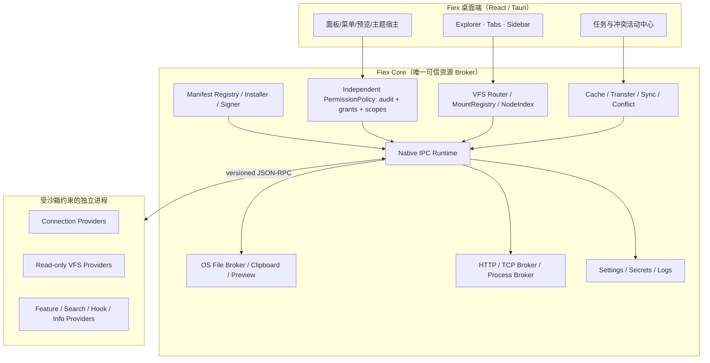
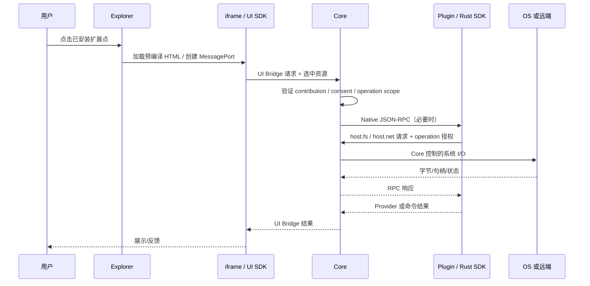
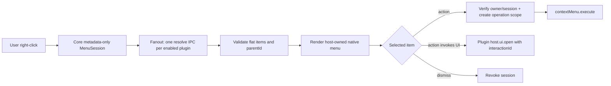
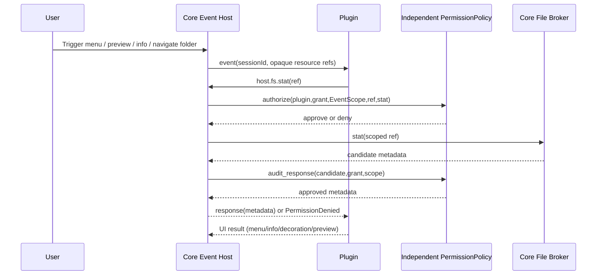
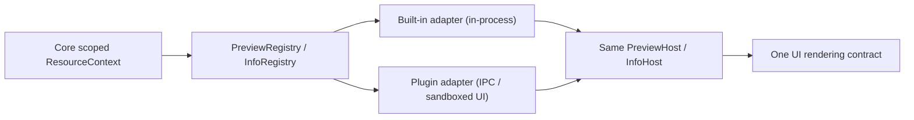
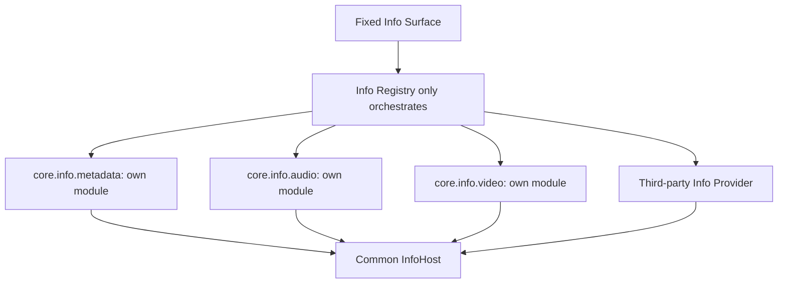
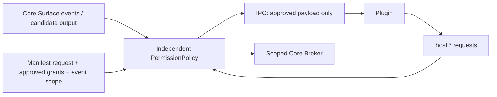
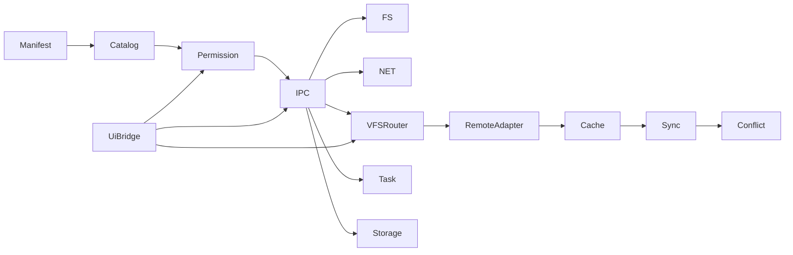

# 01 · 目标架构和职责边界

## 1. 总体分层

关键原则：Core 不编译、链接或动态加载插件业务 crate。权限审核另设受信独立 crate/模块 `permission_policy`，业务模块只产生待审核输出，不得绕开策略直接给插件发资源字段。一个 Native 插件进程可服务多个并发请求与多个 Connection；每次请求有独立鉴权上下文，不能从“同一个常驻进程”推导全局文件访问权限。

## 2. 四种通道

四类通道不得混淆：
- **Tauri Command**：Fiex 自己的前端与 Core 的内部 API，不开放给插件 iframe。
- **UI Bridge**：iframe ↔ Host 的版本化 MessagePort API，只有有限宿主操作。
- **Native Plugin IPC**：Core ↔ 插件标准输入输出上的 Length-framed JSON-RPC。
- **数据通道**：小量 Base64、重复使用的共享内存窗口、Core 持有的文件/HTTP/TCP 句柄；不是独立身份通道。

## 2.1 完全动态的右键菜单 Provider

右键菜单是独立的双阶段入口：Manifest 仅注册 `surfaces.contextMenus: true`，每次右键 Core 向本插件发送一条 `contextMenu.resolve` 元数据查询，并发收集所有 Provider 的菜单项。插件只返回本次匹配的 **扁平 `items[]`**，子菜单用 `parentId` 构造，绝无 `when` 或 `children`。用户点击 action 时 Core 验证 Session + itemId，建立一次性 OperationScope，再调用该 owner 的 `contextMenu.execute`。若用户点击 action，插件可通过本次交互的 `host.ui.open` 动态选择页面并请求 Core 创建 Panel；菜单查询本身不能弹窗。

设计必须限定 IPC 查询时间、列表大小、层级与并发；慢插件不能延迟 Fiex 原生菜单。**菜单查询允许申请当前所选对象 metadata，但不允许文件内容读取**，也不是用户对后续执行的永久授权。详细字段见 [02](02-MANIFEST-EXTENSIONS.md) 与 [03](03-IPC-CATALOG.md)。

## 2.2 统一的事件驱动资源申请

**唯一的插件资源访问流程：**Surface/Provider 在 Manifest 中注册事件 → 用户执行操作（Decoration 是用户切换目录）→ Core 发 `event + SessionId + opaque ResourceRef`，**不附带 metadata/文件内容/目录列表** → 插件按需通过通用 `host.fs.stat/list/openRead/...` 申请 → 独立 `PermissionPolicy` 结合 Manifest、已批准 grant、事件/操作 Scope 审核**请求及 Core 返回的数据** → Core 经 IPC 返回获准的结果。没有「Core 自动发 metadata」这条捷径，也不划分 Push/Pull 两套访问模型。

事件会话代表本次明确的对象集合和阶段：右键菜单的 `contextMenu.resolve` 可以申请**所选对象的 metadata**，但不能在菜单查询期间读取文件字节；点击有效菜单 action 后，可按用户确认及 `files.read/write` 权限建立执行 Scope。Preview/Info 的打开行为可允许本次目标的适当读取；Decoration 的目录切换会话**只**能申请当前目录已显示的成员 metadata，不能凭刷新扫描其他目录或读取文件字节。若所需权限未申请或未批准，资源申请返回 `PermissionDenied`，事件通知仍正常发生。

## 2.3 目录限定的 Search

`surfaces.search[]` 不提供 `scope`；所有搜索由 Core 绑定已验证的当前 root。Everything 可以在后台依托全局索引，但必须使用 root 作为路径过滤条件，Core 还要逐项校验结果路径确实属于该目录树；不支持展示跨 root 的全局搜索结果。

## 2.4 统一 Preview / Info 扩展 Provider，而不是硬编码功能分支

内置代码高亮、图片、音频、视频、PDF 和 fallback 也是 `PreviewProvider`；普通文件属性、音频 lofty 解析、MP4/Matroska 视频解析也是 `InfoProvider`。第三方 Provider 与内置使用同形 Descriptor、匹配/排序、Session Context、响应类型、错误降级；`Preview.tsx` 只渲染通用 PreviewHost，`FileInfoDialog.tsx` 只渲染统一 `InfoResponse.sections[]`，绝不按固定 pluginId 为特定官方插件开特例。

**接口相同不等于传输路径相同**：内置组件在宿主进程内部高效运行，第三方必须经过 Broker + iframe 隔离。媒体属性探测涉及文件字节读取，不能把它当成只需 metadata permission 的查询；插件须先发起明确资源请求并由 PermissionPolicy 审核。详见 [08 统一 Preview/Info](08-UNIFIED-PREVIEW-INFO.md) 和 [Roadmap](../../ROADMAP.md)。

## 2.5 Surface 插槽与 Core 多来源实现的边界

UI Surface 是 Core 预设的接入位置，`surfaces.connections[]`（只提供添加连接 + 和侧边栏入口）、`surfaces.preview[]`、`surfaces.info[]`、`surfaces.contextMenus`、`surfaces.search[]`、`surfaces.toolbar[]`、`surfaces.decorations:true`、`surfaces.settings[]` 都有明确 UI 入口。和它们不同，`providers.vfs[]` 与 `providers.hooks[]` 不绑定一个固定 UI 插槽；`surfaces.themes[]` 对应主题选择器；Panel 不出现在 Manifest，只在用户实际交互时由 IPC 创建。

对 Info：`core.info.metadata`、`core.info.audio`、`core.info.video` 是三个**独立源代码模块**，各自有匹配逻辑、解析、结果和单测，聚合时并发执行、彼此失败隔离。对 Preview：`core.preview.text/image/audio/video/pdf/fallback` 也是各自独立的 Renderer/Provider 模块。内置采用进程内 Adapter，第三方经过 IPC/隔离 UI；两者由同一 Registry 调度、同一宿主展示。

## 2.6 所有 UI Surface 的运行时 PanelHost

`host.ui.open` 不是 ContextMenu 的特殊功能。Toolbar、Preview、Info、Search、Connection 和其他真正由用户触发的 Surface 都可以在本次操作中通过 IPC 决定 `view`（包内 HTML 或限额动态 HTML）、标题、展示方式和建议尺寸。**Manifest 没有 `panels[]`、`panelId` 或 Panel permission**。各 Surface 的实际用户操作创建 `interactionId`，Core 验证后创建独立 PanelSession；自动查询、目录装饰刷新和后台同步不得自动弹窗。Core PanelHost 负责 iframe sandbox、CSP、UI Bridge 和关闭清理。

详见 [09-RUNTIME-UI-PANELS.md](09-RUNTIME-UI-PANELS.md)。

## 2.7 独立的 PermissionPolicy / Decoration 订阅 / Connection-VFS 分离

`PermissionPolicy` 是独立可测试的权限审核模块（建议 workspace crate，而不是插件进程）：比较 Core 准备交付的数据字段、当前插件获批权限和事件/操作 Scope，决定哪些字段可交付。Core 不在各 Surface Host 内散写授权分支。`permissions.metadata.enabled` **一项覆盖文件和文件夹**；文件与文件夹的读/写/创建/删除等操作权限保持区分。

`surfaces.decorations:true` 只声明**每次目录切换通知插件**。无论是否有 Metadata 授权，Core 都发送当前目录及可见成员的 opaque ref，不包含属性。插件自行调用 `host.fs.stat`（可以使用限额批量申请）后，由独立 PermissionPolicy 对 `permissions.metadata` 和本次可见集合进行审核，Core 才返回属性；没有授权的请求被拒绝。

`surfaces.connections[]` 仅在添加连接 + 和侧边栏“连接”区注册入口，点击交给插件 `connection.create/open` 决定导航意图。**网盘需要额外声明 `providers.vfs[]`，连接本身不创建 mount**；VFS 文件树独立于 Connection UI，可用于云盘的可写文件树和 Git 的只读历史。

## 3. 所有权矩阵

| 事项 | Core | 插件 |
|---|---|---|
| 插件 ID 绑定、签名验证、授权、停启 | MUST | 不得冒用 |
| URI、mountId、路由、节点安全投影 | MUST | 提供 NodeId/Entry |
| Connection 表单、实例和凭据持久化 | MUST | 提供协议验证及协议转换 |
| 远程协议会话与瞬时缓存 | 管理隔离边界 | MAY 维护连接池/Token，必须按连接隔离 |
| 缓存文件、Pin、恢复、版本基线、冲突 | MUST | 不得私建 Fiex 同步数据库 |
| 精确文件句柄、HTTP/TCP 代理 | MUST | 仅用 SDK 访问 |
| 可执行命令实际启动 | 在安全提示后由 Core | 不得绕开命令 allowlist |
| 菜单、面板、搜索、预览、信息、主题显示 | 宿主渲染、上下文授权 | 贡献定义与结果 |
| Task ID、取消、进度、清理 | 统一协调 | 上报与协作取消 |
| 日志、密钥、存储 | 隔离与加密 | 只能访问自己命名空间 |

## 4. 模块边界与计划拆分

建议独立出（至少文件/目录模块，不强求立即拆 crate）：`plugin_host/{manifest,catalog,installer,process,rpc,scope}`、独立 `permission_policy/{grants,decision,output_filter,scope,tests}`、`plugin_broker/{fs,net,process,storage,buffer}`、`vfs/{uri,mounts,views,index}`、`remote/{connection,listing,materialize,cache,reconcile,conflict}`、`desktop/{commands,ui_bridge,theme}`。SDK 的 `rust/src/{context,files,http,tcp,tasks,protocol}` 与 `ui/src/{bridge,client,types}` 独立。任何分层拆包不得导致 Core 对特定 Provider 增加业务 match。

## 5. 线协议与安全不变量

- 每帧 `Content-Length: N\r\n\r\n<UTF8-JSON>`；JSON-RPC 2.0 request/response + notifications。单帧上限 4 MiB、Header 8 KiB；不允许 stdout 日志。
- 每个 RPC 携带受 SDK runtime 维护的 operation/task 会话标识；Core 从运行实例和调用链关联身份，忽略任意用户可控 pluginId。
- 文件路径访问必须同时满足声明权限、实际批准权限和当前操作资源范围。Job/Task 清理包括 File handles、Shared windows、TCP/HTTP streams。
- 最大持续时间、请求并发、缓存数量、read/write chunk 尺寸、日志条数、列表/游标迭代次数均须有明确上限。
- URI 是定位符而非 bearer token。任何持久 View 的恢复都必须重新验证 owner、磁盘作用域和原始 Provider 版本上下文。
- 坚决不允许“沙箱内禁止执行文件”被解释为 Core `host.process.run` 的操作亦受同一目录沙箱限制；后者是显式高风险授权。

## 6. 职责切分验收

1. 代码扫描禁止 `org.fiex.gdrive`、`org.fiex.git`、`webdav`、`smb` 出现在 Core 的 Provider 决策分支（示例/测试数据除外）。
2. 禁止从虚拟 `fiex:` URI 隐式映射 OS 根目录；所有操作经 `mounts.resolve`。
3. 使用模拟 Provider 验证相同 Core 缓存/同步流水线，不依赖任何官方插件。
4. 跨平台进程一插件一进程池，并发请求正确匹配 ID；关闭时拒绝迟到响应。
