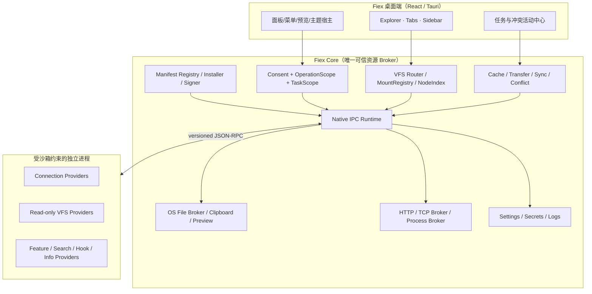
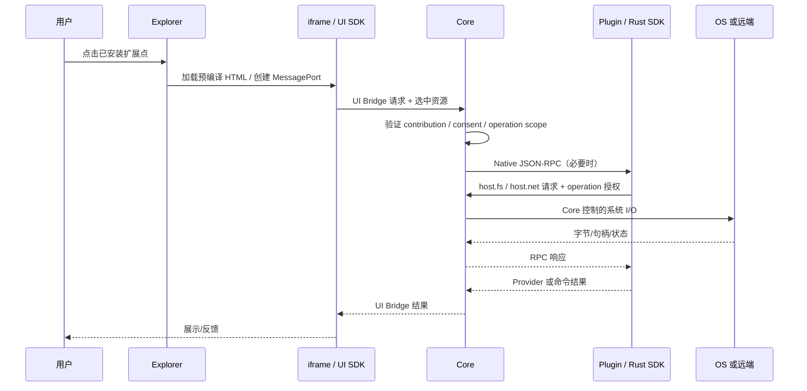
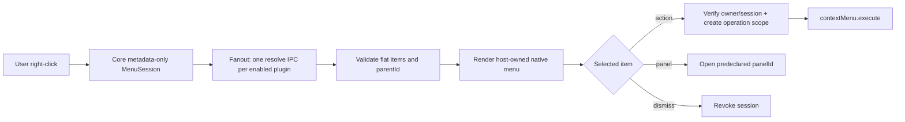
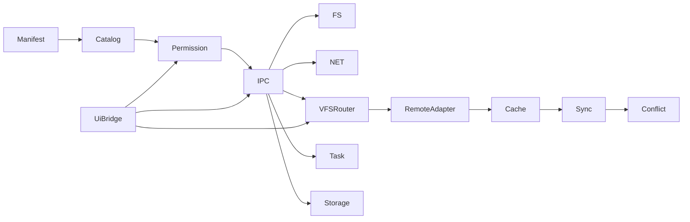

# 01 · 目标架构和职责边界

## 1. 总体分层

关键原则：Core 不编译、链接或动态加载插件业务 crate。一个 Native 插件进程可服务多个并发请求与多个 Connection；每次请求有独立鉴权上下文，不能从“同一个常驻进程”推导全局文件访问权限。

## 2. 四种通道

四类通道不得混淆：
- **Tauri Command**：Fiex 自己的前端与 Core 的内部 API，不开放给插件 iframe。
- **UI Bridge**：iframe ↔ Host 的版本化 MessagePort API，只有有限宿主操作。
- **Native Plugin IPC**：Core ↔ 插件标准输入输出上的 Length-framed JSON-RPC。
- **数据通道**：小量 Base64、重复使用的共享内存窗口、Core 持有的文件/HTTP/TCP 句柄；不是独立身份通道。

## 2.1 完全动态的右键菜单 Provider

右键菜单是独立的双阶段入口：Manifest 仅注册 `contributions.contextMenus: true`，每次右键 Core 向本插件发送一条 `contextMenu.resolve` 元数据查询，并发收集所有 Provider 的菜单项。插件只返回本次匹配的 **扁平 `items[]`**，子菜单用 `parentId` 构造，绝无 `when` 或 `children`。用户点击 action 时 Core 验证 Session + itemId，建立一次性 OperationScope，再调用该 owner 的 `contextMenu.execute`。若返回 panel 类型，必须引用 Manifest `contributions.panels[]` 中已经签名验证的静态页面。

设计必须限定 IPC 查询时间、列表大小、层级与并发；慢插件不能延迟 Fiex 原生菜单。**查询菜单不允许文件内容读取**，也不是用户对后续执行的永久授权。详细字段见 [02](02-MANIFEST-EXTENSIONS.md) 与 [03](03-IPC-CATALOG.md)。

## 3. 所有权矩阵

| 事项 | Core | 插件 |
|---|---|---|
| 插件 ID 绑定、签名验证、授权、停启 | MUST | 不得冒用 |
| URI、mountId、路由、节点安全投影 | MUST | 提供 NodeId/Entry |
| Connection 表单、实例和凭据持久化 | MUST | 提供协议验证及协议转换 |
| 远程协议会话与瞬时缓存 | 管理隔离边界 | MAY 维护连接池/Token，必须按连接隔离 |
| 缓存文件、Pin、恢复、版本基线、冲突 | MUST | 不得私建 Fiex 同步数据库 |
| 精确文件句柄、HTTP/TCP 代理 | MUST | 仅用 SDK 访问 |
| 可执行命令实际启动 | 在安全提示后由 Core | 不得绕开命令 allowlist |
| 菜单、面板、搜索、预览、信息、主题显示 | 宿主渲染、上下文授权 | 贡献定义与结果 |
| Task ID、取消、进度、清理 | 统一协调 | 上报与协作取消 |
| 日志、密钥、存储 | 隔离与加密 | 只能访问自己命名空间 |

## 4. 模块边界与计划拆分

建议独立出（至少文件/目录模块，不强求立即拆 crate）：`plugin_host/{manifest,catalog,installer,process,rpc,scope}`、`plugin_broker/{fs,net,process,storage,buffer}`、`vfs/{uri,mounts,views,index}`、`remote/{connection,listing,materialize,cache,reconcile,conflict}`、`desktop/{commands,ui_bridge,theme}`。SDK 的 `rust/src/{context,files,http,tcp,tasks,protocol}` 与 `ui/src/{bridge,client,types}` 独立。任何分层拆包不得导致 Core 对特定 Provider 增加业务 match。

## 5. 线协议与安全不变量

- 每帧 `Content-Length: N\r\n\r\n<UTF8-JSON>`；JSON-RPC 2.0 request/response + notifications。单帧上限 4 MiB、Header 8 KiB；不允许 stdout 日志。
- 每个 RPC 携带受 SDK runtime 维护的 operation/task 会话标识；Core 从运行实例和调用链关联身份，忽略任意用户可控 pluginId。
- 文件路径访问必须同时满足声明权限、实际批准权限和当前操作资源范围。Job/Task 清理包括 File handles、Shared windows、TCP/HTTP streams。
- 最大持续时间、请求并发、缓存数量、read/write chunk 尺寸、日志条数、列表/游标迭代次数均须有明确上限。
- URI 是定位符而非 bearer token。任何持久 View 的恢复都必须重新验证 owner、磁盘作用域和原始 Provider 版本上下文。
- 坚决不允许“沙箱内禁止执行文件”被解释为 Core `host.process.run` 的操作亦受同一目录沙箱限制；后者是显式高风险授权。

## 6. 职责切分验收

1. 代码扫描禁止 `org.fiex.gdrive`、`org.fiex.git`、`webdav`、`smb` 出现在 Core 的 Provider 决策分支（示例/测试数据除外）。
2. 禁止从虚拟 `fiex:` URI 隐式映射 OS 根目录；所有操作经 `mounts.resolve`。
3. 使用模拟 Provider 验证相同 Core 缓存/同步流水线，不依赖任何官方插件。
4. 跨平台进程一插件一进程池，并发请求正确匹配 ID；关闭时拒绝迟到响应。
