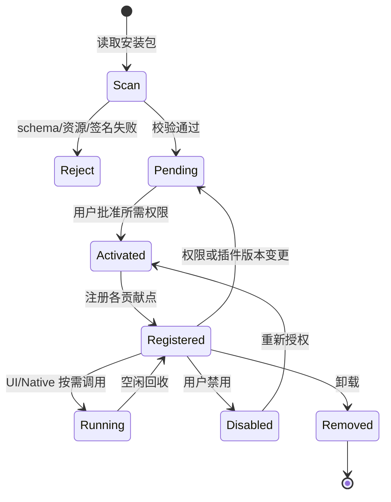

# 02 · Manifest 完整规范与所有扩展点（目标 schemaVersion 2）

## 1. Manifest 核心模型

插件是身份、运行入口、授权请求、扩展点的组合。**扩展点不是权限；权限不是可用性的保证**。顶层仅允许以下字段（其余安装报错）：

| 顶层字段 | 类型 | 约束/用途 |
|---|---|---|
| `schemaVersion` | integer | 固定 `2`，与旧 manifest 划清边界 |
| `id` | string | 逆域名唯一、跨版本稳定；示例 `org.example.provider` |
| `name` | string | 展示名称，非空 |
| `version` | string | 语义版本，发布包版本 |
| `description` | string | 可选产品说明 |
| `icon` | string | 可选宿主支持的图标或经校验资源 |
| `author` | object | `{name,url?}` |
| `publisher` | object | `{id,name,keyId,publicKey}`；与签名验证一致 |
| `files` | map<string,string> | 包内文件相对路径到摘要映射，需覆盖执行文件与资源 |
| `runtime` | object | `{protocolVersion,entrypoints}`；UI-only/主题包可为空 |
| `permissions` | object | 用户需审批的资源权限声明 |
| `contributions` | object | 宿主贡献数组集合 |

`runtime.entrypoints` 按 `windows-x86_64`、`macos-aarch64`、`macos-x86_64`、`linux-x86_64` 等平台映射已打包二进制的相对路径；Native `protocolVersion: "3.0"`；不允许 `..`、绝对路径或包外软链接。禁止在 `contributions` 中声明 `scheme/schemes/uriPrefix/mountId/mountPath/capabilities`，也禁止 `sync/writeMode/conflictControl` 状态开关。Provider 的具体安全能力在运行时依据协议和回包验证，不由未经验证的静态自报决策。

## 2. 权限对象（完整字段）

| 路径 | 类型 | 解释 |
|---|---|---|
| `permissions.folders.read.enabled` | bool | 读取操作范围内的目录列表 |
| `permissions.folders.read.decorations` | object | 目录装饰规则/动态方法声明，装饰不是额外目录授权 |
| `permissions.folders.create` | bool | 创建目录/目录项 |
| `permissions.folders.delete` | bool | 删除目录项 |
| `permissions.folders.rename` | bool | 改名/移动目录项 |
| `permissions.files.read` | bool | 读取操作范围内的文件 |
| `permissions.files.write` | bool | 写已有文件；创建需目录创建权限 |
| `permissions.network.enabled` | bool | 请求 Core HTTP/TCP Broker |
| `permissions.network.domains` | string[] | 安装时声明初始可请求精确域名/IP，连接保存的主机需显式批准 |
| `permissions.commands.enabled` | bool | 请求执行宿主进程的高风险权限 |
| `permissions.commands.allow` | string[] | 可调用的命令名白名单；危险性独立提示 |
| `permissions.hooks.enabled` | bool | 允许处理文件打开前钩子，不等于无限文件读取权限 |

**运行时授权 = Manifest 请求 ∩ 用户批准 ∩ 本次操作所选资源 ∩ Core 方法规则。** 连接 Provider 的远端元数据读取仍需要连接实例拥有者批准与网络权限，但不意味着必须给插件整个本地磁盘的目录权限。

## 3. Contribution 全量目录

| `contributions` 字段 | 必要字段 | Core 注册/调用方式 | Native handler / UI |
|---|---|---|---|
| `connections[]` | `id,title,fields[]` | Core 渲染连接表单；每次保存生成持久 mount | `connection.validate`, `fs.*` |
| `vfs[]` | `id,title,readOnly:true` | 插件用 `open_vfs_view` 建立挂载 | `vfs.*` |
| `toolbar[]` | `id,title,icon?` | 在工具栏添加按钮 | `command` 或 `panel` |
| `contextMenus[]` | `id,title,when?,children?` | 条件展示右键菜单/多级菜单 | `command` 或 `panel` |
| `search[]` | `id,title,scope,command` | Core 并发或有界聚合检索与结果去重 | 默认 `search.query` 或显式命令 |
| `preview[]` | `id,title,extensions,priority,panel` | 在预览优先级选择器中匹配 | 预编译 iframe + 可选 Native 命令 |
| `info[]` | `id,title,extensions?,command,priority?` | 文件信息抽屉扩展卡片 | 返回标题/rows 的插件方法 |
| `hooks[]` | `id,event,command,priority?` | 在批准的文件操作前调用，必须限时 | `hook.beforeOpen` 等自定义命令 |
| `settings[]` | `id,label,type,defaultValue?` | Core 根据字段生成设置界面、私有存储/Secret | Core 表单，无自动 Native 请求 |
| `themes[]` | `path` | 加载包内 JSON 主题 token，不执行脚本 | 无 Native 要求 |

`toolbar/contextMenus` 中的 `panel` 建议仅接受 `{entry,title?,defaultSize?}`，`defaultSize = {width,height}`；`command` 与 `args` 是固定的方法名和预定义参数，不能执行任意脚本。每个贡献 ID 在本插件范围内唯一。`when` 仅接收有限声明式语法，不允许 JS eval。

**Contributions 进一步字段约定**：
- `connections.fields[]`：`id,label,type,required?,placeholder?,defaultValue?`；`type` 为 `text|url|number|checkbox|secret`。Secret 始终由 Keyring 代理，日志及普通 JSON 存储禁止泄露。
- `vfs`：为临时只读视图，创建时必须绑定选中 resourceRoot 与小型不可变 viewContext。
- `search.scope`：`global|directory`；来源不能伪造 Core 文件授权。
- `preview.extensions`：小写不带点，`maxBytes` 可限制可预览对象；扩展选择失败回退内置预览。
- `info`：统一返回 `{title?, rows:[{label,value}]}`；不可由插件提交 HTML 直接插入宿主 DOM。
- `hooks`：动作回复应固定为 `{action:"pass"|"consume", reason?}`；Core 最终裁决。
- `themes[]` 对应 JSON `{id,name,mode,tokens,darkTokens?}`，`mode` 只能 light/dark；限制 token 字符与值，不接受 CSS 任意选择器或远程资源。
- `folders.read.decorations`：`mode:"declarative"` 时 `rules[]` 含 `match` 与 `badge`；`mode:"dynamic"` 时需 `method,priority,scope?`，由 Core 有界批量请求。

## 4. 完整示范：一个同时提供云连接、面板和信息扩展的插件

```json
{
  "schemaVersion": 2,
  "id": "org.example.cloud",
  "name": "Example Cloud",
  "version": "1.0.0",
  "description": "远端目录、离线同步和文件信息",
  "runtime": {
    "protocolVersion": "3.0",
    "entrypoints": {
      "windows-x86_64": "bin/example-cloud.exe",
      "macos-aarch64": "bin/example-cloud",
      "linux-x86_64": "bin/example-cloud"
    }
  },
  "permissions": {
    "files": {"read": true, "write": false},
    "network": {"enabled": true, "domains": ["cloud.example.com"]}
  },
  "contributions": {
    "connections": [{
      "id": "cloud", "title": "Example Cloud",
      "fields": [
        {"id":"url","label":"服务地址","type":"url","required":true},
        {"id":"accessToken","label":"访问令牌","type":"secret","required":true}
      ]
    }],
    "toolbar": [{
      "id":"cloud.account","title":"账户信息","icon":"cloud",
      "panel":{"entry":"ui/index.html","title":"账户信息","defaultSize":{"width":480,"height":380}}
    }],
    "info": [{
      "id":"cloud.info","title":"远端信息","extensions":["txt","pdf"],
      "priority":50,"command":"cloud.fileInfo"
    }]
  },
  "author": {"name":"Example Contributors"}
}
```

示例故意 **不提供** `contributions.vfs`：声明 Connection 后，Core 按用户创建的每个连接生成 VFS mount；不需要重复声明。示例只表示 JSON 结构目标契约，并不表示无需提供校验、实现、打包签名。

## 5. Contribution 生命周期



## 6. 官方插件作为验收样例

| 贡献点 | 必须能用独立插件验证的场景 |
|---|---|
| Connections | WebDAV、SMB、OpenList、Google Drive，多连接实例 |
| VFS | Git 某个 commit 的只读树 |
| Toolbar / ContextMenus | Git、Archive、GPG |
| Search | Everything 搜索来源 |
| Preview | Data/Office 预览 |
| Info | 数据格式的“显示简介” |
| Hooks | Archive 对打开操作的接管 |
| Decorations | ZIP/RAR 徽标与 Git 状态 |
| Themes | Vista / Win11 主题包 |
| Settings | Secret、数字、布尔、枚举（目标扩展须有 schema） |

所有贡献点都要实现：禁止命名冲突、独立激活/撤销、错误降级、并发隔离、升级重载、UI 无权限直达 Provider 请求。
