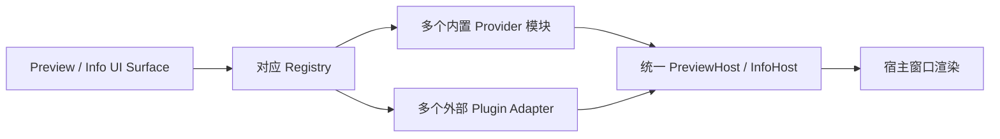
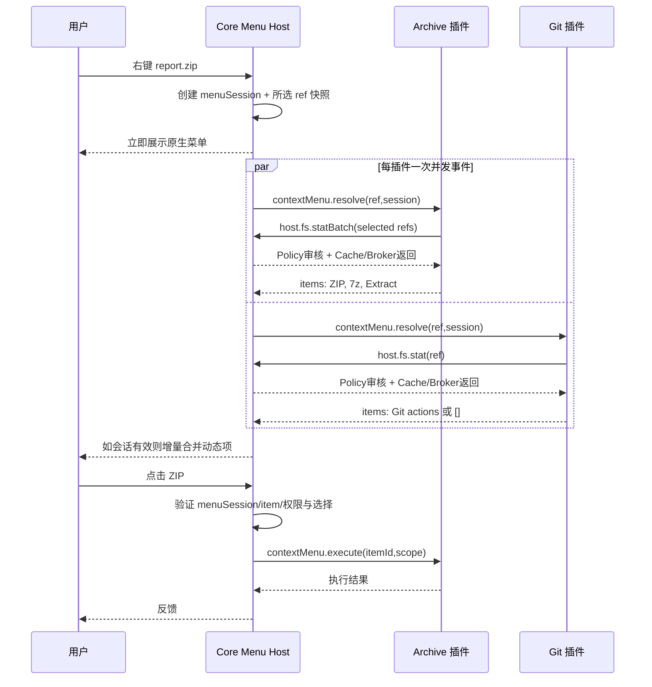
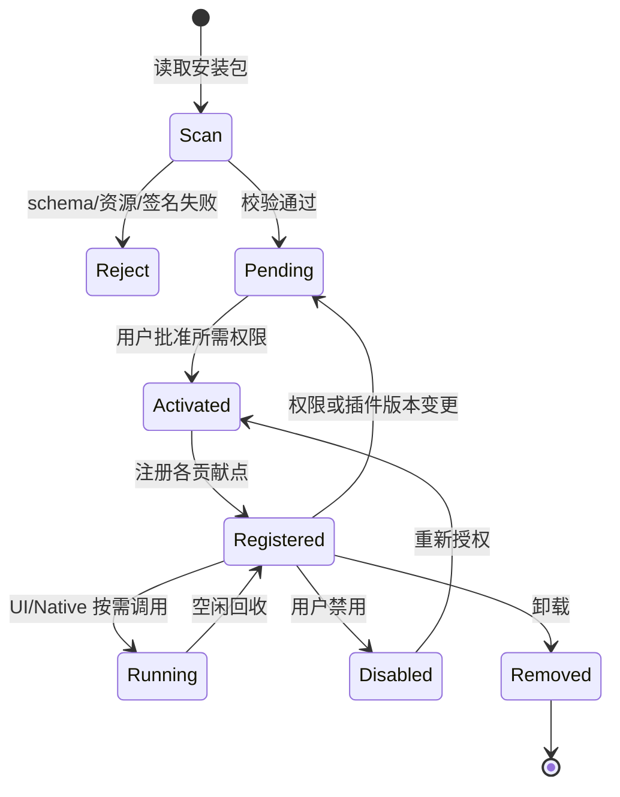

# 02 · Manifest 分层规范：Surfaces / Providers（目标 schemaVersion 2）

## 1. Manifest 核心模型

插件 Manifest 将**宿主固定的界面插槽（Surfaces）**、**可供调用的非固定界面功能（Providers）**分开。Panel 是 Core 按用户交互在运行时创建的 UI 实例，**不是 Manifest 静态贡献或资源**。Core 内置模块与外部插件可以向相同 Surface Registry 注册**多个独立实现**：一个 Preview 界面并不意味着只有一个预览 Provider，一个 Info 界面也不意味着只有一个元数据 Provider。界面注册不意味着获得文件权限。顶层仅允许以下字段（其余安装报错）：

| 顶层字段 | 类型 | 约束/用途 |
|---|---|---|
| `schemaVersion` | integer | 固定 `2`，与旧 manifest 划清边界 |
| `id` | string | 逆域名唯一、跨版本稳定；示例 `org.example.provider` |
| `name` | string | 展示名称，非空 |
| `version` | string | 语义版本，发布包版本 |
| `description` | string | 可选产品说明 |
| `icon` | string | 可选宿主支持的图标或经校验资源 |
| `author` | object | `{name,url?}` |
| `publisher` | object | `{id,name,keyId,publicKey}`；与签名验证一致 |
| `files` | map<string,string> | 包内文件相对路径到摘要映射，需覆盖执行文件与资源 |
| `runtime` | object | `{protocolVersion,entrypoints}`；UI-only/主题包可为空 |
| `permissions` | object | 用户需审批的资源权限声明 |
| `surfaces` | object | UI 的固定集成位置：Connections / Toolbar / ContextMenus / Search / Preview / Info / Decorations / Settings / Themes |
| `providers` | object | 无固定 UI 插槽的能力：独立 VFS 文件树（可写云盘或只读历史） / 文件操作 Hooks |

`runtime.entrypoints` 按 `windows-x86_64`、`macos-aarch64`、`macos-x86_64`、`linux-x86_64` 等平台映射已打包二进制的相对路径；Native `protocolVersion: "3.0"`；不允许 `..`、绝对路径或包外软链接。禁止在 `surfaces/providers` 中声明 `scheme/schemes/uriPrefix/mountId/mountPath/capabilities`，也禁止 `sync/writeMode/conflictControl` 状态开关；旧顶层 `contributions` 必须被 schema 拒绝，不再双写或兼容。Provider 的具体安全能力在运行时依据协议和回包验证，不由未经验证的静态自报决策。

## 2. 权限对象（完整字段）

所有 **file/folder 操作权限以及统一 `permissions.metadata` 均为对象**，每项都有显式 `enabled: boolean`；未声明或 `enabled:false` 均为禁用。这样可以在未来为每一项独立增加 `extensions`、`limits`、`constraints` 等字段而无需再次修改字段的 JSON 类型。Manifest `enabled` 表示*申请*权限，用户实际批准与本次操作 Scope 仍独立校验。

| 路径 | 类型 | 解释 |
|---|---|---|
| `permissions.metadata.enabled` | bool | **一项覆盖文件与文件夹**：允许独立权限审核模块在限定事件中披露其 metadata，或在明确授权的 OperationScope 中批准插件主动 `host.fs.stat`；不允许列目录或读取字节 |
| `permissions.folders.read.enabled` | bool | 遍历操作范围内的文件夹内容，`host.fs.list`；列举不等于获准读取所有子文件内容 |
| `permissions.folders.create.enabled` | bool | 创建文件夹（目录对象） |
| `permissions.folders.delete.enabled` | bool | 删除文件夹；默认不递归删除，递归删除需明确范围与确认 |
| `permissions.folders.rename.enabled` | bool | 重命名/移动文件夹 |
| `permissions.files.read.enabled` | bool | 读取现有文件的内容 |
| `permissions.files.write.enabled` | bool | 修改现有文件的内容，不隐含创建 |
| `permissions.files.create.enabled` | bool | 创建新文件并写入其初始内容，不隐含修改已存在的文件 |
| `permissions.files.delete.enabled` | bool | 删除已有文件 |
| `permissions.files.rename.enabled` | bool | 重命名/移动已有文件 |
| `permissions.network.enabled` | bool | 请求 Core HTTP/TCP Broker |
| `permissions.network.domains` | string[] | 安装时声明初始可请求精确域名/IP，连接保存的主机需显式批准 |
| `permissions.commands.enabled` | bool | 请求执行宿主进程的高风险权限 |
| `permissions.commands.allow` | string[] | 可调用的命令名白名单；危险性独立提示 |
| `permissions.hooks.enabled` | bool | 允许处理文件打开前钩子，不等于无限文件读取权限 |

推荐声明示例：

```json
{
  "permissions": {
    "metadata": {"enabled": true},
    "folders": {
      "read": {"enabled": true},
      "create": {"enabled": false},
      "delete": {"enabled": false},
      "rename": {"enabled": false}
    },
    "files": {
      "read": {"enabled": true},
      "write": {"enabled": false},
      "create": {"enabled": false},
      "delete": {"enabled": false},
      "rename": {"enabled": false}
    }
  }
}
```

### 2.1 统一事件 → 资源申请流程（不区分 Push/Pull）

**唯一的插件资源访问流程：**Surface/Provider 在 Manifest 中注册事件 → 用户执行操作（Decoration 是用户切换目录）→ Core 发 `event + SessionId + opaque ResourceRef`，**不附带 metadata/文件内容/目录列表** → 插件按需通过通用 `host.fs.stat/list/openRead/...` 申请 → 独立 `PermissionPolicy` 结合 Manifest、已批准 grant、事件/操作 Scope 审核**请求及 Core 返回的数据** → Core 经 IPC 返回获准的结果。没有「Core 自动发 metadata」这条捷径，也不划分 Push/Pull 两套访问模型。

事件会话代表本次明确的对象集合和阶段：右键菜单的 `contextMenu.resolve` 可以申请**所选对象的 metadata**，但不能在菜单查询期间读取文件字节；点击有效菜单 action 后，可按用户确认及 `files.read/write` 权限建立执行 Scope。Preview/Info 的打开行为可允许本次目标的适当读取；Decoration 的目录切换会话**只**能申请当前目录已显示的成员 metadata，不能凭刷新扫描其他目录或读取文件字节。若所需权限未申请或未批准，资源申请返回 `PermissionDenied`，事件通知仍正常发生。

默认 `metadata` 响应字段为 `{name,kind,extension,mime?,size?,modified?,readOnly?,source?}`，完整宿主路径/秘密不会默认提供。文件与文件夹共用 `permissions.metadata.enabled` 一项；主动 `host.fs.stat` 请求必须同时满足插件授权和本次 EventScope/OperationScope，并由 PermissionPolicy 审核返回字段。目录列表不是对内容读取的许可；读取文件字节另外检查 `permissions.files.read`，列举不在当前可见集合的目录另外检查 `permissions.folders.read` 与明确授权 Scope。

### 2.2 独立权限审核组件（不在 Core 业务模块里判权限）

权限审核不能分散在 Explorer、MenuBroker、PreviewHost、Decoration Host 或 Connection UI 内。定义独立、可单测的受信 `PermissionPolicy` / `AuthorizationGateway` 模块（建议独立 workspace crate，而非插件可调用的外部 Provider），输入插件身份、已批准的权限快照、Core 候选输出、事件/操作 Scope 及消息 schema；输出为**经过审查的载荷**或 Denied。

```text
Core event + opaque refs → PermissionPolicy.audit_event → IPC 通知插件 (不含 metadata)
Plugin host.fs.* request → PermissionPolicy.authorize_call(plugin,grants,eventOrOperationScope,request)
Core Broker 获得资源 → PermissionPolicy.audit_output(response,request,scope) → IPC 返回审查后的结果
```

`PermissionPolicy` 负责具体字段和资源范围比较，包括嵌套 `entries[]`、`selection[]`、`metadata` 和返回值；未经审核的 Core 数据**不得先序列化送到插件**。Core 业务层不重复写 `if metadata granted` 分支，策略集中在审核模块。自动目录切换只通知事件和可见对象的不透明引用。插件需在该事件内再次请求 metadata 并通过审核，才能产出基于文件属性的逐项 Decoration。审核模块独立于插件进程和其可控 IPC 参数，不允许插件自报已获批权限。

## 3. 两类注册：Surface / Provider

**Surface 是 Core 定义的固定 UI 集成点，不是单个全局实现。** 一个 Surface Registry 可以容纳多个 Core 内置 Provider 与多个第三方插件 Provider；二者统一描述符、优先级、匹配、生命周期与视图渲染，调用 Adapter 根据进程信任域区分。**Connection 和 Preview 一样有具体的宿主位置**：添加连接对话框、连接列表/侧栏；连接本身不提供文件访问，网盘还需独立注册 `providers.vfs[]`，不应把它错误归类为无界面 Provider。

| Manifest 字段 | 类型与必要内容 | 对应宿主 UI 位置 | Core 执行入口 |
|---|---|---|---|
| `surfaces.connections[]` | `id,title,icon?` | 仅注册“添加连接（+）”入口和“连接”侧边栏项 | 用户点击调用插件 `connection.create/open`，插件经 IPC 返回 NavigationIntent 或请求 Panel；**不自动生成 VFS** |
| `surfaces.toolbar[]` | `id,title,icon?,command` | 工具栏 | 点击后通过 command 回调；可动态 `host.ui.open` |
| `surfaces.contextMenus` | `true` | 文件/目录右键菜单 | `contextMenu.resolve/execute`，每次右键一次/插件 |
| `surfaces.search[]` | `id,title,command?` | 当前目录的搜索区 | `search.query`，仅搜索指定 root |
| `surfaces.preview[]` | `id,title,extensions?,mimeTypes?,priority?,command?` | 快速预览窗口 | 多内置与外部 Preview Provider 共享 Registry；运行时选择 View |
| `surfaces.info[]` | `id,title,extensions?,mimeTypes?,command?,priority?` | 显示简介窗口 | 与**多个** Core 内置 Info Provider 共享 InfoRegistry，统一 sections 回包 |
| `surfaces.decorations` | `true` | 每次切换目录触发订阅通知 | 每次通知插件 `decorations.resolve`，只给当前目录/可见成员的不透明 ref；插件申请 metadata 时才按 `permissions.metadata` 和会话 Scope 检查并返回 |
| `surfaces.settings[]` | `id,label,type,defaultValue?` | 插件设置页 | Core 生成表单、插件隔离存储/Keyring |
| `providers.vfs[]` | `id,title` | 无固定 UI 插槽的文件树来源；可用于云盘或 Git 历史 | 由用户触发的插件 VFS 请求独立创建 mount；支持只读 Git View、可读写云盘；Core 分配 mountId，具体能力由协议/真实操作校验 |
| `providers.hooks[]` | `id,event,command,priority?` | 文件操作的生命周期，而非 UI 位置 | `hook.beforeOpen` 等；Core 限时裁决 |
| `surfaces.themes[]` | `path` | 外观设置的主题选择器 | 包内主题 JSON token，不能执行脚本 |

不额外把 `PreviewProvider`、`InfoProvider` 声明在 `providers`，因为**预览与信息都属于已知的 UI Surface**。其**具体实现才是多个 Provider**。相反，`providers.vfs` 是无默认 UI 插槽的临时文件树能力；Connection **本身不建立 VFS mount**。网盘插件需要同时声明 `surfaces.connections[]`（UI 入口）和 `providers.vfs[]`（文件树能力），点击具体连接时由插件决定导航到哪一个已建立/按需建立的 VFS mount，也可导航到插件 Panel；Git 历史等独立虚拟文件树也使用 `providers.vfs[]`。

### 3.1 Preview 和 Info：多个内置模块分别注册

```text
PreviewSurface → PreviewRegistry
  ├─ core.preview.text         → 代码高亮/普通文本（独立模块）
  ├─ core.preview.image        → 图片（独立模块）
  ├─ core.preview.audio        → 音频播放器（独立模块）
  ├─ core.preview.video        → 视频播放器（独立模块）
  ├─ core.preview.pdf          → PDF（独立模块）
  ├─ core.preview.fallback     → 基础默认预览（独立模块）
  └─ org.example:preview.xyz   → 插件适配器

InfoSurface → InfoRegistry
  ├─ core.info.metadata        → 基础文件/文件夹 stat 元信息（独立模块）
  ├─ core.info.audio           → lofty 音频标签/时长（独立模块）
  ├─ core.info.video           → MP4 / Matroska 媒体信息（独立模块）
  └─ org.example:info.xyz      → 插件适配器
```

这不仅是接口命名，更是**源文件和责任的真实拆分**：不能将 `core.info.metadata/audio/video` 的业务逻辑全塞进一个 `src-tauri/src/plugins/info.rs` 的 if/else 中，也不能把文本/图片/音视频/PDF 的内容渲染全留在一个 `src/components/Preview.tsx` 中。Registry 只做注册、匹配、调度与会话；每个内置 Provider 拥有自己的实现模块和测试，第三方 Provider 使用相同调度合同但继续通过 IPC/沙箱隔离。



### 3.2 资源引用和字段约束

- `surfaces.connections[]` 只注册 UI 位置及文案/图标（`id,title,icon?`），**不规定 Core 固定表单，更不自动注册 VFS**。点击添加按钮调用 `connection.create`，点击侧边栏具体连接调用 `connection.open`；插件返回受控 `NavigationIntent` 或使用当前用户会话的 `host.ui.open`。凭据交由 Core Keyring Broker 保管。
- `providers.vfs[]` 由网盘、Git 等文件树插件独立声明；VFS 挂载由插件通过受控 IPC 申请、Core 创建，导航目标只能指向已验证且属于该插件/连接的目标。云盘无需将 `readOnly` 静态写死，按调用的读/写方法及运行时实际能力校验。
- `surfaces.contextMenus:true`：注册动态右键 Provider，不写 `when/children` 或静态 action；每次右键通过 IPC 查询当前元数据、返回扁平 `items[]` 和可选 `parentId`。
- `surfaces.search[]`：没有 `scope`；Core 将当前 root 传给插件，Everything 虽用全局索引，查询与返回都必须限制 root；Core 二次校验。
- `surfaces.preview[]`：扩展名小写无点，MIME 可选；每次预览时插件动态返回具体 View/Panel 请求而非 Manifest 声明 `panelId`；所有内置和外部 Preview 同台排序并有 fallback。
- `surfaces.info[]`：返回 `{sections:[{id,title,rows:[{label,value}]}]}`；Core **分别**注册 `core.info.metadata/audio/video`，第三方可注册多个 Info Handler；一个错误不得影响其他区块。
- `surfaces.decorations:true` **仅订阅每次目录切换**。Core 总是通知并提供当前可见成员的 opaque ref，不主动发送 Metadata；插件主动批量申请 metadata 时，由独立权限审核模块检查唯一的 `permissions.metadata.enabled` 与当前目录会话中的可见对象集合。没有该权限就无法得到属性并生成逐项 Decoration；没有 Declarative 绕过路径。
- `providers.hooks[]`：受控 `{action:"pass"|"consume",reason?}`，Core 最终裁决。
- `surfaces.themes[]`：包内 JSON `{id,name,mode,tokens,darkTokens?}`，只允许校验通过的 tokens，不执行任意 CSS/JS。
- 所有用户交互式 Surface（包括 Connection、Toolbar、ContextMenu、Preview、Info、Search）均可通过运行时 `host.ui.open` 创建 Panel；Manifest **没有** `panels`、`panelId` 或单独 Panel 权限。内容/标题/尺寸/展示位置通过本次 IPC 选择，Core 验证 `interactionId` 和 UI 沙箱。自动查询/刷新阶段或后台任务不可主动弹窗。

### 3.3 Manifest 分类完整示例

```json
{
  "schemaVersion": 2,
  "id": "org.example.media-tools",
  "name": "Media Tools",
  "version": "1.0.0",
  "permissions": {
    "metadata":{"enabled":true},
    "files": {"read":{"enabled":true}}
  },
  "surfaces": {
    "contextMenus": true,
    "preview": [{"id":"viewer","title":"媒体预览","extensions":["xyz"]}],
    "info": [
      {"id":"codec","title":"编码信息","extensions":["xyz"],"command":"media.info.codec"},
      {"id":"tags","title":"标签信息","extensions":["xyz"],"command":"media.info.tags"}
    ],
    "toolbar": [{"id":"open","title":"媒体工具","command":"media.openTools"}]
  },
  "providers": {
    "hooks": [{"id":"before-open","event":"beforeOpen","command":"media.beforeOpen"}]
  }
}
```

同一个插件可提供**多个** Info/Preview 实现：数组中每个 `id` 都是可独立启用、排序、取消和测试的 Provider 注册项；多个实现不必集中写在一个处理器里。Core 内置各个实现也遵守同一原则。批准 `permissions.metadata` 仅允许接收当前事件选中对象的基础属性，解析音视频文件内容仍需要 `files.read` + 本次操作 Scope。

### 3.4 Panel 不是配置对象，而是所有交互式 Surface 通用的运行时服务

Manifest 不含 `panels`、`panelId`、静态 `entry/defaultSize` 等 Panel 注册项。插件处理来自 Toolbar、ContextMenu、Preview、Info、Search、Connection 等宿主 UI 的明确用户交互时，可在 IPC 中**选择本次具体视图及其外观**：

```json
{
  "method":"host.ui.open",
  "params":{
    "interactionId":"core-issued-interaction",
    "view":{"source":"package","entry":"ui/advanced.html"},
    "presentation":{"title":"高级设置","placement":"dialog","preferredSize":{"width":520,"height":400}}
  }
}
```

`view.source` 支持已校验包内 HTML（无需 Manifest 提前声明使用何页面）或受限的运行时 HTML 文本；不得直接加载任意宿主绝对路径或远端地址。Core 仍使用 opaque-origin iframe、CSP 与 UI Bridge 隔离。自动查询（`contextMenu.resolve/info.resolve/search.query`）、后台同步或刷新不能凭注册 Surface 自行弹窗，必须有用户点击/明确打开预览等有效 `interactionId`。**允许请求 Panel 不等于文件/网络权限。** 详见 [09-RUNTIME-UI-PANELS.md](09-RUNTIME-UI-PANELS.md)。

## 4. 完整示范：云盘插件需要 Connection + VFS 两项声明

```json
{
  "schemaVersion": 2,
  "id": "org.example.cloud",
  "name": "Example Cloud",
  "version": "1.0.0",
  "runtime": {"protocolVersion":"3.0","entrypoints":{"linux-x86_64":"bin/example-cloud"}},
  "permissions": {
    "metadata": {"enabled":true},
    "files": {"read":{"enabled":true}, "write":{"enabled":true}, "create":{"enabled":true}},
    "network": {"enabled":true, "domains":["cloud.example.com"]}
  },
  "surfaces": {
    "connections": [{"id":"cloud","title":"Example Cloud","icon":"cloud"}],
    "decorations": true,
    "toolbar": [{"id":"cloud.account","title":"账户信息","icon":"cloud","command":"cloud.openAccount"}],
    "contextMenus": true
  },
  "providers": {
    "vfs": [{"id":"remote-files","title":"Cloud Files"}]
  },
  "author": {"name":"Example Contributors"}
}
```

Connection 仅提供添加入口和侧边栏连接项；用户点击时插件通过 `connection.create/open` 决定是打开运行时登录 Panel、设置页，还是导航到已申请的 VFS mount。声明 VFS 不会自动创建连接，声明 Connection 也不会自动创建挂载。具体 NavigationIntent 及双向同步见 [05](05-VFS-CONNECTION-SYNC.md)。Decoration 虽然会收到每次切换目录的事件，**没有独立批准的 `permissions.metadata` 也拿不到成员元数据**。示例只是一份目标 Schema，不能作为已实现行为。

## 4.1 右键菜单完全动态：Manifest 只注册 Provider

本设计废除静态右键项：**没有 `when`，也没有 `children`**。所有插件只需声明：

```json
{"surfaces":{"contextMenus":true}}
```

Core 在用户每次右键时，并发通知每个已启用且声明该 Surface 的 Native 插件（每个插件恰好一次）：`contextMenu.resolve`。通知**不含 Metadata**；插件可以在该菜单会话里申请当前所选文件的 metadata，权限审核通过后才得到数据。是否通知不依赖 metadata 权限。响应即本次菜单的完整内容；没有独立的静态根菜单或 Core 内置 `isArchive` 判断。UI-only 插件若想使用这一扩展点，必须提供 Native 后端；纯静态 iframe 不是 IPC Provider。

**事件请求（目标结构，不携带资源属性）**：

```json
{
  "menuSessionId": "core-ephemeral-session",
  "target": {"ref": {"mountId":"m1","nodeId":"n42"}},
  "selection": [{"ref":{"mountId":"m1","nodeId":"n42"}}],
  "directory": {"ref":{"mountId":"m1","nodeId":"parent"}}
}
```

右键事件后，插件若需要判断文件扩展名，使用会话中的 ref 调用 `host.fs.stat`；独立 PermissionPolicy 审核统一 `permissions.metadata.enabled` 与仅限当前 target/selection 的 EventScope，再由 Core 返回数据。无权限则返回 `PermissionDenied`。Core 绝不在 `contextMenu.resolve` 参数里预先塞入 metadata；不会授权读取其他文件。有效菜单 item 的执行在用户点击后才取得额外的读写 OperationScope。

**响应：一份扁平的菜单项数组**。子菜单通过 `parentId` 引用同次返回的一个 `submenu`，**整个协议也无需 `children`**。

```json
{
  "items": [
    {"id":"archive.compress","type":"submenu","title":"压缩为","icon":"archive"},
    {"id":"archive.zip","parentId":"archive.compress","type":"action","title":"ZIP"},
    {"id":"archive.7z","parentId":"archive.compress","type":"action","title":"7z"},
    {"id":"archive.extract","type":"action","title":"解压到此处","enabled":true},
    {"id":"archive.advanced","type":"action","title":"高级选项…"}
  ]
}
```

| 响应字段 | 是否必需 | 说明 |
|---|---|---|
| `items[]` | 必须 | 本次响应全部菜单节点；允许空数组 |
| `id` | 必须 | 本次菜单与本 Provider 内唯一，供执行回调 |
| `type` | 必须 | `action / submenu / separator`；是否创建 Panel 由点击后的回调决定 |
| `title` | 非 separator 必须 | 可显示菜单标题，最长 128 字符 |
| `icon` | 可选 | 宿主受限图标名 |
| `parentId` | 可选 | 指向同次返回的 `type:submenu` 项；不使用 `children` |
| `enabled` | 可选 | 默认 true；false 显示禁用且不可执行 |
| `checked` | 可选 | 复选标记，不表示有修改数据的权限 |
| `group` / `order` | 可选 | 宿主按分组稳定排序，不能指定宿主绝对位置 |

Core 在用户点击 `action` 后发送 `contextMenu.execute({menuSessionId,itemId,interactionId})`；插件依据 itemId 执行业务操作，或者通过通用 `host.ui.open` 在当前用户交互会话中动态创建 Panel。**菜单项不区分 action/panel，Manifest 不写任何 `panelId`。** 对 Toolbar、Preview、Info、Search、Connection 等其他用户主动触发的 Surface，使用完全相同的运行时 PanelHost 服务。

Core 按单次菜单 Session 保存已返回的 `itemId/type/owner`，执行前核验 Session 未过期、资源未被无声替换、item 已启用且归属同一插件；异步返回必须绑定当前 Session，不能覆盖下一次右键的菜单。

**性能预算（目标）**：每次右键每个已启用插件收到一次 `contextMenu.resolve` **事件**，但事件处理期间允许再通过统一 Broker 发送 `host.fs.stat/host.fs.statBatch` 等嵌套资源 RPC；不能误解成整次交互只能发生一次 IPC。所有插件并发查询，原生菜单先显示，动态菜单在有效 Session 内增量合并并保持焦点/已悬停项稳定。软预算 120 ms、硬截止 250 ms 只是待 Windows/macOS/Linux 基准验证的候选值；超时、崩溃、远端 VFS 慢响应均不得阻塞原生菜单。每 Provider 最多 80 项、最大四层，拒绝环及超大响应。常驻进程复用，绝不为单次右键另启插件进程；每次右键重新查询菜单结果，**Metadata 缓存只能在按次授权审核后复用，不能缓存菜单结果替代当前判断**。

**统一资源接口的优化约束**：`host.fs.statBatch` 与单项 `host.fs.stat` 使用完全相同的 `permissions.metadata.enabled` 和本次 EventScope；Core 先授权，再复用 Explorer/VFS 已取得且有效的 Metadata 缓存，返回前逐项审核。多选一次申请、请求可重入且不能被 `resolve` 等待锁阻塞；插件查询慢或无权限不延迟原生菜单。详情以 [03 IPC](03-IPC-CATALOG.md) 的性能合同为准。

**最小授权**：`resolve` 阶段可以调用 `host.fs.stat` 主动申请**本次 target/selection** 的 metadata，必须通过统一 Metadata 授权和事件 Scope；其他对象的 stat、内容读取及目录遍历都要拒绝。`execute` 在用户点击后才由 Core 根据真实 selection 建立 OperationScope，并按每一种文件或文件夹权限重新检查。`contextMenus:true` 不自动授予元数据或内容读取权限。




## 5. Surface / Provider 生命周期



## 6. 官方插件作为验收样例

| 贡献点 | 必须能用独立插件验证的场景 |
|---|---|
| Connections | WebDAV、SMB、OpenList、Google Drive，多连接实例 |
| VFS | Git 某个 commit 的只读树 |
| Toolbar / ContextMenus | Git、Archive、GPG |
| Search | Everything 搜索来源 |
| Preview | Data/Office 预览 |
| Info | 数据格式的“显示简介” |
| Hooks | Archive 对打开操作的接管 |
| Decorations | ZIP/RAR 徽标与 Git 状态 |
| Themes | Vista / Win11 主题包 |
| Settings | Secret、数字、布尔、枚举（目标扩展须有 schema） |

所有 Surface/Provider 注册项都要实现：禁止命名冲突、独立激活/撤销、错误降级、并发隔离、升级重载、UI 无权限直达 Provider 请求。
