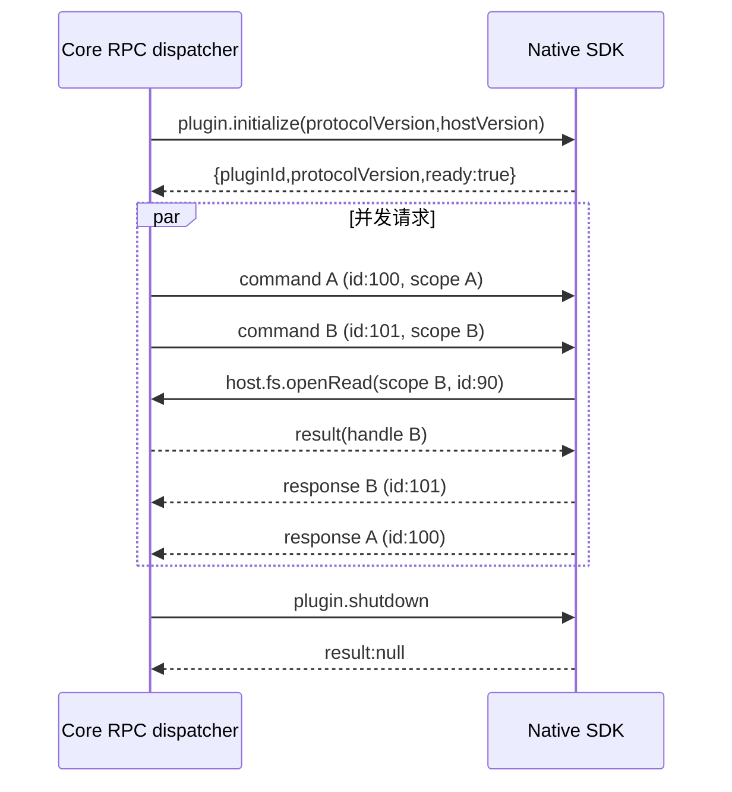
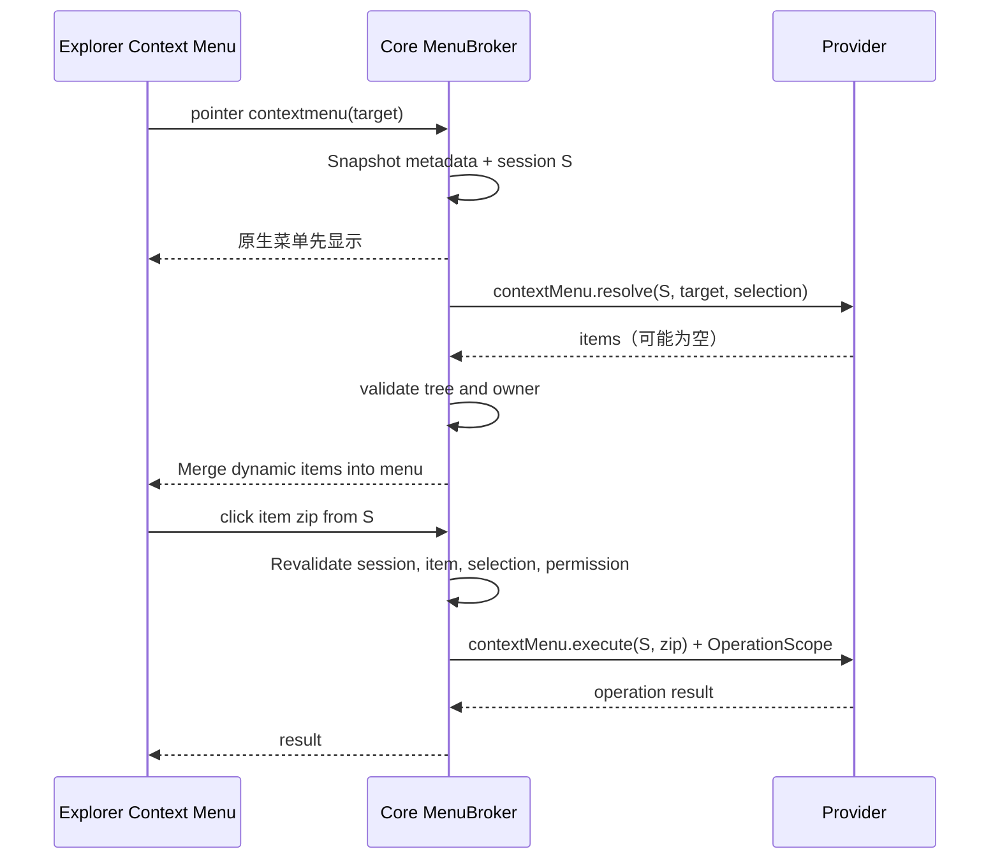
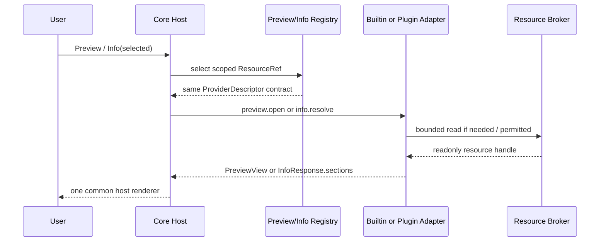

# 03 · Native IPC 全量方法目录与目标协议

> 本文列举插件系统内所有 `plugin.*`、`vfs.*`、`connection.*`、`fs.*`、`host.*` 方法及动态注册命令。API 列表是新设计的 **目标实现清单**；代码落地时须在 schema 中逐项定义 params/result/error/授权和契约测试。**不将 Tauri 内部 command 当作插件可调用的外部 IPC。**

## 1. Envelope、Session 与错误

```json
{"jsonrpc":"2.0","id":42,"method":"host.fs.openRead","params":{"path":"notes.txt","authorization":{"operationId":13}}}
```
```json
{"jsonrpc":"2.0","id":42,"result":{"handle":"opaque","size":12345}}
```
```json
{"jsonrpc":"2.0","id":42,"error":{"code":-32003,"message":"PermissionDenied","data":{"reason":"path_not_selected"}}}
```

目标 Native 版本 `3.0`，标准传输仍为 `Content-Length` framed JSON-RPC 2.0，单帧 4 MiB。Core 维护关联 operation/task 的密钥和进程身份；SDK 自动附加 `authorization`。文档不要求开发者手工构造授权对象。推荐稳定错误码：`-32601` method_not_found、`-32602` invalid_params、`-32603` internal、`-32800` cancelled、`-32001` not_found、`-32002` conflict、`-32003` permission_denied、`-32004` unavailable、`-32005` deadline_exceeded。详细数据只能包含非敏感结构化字段。



## 2. Core → Plugin：系统/Provider 完整目录

| Method | Params（关键字段） | Result | 用途/约束 |
|---|---|---|---|
| `plugin.initialize` | `protocolVersion,hostVersion` | `pluginId,protocolVersion,ready` | 启动协商，必须匹配安装包身份 |
| `plugin.ping` | 空 | `pong/ok` | 存活检测 |
| `plugin.shutdown` | 空 | `null` | 优雅退出、在最后期限强杀 |
| `plugin.cancel` | `taskId` | notification | 协作取消任务 |
| `contextMenu.resolve` | `menuSessionId,target,selection,directory` | `{items:[...]}` | Core 每次右键主动推送资源 ref；仅获批 `files.metadata/folders.metadata` 时追加 `metadata`；不提供主动查询权限 |
| `contextMenu.execute` | `menuSessionId,itemId,selection` | `JSON/null` | 仅允许点击了本次 resolve 中有效 `type:action` 项后调用，建立独立 OperationScope |
| `info.resolve` / `<registered info command>` | `sessionId,resource{ref,metadata?}` | `{sections:[{id,title,rows:[{label,value}]}]}` | 外部 Info Provider 固定响应 Schema；内置 Info Adapter 同合同进程内调用，不必走物理 IPC |
| `connection.validate` | `connection` | `{valid:true,...}` | 验证连接配置；不得泄露 Secret |
| `fs.list` | `connection,directoryId?,cursor?,limit?` | `entries,nextCursor,snapshotToken?,identityStability?` | Connection 远端目录分页 |
| `fs.stat` | `connection,nodeId` | `revision,size,kind?,modified?` | 获取一致性基线 |
| `fs.readSmall` | `connection,nodeId,offset,maxBytes` | `base64,eof` | 小数据预览，严格限长 |
| `fs.openRead` | `connection,nodeId,ifRevision?` | `streamId,size?,revision?` | 建立读取会话并绑定文件版本 |
| `fs.readStream` | `streamId,offset,maxBytes` | `base64,bytesRead?,eof` | 有界分块，必须防跨版本拼接 |
| `fs.closeRead` | `streamId` | `null` | 无论成功、取消、错误均清理 |
| `fs.writeFile` | `connection,nodeId,source,size,ifRevision` | `revision,size?` | 单一远端写回入口，Core 仅授权指定快照 |
| `vfs.list` | `contributionId,viewContext,nodeId?,cursor?,limit?` | `entries,nextCursor,warnings?` | 显式 VFS 目录列表 |
| `vfs.stat` | `contributionId,viewContext,nodeId` | `Entry` | 虚拟节点信息 |
| `vfs.readSmall` | `contributionId,viewContext,nodeId,maxBytes` | `base64` | 小文件读取/临时导出 |
| `vfs.search` | `contributionId,viewContext,nodeId?,query,limit?,hidden?,ignores?` | `entries` | 在只读 VFS 上检索 |
| `<custom command>` | 由其他贡献点注册的 `command/args` 和操作上下文决定 | JSON | toolbar、search、preview、info、hooks、decorations 的自定义处理；右键菜单只允许 `contextMenu.resolve/execute` |

Provider 清单中的 `nodeId` 与 `revision` 均不应当被 Core 当作磁盘路径；所有 `Entry.path` 必须由 Core 根据 mountId 生成。扩展点动态命令原则上不能冒充 `plugin.`、`host.`、`vfs.`、`fs.`、`connection.` 保留前缀。


## 2.1 完全动态右键菜单的强制 RPC 合同

Manifest 只需 `"contextMenus": true`，不会出现 `when`、`children`、静态 `command` 或 `panel`。目标流程每次右键向每个已启用、已获授权的插件发送一次 `contextMenu.resolve`；它返回本次菜单，而不是菜单谓词。请求总是包含本次右键选中对象的不透明 ref；只有插件声明并获批其类型对应的 `files.metadata.enabled` 或 `folders.metadata.enabled`，Core 才主动附带 `metadata` 对象。这是由事件触发的 **Core→Plugin Push**，不是插件在 IPC 里主动查询数据。未批准时必须省略 `metadata`；无论怎样都不包含文件字节或宿主任意可访问目录。

```json
{
  "jsonrpc":"2.0","id":301,"method":"contextMenu.resolve",
  "params":{
    "menuSessionId":"sess-opaque",
    "target":{"ref":{"mountId":"m1","nodeId":"n7"},
              "metadata":{"name":"report.zip","kind":"file","extension":"zip","size":4200,"readOnly":false}},
    "selection":[{"ref":{"mountId":"m1","nodeId":"n7"},
                  "metadata":{"name":"report.zip","kind":"file","extension":"zip"}}],
    "directory":{"ref":{"mountId":"m1","nodeId":"parent"}}
  }
}
```

```json
{
  "jsonrpc":"2.0","id":301,"result":{
    "items":[
      {"id":"compress","type":"submenu","title":"压缩为"},
      {"id":"zip","parentId":"compress","type":"action","title":"ZIP"},
      {"id":"7z","parentId":"compress","type":"action","title":"7z"},
      {"id":"settings","type":"action","title":"高级选项"}
    ]
  }
}
```

所有 item 是扁平数组，`parentId` 仅引用同一批返回的 submenu；不用 `children`，也不允许动态 JavaScript。Core 检验 `id` 唯一、`type=action|submenu|separator`、parentId 无环、层数≤4、数量≤80、标题≤128、大小与 deadline 界限。无匹配项直接 `{items:[]}`，不显示该插件菜单。

用户点击 `type:action` 的某个 item 后，Core 确认 `menuSessionId` 仍为有效菜单、`itemId` 曾由当前 owner 返回、该项启用且右键目标未被悄然替换，然后调用：

```json
{"jsonrpc":"2.0","id":302,"method":"contextMenu.execute",
 "params":{"menuSessionId":"sess-opaque","itemId":"zip",
           "selection":[{"ref":{"mountId":"m1","nodeId":"n7"},"name":"report.zip"}]}}
```

`execute` 从已经用户实际点击的菜单项派生 **OperationScope**；必须经过该方法需要的 Manifest permission 与当前选择的精确对象校验。查询 `resolve` 阶段没有任何主动文件 I/O 资源 Scope，**包括主动 `host.fs.stat` 查询**；所有 `host.fs.*` 对查询阶段额外路径的访问均应返回 `PermissionDenied`。在此阶段 `metadata` 只能作为 Core 主动推送的 IPC 参数出现，且只包含这次用户右键实际选择并有 metadata 权限的对象。Core 不允许前端或其他插件直接调用这两个保留的 Provider RPC。

菜单项全是 `action/submenu/separator`，是否打开 Panel 由用户点击后的 `contextMenu.execute` 处理器决定：处理器可在当次交互中调用 `host.ui.open` 指定本次 UI，Manifest 不预注册 Panel。子菜单展开由 Core 负责，无需额外 IPC。弱网或崩溃应在界限内失败并忽略该插件，不能阻塞宿主原生菜单。菜单 Session 关闭、插件重启或新一次右键后失效，迟到响应不得污染新的菜单。



### Connection 文件契约

```json
{
  "entries":[
    {"nodeId":"opaque-81","name":"a.txt","kind":"file","size":12,"modified":1800000000,"revision":"r42"}
  ],
  "nextCursor":null,
  "identityStability":"stable"
}
```

`identityStability: "stable"|"path"` 表示改名后的 ID 稳定性，**不表示内容一致性**。目录分页必须有单调前进规则；若远端分页顺序变化、缺少快照功能，Core 不得把“分页结束”当成整目录强一致快照。

## 3. Plugin → Core：文件 Broker 全部方法

| IPC method | Params | Result | 必要权限 |
|---|---|---|---|
| `host.fs.list` | `path` | `Entry[]` | `folders.read.enabled` + scope；返回目录成员，其他属性须按 metadata 权限裁剪 |
| `host.fs.stat` | `path` | `Entry` | 对文件要求 `files.metadata.enabled`；对目录要求 `folders.metadata.enabled`，**另需明确的 OperationScope/TaskScope**；菜单查询时禁止调用 |
| `host.fs.readChunk` | `path,offset,length` | `base64,size,eof` | `files.read.enabled` + scope |
| `host.fs.read` | `path,offset,length` | `buffer,size,eof` | `files.read.enabled` + scope；内部低层 |
| `host.fs.openRead` | `path` | `handle,size` | `files.read.enabled` + scope |
| `host.fs.readOpen` | `handle,offset,length,buffer?` | `size,eof,base64?` | 属主 Handle + 文件权限 |
| `host.fs.closeRead` | `handle` | `null` | Handle 所属 operation/task |
| `host.fs.create` | `path` | `Entry` | 创建**新文件**时使用 `files.create.enabled` + scope；不得覆盖已有文件 |
| `host.fs.mkdir` | `path` | `Entry` | `folders.create.enabled` + scope |
| `host.fs.beginWrite` | `path,create` | `handle` | `create:false` 需要 `files.write.enabled`；`create:true` 仅允许对不存在的目标以 `files.create.enabled` 写入初始内容；两者均需 scope |
| `host.fs.writeChunk` | `handle,base64` | `null` | 原事务授权 `files.write.enabled` 或 `files.create.enabled` + Handle owner |
| `host.fs.writeBuffer` | `handle,buffer,size` | `null` | 原事务授权 `files.write.enabled` 或 `files.create.enabled` + Handle owner |
| `host.fs.seekWrite` | `handle,kind,offset` | `u64 offset` | 原事务授权 `files.write.enabled` 或 `files.create.enabled` + Handle owner |
| `host.fs.commit` | `handle` | `Entry/confirmation` | 原事务授权 `files.write.enabled` 或 `files.create.enabled` + 冲突复检 |
| `host.fs.abort` | `handle` | `null` | Handle owner |
| `host.fs.write` | `path,buffer,mode` | 状态 | 按目标是否存在、是否创建检查 `files.write.enabled` 或 `files.create.enabled`；旧式方法最终收敛 |
| `host.fs.remove` | `path` | `null` | 根据目标类型要求 `files.delete.enabled` **或** `folders.delete.enabled` + scope；目录默认仅删除空目录 |
| `host.fs.rename` | `from,to` | `null` | 根据源目标类型要求 `files.rename.enabled` **或** `folders.rename.enabled` + 双路径 scope |

统一处理文件目录对象的 race/symlink、原子提交、临时权限与文件大小。文件与目录的 `create/delete/rename` **按对象种类分别检查**，创建现有文件与新文件的操作权限不互相隐含；`rename` 要分别校验源和目标所选 Scope。Core 内部为了构建 Explorer UI 而获取元数据不属于插件调用 `host.fs.stat`，只有实际推送给插件时才按 `metadata.enabled` 校验。


### 元数据：推送与主动查询严格分离

| 数据流 | 方法 | 必要权限 | 是否需要文件操作 Scope |
|---|---|---|---|
| Core 因用户操作主动提供所选文件属性 | `contextMenu.resolve` / 预览、信息、工具栏等事件的 `params.target.metadata` | `permissions.files.metadata.enabled`（文件）或 `permissions.folders.metadata.enabled`（目录），并且**用户已批准** | 不需要额外点击动作；只绑定当前已触发的事件与当前选择 |
| Plugin 在执行操作中主动查询任意文件自身属性 | `host.fs.stat` → `Files::metadata(path)` | 对应 `metadata.enabled` 已批准 | **必须**有本次操作/任务对该精确文件或目录的授权 |
| Plugin 主动列举目录成员 | `host.fs.list` → `Files::list(path)` | `permissions.folders.read.enabled` 已批准 | 必须包含该目录的操作授权；列举的附加字段按 metadata 权限裁剪 |
| Plugin 主动读取文件字节 | `host.fs.openRead/readOpen` | `permissions.files.read.enabled` 已批准 | 必须包含该文件的操作授权 |

元数据回包规范目标统一使用可选的 `metadata` 对象：`{name,kind,extension,mime?,size?,modified?,readOnly?,source?}`。没有本类型的 metadata 用户批准就**不发送** `metadata`，只给当前事件所需的不透明 `ref`。特别注意：`contextMenu.resolve` 是 Core **主动向插件提供已经持有的元数据**，不能通过菜单的特殊身份暗中开放 `host.fs.stat` 或 `ctx.files().metadata`；插件一旦主动查询，就必须满足更严格的操作/任务授权。Connection Provider 的内部 `fs.stat` 是另一类由 Core 发起的协议适配，不与 `host.fs.stat` 混淆。

### Search 的局部路径约束

`surfaces.search[]` 只声明 `id/title/command?`，彻底移除 `scope`。宿主始终将用户当前指定的目录作为 `root`，不得提供全局搜索入口。Everything 允许继续依托其**全局构建的搜索索引**，但必须向 ES 查询施加对应 `root` 路径限制；Core 再对返回的每项路径执行规范化、目录边界检查与去重，不允许将全局范围的命中直接渲染到局部搜索结果。注意 Core 的结果过滤不等于禁止已授权的 `es` 外部命令本身查询全局索引：这属于独立的外部命令风险模型。

## 4. Plugin → Core：网络、共享缓冲、进程

| IPC method | Params | Result | 权限/说明 |
|---|---|---|---|
| `host.net.http.open` | `method,url,headers?,bodyBase64?,bodyReadHandle?,timeoutMs?,allowInvalidCerts?` | `stream,status,headers` | network + 每跳域名/IP 校验 |
| `host.net.http.read` | `stream,size` | `base64,size,eof` | 当前响应属主 |
| `host.net.http.close` | `stream` | `null` | 释放响应 |
| `host.net.http` | `method,url,headers?,bodyBuffer?` | `status,headers,bodyBase64?/bodyBuffer?` | 有界旧式单次 HTTP；目标收敛到 open/read/close |
| `host.net.tcp.open` | `host,port` | `stream,peerAddress` | network + 审批目标 |
| `host.net.tcp.readBytes` | `stream,size` | `base64,size,eof` | 标准 TCP SDK 使用 |
| `host.net.tcp.writeBytes` | `stream,base64` | `size` | 标准 TCP SDK 使用 |
| `host.net.tcp.read` | `stream,size` | `buffer,size,eof` | 共享窗口低层 |
| `host.net.tcp.write` | `stream,buffer` | `size` | 共享窗口低层 |
| `host.net.tcp.close` | `stream` | `null` | 清理 |
| `host.buffer.create` | `size,writable` | `descriptor` | owner、配额、上限 |
| `host.buffer.map` | `id` | `descriptor` | 相同 owner |
| `host.buffer.release` | `id` | `null` | 映射释放 |
| `host.process.run` | `command,args,cwd?,stdin?` | `code,stdout/stderr,truncated` | commands allowlist，高风险 |
| `host.exec` | `command,args...` | 结构化执行结果 | 低层执行入口；建议最终统一至 process.run |

`allowInvalidCerts` 不应仅靠插件自行设置；设计要求连接实例保存经用户确认的证书例外，并且限定具体主机。避免 DNS 重绑定与内网 SSRF 的建议：域名匹配 + 解析 IP 校验 + 连接实际地址验证；HTTP 禁止跨目标泄露 Authorization/Cookie，重定向逐跳验证。

## 5. Plugin → Core：视图、任务、数据、诊断

| IPC method | Params | Result | 说明 |
|---|---|---|---|
| `host.vfs.openView` | `contributionId,resourceRoot,viewContext` | `fiex://mount/.../` | 只允许显式 vfs owner + 已选资源 |
| `host.ui.open` | `interactionId,view{source,entry?/html?},presentation{title,placement,preferredSize?}` | `panelSessionId` | **所有用户触发的 UI Surface 通用**，运行时选择具体页面或 HTML；Core 验证交互身份/时效与沙箱，自动查询/后台不得弹窗 |
| `host.preview.create` | `name,base64` | `path` | 限额临时预览；目标升级为 opaque resource ref |
| `host.task.start` | `taskId,label?,internal?` | `null` | 从本次操作衍生 TaskScope |
| `host.task.progress` | `taskId,done,total?` | `null` | 更新活动中心 |
| `host.task.finish` | `taskId,status,result?,error?` | `null` | 回收 TaskScope 和句柄 |
| `host.task.cancel` | `taskId` | `null` | 请求取消，应双向闭环 |
| `host.storage.get` | `scope,key` | JSON 或 null | 隔离插件 KV |
| `host.storage.set` | `scope,key,value` | `null` | 宿主原子持久化 |
| `host.storage.delete` | `scope,key` | `null` | 删除 KV |
| `host.storage.keys` | `scope` | `string[]` | 只列自己命名空间 |
| `host.secret.get` | `scope,key` | `string` | OS 凭据代理 |
| `host.secret.set` | `scope,key,value` | `null` | secret 不进普通日志 |
| `host.secret.delete` | `scope,key` | `null` | 删除 Secret |
| `host.secret.available` | 空 | `bool` | 是否有可用 Keyring |
| `host.error.report` | `code?,message,detail?` | `null` | 限流记录、去标识化 |

`host.*` 方法的权限不能由用户提供的同名字段提升；Core 必须验证 operation owner、handle owner、已安装并已授权的插件进程。低层方法可以在最终 ABI 继续存在，**但仅作为 SDK 内部机制，不应承诺它们是推荐的第三方开发入口**。

## 6. 动态命令合同

| 来源 | 调用方法名称 | 推荐参数/结果 |
|---|---|---|
| Toolbar | `<plugin>.<action>` | `{selection,directory,args}` → JSON |
| ContextMenu 查询 | `contextMenu.resolve` | `{menuSessionId,target,selection,directory}` → `{items}` |
| ContextMenu 执行 | `contextMenu.execute` | `{menuSessionId,itemId,interactionId,selection}` → JSON/null |
| Search（仅目录内搜索） | 声明 `command`，默认 `search.query`；Manifest 无 `scope` | `{query,root,hidden,ignores,limit}` → `{entries}`；Provider 限定 root，Core 校验返回路径 |
| Info | 默认 `info.resolve` 或贡献项声明的 `command` | `{sessionId,resource:{ref,metadata?}}` → `{sections:[{id,title,rows:[{label,value}]}]}`；内置与插件同形，禁止裸路径/旧 rows 回包 |
| Hooks | 声明 `command` | `{event,path}` → `{action:"pass"|"consume"}` |
| Dynamic Decorations | 声明 `method` | `{directory,entries}` → 仅装饰，无文件写权限 |
| Preview | Host 逻辑入口 `preview.open` → 动态 `PreviewView` / `host.ui.open` | `{sessionId,resource:{ref,metadata?},intent:"preview"}` → 动态具体视图；内置进程内调用，外部需沙箱 UI Bridge |

动态命令不属于 `host.*` 白名单，仅能在其贡献点明确注册的触发流程下执行；Core 对所有动态参数进行数据 schema 验证，并绑定最小资源授权。右键菜单不接受通过返回值指定任意命令字符串：只有 Core 控制的 `contextMenu.execute` 执行入口；其中 `itemId` 必须出自当前 Session 的 `resolve` 结果。

## 6.1 Preview 与 Info 的统一 Provider 生命周期



**`preview.open` 是统一的 Host→Provider 逻辑入口**：Core 内置渲染器直接通过进程内 Adapter 实现，外部预览在本次用户打开预览时动态选择包内视图或有界 HTML，通过 Core PanelHost 与 UI Bridge 加载；不强制产生额外的 Native RPC。**`info.resolve` 是 Info Provider 的目标固定 IPC 方法**（自定义命令亦必须遵守同一参数/回包）；Core 内置基础文件/音频/视频解析也调用同形的内部实现。所有 Info 结果按 `InfoResponse.sections[]` 聚合，一个失败不能让其他区块消失。

查询插件可见 `metadata?` 时须先通过 `files.metadata.enabled` 或 `folders.metadata.enabled`；额外解析媒体内容需独立 `files.read.enabled` 与查看操作 Scope。两类 Provider 的大数据访问仅通过 Core ResourceBroker 安全流，不允许经 IPC JSON 传整文件或将任意宿主路径泄露给 iframe。详见 [08 统一 Preview/Info](08-UNIFIED-PREVIEW-INFO.md)。

## 6.2 所有交互式 Surface 共用的 Runtime Panel IPC

创建 Panel 不需要 `panels[]` Manifest 声明、预设 `panelId`、单独 Panel 权限，也不只针对 ContextMenu。`surfaces.toolbar/connections/contextMenus/preview/info/search/settings` 等用户主动触发的回调可以通过相同的 `host.ui.open` 发起运行时 UI 请求。注册 Surface 赋予参与该 Surface 交互的资格，**不赋予任意后台弹窗许可**。

```json
{"jsonrpc":"2.0","id":501,"method":"host.ui.open","params":{
  "interactionId":"core-issued",
  "view":{"source":"package","entry":"ui/options.html"},
  "presentation":{"title":"选项","placement":"dialog","preferredSize":{"width":520,"height":420}}
}}
```

`view` 可在 **当次 IPC** 中选择包内文件 `{source:"package",entry:"..."}` 或受限的运行时 HTML `{source:"html",html:"..."}`。Core 校验包内资源属于当前插件、动态 HTML 大小、Content Security Policy、iframe sandbox、进程身份、当前交互来源与有效期限；返回新的 `panelSessionId`。自动 `contextMenu.resolve` / `info.resolve` / `search.query` / decorations 刷新/后台 Hook 不可据此主动弹窗。点击行为与明确打开预览可以触发会话。详见 [09-RUNTIME-UI-PANELS.md](09-RUNTIME-UI-PANELS.md)。

## 7. 目标规范落地清单

- 为每个上述方法生成 JSON Schema，固定 required/default/bounds、result shape、超时和各平台错误映射；
- 进程握手、并发请求乱序、多级请求回入、错 ID、超时、取消、关闭进程的恢复都需契约测试；
- `fs.writeFile` 在 WebDAV 强 ETag 下断言原子前置条件，其他 Provider 必须准确报告保障级别，由 Core 按最保守策略执行；
- 所有 `host.fs.*` 都测试未选择、其他文件、其他 task、重复提交、符号链接/重命名绕出目录与大于 5 GiB 稀疏文件；
- 有界 buffer 创建、释放与错误降级不应导致数据静默损坏。
