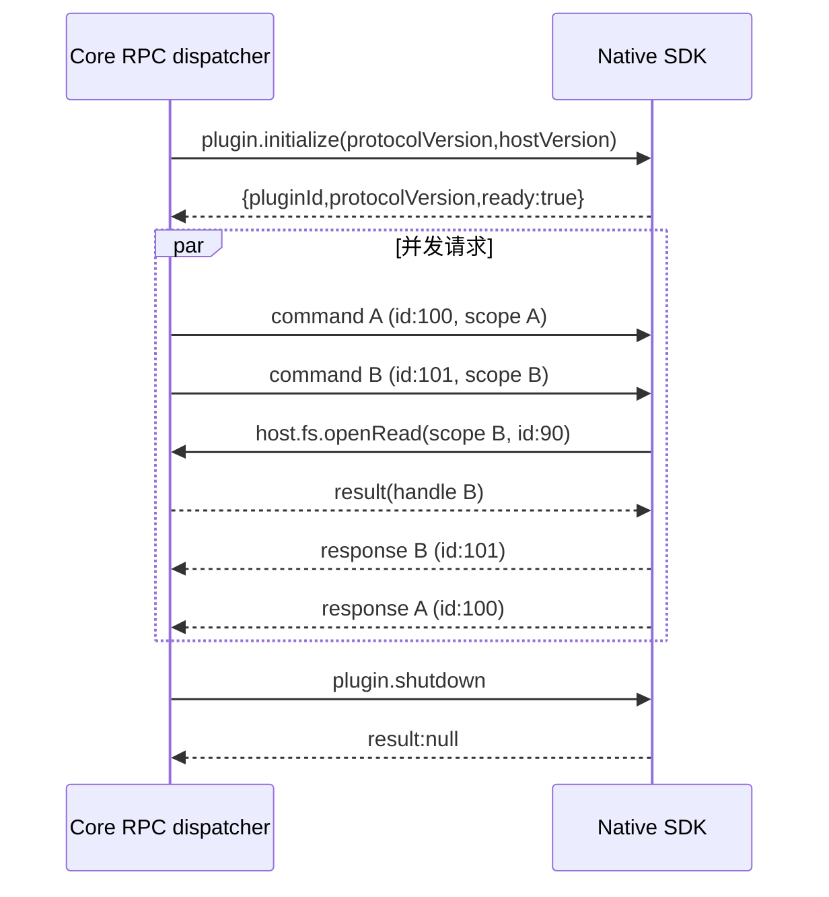
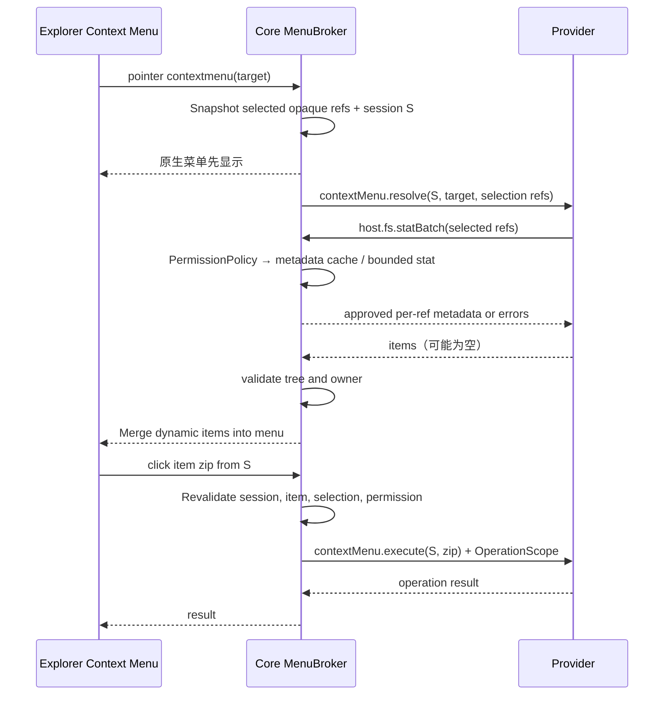
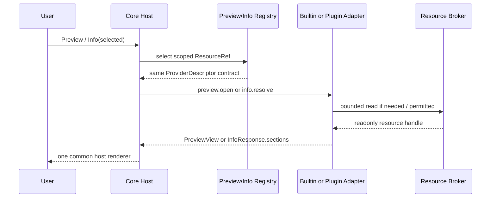

# 03 · Native IPC 全量方法目录与目标协议

> 本文列举插件系统内所有 `plugin.*`、`vfs.*`、`connection.*`、`vfs.*`、`host.*` 方法及动态注册命令。API 列表是新设计的 **目标实现清单**；代码落地时须在 schema 中逐项定义 params/result/error/授权和契约测试。**不将 Tauri 内部 command 当作插件可调用的外部 IPC。**

## 1. Envelope、Session 与错误

```json
{"jsonrpc":"2.0","id":42,"method":"host.fs.openRead","params":{"path":"notes.txt","authorization":{"operationId":13}}}
```
```json
{"jsonrpc":"2.0","id":42,"result":{"handle":"opaque","size":12345}}
```
```json
{"jsonrpc":"2.0","id":42,"error":{"code":-32003,"message":"PermissionDenied","data":{"reason":"path_not_selected"}}}
```

目标 Native 版本 `3.0`，标准传输仍为 `Content-Length` framed JSON-RPC 2.0，单帧 4 MiB。Core 维护关联 operation/task 的密钥和进程身份；SDK 自动附加 `authorization`。文档不要求开发者手工构造授权对象。推荐稳定错误码：`-32601` method_not_found、`-32602` invalid_params、`-32603` internal、`-32800` cancelled、`-32001` not_found、`-32002` conflict、`-32003` permission_denied、`-32004` unavailable、`-32005` deadline_exceeded。详细数据只能包含非敏感结构化字段。



## 2. Core → Plugin：系统/Provider 完整目录

| Method | Params（关键字段） | Result | 用途/约束 |
|---|---|---|---|
| `plugin.initialize` | `protocolVersion,hostVersion` | `pluginId,protocolVersion,ready` | 启动协商，必须匹配安装包身份 |
| `plugin.ping` | 空 | `pong/ok` | 存活检测 |
| `plugin.shutdown` | 空 | `null` | 优雅退出、在最后期限强杀 |
| `plugin.cancel` | `taskId` | notification | 协作取消任务 |
| `contextMenu.resolve` | `menuSessionId,target,selection,directory`（仅 opaque refs） | `{items:[...]}` | Core 每次右键发送事件且不附带 metadata；插件可在本次 EventScope 内自行申请所选对象 `host.fs.stat`，由独立 PermissionPolicy 审核请求和响应 |
| `contextMenu.execute` | `menuSessionId,itemId,selection` | `JSON/null` | 仅允许点击了本次 resolve 中有效 `type:action` 项后调用，建立独立 OperationScope |
| `info.resolve` / `<registered info command>` | `sessionId,resource{ref}` | `{sections:[{id,title,rows:[{label,value}]}]}` | 外部 Info Provider 固定响应 Schema；内置 Info Adapter 同合同进程内调用，不必走物理 IPC |
| `connection.create` | `factoryId,interactionId` | `NavigationIntent?/null` | 用户在添加连接 + 选择插件后调用；插件决定配置/登录 Panel 或经验证导航 |
| `connection.open` | `factoryId,connectionId,interactionId` | `NavigationIntent?/null` | 用户点击连接侧边栏项目后由插件决定跳转位置 |
| `decorations.resolve` | `sessionId,directoryRef,visibleRefs[]` | `{items:[{ref,decoration}]}` | 每次切换目录发送 opaque refs；插件另用 `host.fs.stat`/`statBatch` 申请 metadata；拒绝未授权请求，不跳过事件 |
| `vfs.list` | `mountId,nodeId?,cursor?,limit?` | `entries,nextCursor,snapshotToken?` | 已挂载 VFS 的分页目录浏览；支持网盘与 Git |
| `vfs.stat` | `mountId,nodeId` | `Entry` | 读取 VFS Provider 的节点属性/版本 |
| `vfs.readSmall` | `mountId,nodeId,offset,maxBytes` | `base64,eof` | 小片段读取，严格限额 |
| `vfs.openRead` | `mountId,nodeId,ifRevision?` | `streamId,revision?,size?` | 大文件有界流式读取 |
| `vfs.readStream` | `streamId,offset,maxBytes` | `bounded chunk/eof` | 有界读取及版本校验 |
| `vfs.closeRead` | `streamId` | `null` | 关闭流会话 |
| `vfs.writeFile` | `mountId,nodeId,source,size,ifRevision` | `revision,size?` | 可写网盘 VFS 的受控写回，Git 等只读视图可返回 Unsupported |
| `vfs.search` | `mountId,nodeId?,query,limit?` | `entries` | 当前 VFS 目录受限检索 |
| `<custom command>` | 由其他贡献点注册的 `command/args` 和操作上下文决定 | JSON | toolbar、search、preview、info、hooks、decorations 的自定义处理；右键菜单只允许 `contextMenu.resolve/execute` |

Provider 清单中的 `nodeId` 与 `revision` 均不应当被 Core 当作磁盘路径；所有 `Entry.path` 必须由 Core 根据 mountId 生成。扩展点动态命令原则上不能冒充 `plugin.`、`host.`、`vfs.`、`fs.`、`connection.` 保留前缀。


## 2.0 统一事件回调与按需资源 IPC

**唯一的插件资源访问流程：**Surface/Provider 在 Manifest 中注册事件 → 用户执行操作（Decoration 是用户切换目录）→ Core 发 `event + SessionId + opaque ResourceRef`，**不附带 metadata/文件内容/目录列表** → 插件按需通过通用 `host.fs.stat/list/openRead/...` 申请 → 独立 `PermissionPolicy` 结合 Manifest、已批准 grant、事件/操作 Scope 审核**请求及 Core 返回的数据** → Core 经 IPC 返回获准的结果。没有「Core 自动发 metadata」这条捷径，也不划分 Push/Pull 两套访问模型。

事件会话代表本次明确的对象集合和阶段：右键菜单的 `contextMenu.resolve` 可以申请**所选对象的 metadata**，但不能在菜单查询期间读取文件字节；点击有效菜单 action 后，可按用户确认及 `files.read/write` 权限建立执行 Scope。Preview/Info 的打开行为可允许本次目标的适当读取；Decoration 的目录切换会话**只**能申请当前目录已显示的成员 metadata，不能凭刷新扫描其他目录或读取文件字节。若所需权限未申请或未批准，资源申请返回 `PermissionDenied`，事件通知仍正常发生。

独立 PermissionPolicy 在插件调用 `host.fs.*` 时审核请求，Core Broker 取得结果后再由同一模块审核响应对象/字段。事件消息本身只携带 Session 和被限定的 opaque ref，不会因为获批 Metadata 就附上 metadata。Decoration 可以通过 `host.fs.stat` 或待补充的 `host.fs.statBatch` 批量申请**当前已显示成员**的属性；未获批准时资源请求失败，但目录切换事件依旧交付。

### Connection 与 VFS 是独立 RPC 边界

`surfaces.connections[]` 仅注册添加连接 + 入口和侧边栏条目。用户点击 + 时调用 `connection.create`；点击已有连接时调用 `connection.open`，插件返回 `NavigationIntent`（例如 `{"kind":"vfs","mountId":"..."}`）或通过通用 `host.ui.open` 打开 Panel。Core 校验目标归属和当前交互，再执行跳转。**注册 Connection 不自动挂载、不自动调用文件树协议。**

`providers.vfs[]` 单独提供 VFS 文件树，只有显式 VFS 创建请求通过 Core 审核才分配 `mountId`；云盘插件必须同时注册 Connection（入口）和 VFS（文件树），Git 历史可以只注册 VFS。VFS 可实现读/写数据接口，不在 Manifest 中硬编码 readOnly 或 sync/writeMode 开关。

## 2.1 完全动态右键菜单的强制 RPC 合同

Manifest 只需 `"contextMenus": true` 注册监听，每次用户右键 Core 向所有已注册插件发送仅含 `menuSessionId`、本次所选 opaque ref 的 `contextMenu.resolve` 事件。事件本身不包含属性；如需扩展名，插件须用当前会话里的 ref 申请 `host.fs.stat`，由独立 PermissionPolicy 对 `permissions.metadata.enabled`、EventScope 和结果字段审核后返回。查询阶段只允许本次 target/selection 的 metadata，不允许内容读取和任意目录遍历。菜单回包仍是本次完整的扁平 `items[]`。

```json
{
  "jsonrpc":"2.0","id":301,"method":"contextMenu.resolve",
  "params":{
    "menuSessionId":"sess-opaque",
    "target":{"ref":{"mountId":"m1","nodeId":"n7"}},
    "selection":[{"ref":{"mountId":"m1","nodeId":"n7"}}],
    "directory":{"ref":{"mountId":"m1","nodeId":"parent"}}
  }
}
```

```json
{
  "jsonrpc":"2.0","id":301,"result":{
    "items":[
      {"id":"compress","type":"submenu","title":"压缩为"},
      {"id":"zip","parentId":"compress","type":"action","title":"ZIP"},
      {"id":"7z","parentId":"compress","type":"action","title":"7z"},
      {"id":"settings","type":"action","title":"高级选项"}
    ]
  }
}
```

所有 item 是扁平数组，`parentId` 仅引用同一批返回的 submenu；不用 `children`，也不允许动态 JavaScript。Core 检验 `id` 唯一、`type=action|submenu|separator`、parentId 无环、层数≤4、数量≤80、标题≤128、大小与 deadline 界限。无匹配项直接 `{items:[]}`，不显示该插件菜单。

用户点击 `type:action` 的某个 item 后，Core 确认 `menuSessionId` 仍为有效菜单、`itemId` 曾由当前 owner 返回、该项启用且右键目标未被悄然替换，然后调用：

```json
{"jsonrpc":"2.0","id":302,"method":"contextMenu.execute",
 "params":{"menuSessionId":"sess-opaque","itemId":"zip",
           "selection":[{"ref":{"mountId":"m1","nodeId":"n7"},"name":"report.zip"}]}}
```

`execute` 从已经用户实际点击的菜单项派生 **OperationScope**；必须经过该方法需要的 Manifest permission 与当前选择的精确对象校验。查询 `resolve` 阶段有严格限定的**metadata-only EventScope**：允许插件通过 `host.fs.stat` 申请当前右键选中对象的属性；其他路径 stat、文件内容读取和目录枚举仍返回 `PermissionDenied`。不再有 Core 提前在菜单事件参数中附带 metadata 的路径。Core 不允许前端或其他插件直接调用这两个保留的 Provider RPC。

菜单项全是 `action/submenu/separator`，是否打开 Panel 由用户点击后的 `contextMenu.execute` 处理器决定：处理器可在当次交互中调用 `host.ui.open` 指定本次 UI，Manifest 不预注册 Panel。子菜单展开由 Core 负责，无需额外 IPC。弱网或崩溃应在界限内失败并忽略该插件，不能阻塞宿主原生菜单。菜单 Session 关闭、插件重启或新一次右键后失效，迟到响应不得污染新的菜单。



### 2.1.1 右键菜单嵌套 IPC 与首帧响应性能（目标规范）

**保留事件 → 插件请求资源 → Core 审核返回** 的唯一流程，绝不为提速在 `contextMenu.resolve` 事件里夹带 Metadata。右键事件及单次嵌套 `host.fs.statBatch` 在理想情况下构成两次 RPC 往返（resolve 往返内部包含 statBatch 往返），比直接事件附带 Metadata 多一次资源请求 RTT；用下列机制控制延迟：

1. **聚合批量请求**：多选右键由插件向 `host.fs.statBatch` 一次提交本次所选资源 refs；单文件仍可用 `host.fs.stat`。Core Broker 限额、去重、按项审核并返回；同批中未获准的资源绝不通过其它条目泄漏属性。Decoration 的可见成员也可复用此接口，但不能扩大 EventScope。
2. **复用 Core Metadata 缓存**：Explorer 已获取的基础 stat 和 VFS 页内 Metadata 可在**通过 PermissionPolicy.authorize_call 之后**进入相同 Broker 的缓存读取路径，取得候选结果后仍必须通过 `audit_response` 才交付插件。缓存键必须含 mount/node 稳定身份、版本/快照代次及对象种类；监听/目录刷新、文件写删改名、VFS revision 变化、权限撤销或重新绑定时失效/重新验证。缓存不包含权限授权本身，不允许因命中而跳过 Grant/Scope；不可靠远端缓存必须有有界新鲜度或降级重新取数。缓存只用于展示属性，不作为写回/删除等破坏性操作的最终一致性证明。
3. **并发且可重入的 IPC**：Core 对已激活的所有 ContextMenu Provider 并发 `resolve`；插件在处理 `resolve` 期间可发 `host.fs.stat/host.fs.statBatch` 并得到响应。双向消息的 request-id 匹配、读循环、dispatcher 和 Broker 必须独立推进；任何一方不得持有 MenuSession/PluginRegistry/IPC 写锁跨越 `await` 或阻塞等待对方的嵌套调用。SDK 的 `serve` 亦不得单线程串行等待当前 resolve 完成才接收 host response。背压、每插件/每 Session 并发与总量限制由 Core 统一实施。
4. **原生菜单先绘制**：右键立即显示内置/原生菜单，插件菜单在有效 `menuSessionId` 中异步增量合并，Core 应保持已悬停或正在键盘导航的条目顺序/焦点稳定；一旦用户点击、关闭、再次右键或 Session 失效，不得合并迟到结果。插件过慢时退化为只有原生菜单，不等待网络盘或重试阻塞 UI。

软预算 **120 ms**、硬截止 **250 ms** 仅作为初始候选目标，须在 Windows/macOS/Linux 的真实负载中校准，而不是已测得或已保证的响应时间。分别记录点击到原生菜单首帧、发出 resolve、`statBatch` 审核/缓存命中/缓存未命中及远端查询、插件回包、动态菜单合并的 p50/p95/p99；目标是验证**额外 IPC RTT 不明显损害本地单选右键体验**。需测试单选、100/1000 多选、10 个并发插件、慢/离线 VFS、冷热缓存、取消、权限撤销、过期 Session，以及在回调中嵌套调用不死锁的压力场景。

### VFS 文件树数据契约（Connection 不隐含文件操作）

```json
{
  "entries":[
    {"nodeId":"opaque-81","name":"a.txt","kind":"file","size":12,"modified":1800000000,"revision":"r42"}
  ],
  "nextCursor":null,
  "identityStability":"stable"
}
```

`identityStability: "stable"|"path"` 表示改名后的 ID 稳定性，**不表示内容一致性**。目录分页必须有单调前进规则；若远端分页顺序变化、缺少快照功能，Core 不得把“分页结束”当成整目录强一致快照。

## 3. Plugin → Core：文件 Broker 全部方法

| IPC method | Params | Result | 必要权限 |
|---|---|---|---|
| `host.fs.list` | `path` | `Entry[]` | `folders.read.enabled` + scope；返回目录成员，其他属性须按 metadata 权限裁剪 |
| `host.fs.stat` | `ref` | `Entry` | 文件/目录统一要求 `permissions.metadata.enabled` + 精确 EventScope/OperationScope/TaskScope；菜单允许所选对象 stat，Decoration 允许可见成员 stat；请求及回包均经 PermissionPolicy 审核 |
| `host.fs.statBatch`（目标新增） | `refs:ResourceRef[]` | `{results:[{ref,metadata?,error?}]}` | 一个 RPC 批量申请，按输入顺序逐项审核、逐项返回（metadata 与 error 二选一），单项失败不泄露其属性；同一统一 metadata 权限，无新增批量特权 |
| `host.fs.readChunk` | `path,offset,length` | `base64,size,eof` | `files.read.enabled` + scope |
| `host.fs.read` | `path,offset,length` | `buffer,size,eof` | `files.read.enabled` + scope；内部低层 |
| `host.fs.openRead` | `path` | `handle,size` | `files.read.enabled` + scope |
| `host.fs.readOpen` | `handle,offset,length,buffer?` | `size,eof,base64?` | 属主 Handle + 文件权限 |
| `host.fs.closeRead` | `handle` | `null` | Handle 所属 operation/task |
| `host.fs.create` | `path` | `Entry` | 创建**新文件**时使用 `files.create.enabled` + scope；不得覆盖已有文件 |
| `host.fs.mkdir` | `path` | `Entry` | `folders.create.enabled` + scope |
| `host.fs.beginWrite` | `path,create` | `handle` | `create:false` 需要 `files.write.enabled`；`create:true` 仅允许对不存在的目标以 `files.create.enabled` 写入初始内容；两者均需 scope |
| `host.fs.writeChunk` | `handle,base64` | `null` | 原事务授权 `files.write.enabled` 或 `files.create.enabled` + Handle owner |
| `host.fs.writeBuffer` | `handle,buffer,size` | `null` | 原事务授权 `files.write.enabled` 或 `files.create.enabled` + Handle owner |
| `host.fs.seekWrite` | `handle,kind,offset` | `u64 offset` | 原事务授权 `files.write.enabled` 或 `files.create.enabled` + Handle owner |
| `host.fs.commit` | `handle` | `Entry/confirmation` | 原事务授权 `files.write.enabled` 或 `files.create.enabled` + 冲突复检 |
| `host.fs.abort` | `handle` | `null` | Handle owner |
| `host.fs.write` | `path,buffer,mode` | 状态 | 按目标是否存在、是否创建检查 `files.write.enabled` 或 `files.create.enabled`；旧式方法最终收敛 |
| `host.fs.remove` | `path` | `null` | 根据目标类型要求 `files.delete.enabled` **或** `folders.delete.enabled` + scope；目录默认仅删除空目录 |
| `host.fs.rename` | `from,to` | `null` | 根据源目标类型要求 `files.rename.enabled` **或** `folders.rename.enabled` + 双路径 scope |

统一处理文件目录对象的 race/symlink、原子提交、临时权限与文件大小。文件与目录的 `create/delete/rename` **按对象种类分别经 PermissionPolicy 检查**，创建现有文件与新文件的操作权限不互相隐含；`rename` 要分别校验源和目标所选 Scope。Core 内部为了 Explorer UI 获取的元数据不能直接交给插件；插件必须发起 `host.fs.stat` 请求，并在执行和响应两个边界经 PermissionPolicy 审核。


### 元数据：一个请求/响应协议，无 Push/Pull 区分

```text
Core --[event(sessionId, resourceRefs)]--> Plugin
Plugin --[host.fs.stat({ref})]------------> Core
Core --> PermissionPolicy.authorize_call(request, grants, EventScope/OperationScope)
Core FileBroker -> stat -> PermissionPolicy.audit_response(metadata, scope)
Core --[metadata or PermissionDenied]-----> Plugin
```

`permissions.metadata.enabled` 同时适用于文件和文件夹。EventScope 仅覆盖本次右键所选、预览/Info 打开的目标，或 Decoration 目录切换事件中的当前可见节点；不因注册 Surface 或曾收到通知扩大范围。请求返回值按 Schema 裁剪，绝对路径、其他节点 metadata 和文件字节不可借 `host.fs.stat` 泄露。批量元数据接口 `host.fs.statBatch` 是**正式待实现的性能合同**，而非第二条元数据分发路径；单个 `host.fs.stat` 同样保留。请求只接受不透明 `ResourceRef[]`，Core 在批次上限内按引用去重、按输入顺序回填，每项都通过相同的授权、真实对象身份和响应字段审核；每项只返回 `{ref,metadata}` 或 `{ref,error:PermissionDenied|Unavailable|...}`。**任何缓存命中和批处理都不能跳过 PermissionPolicy**。默认批次上限目标为 256 项（由 Schema 固定且可按基准调整），超过则拒绝整批、SDK 按限额拆批；支持取消、deadline 和远端受限并发，避免把 1000 个单文件 stat 变成 1000 个串行往返。 

### Search 的局部路径约束

`surfaces.search[]` 只声明 `id/title/command?`，彻底移除 `scope`。宿主始终将用户当前指定的目录作为 `root`，不得提供全局搜索入口。Everything 允许继续依托其**全局构建的搜索索引**，但必须向 ES 查询施加对应 `root` 路径限制；Core 再对返回的每项路径执行规范化、目录边界检查与去重，不允许将全局范围的命中直接渲染到局部搜索结果。注意 Core 的结果过滤不等于禁止已授权的 `es` 外部命令本身查询全局索引：这属于独立的外部命令风险模型。

## 4. Plugin → Core：网络、共享缓冲、进程

| IPC method | Params | Result | 权限/说明 |
|---|---|---|---|
| `host.net.http.open` | `method,url,headers?,bodyBase64?,bodyReadHandle?,timeoutMs?,allowInvalidCerts?` | `stream,status,headers` | network + 每跳域名/IP 校验 |
| `host.net.http.read` | `stream,size` | `base64,size,eof` | 当前响应属主 |
| `host.net.http.close` | `stream` | `null` | 释放响应 |
| `host.net.http` | `method,url,headers?,bodyBuffer?` | `status,headers,bodyBase64?/bodyBuffer?` | 有界旧式单次 HTTP；目标收敛到 open/read/close |
| `host.net.tcp.open` | `host,port` | `stream,peerAddress` | network + 审批目标 |
| `host.net.tcp.readBytes` | `stream,size` | `base64,size,eof` | 标准 TCP SDK 使用 |
| `host.net.tcp.writeBytes` | `stream,base64` | `size` | 标准 TCP SDK 使用 |
| `host.net.tcp.read` | `stream,size` | `buffer,size,eof` | 共享窗口低层 |
| `host.net.tcp.write` | `stream,buffer` | `size` | 共享窗口低层 |
| `host.net.tcp.close` | `stream` | `null` | 清理 |
| `host.buffer.create` | `size,writable` | `descriptor` | owner、配额、上限 |
| `host.buffer.map` | `id` | `descriptor` | 相同 owner |
| `host.buffer.release` | `id` | `null` | 映射释放 |
| `host.process.run` | `command,args,cwd?,stdin?` | `code,stdout/stderr,truncated` | commands allowlist，高风险 |
| `host.exec` | `command,args...` | 结构化执行结果 | 低层执行入口；建议最终统一至 process.run |

`allowInvalidCerts` 不应仅靠插件自行设置；设计要求连接实例保存经用户确认的证书例外，并且限定具体主机。避免 DNS 重绑定与内网 SSRF 的建议：域名匹配 + 解析 IP 校验 + 连接实际地址验证；HTTP 禁止跨目标泄露 Authorization/Cookie，重定向逐跳验证。

## 5. Plugin → Core：视图、任务、数据、诊断

| IPC method | Params | Result | 说明 |
|---|---|---|---|
| `host.vfs.openView` | `contributionId,resourceRoot,viewContext` | `fiex://mount/.../` | 只允许显式 vfs owner + 已选资源 |
| `host.ui.open` | `interactionId,view{source,entry?/html?},presentation{title,placement,preferredSize?}` | `panelSessionId` | **所有用户触发的 UI Surface 通用**，运行时选择具体页面或 HTML；Core 验证交互身份/时效与沙箱，自动查询/后台不得弹窗 |
| `host.preview.create` | `name,base64` | `path` | 限额临时预览；目标升级为 opaque resource ref |
| `host.task.start` | `taskId,label?,internal?` | `null` | 从本次操作衍生 TaskScope |
| `host.task.progress` | `taskId,done,total?` | `null` | 更新活动中心 |
| `host.task.finish` | `taskId,status,result?,error?` | `null` | 回收 TaskScope 和句柄 |
| `host.task.cancel` | `taskId` | `null` | 请求取消，应双向闭环 |
| `host.storage.get` | `scope,key` | JSON 或 null | 隔离插件 KV |
| `host.storage.set` | `scope,key,value` | `null` | 宿主原子持久化 |
| `host.storage.delete` | `scope,key` | `null` | 删除 KV |
| `host.storage.keys` | `scope` | `string[]` | 只列自己命名空间 |
| `host.secret.get` | `scope,key` | `string` | OS 凭据代理 |
| `host.secret.set` | `scope,key,value` | `null` | secret 不进普通日志 |
| `host.secret.delete` | `scope,key` | `null` | 删除 Secret |
| `host.secret.available` | 空 | `bool` | 是否有可用 Keyring |
| `host.error.report` | `code?,message,detail?` | `null` | 限流记录、去标识化 |

`host.*` 方法的权限不能由用户提供的同名字段提升；Core 必须验证 operation owner、handle owner、已安装并已授权的插件进程。低层方法可以在最终 ABI 继续存在，**但仅作为 SDK 内部机制，不应承诺它们是推荐的第三方开发入口**。

## 6. 动态命令合同

| 来源 | 调用方法名称 | 推荐参数/结果 |
|---|---|---|
| Toolbar | `<plugin>.<action>` | `{selection,directory,args}` → JSON |
| ContextMenu 查询 | `contextMenu.resolve` | `{menuSessionId,target,selection,directory}` → `{items}` |
| ContextMenu 执行 | `contextMenu.execute` | `{menuSessionId,itemId,interactionId,selection}` → JSON/null |
| Search（仅目录内搜索） | 声明 `command`，默认 `search.query`；Manifest 无 `scope` | `{query,root,hidden,ignores,limit}` → `{entries}`；Provider 限定 root，Core 校验返回路径 |
| Info | 默认 `info.resolve` 或贡献项声明的 `command` | `{sessionId,resource:{ref}}` → `{sections:[{id,title,rows:[{label,value}]}]}`；内置与插件同形，禁止裸路径/旧 rows 回包 |
| Hooks | 声明 `command` | `{event,path}` → `{action:"pass"|"consume"}` |
| Decorations | `surfaces.decorations:true` → 固定 `decorations.resolve` | 每次切换目录通知 `{sessionId,directoryRef,visibleRefs}`；插件通过独立资源 IPC 请求 metadata，获批后 Core 才返回 |
| Preview | Host 逻辑入口 `preview.open` → 动态 `PreviewView` / `host.ui.open` | `{sessionId,resource:{ref},intent:"preview"}` → 动态具体视图；内置进程内调用，外部需沙箱 UI Bridge |

动态命令不属于 `host.*` 白名单，仅能在其贡献点明确注册的触发流程下执行；Core 对所有动态参数进行数据 schema 验证，并绑定最小资源授权。右键菜单不接受通过返回值指定任意命令字符串：只有 Core 控制的 `contextMenu.execute` 执行入口；其中 `itemId` 必须出自当前 Session 的 `resolve` 结果。

## 6.1 Preview 与 Info 的统一 Provider 生命周期



**`preview.open` 是统一的 Host→Provider 逻辑入口**：Core 内置渲染器直接通过进程内 Adapter 实现，外部预览在本次用户打开预览时动态选择包内视图或有界 HTML，通过 Core PanelHost 与 UI Bridge 加载；不强制产生额外的 Native RPC。**`info.resolve` 是 Info Provider 的目标固定 IPC 方法**（自定义命令亦必须遵守同一参数/回包）；Core 内置基础文件/音频/视频解析也调用同形的内部实现。所有 Info 结果按 `InfoResponse.sections[]` 聚合，一个失败不能让其他区块消失。

插件请求 Metadata 时须先通过独立 PermissionPolicy 对 `permissions.metadata.enabled` 和会话 Scope 的审核，Core 不在事件中预先交付；额外解析媒体内容需独立 `files.read.enabled` 与查看操作 Scope。两类 Provider 的大数据访问仅通过 Core ResourceBroker 安全流，不允许经 IPC JSON 传整文件或将任意宿主路径泄露给 iframe。详见 [08 统一 Preview/Info](08-UNIFIED-PREVIEW-INFO.md)。

## 6.2 所有交互式 Surface 共用的 Runtime Panel IPC

创建 Panel 不需要 `panels[]` Manifest 声明、预设 `panelId`、单独 Panel 权限，也不只针对 ContextMenu。`surfaces.toolbar/connections/contextMenus/preview/info/search/settings` 等用户主动触发的回调可以通过相同的 `host.ui.open` 发起运行时 UI 请求。注册 Surface 赋予参与该 Surface 交互的资格，**不赋予任意后台弹窗许可**。

```json
{"jsonrpc":"2.0","id":501,"method":"host.ui.open","params":{
  "interactionId":"core-issued",
  "view":{"source":"package","entry":"ui/options.html"},
  "presentation":{"title":"选项","placement":"dialog","preferredSize":{"width":520,"height":420}}
}}
```

`view` 可在 **当次 IPC** 中选择包内文件 `{source:"package",entry:"..."}` 或受限的运行时 HTML `{source:"html",html:"..."}`。Core 校验包内资源属于当前插件、动态 HTML 大小、Content Security Policy、iframe sandbox、进程身份、当前交互来源与有效期限；返回新的 `panelSessionId`。自动 `contextMenu.resolve` / `info.resolve` / `search.query` / decorations 刷新/后台 Hook 不可据此主动弹窗。点击行为与明确打开预览可以触发会话。详见 [09-RUNTIME-UI-PANELS.md](09-RUNTIME-UI-PANELS.md)。

## 7. 目标规范落地清单

- 为每个上述方法生成 JSON Schema，固定 required/default/bounds、result shape、超时和各平台错误映射；
- 进程握手、并发请求乱序、多级请求回入、错 ID、超时、取消、关闭进程的恢复都需契约测试；
- `vfs.writeFile` 在 WebDAV 强 ETag 下断言原子前置条件，其他 Provider 必须准确报告保障级别，由 Core 按最保守策略执行；
- 所有 `host.fs.*` 都测试未选择、其他文件、其他 task、重复提交、符号链接/重命名绕出目录与大于 5 GiB 稀疏文件；
- 有界 buffer 创建、释放与错误降级不应导致数据静默损坏。
