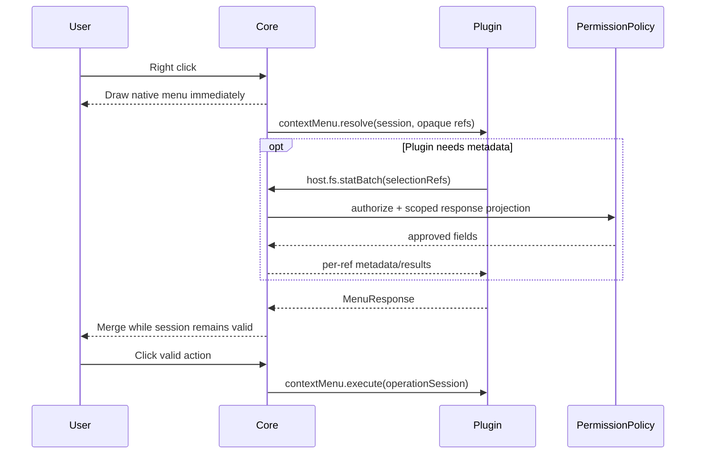

# 03 · Native IPC 与扩展事件协议

## 1. 传输

Native 插件常驻沙箱进程与 Core 使用双向、异步 JSON-RPC 2.0：`id` 关联请求与响应，`method` 表示调用，`params` 受版本化 Schema 约束；支持取消、错误数据、deadline、流会话和多个并发 in-flight request。对文件块使用有界 IPC buffer 或可回收共享窗口，不把大文件 base64 放进单条 JSON。

任何 Provider 回调等待期间都允许向 Core 发起 `host.*` 请求并收到返回。收发循环与 dispatch 不能持锁等待其正在处理的业务请求完成。
同步 `Read/Write/Seek` 与可选 Tokio `AsyncRead/AsyncWrite/AsyncSeek` 是 SDK IO Trait，不是两套宿主文件系统。Core Broker 都按相同的 `{pluginInstance,handle,session,scope,requestId}` 审核。异步流通过多路并发 Request/Response 唤醒 Future，不得在 `poll_read/poll_write` 内执行阻塞同步 RPC。流式传输支持背压、取消、EOF 与回收。

## 2. Core → Plugin 事件

| 事件                                 | 参数                                                 | 返回                           |
| ------------------------------------ | ---------------------------------------------------- | ------------------------------ |
| `plugin.initialize`                  | `protocolVersion,hostVersion`                        | `pluginId,ready`               |
| `plugin.ping` / `plugin.shutdown`    | 空                                                   | `ok` / `null`                  |
| `contextMenu.resolve`                | `menuSessionId,targetRef,selectionRefs,directoryRef` | `MenuResponse {items[]}`       |
| `contextMenu.execute`                | `menuSessionId,itemId,interactionId`                 | 业务处理结果                   |
| `info.resolve`                       | `InfoContext`（标准）                                | `InfoResponse {sections[]}`    |
| `preview.open`                       | `PreviewContext`（标准）                             | `PreviewView`                  |
| `decorations.resolve`                | `DecorationContext`（标准）                          | `DecorationResponse {items[]}` |
| `connection.create`                  | `factoryId,interactionId`                            | `NavigationTarget`             |
| `connection.open`                    | `factoryId,connectionId,interactionId`               | `NavigationTarget`             |
| `search.query`                       | `sessionId,rootRef,query,cursor?`                    | 受 root 约束的 SearchResponse  |
| `toolbar.invoke` / `settings.invoke` | `interactionId,context`                              | 对应扩展的业务结果             |
| `hooks.invoke`                       | `event,resourceRef,operationSession`                 | 受约束的 HookResponse          |

`info.resolve`、`preview.open`、`decorations.resolve` 是**预定义上下文的标准事件**。Core 在请求前通过 ContextBuilder 准备候选 Metadata/受限文件访问引用，PermissionPolicy 针对插件 Grant 和 Scope 裁剪后交付。一次 Core→Plugin 请求与一次业务返回即可完成不需要读取大量文件字节的标准处理。

`contextMenu.resolve` 是**自定义交互**：默认只给 opaque refs；插件确有需要才通过 `host.fs.stat/statBatch` 申请。所有受保护字段必须由 PermissionPolicy 授权后返回。

## 3. 标准事件合同

```json
{
  "jsonrpc": "2.0",
  "id": 71,
  "method": "info.resolve",
  "params": {
    "sessionId": "i-opaque",
    "resource": {
      "ref": { "mountId": "m1", "nodeId": "n9" },
      "metadata": { "name": "song.mp3", "kind": "file", "size": 2048 },
      "read": { "resourceId": "read-scoped-9" }
    }
  }
}
```

`metadata` 与 `read` 均为可选：独立 PermissionPolicy 仅在插件具有相应 `permissions.metadata` 与 `permissions.files.read` 批准、且当前用户查看操作允许时才交付。这里的 `read.resourceId` 是会话绑定的受限访问引用，**不等于文件内容**；大文件仍由 Broker 按需流式读取。Context 不能携带宿主绝对路径、凭据或其他未选中文件的信息。

Preview 的事件采用相同 ResourceContext，响应为 PreviewView；Decoration 传 `directoryRef`、`visibleEntries:[{ref,metadata?}]`，只包括当前已显示对象。Info、Preview、Decoration 的结果一律按 Core 公共业务 Schema 解码；Info 可并发聚合多个 sections，各来源独立失败/回退。

## 4. Connection 导航

`NavigationTarget` 是精确两分支枚举：

```json
{ "kind": "vfs", "mountId": "m1", "nodeRef": { "mountId": "m1", "nodeId": "root" } }
```

```json
{
  "kind": "pluginView",
  "view": { "source": "package", "entry": "ui/home.html" },
  "state": { "connectionId": "c1" }
}
```

`kind=vfs` 必须指向本插件已获准并已创建的 VFS Mount。 `kind=pluginView` 必须指向该插件安装包内经过校验的 HTML；Core 将整个右侧主内容区替换为 sandboxed iframe，保留左侧栏和全局 TabHost。Connection RPC 不接受 `panel`、`dialog`、`externalUrl`、`modal`、`html` 等导航结果，不能返回任意远程网页地址。

## 5. Plugin → Core 资源请求

| 方法                                         | 参数                                   | 许可                                                     |
| -------------------------------------------- | -------------------------------------- | -------------------------------------------------------- |
| `host.fs.stat`                               | `ref`                                  | `permissions.metadata` + EventScope/OperationScope       |
| `host.fs.statBatch`                          | `refs[]`                               | 同上，按项审核，逐项返回 Result                          |
| `host.fs.list`                               | `directoryRef,cursor?,limit?`          | `folders.read` + 可遍历的 Scope                          |
| `host.fs.openRead`                           | `ref` 或标准事件受限 `read.resourceId` | `files.read` + 当前目标 Scope                            |
| `host.fs.readOpen/closeRead`                 | `handle,offset,length` / `handle`      | 有效句柄所有权与会话                                     |
| `host.fs.beginWrite/writeChunk/commit/abort` | 目标 ref / 限额 chunks / handle        | `files.write` 或 `files.create` + 精确操作范围与冲突检测 |
| `host.fs.mkdir`                              | `parentRef,name`                       | `folders.create`                                         |
| `host.fs.remove` / `host.fs.rename`          | 目标、源与目标                         | 按真实文件/目录类型验证对应权限                          |
| `host.net.http.*` / `host.net.tcp.*`         | Host、域名、端口、流                   | 已批准 Network 目标                                      |
| `host.net.tcp.shutdown`                      | `stream,direction=write/read/both`     | Owner、Scope、连接状态及 TCP 半关闭权限                  |
| `host.process.run`                           | 受限制命令与参数                       | 单独高风险 Commands 授权                                 |
| `host.storage.*` / `host.secret.*`           | 插件命名空间键                         | 进程身份与 Secret Broker                                 |
| `host.ui.open`                               | 有效 interactionId 与 PanelSpec        | 通用用户交互 UI，不替代 Connection 导航                  |
| `host.vfs.openView`                          | `providerId,context,rootRef?`          | 已注册 `extensions.vfs` + MountRegistry 审核             |

`statBatch` 默认目标批次限额为 256（由 Schema 和压测校准），按输入顺序返回 `{results:[{ref,metadata? ,error?}]}`，每项要么 Metadata 要么错误。Core 在授权之后读取有效的 Explorer/VFS Metadata 缓存，响应之前再次审核；缓存不持有授权。批量无权项目不得泄露名称、大小、真实路径或未批准的枚举信息。

**区别**：Core 向一个虚拟文件树 Provider 查询其自己管理的云端节点 `vfs.stat`，不是让该插件主动访问宿主本地文件的 `host.fs.stat`。两者都走受信任 Core Broker 的身份/边界检查。

### 5.1 文件与网络流的统一 IPC 语义

- 文件 `openRead/read/seek/closeRead` 绑定目标文件的只读 Handle；`beginWrite/write/seekWrite/commit/abort` 是写入事务。同步与 Tokio 异步 SDK 使用相同 Core Handle/Grant；`flush` 不等于 `commit`。
- TCP `open/readBytes/writeBytes/shutdown/close` 支持**同一连接上的读和写独立推进**。阻塞读不能持有排斥写入的共同锁；同方向并发操作必须排序或显式禁止帧交错。
- `shutdown(write)` 向对端发送 FIN，`close` 清理句柄并取消在途操作。EOF 返回 0，短读/短写须符合标准 IO Trait；撤权/取消/连接关闭必须及时终止等待并产生错误。
- 网络 `open` 先验证插件目标 Host Grant，再验证解析后实际连接的 IP、端口及 IPv4/IPv6/环回/私网规则；HTTP 跳转每一跳独立审核。两种网络流的 Grant 一致。
- HTTP 请求和响应使用有界分块；Core `FileReader` 的精确只读 Handle 可直接上传，通用同步 `Read` / Tokio `AsyncRead` 请求体由新的受限流 Session、背压与取消实现，绝不整文件 JSON 化。
- TLS 和 STARTTLS 由插件在 SDK TCP 字节流上完成端到端协议，Core 不必解密 TLS；SDK 高层 HTTP 由 Core 执行证书和主机名验证。

## 6. VFS 数据协议

| 方法（Core → VFS Provider）                            | 语义                                                     |
| ------------------------------------------------------ | -------------------------------------------------------- |
| `vfs.list(mountId,nodeId,cursor?,limit?)`              | 目录分页，返回 entries、nextCursor 与可选 snapshotToken  |
| `vfs.stat(mountId,nodeId)`                             | 节点元信息、revision、identityStability                  |
| `vfs.openRead/readStream/closeRead`                    | 有界可取消只读流，带版本检查                             |
| `vfs.writeFile(mountId,nodeId,source,size,ifRevision)` | 可写 Provider 的受控写回；只读 Provider 返回 Unsupported |
| `vfs.search`                                           | 当前 Mount 下的目录限定查询                              |

Mount URI 由 Core 构造：`fiex://mount/<mountId>/<encoded-path>`，Provider 不分配 URI scheme 或 mountId。流式、文件对象增删改、远端 revision 和同步状态由 VFS Broker 进行安全协调。

## 7. ContextMenu 性能与安全



Core 对所有已激活插件并发查询，保持常驻插件进程；原生菜单先显示，动态菜单合并不能移动用户正悬停或键盘选中的项，迟到/取消/超时结果丢弃。软预算 120 ms、硬截止 250 ms 是**待基准验证的候选值**，不是性能承诺。需测跨平台单选、多选、10 插件、冷热缓存、离线 VFS、p50/p95/p99 和嵌套双向 IPC 死锁。

## 8. Session 与错误

每个消息有不可复用的会话标识，资源 Handle 绑定插件实例和 Session；关闭、权限撤销、插件重启、导航或取消都会使旧 Scope 失效。标准错误包括 `invalid_params`、`method_not_found`、`permission_denied`、`conflict`、`cancelled`、`deadline_exceeded`、`unavailable`。拒绝要可追踪，不能把权限失败假装成空目录。
异步 Pending IO 在 Scope/Handle 失效时必须被唤醒并返回失败，禁止残留永远 Pending 的 Future。
