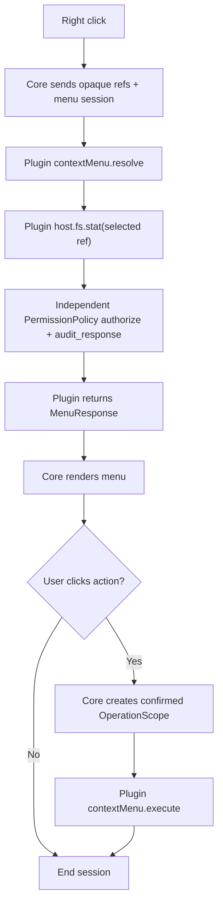
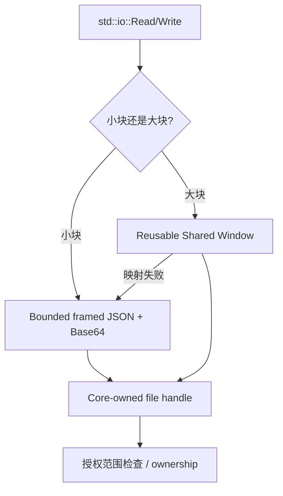
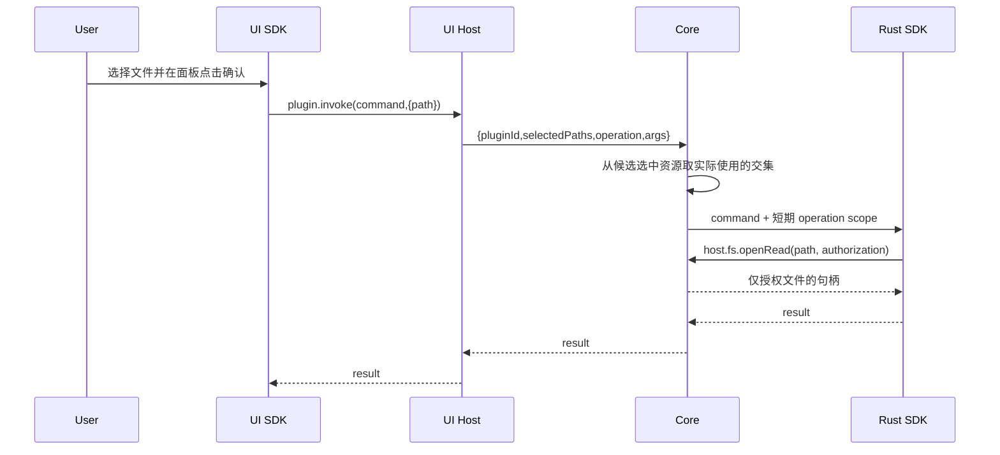

# 04 · Rust SDK / UI SDK API 全量清单与底层 IPC 对照

> 此页枚举插件作者和 SDK 内部可见的全部接口簇。目标是**面向开发者的高层 SDK、对 Core 的稳定 Wire Contract、对 UI 的隔离 Bridge 三个层次严格一致**。公开 SDK 类型保留常规 Rust/TypeScript 使用习惯；新引入的 API 要在 M0 冻结 schema 后实现。

## 1. Rust SDK 模块与顶层导出

Rust crate `fiex-plugin-sdk` 导出：`serve`, `PROTOCOL_VERSION`, `MAX_FRAME`, `read_frame`, `write_frame`, `RpcError`; 类型 `RequestContext`, `TaskContext`, `Files`, `FileReader`, `FileWriter`, `HttpClient`, `Request`, `Response`, `TcpClient`, `TcpStream`, `TaskHandle`, `TaskStatus`, `Entry`, `ProcessResult`。底层辅助模块 `ipc` 导出 `SharedBuffer`、`BufferDescriptor`，提供 `create/open/descriptor/size/fill/fill_from/as_slice/as_mut_slice`。底层 IPC 仅作为 SDK 实现能力，不要求普通插件直接使用。

```rust
use fiex_plugin_sdk::{self as sdk, RpcError};
use serde_json::{json, Value};
fn main() {
    sdk::serve("org.example.demo", |ctx| match ctx.method() {
        "demo.echo" => Ok(json!({"received": ctx.params()})),
        "connection.validate" => Ok(json!({"valid": true})),
        other => Err(RpcError::method_not_found(other)),
    }).expect("plugin terminated");
}
```

`serve` 启动常驻 Native 进程，负责握手、多个 in-flight request 的 ID 配对、授权上下文与工作线程；SDK 的 public API 不暴露 `HostProxy`、裸写 stdout、手动协商 Request ID 等行为。所有未识别方法返回 `method_not_found`。

## 2. RequestContext 与 TaskContext

| Rust API | Native IPC / 行为 | 说明 |
|---|---|---|
| `ctx.method()` | 当前入站 RPC | 返回方法名 |
| `ctx.params()` | 当前入站 params | 返回 JSON |
| `ctx.files()` | `host.fs.*` | 返回可独立持有的 `Files` |
| `ctx.http()` | `host.net.http.*` | 返回 `HttpClient` |
| `ctx.tcp()` | `host.net.tcp.*` | 返回 `TcpClient` |
| `ctx.invoke(method,params)` | 指定 `host.*` | 高级能力未封装时的受限低层入口 |
| `ctx.open_vfs_view(id,root,context)` | `host.vfs.openView` | 请求独立 VFS Provider 创建受控 mount，可对应只读 Git View 或云盘文件树，不因 Connection 注册自动生成 |
| `ctx.report_error(code,message,detail)` | `host.error.report` | 限流、非敏感诊断 |
| `ctx.process_run(command,args,stdin)` | `host.process.run` | 启动批准的外部命令（危险） |
| `ctx.storage_get(scope,key)` | `host.storage.get` | 返回 JSON/Null |
| `ctx.storage_set(scope,key,value)` | `host.storage.set` | 更新自己 KV |
| `ctx.secret_get(scope,key)` | `host.secret.get` | Keyring 读取 |
| `ctx.secret_set(scope,key,value)` | `host.secret.set` | Keyring 写入 |
| `ctx.spawn_task(work)` | `host.task.start` | 独立继承 operation scope |
| `ctx.spawn_task_with_label(label,work)` | `host.task.start` | 带友好名称 |
| `ctx.spawn_internal_task(label,work)` | `host.task.start(internal:true)` | 不展示给用户的内部任务 |
| `ctx.is_cancelled()` | 取消通知状态 | 响应取消 |

`TaskContext` 应完整拥有 `id/files/http/tcp/invoke/report_error/process_run/storage_get/storage_set/secret_get/secret_set/cancel/is_cancelled/progress`。其中 `progress(done,total)` 对应 `host.task.progress`，取消后 SDK 和 Core 都要拒绝再使用旧 TaskScope。`TaskHandle` 的方法为 `id/cancel/is_cancelled/is_finished/status/progress/wait`；`TaskStatus = Running|Completed|Failed|Cancelled`，Rust `RpcError` 有 `method_not_found/invalid_params/internal/cancelled` 构造器，目标补全 `permission_denied/conflict/unavailable/deadline_exceeded` 并保留错误数据。


## 2.1 `contextMenu.resolve` 与 `contextMenu.execute` 的统一事件/资源请求

`surfaces.contextMenus:true` 只注册右键事件，不给 Metadata 权限。Core 右键通知 `contextMenu.resolve`（包含本次目标的 opaque ref、选中引用和 SessionId），**不主动附带任何 Metadata**。插件按需通过通用 `host.fs.stat` 申请所选对象属性，只有唯一 `permissions.metadata.enabled` 经用户批准且符合当前 EventScope 时，独立 PermissionPolicy 才审核请求并让 Core 返回属性。没有权限则返回 `PermissionDenied`。菜单 resolve 阶段不允许文件内容读取。

| SDK 方法 / 协议 | 用途 | 资源边界 |
|---|---|---|
| `contextMenu.resolve` | 每次右键通知并返回 `{items:[]}` | 仅事件 + opaque refs，无元数据 |
| `ctx.files().metadata(ref)`（目标签名） | 插件在本次 resolve 阶段申请目标属性 | 统一 `permissions.metadata` 与当前所选 EventScope，响应也经审核 |
| `contextMenu.execute` | 用户点击有效菜单动作后执行 | 根据被确认操作创建新的读/写 OperationScope |

```rust
// 流程伪代码，签名以未来 SDK 定义为准
match ctx.method() {
    "contextMenu.resolve" => {
        let target_ref = &ctx.params()["target"]["ref"];
        let metadata = ctx.files().metadata(target_ref)?;
        if metadata.extension() == "zip" {
            Ok(json!({"items":[{"id":"extract","type":"action","title":"解压"}]}))
        } else {
            Ok(json!({"items":[]}))
        }
    }
    "contextMenu.execute" => {
        // 具体读写请求还要经过 OperationScope 与 PermissionPolicy
        Ok(json!({"accepted":true}))
    }
    _ => Err(RpcError::method_not_found(ctx.method()))
}
```

该示例表达目标交互方式，不表示当前 Rust SDK 已实现所示 `metadata(ref)` API。



## 2.2 Connection 与 VFS 的 SDK 职责互不隐含

- `surfaces.connections[]` 仅在 Core UI 注册添加连接 + 和侧边栏条目；点击加号选择插件 → 固定 `connection.create`，点击已有连接 → `connection.open`。插件处理器经 IPC 返回 `NavigationIntent` 或调用 `ctx.ui().open_panel(...)`，由 Core 验证导航/交互身份并真正跳转。
- `providers.vfs[]` 独立注册文件树；云盘插件须同时声明 Connection 和 VFS，Git 历史等可只声明 VFS。SDK 中的 VFS 访问/挂载封装只在相应 Provider 已注册且用户操作允许时才向 Core 提交，不能从 Connection 类型推导文件树能力。
- 远端的 VFS 接口由对应协议处理 `list/stat/openRead/writeFile`；普通宿主 `host.fs.stat` 由独立 PermissionPolicy 校验一项 `permissions.metadata.enabled` + OperationScope，不能混淆。

## 2.3 Decoration 订阅与审核模块

`surfaces.decorations:true` 只使 Core 每次切换目录时发送一次 `decorations.resolve`；即使未批准 metadata 也会发事件。Core 只发送目录切换事件及当前可见成员的 opaque refs；插件通过 `ctx.files().metadata(ref)` 逐项申请（或将来批量 `statBatch`），独立 PermissionPolicy 按 `permissions.metadata.enabled` 和本次目录可见集合审核请求与返回值，Core 才返回 Metadata。SDK 无法通过这个事件额外获取目录读取能力；没有 metadata 则无法返回逐文件有效角标。

### 2.4 批量 stat、缓存与嵌套 IPC 的 SDK 要求

`Files::stat_batch(&[ResourceRef])` 是**目标高层 SDK API**（尚未实现），内部调用同一 `host.fs.statBatch`，无需开发者知道 IPC 细节，亦不导出 Preview/Info 特殊类型。对单选使用 `Files::metadata(ref)` 即可；多选（ContextMenu）和大量可见对象（Decoration）应优先使用批量调用，SDK 有界拆批并支持取消。返回格式应逐 ref 关联成功或错误，禁止无声丢掉 `PermissionDenied` 导致索引错位。

SDK 的常驻 `serve` / IPC 读循环必须支持 **Provider 回调进行中再发起 Host RPC、异步收到响应并继续回调**；同一个进程可并发多个 Provider 请求，通过 JSON-RPC ID + 会话身份精准匹配。不得在持有请求队列、进程写锁或会话锁时同步等待 Core 返回，也不得因为处理 `contextMenu.resolve` 就暂停处理嵌套 Host RPC 的响应。Core 的 Metadata 缓存和权限审核属于宿主，不在 SDK 内再次缓存未经授权的全局文件元数据。

## 3. Files、Reader、Writer：完整映射

| 公共 Rust API | 具体 IPC | 说明 |
|---|---|---|
| `Files::read(path)` | `openRead/readOpen/closeRead` | 一次性读取最多 64 MiB |
| `Files::read_to_string(path)` | `openRead/readOpen/closeRead` | UTF-8 |
| `Files::open_read(path)` | `host.fs.openRead` | 返回 `FileReader` |
| `FileReader::read(&mut buf)` | `host.fs.readOpen`，必要时 buffer | `Read`，自动短 IPC 或共享窗 |
| `FileReader::seek(position)` | 改变客户端偏移 | `Seek`，下次 read 发目标 offset |
| `FileReader::len()` / `is_empty()` | openRead 元信息 | 无追加 RPC |
| `drop(FileReader)` | `host.fs.closeRead` + buffer.release | 自动资源清理 |
| `Files::begin_write(path,create)` | `host.fs.beginWrite` | 开始 Core 暂存事务 |
| `FileWriter::write(&buf)` / `flush()` | `host.fs.writeChunk` 或 `writeBuffer` | `Write`，自动缓存 |
| `FileWriter::seek(position)` | `host.fs.seekWrite` | `Seek` |
| `FileWriter::commit(self)` | `host.fs.commit` | 检查冲突/原子替换 |
| `drop(FileWriter)` 未提交 | `host.fs.abort` + buffer.release | 自动回滚 |
| `Files::write(path,bytes)` | beginWrite/write/commit | `files.write.enabled`：只修改已存在文件，不隐含新建 |
| `Files::create(path,bytes)` | beginWrite(create:true)/commit | `files.create.enabled`：只创建不存在的文件并写入初始内容；不需要 `folders.create`，不隐含 `files.write` |
| `Files::list(path)` | `host.fs.list` | 仅许可目录内 |
| `Files::metadata(ref)`（目标签名） | `host.fs.stat` | **所有 Metadata 统一按需申请**：要求 `permissions.metadata.enabled` + EventScope/OperationScope/TaskScope，返回二次审核；事件不会带 metadata |
| `Files::stat_batch(&[ResourceRef])`（目标新增） | `host.fs.statBatch` | 一次 IPC 批量请求，返回按输入顺序排列的逐项 Result；SDK 按 Schema 上限拆批，调用者逐项处理无权/不可用结果；不增加授权范围 |
| `Files::create_dir_all(path)` | `host.fs.mkdir` | `folders.create.enabled`：创建目录，不等于创建新文件 |
| `Files::remove(path)` | `host.fs.remove` | 按目标类型要求 `files.delete.enabled` 或 `folders.delete.enabled`，检查本次所选范围 |
| `Files::rename(from,to)` | `host.fs.rename` | 按目标类型要求 `files.rename.enabled` 或 `folders.rename.enabled`，检查双路径 Scope |

`FileReader` 和 `FileWriter` 实现标准 `Read/Seek/Write` 与 `Send + 'static`，可以脱离临时 `Files` 变量；不能脱离 Core 注册的 operation/task 授权。目标由 SDK 自动选择：小块 IPC 缓冲、读共享窗口最多 4 MiB、写共享窗口最多 256 KiB；共享内存不可用时降级有界 IPC。任何全文件分配都必须显式受 64 MiB 限制。



## 4. HTTP/TCP：全量映射

| Rust API | IPC | 用法 |
|---|---|---|
| `ctx.http().request(method,url)` | 请求构造 | 自定义 PUT/PATCH/PROPFIND |
| `ctx.http().get/post/put/delete(url)` | 构造快捷方式 | 无立即网络 |
| `Request::header(name,value)` | header 序列化 | 类型校验 |
| `Request::body(bytes)` | `bodyBase64` | 小型内存请求体 |
| `Request::body_reader(FileReader)` | `bodyReadHandle` | Core 直接从精确授权文件流上传 |
| `Request::json(value)` | JSON body + content-type | JSON 序列化 |
| `Request::basic_auth(u,p)` | Authorization | 每跳隔离 |
| `Request::bearer_auth(token)` | Authorization | 禁止跨 origin 泄露 |
| `Request::timeout(duration)` | `timeoutMs` | 上限由 Core 裁决 |
| `Request::allow_invalid_certs(bool)` | TLS 字段 | 目标额外要求用户确认证书例外 |
| `Request::send()` | `host.net.http.open` | `Response` 包含 `status/headers` |
| `Response::read(buf)` | `host.net.http.read` | `Read` trait |
| `Response::bytes/text/json()` | 多次 `http.read` | 每次聚合最大 64 MiB |
| `Response::error_for_status()` | 本地状态判断 | 4xx/5xx 返回错误 |
| `drop(Response)` | `host.net.http.close` | 回收连接 |
| `ctx.tcp().connect(host,port)` | `host.net.tcp.open` | Core 网络授权 |
| `TcpStream::read/write/flush` | `host.net.tcp.readBytes/writeBytes` | Rust `Read+Write` |
| `TcpStream::peer_addr()` | open 结果 | peerAddr |
| `drop(TcpStream)` | `host.net.tcp.close` | 最后引用释放 |

文件 HTTP 上传例：

```rust
let reader = ctx.files().open_read("upload.iso")?;
let result = ctx.http()
    .put("https://cloud.example.com/files/opaque-node")
    .body_reader(reader)
    .send()?
    .error_for_status()?;
```

不把宿主绝对路径传给网络插件。HTTP 和 TCP 共用审批的 `permissions.network.domains`；TCP 不提供任意 UDP/本机进程互联的自动授权。

## 5. 低层 IPC 类型目录

| 暴露类型/函数 | 用途 | 对应低层 |
|---|---|---|
| `ipc::BufferDescriptor {id,name,size,writable}` | SharedMemory 描述符 | `host.buffer.*` |
| `ipc::SharedBuffer::create/open` | 操作系统共享窗口 | 受 Core owner 限制 |
| `SharedBuffer::descriptor/size/fill/fill_from/as_slice/as_mut_slice` | 受界内存访问 | SDK 内部加速 |
| `ipc::Entry` | host 文件/目录元数据 | `host.fs.list/stat` |
| `ipc::ProcessResult` | 退出码、输出及截断标记 | `host.process.run` |
| `ProcessResult::stdout_bytes()` | 读取可能在 Buffer 的输出 | `ProcessResult` 本地处理 |
| `read_frame/write_frame` | 原始长度帧测试/自定义工具 | 正常插件不直接使用 |

## 6. UI SDK 的全部公共方法与 Bridge method

目标 `@fiex/ui-sdk` 统一出口 `fiex`，支持 `new FiexUiClient({timeoutMs,reportUnhandledErrors})`、`FiexBridgeError`、`ResourceRef`、`ExplorerContext`、`ThemeSnapshot`、`JsonValue`、`applyTheme`。UI 与 Native 的版本/鉴权独立。

| UI SDK API | MessagePort method/event | 权限/预期 |
|---|---|---|
| `fiex.ready()` | handshake probe/init/ready | 建立一次性 session |
| `fiex.invoke(method,params,options)` | 通用请求包装 | 仅下表允许的 method |
| `fiex.on(name,handler)` | event subscription | 事件回调 |
| `fiex.dispose()` | 关闭 port | 清理挂起操作 |
| `fiex.context.get()` | `context.get` | 当前最小上下文 |
| `fiex.context.subscribe(handler)` | `context.changed` 事件 | 随面板作用域改变 |
| `fiex.plugin.invoke(command,args,options)` | `plugin.invoke` | 本插件已注册命令，所选资源 |
| `fiex.plugin.task(taskId)` **目标新增** | `plugin.task` | 只读自己的任务 |
| `fiex.vfs.stat(ref)` | `vfs.stat` | 目标必须新增宿主分发实现 |
| `fiex.vfs.list(ref,cursor?)` | `vfs.list` | 目标必须新增宿主分发实现 |
| `fiex.vfs.open(ref)` | `vfs.open` | 由 Core 导航/打开，不返回路径 |
| `fiex.tasks.list()` | `tasks.list` | 仅面板拥有的任务，非全局泄漏 |
| `fiex.tasks.create(title,opts)` | `tasks.create` | 注册 UI 任务 |
| `fiex.tasks.spinner(title,opts)` | `tasks.spinner` | Indeterminate |
| `fiex.tasks.update(taskId,patch)` | `tasks.update` | owner check |
| `fiex.tasks.finish(taskId,opts)` | `tasks.finish` | 结束 |
| `fiex.tasks.cancel(taskId)` | `tasks.cancel` | 取消 |
| `fiex.dialog.openFile(opts)` | `dialog.openFile` | Native picker，不等于立刻赋权 |
| `fiex.dialog.openFiles(opts)` | `dialog.openFiles` | 多选 |
| `fiex.dialog.openDirectory(opts)` | `dialog.openDirectory` | 目录选择 |
| `fiex.dialog.saveFile(opts)` | `dialog.saveFile` | 保存路径 |
| `fiex.panel.resize(w,h)` | `panel.resize` | 宿主约束最小/最大尺寸 |
| `fiex.panel.close()` | `panel.close` | 只关闭自身 |
| `fiex.errors.report(message,detail?)` | `plugin.error` | 限流日志 |
| `fiex.theme.get()` | `theme.get` | token Snapshot |
| `fiex.theme.subscribe(handler)` | `theme.changed` 事件 | 实时主题 |
| `fiex.events.on(name,handler)` | 所有允许的 Host 事件 | 解除订阅函数 |
| `fiex.clipboard.writeText(text)` **目标新增** | `clipboard.writeText` | 宿主验证长度和用户操作 |
| `fiex.navigation.open(path)` **目标新增** | `navigation.open` | 路径校验、由宿主执行 |

UI Bridge 目标允许的请求全集（排除握手控制帧）：

```text
context.get  plugin.invoke  plugin.task  plugin.error
vfs.stat  vfs.list  vfs.open
tasks.list  tasks.create  tasks.spinner  tasks.update  tasks.finish  tasks.cancel
dialog.openFile  dialog.openFiles  dialog.openDirectory  dialog.saveFile
panel.resize  panel.close
theme.get  clipboard.writeText  navigation.open
```

事件至少包括 `context.changed`、`theme.changed`、`panel.visibility` 和受限制的本插件事件。UI 侧 `type:cancel` 必须可取消宿主尚未执行的请求或协作取消进行中的任务；不要只在 UI 本地丢弃 Promise。

## 7. UI → Native → Core 的作用域



UI Bridge 不提供 `contextMenu.resolve/execute` 的任意调用方法；这两个 RPC 仅由 Core 在真实右键/点击事件上向对应 Native Provider 调用。**面板无静态注册表**：所有用户触发的 Surface 均由相关 Plugin Handler 调用 `ctx.ui().open_panel(...)`，Core 校验当前 interactionId、包内 HTML 或有界运行时 HTML、CSP 与 iframe 沙箱，绝不授予任意宿主 JS/文件权限。

### 事件只提供资源引用，插件自行申请元数据

| 触发方式 | Rust SDK / RPC | 授权条件 |
|---|---|---|
| 当前文件被右键、预览或显示简介 | 事件只给 `ctx.params()["target"]["ref"]` 等 opaque ref | 注册对应 Surface 即收到事件；不附带 Metadata |
| 插件在事件中申请目标元数据 | `ctx.files().metadata(ref)` → `host.fs.stat` | 唯一 `permissions.metadata.enabled` 已批准，且目标在本次 EventScope/OperationScope/TaskScope 内，由 PermissionPolicy 审核请求和返回值 |
| 插件主动读取文件内容 | `ctx.files().open_read(path)` → `host.fs.openRead` | `files.read.enabled` + 精确文件 Scope；metadata 权限不能代替 |

查询 `contextMenu.resolve` 时**允许申请当前 target/selection 的 metadata**，但不得请求不属于本次选择的其他文件。未获批则 `host.fs.stat` 返回 `PermissionDenied`，不是事件中 `metadata` 字段消失。

不同 UI/Native 会话绝不共享隐式“当前目录”权限。面板关闭不会自动取消已经显式启动、仍被 Core 持有的后台任务，但必须解除 UI panel-local 任务；用户能从活动中心取消后台任务。

## 7.1 Preview/Info 通用 IPC 契约（业务类型归 Core）

内置文本高亮/图片/音视频/PDF 与第三方 Preview 注册**同一个** `PreviewDescriptor`，内置基础/音频/视频与第三方 Info 注册**同一个** `InfoDescriptor`。Core Adapter 和 Native Plugin Adapter 必须接受相同逻辑上下文、返回相同结果；传输层实现不同，但不能在 FileInfoDialog/Preview 里写出两套契约。

| SDK 导出/逻辑合同 | Core ↔ Provider 入口 | 目标语义 |
|---|---|---|
| `preview::PreviewDescriptor` | Host `PreviewRegistry.register` | `id,title,extensions?,mimeTypes?,priority?`；内置与外部同形，无静态 panelId |
| `preview::PreviewContext` | `preview.open` | `{sessionId,intent:"preview",resource:{ref}}`，以 Ref 代替 host 路径 |
| `preview::PreviewView` | Host `PreviewHost` | 运行时返回的具体 Renderer 或视图描述，第三方只能请求其本次交互的隔离 Panel |
| `info::InfoDescriptor` | Host `InfoRegistry.register` | `id,title,extensions?,mimeTypes?,priority?,command?` |
| `info::InfoContext` | `info.resolve` | `{sessionId,intent:"info",resource:{ref}}` |
| `info::InfoRow` / `InfoSection` / `InfoResponse` | `info.resolve` | `{sections:[{id,title,rows:[{label,value}]}]}`，聚合原生与第三方来源 |
| `resources::PreviewResourceRef` | Core Scoped Resource Broker | 只读、限量、可取消、支持视频/PDF Range/Seek；插件无法拿到裸本地文件路径 |
| `preview::PreviewSession` / `info::InfoSession` | Core session owner | 文件切换、对话框关闭/插件禁用、取消时释放资源，后到结果丢弃 |

`preview.open` 对 Core 内置 Provider 是进程内 Adapter 调用，对插件是 Host 统一管理的 Panel/UI Bridge 加载过程，**不是要求插件每次额外跑一遍 Native IPC**。插件仅注册 `surfaces.preview[]`；打开预览时通过 IPC/Bridge 动态指定本次包内页面或受限 HTML，Core 验证内容与来源。Info Native handler 可以使用 `info.resolve` 或声明的 `command`，但必须返回同形 `InfoResponse`；Core 负责定义 Info Handler 数据契约，SDK 使用通用 IPC 即可，无需单独公开 InfoResponse 类型。

**权限**：Preview/Info 事件只给 opaque ref；Provider 必须再通过 `host.fs.stat` 申请 Metadata，独立 PermissionPolicy 审核请求和响应；媒体探测/图片/视频/PDF 内容解析需要相应文件的 `files.read.enabled` + 精确 Scope。内置 Provider 的内部读取不向外部插件暴露特权；所有第三方流由 Broker 代理。完整规范见 [08 统一 Preview/Info](08-UNIFIED-PREVIEW-INFO.md)。


**职责限定**：上表描述协议和 Core 业务对象，并非要求 Rust SDK 导出全部 Preview/Info 专有 Struct。插件可以返回遵循协议的 JSON；Core 反序列化成与内置 Provider 构造完全相同的类型，InfoHost/PreviewHost 不区分对象来源。SDK 只需通用 IPC、资源 Broker 和通用运行时 UI 封装。
## 7.2 通用运行时 UI SDK：`ctx.ui().open_panel`

`ctx.ui().open_panel(view,presentation)` 由 Native SDK 在上下文内带上 Core 下发的 `interactionId`（插件开发者不手工创建/复用），通过 `host.ui.open` 创建 **PanelSession**；Toolbar、ContextMenu、Preview、Info、Search、Connection 等用户主动触发的 UI Surface 均可使用，无需 Manifest `panels`、`panelId` 或单独 Panel permission。

```rust
// 目标 API 伪代码，不声称已编译
ctx.ui().open_panel(
    sdk::ui::PanelView::Package("ui/options.html".into()),
    sdk::ui::PanelPresentation::dialog("高级设置", 520, 420)
)?;
```

另一种 `PanelView::Html(html)` 通过同一个 IPC 请求提交有界 HTML。SDK / Core 不应自动在菜单 `resolve`、目录搜索 `query`、信息 `resolve`、Decorations 刷新、后台同步等无用户主动打开动作中颁发 `interactionId`。Panel 与 OperationScope 分离，Panel 创建后文件资源访问仍按用户已批准的权限和本次操作 Scope 校验。详见 [09-RUNTIME-UI-PANELS.md](09-RUNTIME-UI-PANELS.md)。

## 8. Fiex 内部 Tauri command 边界（非插件公开接口）

Core 的 UI Host 对内部命令进行代理、校验与路由，包含：
- 插件调用/安装：`plugin_invoke`, `plugins_list`, `plugin_status`, `plugin_marketplace`, `plugin_release_assets`, `plugin_prepare_install`, `plugin_prepare_local_install`, `plugin_confirm_install`, `plugin_cancel_install`, `plugin_uninstall`;
- 授权与设置：`plugin_activate`, `plugin_set_enabled`, `plugin_set_permission`, `plugin_set_command`, `plugin_set_network_domain`, `plugin_approve_install`, `plugin_network_domains`, `plugin_permission_allowed`, `plugin_storage_get`, `plugin_storage_set`, `plugin_storage_delete`, `plugin_secret_set`, `plugin_secret_available`;
- UI/诊断：`plugin_panel_html`, `plugin_panel_asset`, `plugin_decorations`, `plugin_themes`, `plugin_errors`, `plugin_error_report`, `plugin_error_clear`, `plugin_search`, `plugin_task`, `plugin_cancel_task`, `file_info_details`;
- 文件选择/物化/视图：`plugin_file_dialog`, `plugin_files_dialog`, `materialize_file`, `plugin_context_directory`, `vfs_retain_views`。

这些是宿主自己的实现 API，不能以“iframe 可以执行任意 Tauri Command”的方式暴露。增删内部 command 时需同步更新宿主注册、测试与本文附录，但不影响公开 UI Bridge 协议。
