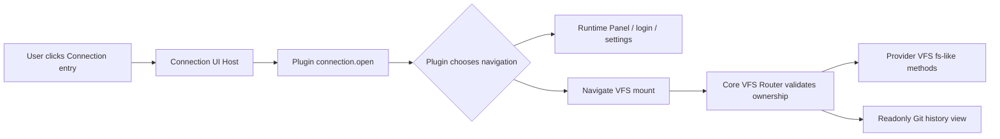
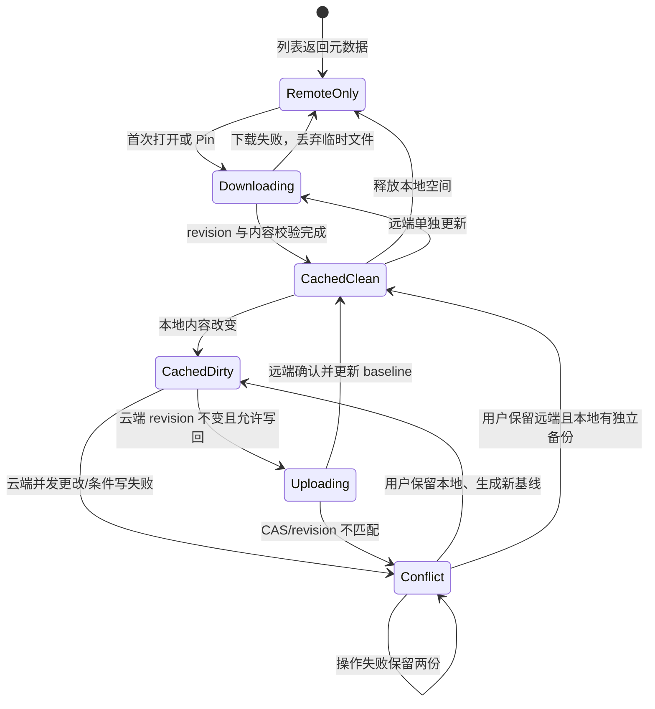
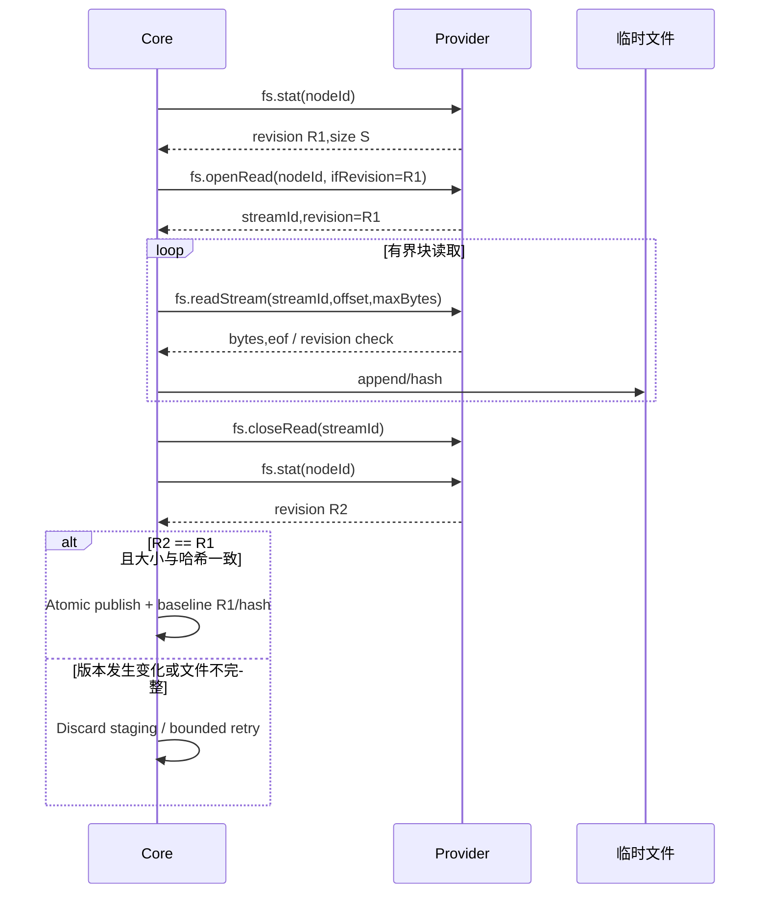
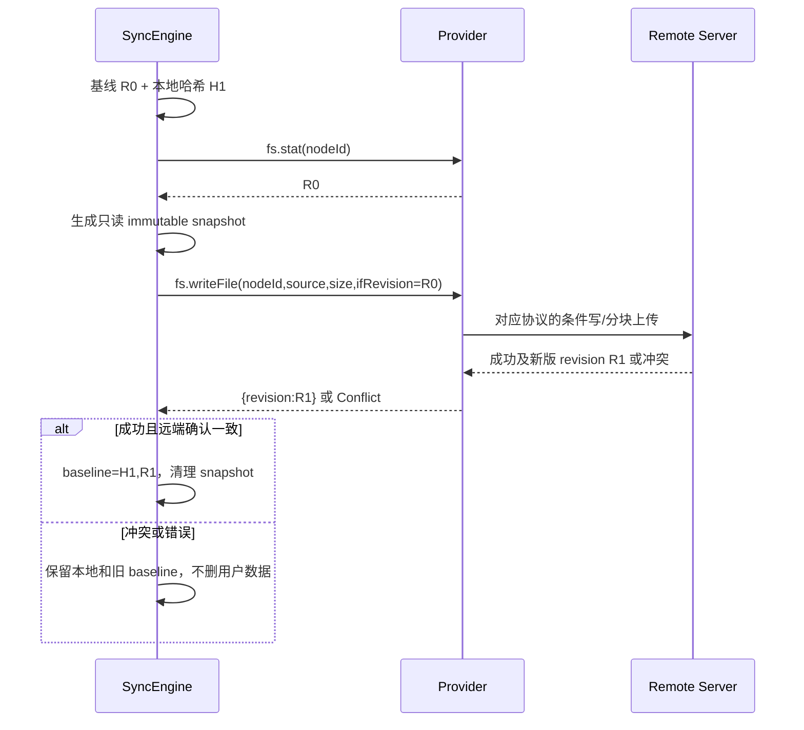

# 05 · VFS、Connection 与可靠双向同步设计

## 1. Core 管理的 VFS：独立于 Connection UI

`fiex://mount/<mountId>/<encoded-relative-path>` 是 Fiex 的受控虚拟导航 URI，由 Core VFS Router 校验每个路径段、对象身份及 mount 的 Provider 归属，防止 `..`、越权、符号链接或节点替换。**注册一个 Connection 不会创建 mount**；只有插件独立声明 `providers.vfs[]` 且用户操作确实申请并通过 VFS Broker 校验时，Core 才建立 mount。相同的 Core MountRegistry 可处理长期云盘文件树和临时 Git 历史树，但生命周期由独立 VFS 创建请求决定。



`providers.vfs[]` 只声明该插件可作为虚拟文件树来源，并不在 Manifest 中写 `scheme`、`mountId`、`sync`、`writeMode` 或 `readOnly`；只读/可写由对应调用方法与 Provider 响应实际能力决定，写回由 Core 的受控资源操作和授权校验保证。对于 Git 历史，通常只实现读操作；对于网盘，必须按实际需要实现读流、写回及可靠缓存/双向同步。View context 应有大小限制，不能内嵌整个树或明文密钥。

## 2. Connection 只贡献两个 UI 入口：添加按钮与侧边栏条目

Manifest `surfaces.connections[]` 只注册连接提供者的 ID、名称、图标以及在“添加连接 +”选择列表和侧边栏“连接”区的展示。它**不负责文件访问、不承诺固定跳转、不要求 Core 固定填写表单、不自动调用 `fs.*`、不生成 VFS**。

- 用户点“+”选择插件，Core 通过 `connection.create({factoryId,interactionId})` 通知插件；插件可以在该交互中调用 `host.ui.open` 打开登录/授权/配置 Panel，或返回 `NavigationIntent`。
- 用户点侧边栏已登记的某项连接，Core 调用 `connection.open({factoryId,connectionId,interactionId})`。插件决定去哪里，返回 `NavigationIntent`：例如跳转它自己的已建立 VFS mount、打开插件设置 Panel、显示登录失效页面。**不是 Core 看到 Connection 就自动 `fiex://mount/...` 导航。**
- Core 仍管理连接项目的稳定标识 `connectionId`、所有者与基本展示状态，并通过 Keyring/Secret Broker 保管凭据；插件的实际登录、配置和导航语义不由 Core 硬编码。是否创建以及何时持久化连接，由用户/插件交互经 Core connection registry 明确提交。
- `NavigationIntent` 是命令结果（如 `{"kind":"vfs","mountId":"..."}`，或 `{"kind":"panel","view":{...}}`），并非任意外部 URL/命令：Core 必须校验插件 ID、连接实例所有权、目标类型、mount 是否存在、会话与允许的导航范围，然后真正执行界面跳转。Panel 的来源和隔离沿用统一运行时 PanelHost。

```json
{
  "surfaces":{"connections":[{"id":"cloud","title":"Cloud Drive","icon":"cloud"}]},
  "providers":{"vfs":[{"id":"remote-tree","title":"Cloud files"}]}
}
```

这两个声明相互独立：仅有 Connection 可以提供非文件树的账户管理项；仅有 VFS 可以提供不绑定 Connection 的 Git 历史树。**网盘同时声明二者**。每个连接可按插件明确请求创建、绑定自己的 mount，Core 分配 `mountId` 并保证不同账户与 Provider 隔离。删除某个连接前，Core 必须处理该实例显式关联的 VFS、缓存和未同步脏数据，绝不能误删其他连接的数据。

### 2.1 VFS 数据调用与 SDK 的区别

`vfs.list/stat/openRead/readStream/writeFile` 等为 **Core → VFS Provider** 的数据操作接口（实际方法列表需在 Schema/IPC 目录补全）。Core 不因为用户点“连接”就隐式调用它们；只有导航到了真正存在且已批准的 VFS mount 后，才由 VFS Broker 按需调用。远端 `vfs.stat` 为 Provider 对自身虚拟节点的响应，不等于插件主动访问宿主本地磁盘的 `host.fs.stat`。后者仍必须满足独立 `PermissionPolicy` 对 `permissions.metadata.enabled` + OperationScope 的审查；同一个 `metadata` 权限覆盖普通文件与目录。

### 2.2 Connection 也使用通用运行时 Panel

用户明确点击添加连接或某个连接项目时，插件可在当前 InteractionSession 使用 `host.ui.open` 动态选择登录、账号设置等 Panel，无需 Manifest `panels[]` 或静态 UI 位置路径。纯后台连接状态刷新不能弹窗；Panel 打开也不扩大本地文件、网络或远端连接授权。

## 3. Node/目录分页/身份策略

Provider 每页返回 `{entries,nextCursor,snapshotToken?,identityStability?}`，`entries[].name` 是单个可打印安全路径段，`nodeId` 不透明，`revision` 版本不透明；Core 校验列表长度、重复 nodeId、重复路径、非法字符、循环 cursor、最大扫描页数。只有完整、无错误的枚举能提交新目录快照；遇到分页途中网络断开保留上次已确认目录快照。

目录 ID 与文件 ID 必须可跨分页稳定查找：Drive 用文件 ID，WebDAV/OpenList/SMB 若用 path ID，则重命名可能变更 ID，需以 `identityStability=path` 申明逻辑身份限制。Stable 身份也不得跨两个不同账号或挂载复用。

## 4. 按需缓存与同步状态机



**必须独立保存**：`remoteRevision`（枚举观察值）、`downloadRevision`（已下载时固定的版本）、`baselineHash`（下载内容 SHA-256）、`localStamp`（仅快速检测）、`pinned`、`excluded`、`conflict`、`nodeId`、`cachedState`。不能以列表新 revision 直接覆盖下载 baseline。

“始终保留本地”对目录递归启用，其子孙允许显式排除；“释放本地空间”必须先逐个确认无任何未同步更改或冲突，禁止对包含本地脏文件的树删除缓存。离线打开已缓存文件不触发云端读取；联网时可延迟验证，但必须保证内容一致性。

## 5. 下载一致性：禁止拼接不同云端版本



Provider 应对每块绑定原始 revision 或使用强条件 Range；Core 在开始、结束必须校验版本，且目标大小和总读字节精确一致。对于无稳定 revision 的服务，降级为“无法保证版本一致”，禁止静默宣布完整一致下载；Provider 可实现 snapshot read/临时版本副本。

## 6. 上传写回与冲突保证

统一使用：
`vfs.writeFile({mountId,nodeId,source,size,ifRevision}) -> {revision}`。Core 在提交前从本地内容创建不可变快照，并建立**精确文件**读取授权给 Provider；Provider 可用 SDK `ctx.files().open_read(source)`，对于 HTTP 使用 `ctx.http().put(url).body_reader(reader)`，对于 SMB 使用分块 Read 后服务器端 staging + replace，对于 Drive 使用 resumable 会话与 Range 确认。Provider 不得得到临时快照所在目录的权限。VFS 数据接口必须独立声明并经过 Core VFS Broker，不因 Connection Surface 注册而启用。



**不能宣称所有 Provider 的同等冲突保证**：
- WebDAV：强 ETag + `If-Match` 为服务端 CAS；无强 ETag 则 fail closed。
- SMB：上传临时文件、替换前检查当前 revision；存在校验/替换间的竞争窗口，应优先使用服务器原子协议手段。
- OpenList：现有 API 通常为比较后写入，可能存在 TOCTOU；必须向 Core 返回可明确表达的 `conditionalWrite:"bestEffort"` 协商结果，并在风险状态下拒绝自动覆盖或要求用户确认。
- Google Drive：version 与 ETag 复核、resumable session 的响应 Range 验证；服务器部分确认时按实际 committed byte offset 重试；任何 session redirect 逐跳验证网络域名。
以上安全级别通过 **运行时协议握手与标准返回语义** 获取，不重新引入 Manifest 的 `conflictControl` 字段。

## 7. 本地脏文件检测与恢复

不能只靠 `mtime/size` 决定“无本地编辑”并允许云端覆盖。在远端 revision 改变、清理缓存、解决冲突、更新 baseline 等**破坏性动作之前强制计算实际内容 hash**。mtime/size 只允许用于减少非破坏性扫描工作。并发下载与后台同步同一 VFS 连接实例 需串行元数据事务；实际重 CPU/大磁盘读写放到 blocking pool，避免阻塞 Tokio reactor。元数据提交采取 atomic temp + fsync + rename 并保证断电恢复读到最近完整版本。

必须测试：同大小同 mtime 的内容改写、传输中远端替换、下载过程中网络掉线、目录 10 万项分页、中断后继续、冲突双方保留、离线 Pin/排除、跨两个账号同时同步、进程重启后 URI 不变。

## 8. 目标扩展方向

第一阶段只同步已经存在的普通文件的**内容**；本地创建/删除/重命名云端对象、跨挂载 move 等作为单独增量协议，不靠观察缓存目录自动猜测用户意图。应新增受 Core 管理的 `remote.mutate` 显式操作合同与删除墓碑/冲突测试后才启用。
