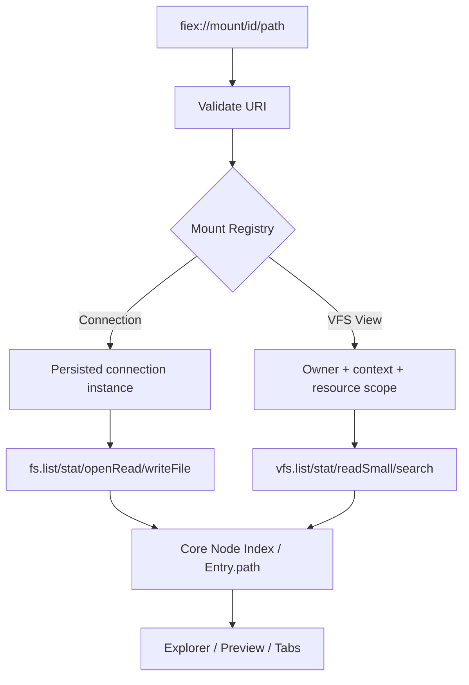
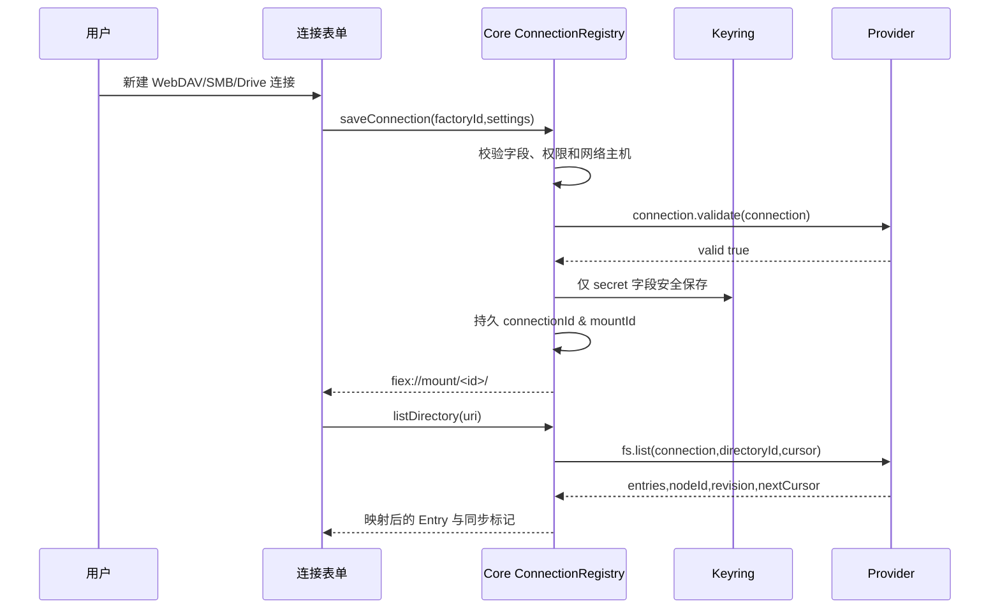
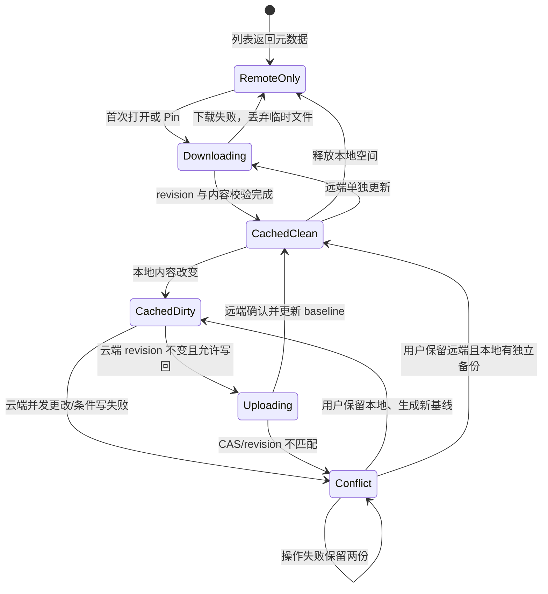
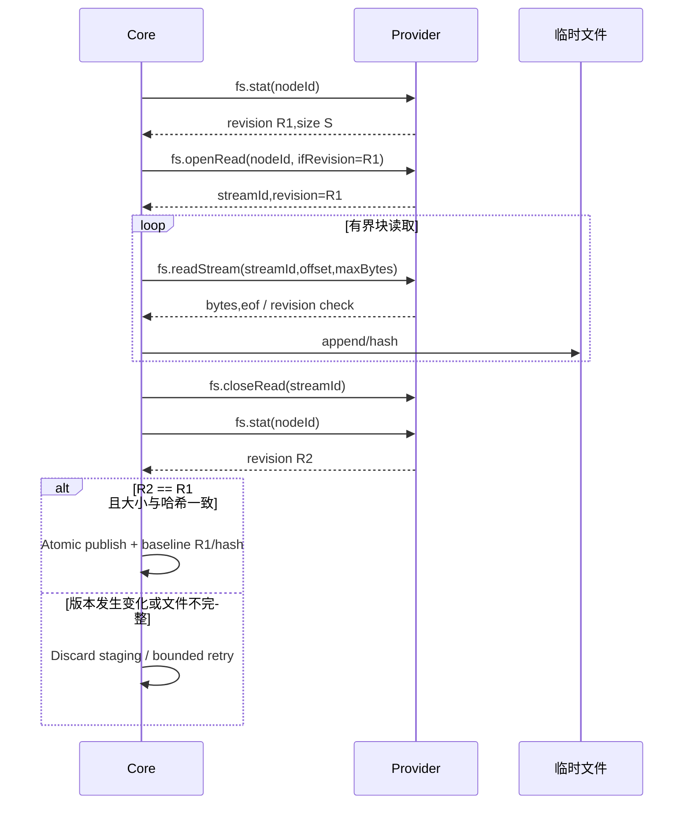
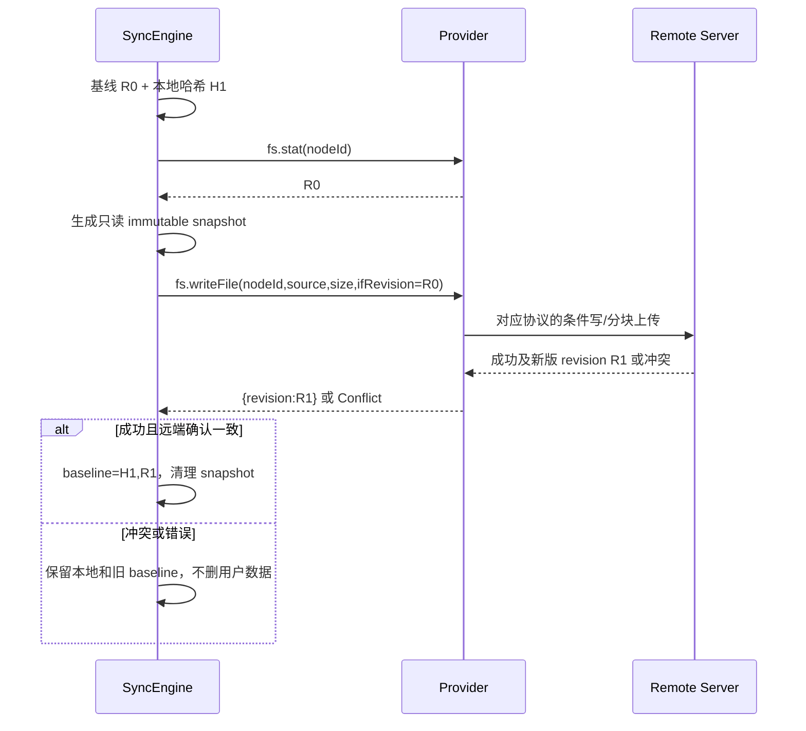

# 05 · VFS、Connection 与可靠双向同步设计

## 1. Core 所有的 VFS：路径与身份

`fiex://mount/<mountId>/<encoded-relative-path>` 是应用内唯一虚拟导航 URI。Core 随机分配 `mountId`，编码每个路径段并拒绝 `..`、斜杠注入、NUL、危险双重编码；`NodeId` 仅在 Provider 上下文内有意义。Connection 的持久 mountId 与只读 View 的动态 mountId 使用相同解析器；提供者不得声明 Scheme/URI 前缀或访问宿主上层目录。

独立 View 的 `viewContext` 小于等于 16 KiB，包含不可变的业务版本信息（如 Git 完整 commit SHA），不能存文件树、登录令牌或可执行字符串。View 生命周期按窗口引用计数，持久收藏/恢复需重验授权；旧 URI 不得意外映射到当前 Git HEAD。目标文件超过 readSmall 限制时必须引入可授权的 `vfs.openRead/readStream/closeRead` 或统一 Core 导出 API（见实施 M3），不能悄悄截断。

## 2. Connection Factory 与实例

**Manifest 的 `connections[]` 只定义 Factory，不创建账户连接。** 用户通过 Core 自动表单填写配置，Core 检查字段 schema、用户批准的网络目标与 Provider 激活状态；密钥放系统 Keyring，其他字段存 Core 的连接 Registry。每个用户保存的连接均绑定 `pluginId + factoryId + connectionId + mountId`，两个相同 Provider 的账户彼此独立。Connection 一旦存在，Core 自动提供 VFS 能力；无需 `contributions.vfs`。

配置 `connection` 仅发给所属 Provider 的特定授权进程。重启连接只恢复 provider 配置，不重建 mountId；删除连接需让用户决定缓存和离线副本如何保留，不能隐式抹掉本地未同步文件。

### Connection 的 `fs.stat` 与普通插件的 `host.fs.stat` 不同

Connection Provider 接收的 `fs.stat({connection,nodeId})` 是 Core 为用户已经建立、已获批准的连接发起的内部 Provider 请求，主要用于版本和同步基线。它不赋予 Provider 访问任意宿主本地文件的权限；也不受普通插件查询 `host.fs.stat` 的操作作用域控制。相反，普通插件主动调用 `ctx.files().metadata(path)` / `host.fs.stat` 必须同时具有 `files.metadata.enabled` 或 `folders.metadata.enabled` 和已确认的 OperationScope。Core 在 Explorer 事件中把已经持有的元数据推送给插件（Push）也只有获批后才允许，且不生成普通文件的读内容授权。

## 3. Node/目录分页/身份策略

Provider 每页返回 `{entries,nextCursor,snapshotToken?,identityStability?}`，`entries[].name` 是单个可打印安全路径段，`nodeId` 不透明，`revision` 版本不透明；Core 校验列表长度、重复 nodeId、重复路径、非法字符、循环 cursor、最大扫描页数。只有完整、无错误的枚举能提交新目录快照；遇到分页途中网络断开保留上次已确认目录快照。

目录 ID 与文件 ID 必须可跨分页稳定查找：Drive 用文件 ID，WebDAV/OpenList/SMB 若用 path ID，则重命名可能变更 ID，需以 `identityStability=path` 申明逻辑身份限制。Stable 身份也不得跨两个不同账号或挂载复用。

## 4. 按需缓存与同步状态机

**必须独立保存**：`remoteRevision`（枚举观察值）、`downloadRevision`（已下载时固定的版本）、`baselineHash`（下载内容 SHA-256）、`localStamp`（仅快速检测）、`pinned`、`excluded`、`conflict`、`nodeId`、`cachedState`。不能以列表新 revision 直接覆盖下载 baseline。

“始终保留本地”对目录递归启用，其子孙允许显式排除；“释放本地空间”必须先逐个确认无任何未同步更改或冲突，禁止对包含本地脏文件的树删除缓存。离线打开已缓存文件不触发云端读取；联网时可延迟验证，但必须保证内容一致性。

## 5. 下载一致性：禁止拼接不同云端版本

Provider 应对每块绑定原始 revision 或使用强条件 Range；Core 在开始、结束必须校验版本，且目标大小和总读字节精确一致。对于无稳定 revision 的服务，降级为“无法保证版本一致”，禁止静默宣布完整一致下载；Provider 可实现 snapshot read/临时版本副本。

## 6. 上传写回与冲突保证

统一使用：
`fs.writeFile({connection,nodeId,source,size,ifRevision}) -> {revision}`。Core 在提交前从本地内容创建不可变快照，并建立**精确文件**读取授权给 Provider；Provider 可用 SDK `ctx.files().open_read(source)`，对于 HTTP 使用 `ctx.http().put(url).body_reader(reader)`，对于 SMB 使用分块 Read 后服务器端 staging + replace，对于 Drive 使用 resumable 会话与 Range 确认。Provider 不得得到临时快照所在目录的权限。

**不能宣称所有 Provider 的同等冲突保证**：
- WebDAV：强 ETag + `If-Match` 为服务端 CAS；无强 ETag 则 fail closed。
- SMB：上传临时文件、替换前检查当前 revision；存在校验/替换间的竞争窗口，应优先使用服务器原子协议手段。
- OpenList：现有 API 通常为比较后写入，可能存在 TOCTOU；必须向 Core 返回可明确表达的 `conditionalWrite:"bestEffort"` 协商结果，并在风险状态下拒绝自动覆盖或要求用户确认。
- Google Drive：version 与 ETag 复核、resumable session 的响应 Range 验证；服务器部分确认时按实际 committed byte offset 重试；任何 session redirect 逐跳验证网络域名。
以上安全级别通过 **运行时协议握手与标准返回语义** 获取，不重新引入 Manifest 的 `conflictControl` 字段。

## 7. 本地脏文件检测与恢复

不能只靠 `mtime/size` 决定“无本地编辑”并允许云端覆盖。在远端 revision 改变、清理缓存、解决冲突、更新 baseline 等**破坏性动作之前强制计算实际内容 hash**。mtime/size 只允许用于减少非破坏性扫描工作。并发下载与后台同步同一 Connection 需串行元数据事务；实际重 CPU/大磁盘读写放到 blocking pool，避免阻塞 Tokio reactor。元数据提交采取 atomic temp + fsync + rename 并保证断电恢复读到最近完整版本。

必须测试：同大小同 mtime 的内容改写、传输中远端替换、下载过程中网络掉线、目录 10 万项分页、中断后继续、冲突双方保留、离线 Pin/排除、跨两个账号同时同步、进程重启后 URI 不变。

## 8. 目标扩展方向

第一阶段只同步已经存在的普通文件的**内容**；本地创建/删除/重命名云端对象、跨挂载 move 等作为单独增量协议，不靠观察缓存目录自动猜测用户意图。应新增受 Core 管理的 `remote.mutate` 显式操作合同与删除墓碑/冲突测试后才启用。
