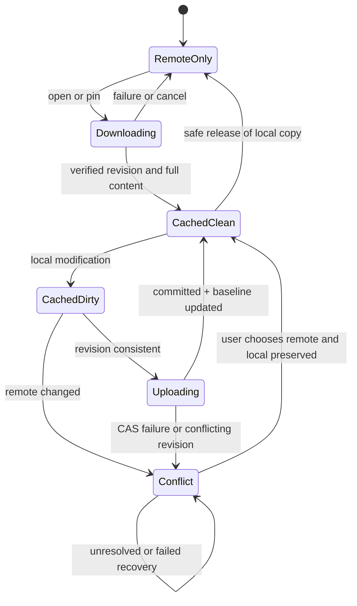

# 05 · Connection、VFS、按需缓存与同步

## 1. Connection 导航

`extensions.connections[]` 在添加连接加号和侧栏连接项注册入口。Core 为连接实例分配稳定 `connectionId`，与 `pluginId/factoryId` 绑定；登录参数由插件管理业务含义，Secret 经 Core Keyring Broker 保管。

用户点击加号调用 `connection.create`，点击已有侧栏实例调用 `connection.open`。插件必须返回下列二者之一：

- `NavigationTarget::Vfs { mountId, nodeRef? }`：Core 使用原生 ExplorerView 显示已验证 VFS。
- `NavigationTarget::PluginView { packageEntry, state }`：Core 将右侧主内容区**整体**替换为本插件 sandboxed iframe（含该区域的目录面包屑、文件操作工具栏、列表/预览位置）。

**Connection 没有弹窗、侧栏 Panel 或外部 URL 导航结果。** 连接登录、配置、账户主页均可用第二种 PluginView。全局左侧栏与 TabHost 保持由 Core 管理；导航具备后退/前进、标签页生命周期和撤权清理。

只有在插件还注册了 `extensions.vfs[]` 并经 Core MountRegistry 创建合法 mount 时，才允许返回 `kind=vfs`。连接实例本身不会获得 VFS。Git 历史等插件可以只注册 VFS 而不注册 Connection。

## 2. VFS 所有权与分页

`fiex://mount/<mountId>/<encoded-relative-path>` 是 Core 产生并解析的应用内 URI。mountId 由 Core 分配，mount 绑定 PluginInstance、可选 connectionId 和 VFS Provider ID；插件不能选择 scheme、复用其他账户 Mount，或通过 nodeId 映射宿主绝对路径。

Provider 以 `vfs.list/stat/openRead/readStream/closeRead/writeFile/search` 等方法服务 Core。每页返回：
Provider 可以使用 SDK 同步标准 `Read/Write/Seek` 或启用 `tokio-io` 使用异步流，实现对远端文件树的协议传输。两者均使用 Core 授权的 Files/HTTP/TCP，而不是通过原生 Socket 绕过 Broker。

```json
{
  "entries": [
    {"nodeId":"opaque-81","name":"a.txt","kind":"file","size":12,"revision":"r42"}
  ],
  "nextCursor": null,
  "snapshotToken": "optional-token",
  "identityStability": "stable"
}
```

Core 校验单个文件名路径段、`..`、重复节点、非法编码、循环游标、单页数量、总分页和目录快照一致性。分页中断不能将未完成的半页快照发布为一致目录。不同账户即便 nodeId 相同也不得共用资源身份。稳定 nodeId 与路径身份的差别必须在 Provider 返回中明确表达。

Provider 的只读或可写能力由其实际协议支持和 Core 允许的文件操作决定；Git View 可以只读，云盘可读写，Manifest 不用单独声明静态 sync/writeMode/conflictControl。

## 3. 按需缓存状态



Core 为每个 VFS 节点维护 `remoteRevision`、`downloadRevision`、`baselineHash`、`localStamp`、`pinned`、`excluded`、`cachedState`、`conflict`、Mount/Node 身份。下载 baseline 与新一次目录刷新看到的远端 revision 不可混用。

- **按需读取**：首次打开时下载，已经 Pin 的资源断网后仍可读；没有缓存的 RemoteOnly 离线打开返回 Unavailable。
- **始终保留本地**：目录可以递归 Pin，允许显式子目录排除；删除/释放缓存前确认所有子文件无脏数据或冲突。
- **释放本地空间**：只删除已验证的干净副本，不触碰远端文件，也不丢失用户修改。
- **双向同步**：远端变化与本地脏文件并存时保留双方，不能自动“最后写入覆盖”。

## 4. 下载一致性

下载开始时用 `vfs.stat` 获取 node 的 revision 与 size，以相同 revision 调用 `vfs.openRead`，在受限流上按块读和计算完整内容 hash，读取完成再次核验 revision、总字节数和完整性，最后以临时文件 fsync + 原子发布。版本改变、字节不完整、错误 Range 或取消时丢弃 staging，并限额重试。没有稳定 revision/ETag 的远端必须清晰报告保证级别，不能把多个版本的块拼接为“已完成”文件。

## 5. 上传与冲突

`vfs.writeFile({mountId,nodeId,source,size,ifRevision})` 代表带版本条件的上传意图。Core 先对本地脏内容生成**不可变快照**并为该精确源建立临时只读授权。Provider 借 SDK 的 FileReader 流式上传，不能获得快照所在目录的广泛读权限。
可选 Tokio 异步 Provider 使用同一精确文件快照的 AsyncFileReader，Scope、revision、冲突校验不可因异步任务而放宽。

- **WebDAV**：优先强 ETag / If-Match CAS；缺乏强保证时拒绝危险的静默覆盖。
- **Google Drive**：版本/ETag 与 resumable upload 会话严格绑定，依据服务端确认的 Range 重试。
- **SMB**：远端 staging + 替换前 revision 复核；无法关闭 TOCTOU 窗口时应明确告知其较弱保证。
- **OpenList**：服务器端原子条件写若缺失，只可视为 best-effort，危险场景不自动覆盖。

远端成功确认并通过一致性验证后才更新 baseline；任何冲突或失败都保留未同步本地文件及旧 baseline。Provider 在运行时返回其实际保障与支持情况，而不是靠 Manifest 自报。

## 6. 本地变化与崩溃恢复

`mtime/size` 可用于减少普通扫描，但在清理、覆盖、解决冲突、更新基线等破坏性动作前必须比对实际内容 hash。一个连接实例的缓存元数据事务需要串行化；CPU/大磁盘任务使用 blocking worker。持久化采用 staging、atomic rename 与 fsync，重启后只接受完整事务。

同大小同 mtime 的本地改写、下载期间远端更改、上传中断、百万级目录分页、网络断开、用户取消、不同连接账户同时工作、Pin 子项排除和崩溃恢复均应有测试。

## 7. 后续 VFS 文件树操作

创建、删除、移动、重命名远端节点需要独立的、受 Core 管理的资源操作合同，包括真实版本前置条件、明确授权、删除墓碑与冲突保护。不能仅根据本地缓存目录出现/消失来推导远端删除。