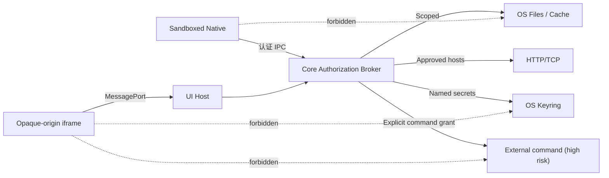
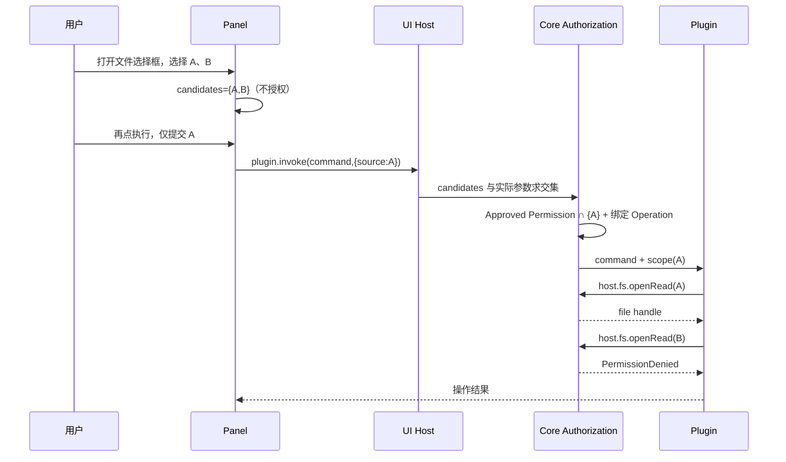
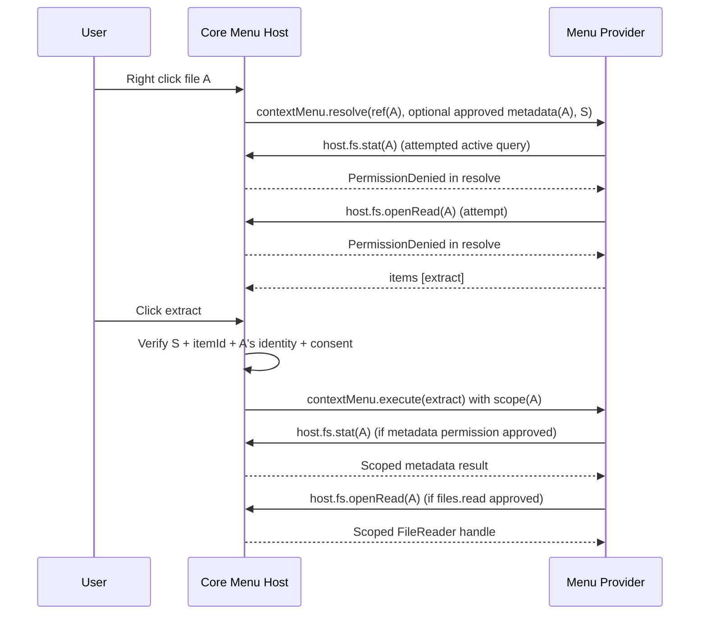
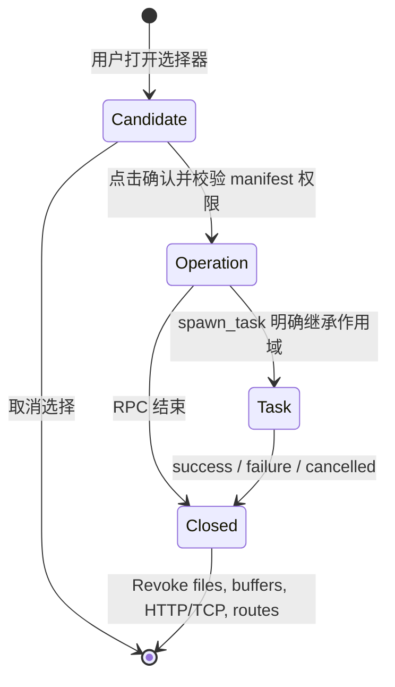
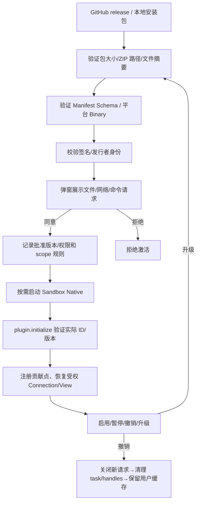

# 06 · 安全边界、授权流程、生命周期与发布规范

## 1. 威胁模型

不信任因素：插件 Native 进程代码、插件 iframe 静态资源、网络 Provider 返回的数据、远端链接及 Redirect、可变 Git 仓库/缓存目录、并发任务、过期的 UI/IPC 消息。Core、被批准的运行程序及 OS Keyring 为可信根，但仍需按最小权限调用。**外部命令的风险级别高于 Core 文件/网络代理**：Core 启动的 `git/gpg/es` 不自动受插件文件 scope 的 OS sandbox 限制。

## 2. 用户选择和实际文件授权的差别

用户打开文件选择框，只产生**候选路径**。UI 端保留候选集合；用户在面板点击“开始/确认”时，UI Bridge 的 `plugin.invoke` 解析当前命令参数真正引用哪些候选路径，对这些路径创建最小 OperationScope。选择一个文件只允许该文件；选择一个目录才允许该目录全部子孙。当前目录不能因为面板打开就自动成为读写授权。用户已选择 `A` 却提交 `B`，必须拒绝。路径不可仅字符串 prefix 匹配：要标准化、使用 OS 受限目录句柄、保护软链接与 TOCTOU。写入的目标路径也应在表单提交时纳入明确 scope。

## 2.1 动态右键菜单的 metadata-only 作用域

右键菜单已改为 **每个注册 Provider 每次右键一次 `contextMenu.resolve`，返回 `items[]`**。查询阶段只向插件暴露本次右键及有效选择对象的不透明资源引用。**仅当分别获批 `files.metadata.enabled` / `folders.metadata.enabled` 时**，Core 才在 `target.metadata` / `selection[].metadata` 主动附带名称、类型、扩展名、大小、时间、只读状态等信息。不暴露文件内容、秘密、宿主全路径树和未选资源。

这种事件 Scope **只能承载 Core 主动推送、且 metadata 权限已获批的所选对象属性**；不能提升为 `files.read`、`folders.read`、`files.write`，更不允许插件在 `resolve` 中调用 `host.fs.stat` 主动探测路径。即便 Manifest 已声明并获批内容权限，Core 也应根据阶段拒绝 `host.fs.*` 的主动资源请求。用户点击 `type:action` 才从可验证的 `menuSessionId + itemId + selection` 派生真正的 OperationScope，并重新检查当前 manifest 权限、文件身份与版本。

安全要求：Core 只信任当前已启用插件的真实进程身份，丢弃过期 Session，绑定响应与原请求 `pluginId/menuSessionId`；动态菜单项不能包含任意 `host.*` 方法或未签名的 HTML/JS。一个文件被重命名、替换或选择变化时，必须重新校验或使旧 Session 失效。查询超时/崩溃时丢弃该插件的菜单，不阻塞 Fiex 的原生菜单。禁止用缓存的菜单 Session 直接执行其他资源上的动作。

## 2.2 文件、文件夹与元数据权限的类型隔离

Manifest 中全部 `permissions.files.*` 和 `permissions.folders.*` 均为含 `enabled` 的对象。分别定义 `metadata/read/create/delete/rename` 和文件特有的 `write`；目录内容的列表访问由 folders.read 处理，目录本身创建、删除、改名由对应操作权限独立控制。文件的 `create` 只创建不存在的文件，`write` 只覆盖现有文件；新建文件不再需要 `folders.create`。删除/改名依据对象实际类型匹配 file 或 folder 权限。

元数据 Push 属于**被动接收本次所选资源的已获批信息**；只有用户触发扩展点且元数据审批通过才发送。插件主动 `host.fs.stat` 则必须具有相同资源类型的 metadata permission 和明确的 OperationScope/TaskScope。Core 的 Connection Provider 内部 `fs.stat` 用于已授权连接的版本协调，是完全不同的协议方向。用户授予 Scope 后还要重新检查真实对象类型、源/目标路径、路径安全边界和资源是否被替换；不能由插件提交 `type:"file"` 就使用更宽松的权限。

## 3. Scope 与句柄生命周期

每个 handle 由 `pluginProcessInstance + operation/task + resourceKind + nonce` 唯一拥有，不可跨任务借用或在进程重启后复用。关闭/取消/权限撤销触发清理；未完成的写入事务回滚、上传 snapshot 保留至 Core 判明安全。后台 TaskScope 不得自动扩大权限；请求级上下文死亡后只允许 Core 明确续命的 TaskScope 访问。Core 自己的 Connection provider、VFS View 调用不走来自 iframe 的任意自报授权。

## 4. 沙箱与网络访问

- Linux 目标组合 Landlock + seccomp + 受限文件句柄、进程隔离；macOS Seatbelt 限制文件/执行/网络；Windows AppContainer 与 Job Object。**不能因为沙箱无法启用就无提示降级到完全信任模式**。
- 官方与第三方使用完全相同的签名、权限和沙箱机制；不要基于安装源绕过授权。
- Plugin 不允许直接使用 ambient `std::fs`、原生 TCP/HTTP、`std::process` 访问用户资源；这些都由 Core Broker 执行。沙箱本身仍以平台能力验证为准，不能用 Rust API 文档代替实机隔离测试。
- HTTP/TCP 统一基于 `network.domains` 用户授权。检验 URL scheme、用户信息、DNS 重绑定/解析 IP、Host 与实际连接目标、重定向链上的域名变化、HTTPS→HTTP 降级、跨源 Authorization/Cookie。SMB 的 `host:port` 与 HTTP 域名是同一网络授权概念，不再出现分别勾选 TCP 与 HTTP。
- 自签名证书例外必须在具体连接上有用户确认与明确标识，Core 不应因为插件设置 `allowInvalidCerts:true` 就无条件信任。

## 5. iframe UI 安全

Plugin UI 必须是离线预编译 HTML/CSS/JS 资产，使用 sandboxed iframe、opaque origin（或明确隔离 origin）、严格 CSP、经一次性 nonce 建立 MessagePort，之后仅用专用 port 通信。禁止给插件 iframe Tauri API、任意 `window.__TAURI__`、Node.js、宿主 DOM、Keyring 或 Native OS 路径。Content-addressed 资产缓存只传静态文件；所有资源加载路径做相对路径/软链检查。UI SDK 是“调用服务”不是“注入宿主 JS”。

`panel.resize` 宿主夹取最大 720×680、最小 320×220，并考虑当前窗口尺寸；`panel.close` 只能关闭自己。消息限并发数、长度、超时、来源/session ID；面板隐藏期间拒绝非必要请求。UI cancel 要传递至 Core，不得只取消 Promise。

## 6. 安装、身份、签名与权限撤销

Release 包必须包含宿主指定平台的 Native entrypoint（UI-only/纯 theme 无需）、manifest、声明过的所有静态资源及其 SHA-256。安装器防 zip-slip、符号链接逃逸和重复路径；签名绑定完整文件摘要列表和 Manifest。插件更新改动权限/域名/命令/工厂标识时重新批准；不要借老版本 consent 自动授予新敏感能力。

## 7. 诊断与隐私

`host.error.report` 只接收小型码/文本，归入按 pluginId 隔离的宿主诊断；错误不能回显密钥、授权令牌、完整用户文件内容或未批准的路径。ActivityCenter 显示运行状态、字节进度、取消、失败原因、冲突选择；不展示 SDK 原始 stdout。密钥获取不应进入 UI Bridge 参数；插件设置中的 Secret 由 Core 表单直接写 Keyring。

## 8. 跨平台对抗性验收

| 场景 | 必须得到的结果 |
|---|---|
| 未选文件、选 A 请求 B、不同 task 复用 handle | PermissionDenied |
| 恶意 `../`、软链接、改名后路径逃逸 | 拒绝或绑定旧安全句柄 |
| Core 网络 broker 遇重定向到内网/未授权主机 | 拒绝且不泄露认证头 |
| 插件启动另一个可执行文件、直接访问磁盘、创建 Socket | 沙箱按平台配置拒绝 |
| UI iframe 调用 Tauri、跨插件 ID、假冒 event/session | UI Host 拒绝 |
| 任意插件发送 `host.task.finish` 关闭其他 task | owner 校验失败 |
| 插件禁用/卸载后仍存在连接标签/缓存 | 只显示 unavailable，不降级本地授权 |
| 外部命令授权界面 | 明确风险警告，独立于文件/网络授权 |
| 断电或 crash 期间写缓存 | 无部分文件发布，保留可信基线 |
