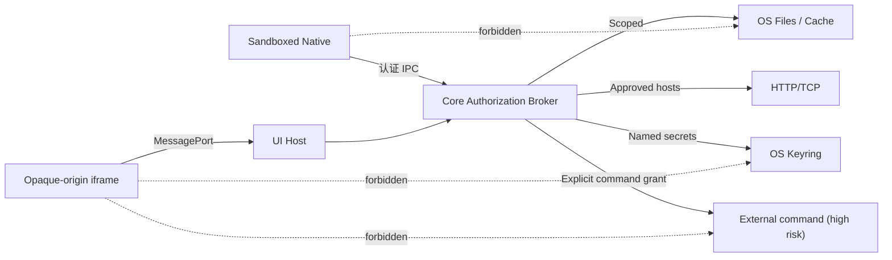
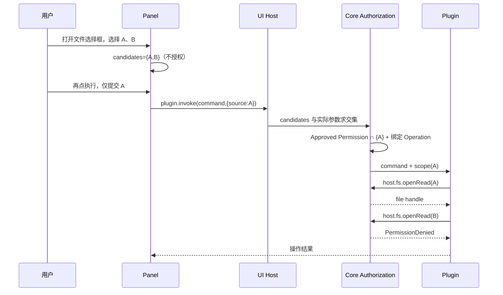
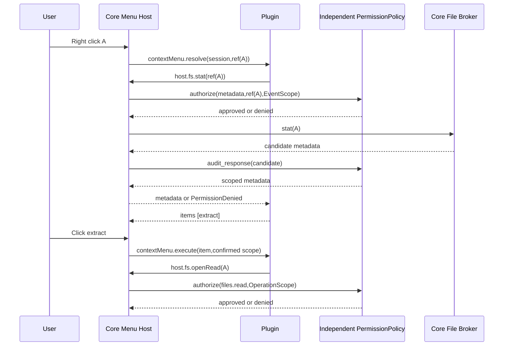
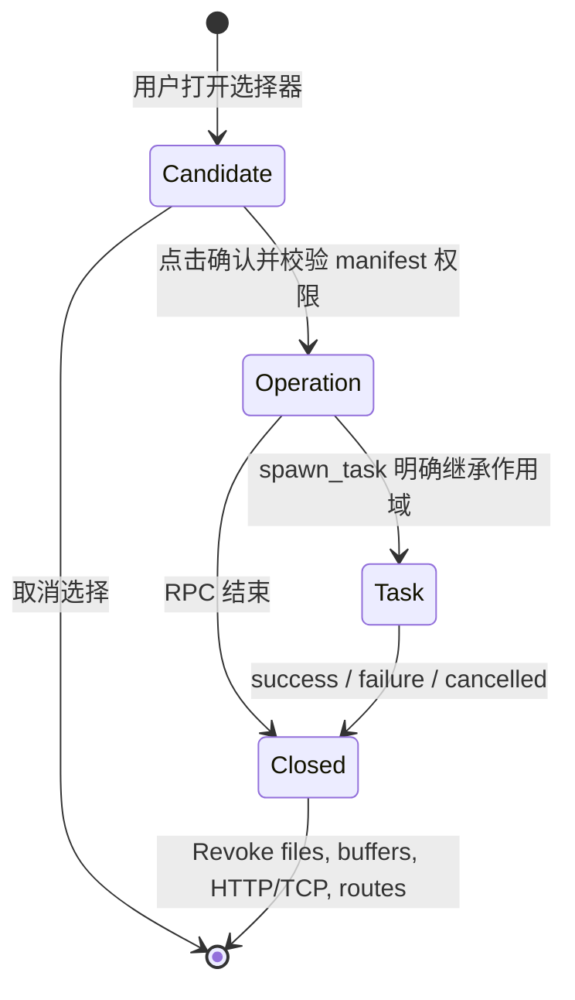
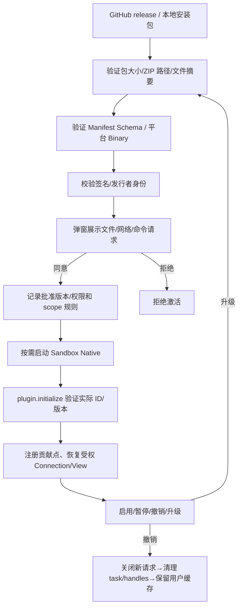

# 06 · 安全边界、授权流程、生命周期与发布规范

## 1. 威胁模型

不信任因素：插件 Native 进程代码、插件 iframe 静态资源、网络 Provider 返回的数据、远端链接及 Redirect、可变 Git 仓库/缓存目录、并发任务、过期的 UI/IPC 消息。Core、被批准的运行程序及 OS Keyring 为可信根，但仍需按最小权限调用。**外部命令的风险级别高于 Core 文件/网络代理**：Core 启动的 `git/gpg/es` 不自动受插件文件 scope 的 OS sandbox 限制。

## 2. 用户选择和实际文件授权的差别

用户打开文件选择框，只产生**候选路径**。UI 端保留候选集合；用户在面板点击“开始/确认”时，UI Bridge 的 `plugin.invoke` 解析当前命令参数真正引用哪些候选路径，对这些路径创建最小 OperationScope。选择一个文件只允许该文件；选择一个目录才允许该目录全部子孙。当前目录不能因为面板打开就自动成为读写授权。用户已选择 `A` 却提交 `B`，必须拒绝。路径不可仅字符串 prefix 匹配：要标准化、使用 OS 受限目录句柄、保护软链接与 TOCTOU。写入的目标路径也应在表单提交时纳入明确 scope。

## 2.1 统一事件与按需资源请求的作用域

用户右键文件 A 后，Core 对注册 ContextMenu 的插件发送 `contextMenu.resolve(session,ref(A))`，**不发送 metadata、文件字节或真实路径**。插件可在菜单事件中申请 `host.fs.stat(ref(A))`，独立 PermissionPolicy 审核唯一的 `permissions.metadata.enabled`、EventScope 和 Core 的最终返回属性。菜单查询可申请 A 的 metadata，但不能读取 A 的字节或扫描其他目录。用户点击有效菜单 action 后，Core 才按用户确认的操作创建必要的读/写 OperationScope。不存在另一条专用 Metadata 推送通道。

Session 被关闭、插件重启、选择更改或资源被替换后应及时失效。权限审核对真实资源身份生效，不因曾获得文件 A 的属性而扩大到文件 B。

## 2.2 文件、文件夹与元数据权限的类型隔离

Manifest 中 `permissions.metadata` 是**文件和文件夹共用**的单个 `{enabled}` 对象；其余 `permissions.files.*` 和 `permissions.folders.*` 才按对象种类区分。分别提供文件的 `read/write/create/delete/rename` 与文件夹的 `read/create/delete/rename`；目录内容的列表访问由 folders.read 处理，目录本身创建、删除、改名由对应操作权限独立控制。文件的 `create` 只创建不存在的文件，`write` 只覆盖现有文件；新建文件不再需要 `folders.create`。删除/改名依据对象实际类型匹配 file 或 folder 权限。

元数据没有自动交付通道：插件只能收到用户触发事件的 opaque ref，再通过 `host.fs.stat` 请求，经统一 `permissions.metadata` 和具体 EventScope/OperationScope/TaskScope 授权。Core 的 VFS Provider 内部 `vfs.stat` 属于 Core 向虚拟树 Provider 读取其自身节点数据，不是插件的宿主本地文件访问授权。用户授予 Scope 后还要重新检查真实对象类型、源/目标路径、路径安全边界和资源是否被替换；不能由插件提交 `type:"file"` 就使用更宽松的权限。

## 2.3 独立权限审核模块是所有 Core→Plugin 数据的强制出口

拆分独立、可信的 `PermissionPolicy`（建议单独 Rust workspace crate），提供 `audit_output(plugin,grants,eventScope,candidate,Schema)` → 已批准载荷 / 拒绝，以及 `authorize_call(plugin,grants,operationScope,request)` → 允许 / 拒绝。Core 业务模块只生成不含资源属性的事件通知和针对资源申请的数据，**不能在渲染组件或插件管理器中分散写特殊授权逻辑，也不得未经审核发送原始 candidate**。审查必须覆盖嵌套 metadata、成员数组、资源引用映射及各类响应，避免 TOCTOU、嵌套字段泄漏与错误 Scope 混淆。独立审核不意味着交给不受信的插件进程，必须位于受信 IPC 发送/执行边界。

`surfaces.decorations:true` 是目录切换事件订阅，独立于数据权限。Core 每次切换目录都调用 Decoration Provider，只传目录与当前可见成员的 opaque ref；插件自行申请 `host.fs.stat`（可批量），独立 PermissionPolicy 审核 `permissions.metadata.enabled`、本次可见集合与响应属性。无该权限时请求拒绝，不能产生按文件属性生成的 Decoration。此前由 Core 自己匹配扩展名的无权限 Declarative Decoration 例外从目标方案移除。

Connection 只在添加连接 +、侧边栏注册 UI 条目。用户点击经 `connection.create/open` 通知插件，插件决定打开什么 Panel/导航到哪个目标。网盘还须另行注册 `providers.vfs[]`，独立 VFS Broker 创建 mount 并处理文件流和写回，不因 Connection 注册扩大文件系统权限。

## 2.4 批量请求和 Metadata 缓存的权限不变量

`host.fs.statBatch` 是多次 `host.fs.stat` 的**受限批处理**，不是一项新的权限，也不扩大 EventScope。独立 PermissionPolicy 必须在读取 Core 缓存前逐 ref 审核插件身份、`permissions.metadata.enabled`、有效 Session 和真实资源所有权；从 Core 缓存或文件系统取得候选属性后，还必须按同一 ref/Scope 审核最终响应。混合有权限与无权限的列表应逐项返回成功或拒绝，不得泄露拒绝项名称、大小、时间、真实宿主路径；不得通过错误处理、计数、补全或缓存命中状态形成旁路。强制请求项数、载荷字节数、每插件并发和 deadline 限额。

Core 可复用 Explorer、VFS 导航已经获得的有效 Metadata，但缓存的**数据不包含授权或文件访问凭证**，必须基于 mount/稳定节点身份、版本/快照代次和对象种类校验；节点改名、删除、写回、观察到的磁盘/VFS revision 变化、Session 撤销及不能可靠验证的新鲜度均不得继续提供旧属性。远端缓存过期或离线只允许显式标记不确定/返回 unavailable，不能伪装成实时结果；缓存数据不得替代写回、删除及冲突检测前的真正版本复核。

Core 并发运行多个 `contextMenu.resolve` 时，插件可能在回调中向 Core 再发 `host.fs.statBatch`。IPC 收发循环、授权处理、Core FileBroker、插件 SDK 均须异步可重入，**不得持锁跨 await、阻塞接收循环或使用非重入单线程 RPC 等待链**。过期的 MenuSession、取消的任务、被撤销授权不得在缓存命中后继续返回 metadata；响应只能匹配发起调用的 pluginProcessInstance + requestId + sessionId。

## 3. Scope 与句柄生命周期

每个 handle 由 `pluginProcessInstance + operation/task + resourceKind + nonce` 唯一拥有，不可跨任务借用或在进程重启后复用。关闭/取消/权限撤销触发清理；未完成的写入事务回滚、上传 snapshot 保留至 Core 判明安全。后台 TaskScope 不得自动扩大权限；请求级上下文死亡后只允许 Core 明确续命的 TaskScope 访问。Core 自己的 Connection provider、VFS View 调用不走来自 iframe 的任意自报授权。

## 4. 沙箱与网络访问

- Linux 目标组合 Landlock + seccomp + 受限文件句柄、进程隔离；macOS Seatbelt 限制文件/执行/网络；Windows AppContainer 与 Job Object。**不能因为沙箱无法启用就无提示降级到完全信任模式**。
- 官方与第三方使用完全相同的签名、权限和沙箱机制；不要基于安装源绕过授权。
- Plugin 不允许直接使用 ambient `std::fs`、原生 TCP/HTTP、`std::process` 访问用户资源；这些都由 Core Broker 执行。沙箱本身仍以平台能力验证为准，不能用 Rust API 文档代替实机隔离测试。
- HTTP/TCP 统一基于 `network.domains` 用户授权。检验 URL scheme、用户信息、DNS 重绑定/解析 IP、Host 与实际连接目标、重定向链上的域名变化、HTTPS→HTTP 降级、跨源 Authorization/Cookie。SMB 的 `host:port` 与 HTTP 域名是同一网络授权概念，不再出现分别勾选 TCP 与 HTTP。
- 自签名证书例外必须在具体连接上有用户确认与明确标识，Core 不应因为插件设置 `allowInvalidCerts:true` 就无条件信任。

## 5. iframe UI 安全

Plugin UI 默认使用安装时校验的包内 HTML/CSS/JS 资产；也允许在本次有效交互中传入有界动态 HTML（仍受同样的沙箱/CSP 约束），使用 sandboxed iframe、opaque origin（或明确隔离 origin）、严格 CSP、经一次性 nonce 建立 MessagePort，之后仅用专用 port 通信。禁止给插件 iframe Tauri API、任意 `window.__TAURI__`、Node.js、宿主 DOM、Keyring 或 Native OS 路径。Content-addressed 资产缓存只传受校验的包内静态文件，动态 HTML 不应被当作不受限远程脚本；所有资源加载路径做相对路径/软链检查。UI SDK 是“调用服务”不是“注入宿主 JS”。

`panel.resize` 宿主夹取最大 720×680、最小 320×220，并考虑当前窗口尺寸；`panel.close` 只能关闭自己。消息限并发数、长度、超时、来源/session ID；面板隐藏期间拒绝非必要请求。UI cancel 要传递至 Core，不得只取消 Promise。

## 5.1 通用运行时 Panel：创建资格、来源与隔离

Panel 不是 Manifest 的一个可预注册贡献点，不设单独的 `panel` permission。`surfaces.toolbar/contextMenus/preview/info/search/connections/settings` 等 UI Surface 在**用户明确触发的操作**中可调用统一的 `host.ui.open`，但不会因为注册某个 Surface 就获得后台弹窗权限。

Core 签发只用于当前操作、插件进程身份和有效时限的 `interactionId`；不能从 `contextMenu.resolve`、`info.resolve`、`search.query`、目录 Decoration 刷新、后台 Hook/Sync 直接打开 Panel。用户点击实际菜单 action、工具栏按钮、搜索结果交互、Info 显式操作、管理连接动作或打开预览等才能派生有效交互；Core 校验后返回自己的 `panelSessionId`。关闭/切换/撤权时会话失效，过期与交叉插件请求拒绝。

运行时 Panel 允许两个受控视图来源：本插件包内已校验的 UI HTML 路径（路径规范化，不能逃离包根、不能指向其他插件文件），或受大小限制的内存 HTML 文档（由调用插件在 IPC 中交付，不能从任意远程 URL/宿主路径直接加载）；对两者强制 opaque-origin `sandbox=allow-scripts` 且不开放 `allow-same-origin`、严格 CSP、MessagePort UI Bridge 白名单、消息身份/长度/并发/会话检查。**运行时 HTML 不等于允许宿主 DOM/Node/Tauri API**。Panel 本身不赋予额外 `files.*`、`folders.*`、网络或进程权限。详见 [09-RUNTIME-UI-PANELS.md](09-RUNTIME-UI-PANELS.md)。

## 6. 安装、身份、签名与权限撤销

Release 包必须包含宿主指定平台的 Native entrypoint（UI-only/纯 theme 无需）、manifest、声明过的所有静态资源及其 SHA-256。安装器防 zip-slip、符号链接逃逸和重复路径；签名绑定完整文件摘要列表和 Manifest。插件更新改动权限/域名/命令/工厂标识时重新批准；不要借老版本 consent 自动授予新敏感能力。

## 7. 诊断与隐私

`host.error.report` 只接收小型码/文本，归入按 pluginId 隔离的宿主诊断；错误不能回显密钥、授权令牌、完整用户文件内容或未批准的路径。ActivityCenter 显示运行状态、字节进度、取消、失败原因、冲突选择；不展示 SDK 原始 stdout。密钥获取不应进入 UI Bridge 参数；插件设置中的 Secret 由 Core 表单直接写 Keyring。

## 8. 跨平台对抗性验收

| 场景 | 必须得到的结果 |
|---|---|
| 未选文件、选 A 请求 B、不同 task 复用 handle | PermissionDenied |
| 恶意 `../`、软链接、改名后路径逃逸 | 拒绝或绑定旧安全句柄 |
| Core 网络 broker 遇重定向到内网/未授权主机 | 拒绝且不泄露认证头 |
| 插件启动另一个可执行文件、直接访问磁盘、创建 Socket | 沙箱按平台配置拒绝 |
| UI iframe 调用 Tauri、跨插件 ID、假冒 event/session | UI Host 拒绝 |
| 任意插件发送 `host.task.finish` 关闭其他 task | owner 校验失败 |
| 插件禁用/卸载后仍存在连接标签/缓存 | 只显示 unavailable，不降级本地授权 |
| 外部命令授权界面 | 明确风险警告，独立于文件/网络授权 |
| 断电或 crash 期间写缓存 | 无部分文件发布，保留可信基线 |
