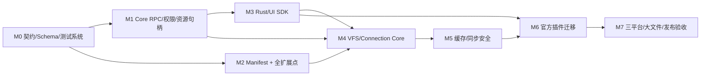
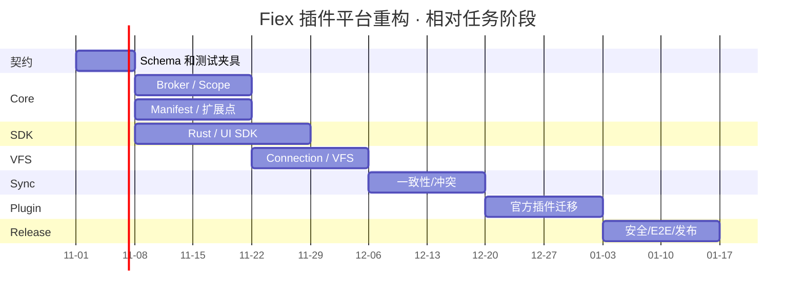

# 07 · 实施计划（Coding Agent 的执行任务书）

> **本文件是计划，不是实现现状或历史报告。** Core、SDK、Official Plugins 三仓共同执行，每阶段有完成条件；在没有满足门禁之前不得宣布阶段完成或合并。尽量用目标设计替代现有实现，不维护多份 legacy 协议；改文件时同步修改所有官方插件与测试。最终提交必须 fmt、clippy、单元/集成测试，CI 三平台验证。

## 1. 交付范围与依赖

## 2. M0 — 协议与测试基线（先完成）

| 编号 | 仓库 | 任务 | 验收 |
|---|---|---|---|
| M0.1 | SDK + Core | 建立 `schemas/manifest.schema.json`、`schemas/native-ipc/*.json`、`schemas/ui-bridge/*.json` | 与 02/03/04 所有表 1:1 可追踪 |
| M0.2 | SDK | 生成 Rust Type、TypeScript Type、方法清单及 docs 表格，不允许手工漂移 | 每个 IPC method 都能找到 schema/测试 |
| M0.3 | Core | 建立 mock Provider / mock Native SDK / mock UI Bridge 驱动 | 能证明权限拒绝与并发请求 ID 对应 |
| M0.4 | 三仓 | 约定 Manifest v2、Native 3.0、UI Bridge 2.0 目标语义 | 同一测试套件跨仓运行，失配明确拒绝 |
| M0.5 | Core | 在 CI 中增加文档/API 完整性守卫和旧字段扫描 | 增删方法而未更新契约时 CI 红灯 |

## 3. M1 — Broker、授权与进程资源

| 编号 | 仓库 | 任务 | 验收 |
|---|---|---|---|
| M1.1 | Core | 将 `Running::rpc/host_method` 拆分为 dispatcher、auth、fs/net/buffer/secret/task broker | 单模块职责清晰，无插件 ID 特判 |
| M1.2 | Core | 操作授权只来自用户确认的资源，精确文件与目录 grant；移除“无选择则自动把当前目录授权给插件” | 选择 A 无法读 B；目录选择允许递归 |
| M1.3 | Core | 句柄绑定 processInstance/operation/task，支持撤销和显式 TaskScope 继承 | 旧 Operation 不能调用；新 Task 延续合法 |
| M1.4 | Core | 网络代理逐跳域名、目标 IP、TLS 异常授权及凭据安全 | 未批准 host/重定向拒绝 |
| M1.5 | Core | 修正 Windows `set_readonly(false)` Clippy 等跨平台硬阻断问题 | Linux/macOS/Windows fmt+clippy 通过 |
| M1.6 | Core | `host.exec` 与 `host.process.run` 归一为一种安全接口；消除旧低层重复变体 | 独立命令授权/安全提示/测试 |

## 4. M2 — Manifest 与宿主扩展点

| 编号 | 仓库 | 任务 | 验收 |
|---|---|---|---|
| M2.1 | Core | 基于 JSON Schema 验证 Manifest 全部键、权限、字段类型、ID、贡献点相互依赖 | 拒绝 scheme/capabilities/sync/writeMode/conflictControl |
| M2.2 | Core | 删除 `when/children` 与 Manifest 中的静态 context menu item；`contributions.contextMenus:true` 注册 Provider，新增 `panels[]` 静态资源目录；实现一次右键每插件一次并发 `contextMenu.resolve` | 每次只传本次选中元数据；空结果/超时不阻塞 UI；最大 80 项/4 层/无环 |
| M2.3 | Core | 完成 search/preview/info/hooks/decorations/themes/settings 的统一生命周期 | 每类用非官方 fixture 验证，不限官方插件 |
| M2.4 | Core | 签名校验覆盖 manifest 与 assets，升级触发权限变更检查 | 篡改文件安装失败；新权限重新同意 |
| M2.5 | SDK | 生成 Manifest Type/Schema/示例包校验工具 | 本地一条命令能 lint 所有官方 manifest |

## 4.1 动态右键菜单的额外验收任务

| 编号 | 仓库 | 任务 | 验收 |
|---|---|---|---|
| M2.6 | Core | 新建 MenuBroker：每次右键产生不可复用 MenuSession，向声明 `contextMenus:true` 的 Native 插件并发 `contextMenu.resolve` | 恰好调用一次/插件/右键；不再读取 `when`、静态 `children` |
| M2.7 | Core | 校验响应扁平 `items[]` 的 `id/type/parentId` 与 `panelId`；无环、最大 4 层/80 项；点击时仅运行 `contextMenu.execute` | 其他插件 ID 注入、任意 host 命令、禁用或已过期 item 全部拒绝 |
| M2.8 | Core | 增加菜单 Query metadata-only 权限与单击后 OperationScope；处理慢 Provider 的截止时间及菜单顺序稳定 | query 调用 `host.fs.openRead` 被拒；异步结果不污染下次菜单；内置菜单不被阻塞 |
| M2.9 | Official Plugins | Archive/Git/GPG 等全部从静态 `when/children` 迁移到返回具体菜单项 | 不识别扩展名返回空数组；子菜单通过 `parentId` 表达；不保留旧分支 |

## 5. M3 — SDK 与 UI Bridge 完整性

| 编号 | 仓库 | 任务 | 验收 |
|---|---|---|---|
| M3.1 | SDK | 03 中每个推荐 `host.*` 方法都有正确 SDK 高层封装；增加 `sdk::context_menu::{ResolveRequest,ExecuteRequest,MenuItem,MenuResponse}` 类型与协议代码生成 | API 自动清单无缺口，Menu 结构与 Core 完全一致 |
| M3.2 | SDK | 文件 Read/Write/Seek、HTTP body_reader、TCP、buffer 自动策略和超大文件边界 | `>5 GiB` 稀疏文件、短读/短写/崩溃通过 |
| M3.3 | SDK | UI Bridge 按 04 全量目标实现，`vfs.*`、plugin.task、clipboard、navigation 等无悬空 public 调用 | 逐 method 运行 contract test |
| M3.4 | Core | UI Bridge host dispatcher 与 UI SDK 声明完全吻合，支持真实协作 cancel | 客户端每项调用得到成功或结构化拒绝 |
| M3.5 | SDK | `RpcError` 标准分类、超时一致、取消/任务进度与自动资源清理 | 取消后无句柄/TaskScope 泄漏 |

## 6. M4 — VFS + Connection 全部统一

| 编号 | 仓库 | 任务 | 验收 |
|---|---|---|---|
| M4.1 | Core | MountRegistry 为 Connection/显式 VFS View 创建随机 ID 与相同 URI parser | 同一 provider 多账户不互相泄露 |
| M4.2 | Core | Core Path-Entry ↔ Provider NodeId Index，分页、snapshot 和目录身份策略 | 重名、改名、中文路径、千页目录通过 |
| M4.3 | Core/SDK | 为显式 VFS 大文件开放受限只读流导出（替换 1 MiB 限制的完整导出） | Git 历史大二进制可预览/导出，不加载整个仓库 |
| M4.4 | Core | View 引用、持久恢复、安全复验、失效标识 | 禁用/卸载后无权限回退到本地 |
| M4.5 | Core | Connection Secret/Registry 与网络目标授权事务化 | 连接保存失败不得半持久/半授权 |

## 7. M5 — 核心离线同步安全

| 编号 | 仓库 | 任务 | 验收 |
|---|---|---|---|
| M5.1 | Core | 上传前 immutable snapshot + 精确文件 grant，统一 `fs.writeFile` | Provider 不能浏览 snapshot 目录 |
| M5.2 | Core | 下载用初始版本锁/结束重验、逐块校验、atomic commit | 传输中远端改变不产生混合文件 |
| M5.3 | Core | 远端 revision 变化/缓存清理前必须真实 hash | 同大小同 mtime 本地更改不丢失 |
| M5.4 | Core | 双向冲突状态机、备份两份内容、用户主动 resolve | 没有 silent overwrite |
| M5.5 | Core | Pin/Unsync/Offline 排除继承、持久 metadata、crash recovery | 离线刷新、断电、中断恢复正确 |
| M5.6 | Core | blocking I/O + per-connection serialization，worker 不长期阻塞 | 压力场景仍可响应 UI 与取消 |

## 8. M6 — 官方 Provider 和全部示例迁移

| 编号 | 仓库 | 任务 | 验收 |
|---|---|---|---|
| M6.1 | Official Plugins | WebDAV 以强 ETag + If-Match 实现原子条件上传；不满足则拒绝 | stale version 不覆盖 |
| M6.2 | Official Plugins | Google Drive 采用版本固定读取和 resumable Range 正确恢复 | Partial 308、断连、跨版本下载通过 |
| M6.3 | Official Plugins | OpenList Token 缓存按连接/账号隔离；上传弱 CAS 告警、保守自动同步 | A 连接 Token 不能发给 B |
| M6.4 | Official Plugins | SMB staging 原子 rename + 提交前复核，并明确竞态保证上限 | 并发替换模拟测试 |
| M6.5 | Official Plugins | Git `vfs`、Archive/GPG **动态右键 Provider**、Everything、数据/Office Preview、主题、Hook、Info/Decorations 全量改到 Manifest v2；删除菜单静态配置 | 每个贡献点至少一条 UI+Core+插件集成用例，Archive ZIP/GPG 签名由动态 resolve → execute 验证 |
| M6.6 | 三仓 | 清理旧 API、旧 schema、无用 compat 与重复功能 | 搜索不到实际可达的 legacy 分支 |

## 9. M7 — 跨平台与交付

| 编号 | 仓库 | 任务 | 验收 |
|---|---|---|---|
| M7.1 | Core | Windows/macOS/Linux Sandboxes 和系统文件 API 实机 CI | 三平台均 fail closed |
| M7.2 | 三仓 | 本地 `cargo fmt`, `cargo clippy -D warnings`, test，前端 prettier/typecheck | 全部通过 |
| M7.3 | 三仓 | 大文件/多连接/操作权限/断网/伪造请求/权限撤销/卸载的 E2E | 0 未解释失败 |
| M7.4 | Official Plugins | signed Release + 文件摘要 + 编译平台矩阵 + 实际安装/卸载 | 安装包完整可用 |
| M7.5 | Core | Windows 路径分隔与权限、Linux 大目录、macOS 文件对话框/E2E | UI 与原生一体化正常 |
| M7.6 | 三仓 | GitHub 提交 PR，提供测试日志/风险限制/配置说明；CI 通过后合并 | CI 绿 + 评审通过 |

## 10. 里程碑建议顺序图（非工期承诺）

甘特日期只用于 Mermaid 展示任务相对顺序，不代表已经排期、承诺交付日期或存在后台执行任务。真正任务依赖以 M0–M7 表和上方 Flowchart 为准。

## 11. PR 组织与减 Token 策略

每个逻辑子系统一组 PR，始终匹配 SDK submodule SHA、Core 目标版本及官方插件编译矩阵；更新公共 IPC 时必须在同一逻辑提交组内同时改 schema、SDK wrapper、Core dispatcher、Official Plugins 和 contract fixture。优先使用窄范围定位/按路径读取、`cargo check -q`、`cargo fmt --check`、单测按模块执行，失败时才看详细日志；该策略**不得跳过必须的测试、静态扫描和跨平台 CI**。PR 描述需附“新增/删除/修改的 IPC 方法”“Manifest 变化”“权限变化”“数据迁移风险”“验收命令和结果”，不允许“CI 在跑”等无具体交付的状态描述当作完成证明。

## 12. 最终完成定义（DoD）

- [ ] **所有 API 已列出**：03 的每个 method 有 Schema、Core 实现或显式拒绝逻辑、SDK 对应或标记内部低层、成功/失败测试；04 的 UI API 每个 getter 均有 Host Bridge 实际分发。
- [ ] **所有贡献点有效**：02 的每类均有 Manifest fixture、渲染入口、错误降级与撤权测试；右键全部使用动态 `contextMenu.resolve/execute`，不再接受 `when/children`。
- [ ] **Core 纯通用**：无官方 Provider ID 特判，无重复 VFS scheme，无旧 capabilities/sync/writeMode/conflictControl。
- [ ] **同步不丢文件**：本地同大小同 mtime 改动、远端传输中改动、CAS 失败均保留双方完整副本并提示。
- [ ] **跨平台隔离**：非授权读写、网络、命令、任务和 UI Tauri 越权均有自动负面测试。
- [ ] **大文件与性能**：不按整个文件大小分配内存，不将大文件复制入 JSON，UI 操作不被后台网络同步阻塞。
- [ ] **安装与升级**：从签名 Release 安装、重新授予权限、禁用和卸载/重装一致；旧文档与 API 无幽灵引用。
- [ ] **三仓 CI 全绿**：并提供一份三平台完整日志链接、真实 Provider 集成与 mock 失败用例报告。

## 13. 禁止违反的七项决策

1. **不得为每种连接在 Core 写专门同步流程。**
2. **不得将 `capabilities` 重新加入 Manifest。**
3. **不得由插件自行分配 VFS scheme 或 mountId。**
4. **不得在选文件时立刻赋权，必须以最终操作确认决定 Scope。**
5. **不得仅凭 mtime/size 证明允许覆盖本地缓存。**
6. **不得把弱比较后上传宣传成强 CAS，也不得默认信任插件自身设置的 TLS 例外。**
7. **不得在 Manifest 保留 `contextMenus.when/children` 或静态右键子项；所有右键项必须由 IPC 动态返回，并将查询与执行授权隔离。**
