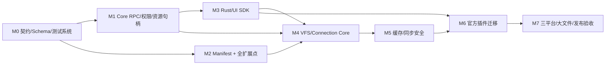
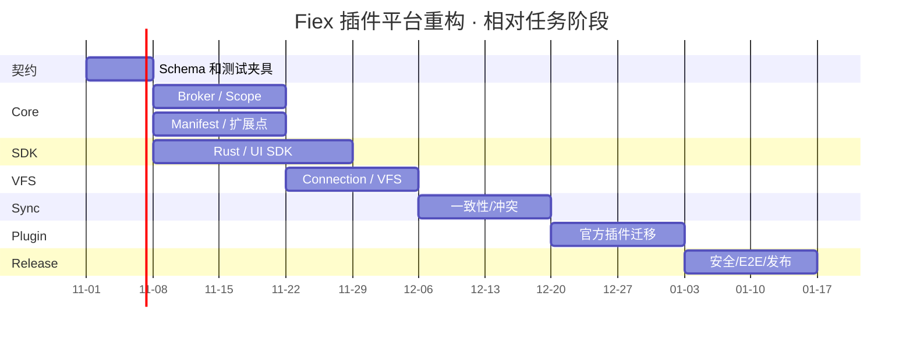

# 07 · 实施计划（Coding Agent 的执行任务书）

> **本文件是计划，不是实现现状或历史报告。** Core、SDK、Official Plugins 三仓共同执行，每阶段有完成条件；在没有满足门禁之前不得宣布阶段完成或合并。尽量用目标设计替代现有实现，不维护多份 legacy 协议；改文件时同步修改所有官方插件与测试。最终提交必须 fmt、clippy、单元/集成测试，CI 三平台验证。

## 1. 交付范围与依赖

## 2. M0 — 协议与测试基线（先完成）

| 编号 | 仓库 | 任务 | 验收 |
|---|---|---|---|
| M0.1 | SDK + Core | 建立 `schemas/manifest.schema.json`、`schemas/native-ipc/*.json`、`schemas/ui-bridge/*.json` | 与 02/03/04 所有表 1:1 可追踪 |
| M0.2 | SDK | 生成 Rust Type、TypeScript Type、方法清单及 docs 表格，不允许手工漂移 | 每个 IPC method 都能找到 schema/测试 |
| M0.3 | Core | 建立 mock Provider / mock Native SDK / mock UI Bridge 驱动 | 能证明权限拒绝与并发请求 ID 对应 |
| M0.4 | 三仓 | 约定 Manifest v2、Native 3.0、UI Bridge 2.0 目标语义 | 同一测试套件跨仓运行，失配明确拒绝 |
| M0.5 | Core | 在 CI 中增加文档/API 完整性守卫和旧字段扫描 | 增删方法而未更新契约时 CI 红灯 |

## 3. M1 — Broker、授权与进程资源

| 编号 | 仓库 | 任务 | 验收 |
|---|---|---|---|
| M1.1 | Core | 将 `Running::rpc/host_method` 拆分为 dispatcher、auth、fs/net/buffer/secret/task broker | 单模块职责清晰，无插件 ID 特判 |
| M1.2 | Core | 操作授权只来自确认的资源；File/Folder 子权限全部改成 `{enabled}` 对象，按真实对象类型区分 read/create/delete/rename 与 files.write；metadata 作为单项 `permissions.metadata.enabled` 文件/目录共用 | 选择 A 无法读 B；`files.create` 不修改已有文件；`folders.create` 不等于新建文件 |
| M1.3 | Core | 句柄绑定 processInstance/operation/task，支持撤销和显式 TaskScope 继承 | 旧 Operation 不能调用；新 Task 延续合法 |
| M1.4 | Core | 网络代理逐跳域名、目标 IP、TLS 异常授权及凭据安全 | 未批准 host/重定向拒绝 |
| M1.5 | Core | 修正 Windows `set_readonly(false)` Clippy 等跨平台硬阻断问题 | Linux/macOS/Windows fmt+clippy 通过 |
| M1.6 | Core | `host.exec` 与 `host.process.run` 归一为一种安全接口；消除旧低层重复变体 | 独立命令授权/安全提示/测试 |

## 4. M2 — Manifest 与宿主扩展点

| 编号 | 仓库 | 任务 | 验收 |
|---|---|---|---|
| M2.1 | Core | 将 Manifest 旧 `contributions` 拆为 `surfaces`（Connection/Toolbar/ContextMenus/Search/Preview/Info/Decorations/Settings/Themes）、`providers`（显式 VFS/Hooks）、`surfaces.themes[]`；PanelHost 为 Core 通用运行时 UI 服务，验证文件/目录 `{enabled}` | 旧 contributions/布尔权限、scheme/capabilities/sync/writeMode/conflictControl 全部拒绝 |
| M2.2 | Core | 删除 `when/children` 与 Manifest 中的静态 context menu item；`surfaces.contextMenus:true` 注册 Provider，删除静态 `panels[]` 并接入运行时 PanelHost；实现一次右键每插件一次并发 `contextMenu.resolve` | 每次只传本次选中元数据；空结果/超时不阻塞 UI；最大 80 项/4 层/无环 |
| M2.3 | Core | 完成 search/preview/info/hooks/订阅式 decorations/themes/settings 生命周期；Preview/Info 内置与外部共用 ProviderRegistry / 请求响应，删除 `search.scope`，只允许指定目录 `root` 搜索 | 统一 Preview/Info fixtures；Everything 查询和结果限定 root；无全局搜索入口 |
| M2.4 | Core | 签名校验覆盖 manifest 与 assets，升级触发权限变更检查 | 篡改文件安装失败；新权限重新同意 |
| M2.5 | SDK | 生成 Manifest Type/Schema/示例包校验工具 | 本地一条命令能 lint 所有官方 manifest |

## 4.0 运行时 Panel UI（所有 UI Surface 共用）

| 编号 | 仓库 | 任务 | 验收 |
|---|---|---|---|
| M2.UI1 | Core | 删除 Manifest 所有 Panel 预声明与 panelId，定义 `host.ui.open(PanelSpec)`，允许按本次 IPC 指定包内页面或限额 HTML | 各 UI Surface 不需要 Panel Contribution 就可打开 UI |
| M2.UI2 | Core/SDK | 使用 Core 签发的 InteractionSession 关联 Toolbar、ContextMenu.execute、Preview.open、Info 显式操作、Search 结果操作、Connection 用户操作 | menu.resolve / info.resolve / search.query / decorations / background 请求打开面板被拒 |
| M2.UI3 | Core | 统一 PanelHost：沙箱 iframe、CSP、UI Bridge、尺寸、焦点、关闭回收、撤权失效 | 无任意磁盘 HTML/远程 URL、无 UI/Tauri 提权或跨插件 UI 注入 |
| M2.UI4 | 官方插件 | 删除 panelId 与静态 panels[]，从真实点击处理器发送动态 PanelSpec | 所有官方 UI 实际能用，同一插件一次操作可选不同 View |

## 4.0A PermissionPolicy 与 Decoration / Connection 入口（P0）

| 编号 | 仓库 | 任务 | 验收 |
|---|---|---|---|
| M2.AUTH1 | 独立模块/Core 适配 | 在 Core 业务模块之外建立可单测 PermissionPolicy（建议 workspace crate），统一 `audit_output` 与 `authorize_call` | 未经 audit_output 的候选 Core 资源消息禁止交给插件；嵌套字段不泄露 |
| M2.AUTH2 | Core/IPC | `permissions.metadata.enabled` **只有一项**，文件/目录共用，废止旧的双 metadata 权限；PermissionPolicy 审核文件请求和 Core 响应字段 | 一项 metadata 权限控制文件、目录和可见列表成员 stat；未授权请求报 PermissionDenied，事件不变 |
| M2.DEC1 | Core/Plugin | `surfaces.decorations:true` 订阅**每次切换目录**；`decorations.resolve` 通知只含目录和当前可见成员 opaque ref；插件统一走 `host.fs.stat` 申请属性 | metadata 未批准仍收到事件，申请成员属性时返回 PermissionDenied；批准后申请可见成员 stat 才有逐文件 Decoration |
| M2.CONN1 | Core/Plugin | Connection 的 + 和侧边栏点击调用 `connection.create/open`；插件运行时返回目标，Core 验证 Navigator；不自动挂载 | 连接项可跳登录/设置 Panel；网盘通过独立 VFS Provider 导航 |
| M2.VFS1 | Core/SDK/Plugins | 网盘同时注册 `surfaces.connections[]` 与 `providers.vfs[]`；VFS 支持云盘读写和 Git 只读，mount 只由受控请求创建 | 只有 Connection 不能列文件；只有 VFS 能提供独立历史树；同步场景仍可写回 |

## 4.1 元数据、搜索及动态右键的额外验收任务

| 编号 | 仓库 | 任务 | 验收 |
|---|---|---|---|
| M2.10 | 独立 PermissionPolicy/Core/SDK | 新增**一个**统一 `permissions.metadata.enabled` 权限（文件与目录共用），统一事件通知 → 插件 `host.fs.stat` 请求 → 审核后返回资源，不设置第二条 Metadata 自动发送通道 | 事件不主动带 metadata；metadata 申请需 grant + 当前 EventScope；未批准 stat 拒绝；右键 resolve 可申请所选对象属性但不能读文件字节 |
| M2.11 | Core/Official Plugins | 删除 `search.scope`；限定本次 root，Everything 使用索引时加路径过滤，Core 复核结果 | 路径前缀碰撞、符号链接、`..` 和全局结果泄漏被拦截 |
| M2.12 | Core/SDK | 文件与目录的 create/delete/rename 分别检查 `{enabled}`，修改 SDK/API | 删除文件不靠 folders.delete；新建文件不靠 folders.create；rename 校验双路径 |

| 编号 | 仓库 | 任务 | 验收 |
|---|---|---|---|
| M2.6 | Core | 新建 MenuBroker：每次右键产生不可复用 MenuSession，向声明 `contextMenus:true` 的 Native 插件并发 `contextMenu.resolve` | 恰好调用一次/插件/右键；不再读取 `when`、静态 `children` |
| M2.7 | Core | 校验响应扁平 `items[]` 的 `id/type/parentId`；无环、最大 4 层/80 项；点击 action 后可以调用 `host.ui.open`，但 resolve 不允许直接弹窗 | 其他插件 ID 注入、任意 host 命令、禁用或已过期 item 全部拒绝 |
| M2.8 | Core | 独立 `permissions.metadata.enabled`：菜单事件只通知 opaque refs；允许插件在 resolve 中调用 `host.fs.stat` 申请本次选择对象 metadata，经独立 PermissionPolicy 双向审核；点击有效菜单 action 后才能获得读写执行 Scope | 未授权 stat 返回 PermissionDenied；查询对所选对象 metadata 可申请，对文件内容 openRead 拒绝；原生菜单不阻塞 |
| M2.9 | Official Plugins | Archive/Git/GPG 等全部从静态 `when/children` 迁移到返回具体菜单项 | 不识别扩展名返回空数组；子菜单通过 `parentId` 表达；不保留旧分支 |

## 5. M3 — SDK 与 UI Bridge 完整性

| 编号 | 仓库 | 任务 | 验收 |
|---|---|---|---|
| M3.1 | SDK | 03 中每个推荐 `host.*` 方法都有正确 SDK 高层封装；增加 `sdk::context_menu::{ResolveRequest,ExecuteRequest,MenuItem,MenuResponse}` 类型与协议代码生成 | API 自动清单无缺口，Menu 结构与 Core 完全一致 |
| M3.2 | SDK | 文件 Read/Write/Seek、HTTP body_reader、TCP、buffer 自动策略和超大文件边界 | `>5 GiB` 稀疏文件、短读/短写/崩溃通过 |
| M3.3 | SDK | UI Bridge 按 04 全量目标实现，`vfs.*`、plugin.task、clipboard、navigation 等无悬空 public 调用 | 逐 method 运行 contract test |
| M3.4 | Core | UI Bridge host dispatcher 与 UI SDK 声明完全吻合，支持真实协作 cancel | 客户端每项调用得到成功或结构化拒绝 |
| M3.5 | SDK | `RpcError` 标准分类、超时一致、取消/任务进度与自动资源清理 | 取消后无句柄/TaskScope 泄漏 |

## 5.1 M3-P · Preview 与 Info Provider 解耦里程碑（P0）

| 编号 | 仓库 | 待实施任务 | 完成条件 |
|---|---|---|---|
| M3.P1 | Core | PreviewRegistry 统一内置高亮文本、图片、音频、视频、PDF、fallback 与外部 Plugin Preview 的描述符、过滤/排序、优先级、失败回退 | 内置/第三方预览可在同一选择器排序；fallback 稳定 |
| M3.P2 | Core | 真正拆分 Preview.tsx 中 Text/Image/Audio/Video/PDF/Fallback 各独立组件和测试，PreviewHost 只处理容器/导航/会话 | 各独立模块可单测、可替换；Preview.tsx 无文件类型渲染分支 |
| M3.P3 | Core | 将 info.rs 物理拆成 info/mod.rs（只编排）与 metadata.rs、audio.rs、video.rs、types.rs；每个来源独立注册并用统一 InfoResponse | 三个来源分别独立超时/失败隔离，插件不触发 Core 特判 |
| M3.P4 | Core | 将 `FileInfoDialog.tsx` 的 `basicRows` 与特定插件 ID 判断移除；基础属性作为 `core.info.metadata` | Dialog 只根据 sections 渲染；同样布局无特例 |
| M3.P5 | Core | 将 `src-tauri/src/plugins/info.rs` 内置解析器拆成可注册 Adapter，消除 `media_sections + plugin_sections` 双路径 | Core/Plugin Info 共享执行时序、异常隔离、序列化 Schema |
| M3.P6 | Core/IPC | Core 定义统一 Preview/Info 业务对象类型；插件通过通用 IPC 传 JSON，Core 反序列化为相同类型；SDK 不强制导出 Preview/Info 专属类型 | Core 内置构造与插件 IPC 反序列化得到同一 Rust 类型；无旧 `{path,rows}` 回包 |
| M3.P7 | Core | Preview/Info 统一限额只读流、资源 URL、范围读取、取消/关闭句柄回收，覆盖本地/可读写云盘 VFS/只读 Git VFS | 无全文件 JSON/base64；跨资源访问拒绝；5 GiB+ 文件稳定 |
| M3.P8 | Core/Official Plugins | 重写 Office/Data Preview 和 Info 等官方贡献，以新 Panel/Descriptor 与 `InfoResponse` 合同接入 | UI/原生插件不能绕过权限；回归文本/图片/音视频/PDF 与媒体元数据 |

这里所有能力都属于**Provider 合同一致**，不要求内置 Component 运行插件进程或不必要地经过 IPC。详见 [08 统一 Preview/Info](08-UNIFIED-PREVIEW-INFO.md) 与 [根目录 Roadmap](../../ROADMAP.md)。

## 6. M4 — VFS + Connection 全部统一

| 编号 | 仓库 | 任务 | 验收 |
|---|---|---|---|
| M4.1 | Core | **Connection 不自动创建 mount**；用户点击 Add/Sidebar 时，先调用插件 `connection.create/open`，再根据经审核的 NavigationIntent 导航。独立 `providers.vfs[]` 才允许插件申请 Core 随机 mountId | 非 VFS Connection 不能调用文件树；多账户 mount 无串扰 |
| M4.2 | Core | Core Path-Entry ↔ Provider NodeId Index，分页、snapshot 和目录身份策略 | 重名、改名、中文路径、千页目录通过 |
| M4.3 | Core/SDK | 为独立 VFS 大文件开放受限只读流，并补充云盘 VFS 的受控写回 API（替换 1 MiB 限制的完整导出） | Git 历史大二进制可预览/导出，不加载整个仓库 |
| M4.4 | Core | View 引用、持久恢复、安全复验、失效标识 | 禁用/卸载后无权限回退到本地 |
| M4.5 | Core | Connection Secret/Registry 与网络目标授权事务化 | 连接保存失败不得半持久/半授权 |

## 7. M5 — 核心离线同步安全

| 编号 | 仓库 | 任务 | 验收 |
|---|---|---|---|
| M5.1 | Core | 上传前 immutable snapshot + 精确文件 grant，统一 `vfs.writeFile` | Provider 不能浏览 snapshot 目录 |
| M5.2 | Core | 下载用初始版本锁/结束重验、逐块校验、atomic commit | 传输中远端改变不产生混合文件 |
| M5.3 | Core | 远端 revision 变化/缓存清理前必须真实 hash | 同大小同 mtime 本地更改不丢失 |
| M5.4 | Core | 双向冲突状态机、备份两份内容、用户主动 resolve | 没有 silent overwrite |
| M5.5 | Core | Pin/Unsync/Offline 排除继承、持久 metadata、crash recovery | 离线刷新、断电、中断恢复正确 |
| M5.6 | Core | blocking I/O + per-connection serialization，worker 不长期阻塞 | 压力场景仍可响应 UI 与取消 |

## 8. M6 — 官方 Provider 和全部示例迁移

| 编号 | 仓库 | 任务 | 验收 |
|---|---|---|---|
| M6.1 | Official Plugins | WebDAV 以强 ETag + If-Match 实现原子条件上传；不满足则拒绝 | stale version 不覆盖 |
| M6.2 | Official Plugins | Google Drive 采用版本固定读取和 resumable Range 正确恢复 | Partial 308、断连、跨版本下载通过 |
| M6.3 | Official Plugins | OpenList Token 缓存按连接/账号隔离；上传弱 CAS 告警、保守自动同步 | A 连接 Token 不能发给 B |
| M6.4 | Official Plugins | SMB staging 原子 rename + 提交前复核，并明确竞态保证上限 | 并发替换模拟测试 |
| M6.5 | Official Plugins | 迁移 Git VFS、Archive/GPG 动态菜单、Everything、Preview、主题、Hook、Info/Decorations 到 Manifest v2；删除静态菜单和 search.scope；迁移 File/Folder `{enabled}` | 每类 UI+Core+Plugin E2E，Everything 目录内搜索，元数据按权限显隐 |
| M6.6 | 三仓 | 清理旧 API、旧 schema、无用 compat 与重复功能 | 搜索不到实际可达的 legacy 分支 |

## 9. M7 — 跨平台与交付

| 编号 | 仓库 | 任务 | 验收 |
|---|---|---|---|
| M7.1 | Core | Windows/macOS/Linux Sandboxes 和系统文件 API 实机 CI | 三平台均 fail closed |
| M7.2 | 三仓 | 本地 `cargo fmt`, `cargo clippy -D warnings`, test，前端 prettier/typecheck | 全部通过 |
| M7.3 | 三仓 | 大文件/多连接/操作权限/断网/伪造请求/权限撤销/卸载的 E2E | 0 未解释失败 |
| M7.4 | Official Plugins | signed Release + 文件摘要 + 编译平台矩阵 + 实际安装/卸载 | 安装包完整可用 |
| M7.5 | Core | Windows 路径分隔与权限、Linux 大目录、macOS 文件对话框/E2E | UI 与原生一体化正常 |
| M7.6 | 三仓 | GitHub 提交 PR，提供测试日志/风险限制/配置说明；CI 通过后合并 | CI 绿 + 评审通过 |

## 10. 里程碑建议顺序图（非工期承诺）

甘特日期只用于 Mermaid 展示任务相对顺序，不代表已经排期、承诺交付日期或存在后台执行任务。真正任务依赖以 M0–M7 表和上方 Flowchart 为准。

## 11. PR 组织与减 Token 策略

每个逻辑子系统一组 PR，始终匹配 SDK submodule SHA、Core 目标版本及官方插件编译矩阵；更新公共 IPC 时必须在同一逻辑提交组内同时改 schema、SDK wrapper、Core dispatcher、Official Plugins 和 contract fixture。优先使用窄范围定位/按路径读取、`cargo check -q`、`cargo fmt --check`、单测按模块执行，失败时才看详细日志；该策略**不得跳过必须的测试、静态扫描和跨平台 CI**。PR 描述需附“新增/删除/修改的 IPC 方法”“Manifest 变化”“权限变化”“数据迁移风险”“验收命令和结果”，不允许“CI 在跑”等无具体交付的状态描述当作完成证明。

## 12. 最终完成定义（DoD）

- [ ] **所有 API 已列出**：03 的每个 method 有 Schema、Core 实现或显式拒绝逻辑、SDK 对应或标记内部低层、成功/失败测试；04 的 UI API 每个 getter 均有 Host Bridge 实际分发。
- [ ] **所有贡献点有效**：02 的每类均有 Manifest fixture、渲染入口、错误降级与撤权测试；右键全部使用动态 `contextMenu.resolve/execute`，不再接受 `when/children`。
- [ ] **统一 Preview/Info**：内置文本高亮、图片、音频、视频、PDF 与第三方共用 PreviewRegistry；基本文件/音频/视频元数据与第三方共用 InfoRegistry 和 InfoResponse；无格式硬编码、多条宿主渲染路径。
- [ ] **Core 纯通用**：无官方 Provider ID 特判，无重复 VFS scheme，无旧 capabilities/sync/writeMode/conflictControl。
- [ ] **同步不丢文件**：本地同大小同 mtime 改动、远端传输中改动、CAS 失败均保留双方完整副本并提示。
- [ ] **跨平台隔离**：越权元数据请求、资源响应字段泄漏、文件读写、目录遍历、网络、命令、任务和 UI Tauri 越权均有自动负面测试。
- [ ] **大文件与性能**：不按整个文件大小分配内存，不将大文件复制入 JSON，UI 操作不被后台网络同步阻塞。
- [ ] **安装与升级**：从签名 Release 安装、重新授予权限、禁用和卸载/重装一致；旧文档与 API 无幽灵引用。
- [ ] **三仓 CI 全绿**：并提供一份三平台完整日志链接、真实 Provider 集成与 mock 失败用例报告。

## 13. 禁止违反的十五项决策

1. **不得为每种连接在 Core 写专门同步流程。**
2. **不得将 `capabilities` 重新加入 Manifest。**
3. **不得由插件自行分配 VFS scheme 或 mountId。**
4. **不得在选文件时立刻赋权，必须以最终操作确认决定 Scope。**
5. **不得仅凭 mtime/size 证明允许覆盖本地缓存。**
6. **不得把弱比较后上传宣传成强 CAS，也不得默认信任插件自身设置的 TLS 例外。**
7. **不得在 Manifest 保留 `contextMenus.when/children` 或静态右键子项；所有右键项必须由 IPC 动态返回，并将查询与执行授权隔离。**
8. **不得继续使用布尔 file/folder 子权限，统一 `{enabled}`，不得把文件创建/删除映射为文件夹权限。**
9. **不得重加 `search.scope` 或全局搜索入口；Core 事件不能主动携带 metadata；插件请求 stat 必须经过唯一 metadata 授权和事件/操作 Scope，最终响应同样审核。**

10. **不得保留内置 Preview/Info 单文件集中业务逻辑：所有来源必须独立模块与测试，Registry 只做调度。**
11. **Connection 归属有固定 UI 位置的 Surface；顶层 `contributions` 不做兼容，Themes 属于 surfaces.themes，Panel 不在 Manifest 声明。**

12. **不得为任何 UI Surface 预注册具体 Panel；所有 Panel 由真实用户交互的插件 IPC 在运行时选择、请求并由 Core PanelHost 校验创建，不能只适用于 ContextMenu。**

13. **权限审核从 Core 业务模块独立出去；所有 Core→Plugin 候选数据必须在发送前通过 PermissionPolicy，文件/目录共用唯一 `permissions.metadata`。**
14. **Decoration 订阅和数据授权必须完全分离：声明 decorations 只订阅每次切换目录；未批准 metadata 则成员 stat 请求拒绝，不能产生基于文件属性的有效逐文件装饰。**
15. **Connection 仅登记添加按钮和侧栏条目，点击导航由插件经 IPC 返回；不自动生成 VFS；网盘还必须单独声明 `providers.vfs[]`。**
