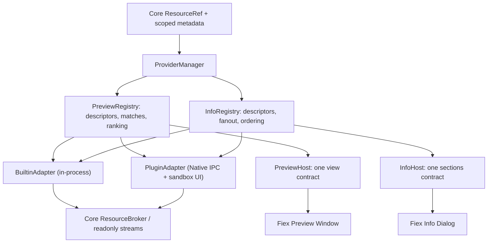
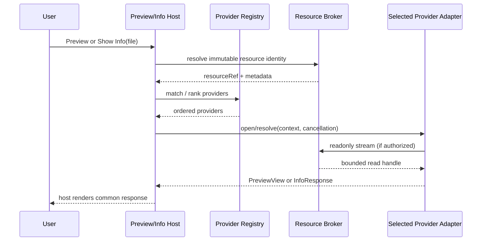
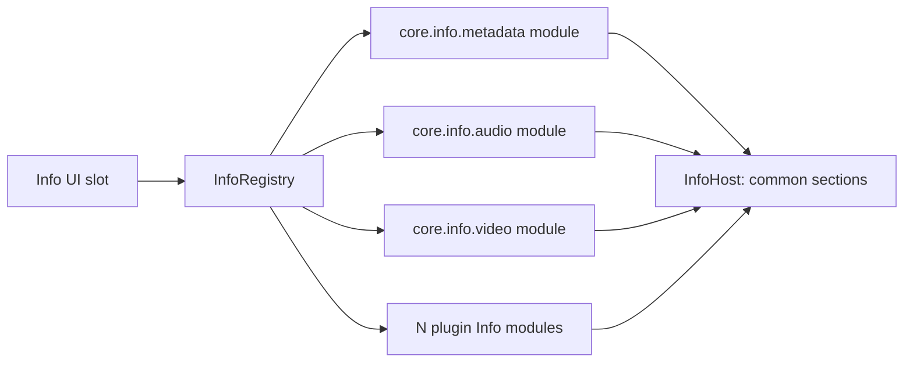
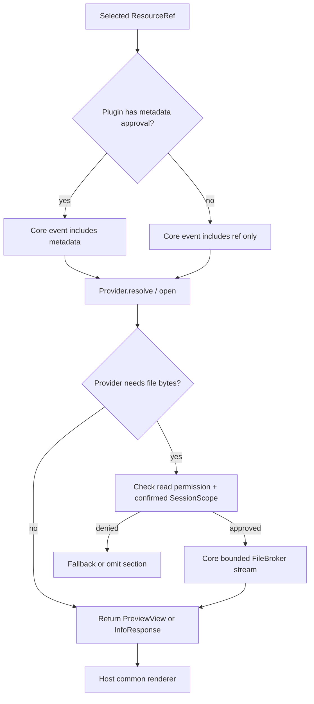

# 08 · Preview 与 Info Provider 统一协议（目标设计）

> **待实施设计**。本篇规定内置预览、第三方预览、普通文件元数据、音频/视频解析结果与第三方 Info 贡献点共用同一套抽象和调用/渲染路径。实现任务见仓库根目录 `ROADMAP.md`；不表示代码已实现。Manifest schemaVersion 2 / Native IPC 3.0 / UI Bridge 2.0 是计划版本。

## 1. 必须遵守的设计决定

1. **内置功能也是 Provider**。代码高亮文本、图片、音频、视频、PDF、未知类型 fallback 由 Core 注册为独立的 `PreviewProvider`；基础文件与文件夹元数据、音频属性、视频属性由 Core 注册为独立的 `InfoProvider`。内置每个来源都必须有独立实现模块和测试，不能只是同一个文件中数个分支。外部插件按相同 Surface Provider Descriptor 注册，参与同一 Registry、过滤、排序、调用生命周期、取消和错误降级。
2. **只统一逻辑接口，不强迫统一隔离层**。内置 Provider 可作为进程内适配器调用，并使用宿主内置 React 视图；第三方 Native 使用 IPC、第三方 UI 使用已验证的沙箱 iframe。两者均接受 `ProviderContext`，返回同一类 `PreviewView` 或 `InfoResponse`；宿主 Host Adapter 负责传输差异。不可要求内置 PDF 也启动插件进程，不可允许第三方绕过 UI Bridge。
3. **Preview 与 Info 是两个独立扩展点**。Preview 输出可交互的*展示视图*，Info 输出结构化*属性区块*；音频/视频文件可以同时命中媒体预览和媒体 Info。普通文件信息在 Info Registry 内注册为基础 Provider，不在 `FileInfoDialog` 中硬编码拼行。
4. **不会把数据读取伪装成 metadata 权限**。普通 stat 属性是 `metadata`；解析 ID3/FLAC、MP4、MKV、媒体编码、图片 EXIF 等可能需要读取文件内容。第三方主动解析需要已批准的 `files.read.enabled` + 用户当前查看操作的精确 Scope；只有 `files.metadata.enabled` 不允许读取文件内容。内置 Core 解析器使用内部受控 FileBroker 访问，不能借此为插件扩权。
5. **所有数据访问都由 Core Broker 控制**。Preview/Info 接收 `ref` 及已批准的 `metadata?`，不默认接收裸绝对路径；**具体 UI 面板不预先声明在 Manifest 中**，由插件随本次用户交互通过 IPC 提供视图描述。大文件从限额可取消的只读资源流/资源代理获取，禁止整文件 base64、任意 materialize 到插件可见路径、跨 Provider 传递原始文件句柄。
6. **任何 Provider 失败都不应让用户失去默认体验**。Preview 按用户顺序与优先级选择，一个失败换下一个可用 Provider，最终进入始终可用的基础 fallback；Info 同时聚合多个区块，单个 Provider 失败不影响其他区块。

## 2. 一个注册表，两种实现适配



Registry 接收统一 `ProviderDescriptor`，至少含 `id`、`title`、`owner`（Core 或插件身份）、`priority`、`extensions?`、`mimeTypes?`、`supportsDirectories?`。内置与插件共用 `matches`、排序、启用禁用、用户选中顺序、超时、取消、故障回退。`owner` 仅供权限校验、诊断和显示，不得参与“官方插件优先”的特判。



## 2.1 Core 内多个来源必须拆成独立实现模块

这里的“统一 Provider”不是只新增一个 Registry 把既有函数原样包起来，而是**物理拆分 Core 内每一个来源**，使它们可独立注册、禁用、排序、测试和替换。建议的模块结构（具体目录可根据代码库调整，职责不可合并）：

```text
src-tauri/src/plugins/
  info/
    mod.rs                    # 仅 InfoRegistry / dispatch / aggregate
    types.rs                  # InfoContext / InfoResponse
    metadata.rs               # core.info.metadata：基本 stat 属性
    audio.rs                  # core.info.audio：lofty 音频信息
    video.rs                  # core.info.video：MP4 / Matroska 视频信息
  preview/
    mod.rs                    # PreviewRegistry / session
    types.rs                  # PreviewContext / PreviewView
    resource.rs               # 受控流、seek/range、资源代理
src/
  components/
    Preview.tsx               # 仅外框，移除格式判断
    FileInfoDialog.tsx        # 仅消费 sections，不再生成 basicRows
    preview/
      PreviewHost.tsx         # 导航、错误、取消、回退
      TextPreview.tsx         # core.preview.text，含代码高亮
      ImagePreview.tsx        # core.preview.image
      AudioPreview.tsx        # core.preview.audio
      VideoPreview.tsx        # core.preview.video
      PdfPreview.tsx          # core.preview.pdf
      FallbackPreview.tsx     # core.preview.fallback
      PluginPreview.tsx       # 第三方 panel 沙箱 Adapter
  lib/
    preview/registry.ts       # 所有内置/外部统一匹配和排序
    info/registry.ts          # 仅汇总多个 Info Provider
```

现在 `src-tauri/src/plugins/info.rs` 同时实现 `audio_section`、`mp4_section`、`matroska_section`、`media_sections`、`plugin_sections`；目标应分别迁移到独立模块，`InfoRegistry` 只做编排。`core.info.metadata` 不因 `core.info.audio/video` 异常消失；音频和视频各有自己的解析、匹配与失败隔离。未来新增 EXIF 等属性只需注册一个新模块。

现在 `src/components/Preview.tsx` 集中处理文本、图片、音视频、PDF；目标应该把各个内容 Renderer 单独拆出，均作为 `PreviewRegistry` 的内置 Adapter 注册；`PreviewHost` 只负责宿主窗口/键盘/导航和会话。内置分模块不代表启动多个进程，保持进程内高效调度。



## 3. 通用事件上下文：Push ≠ Pull

`ProviderContext` 是 Core 对当前用户操作建立的不可变快照：

```json
{
  "resource": {
    "ref": {"mountId":"m1","nodeId":"f18"},
    "metadata": {
      "name":"demo.mp4","kind":"file","extension":"mp4",
      "mime":"video/mp4","size":4512000,"modified":1800000000
    }
  },
  "sessionId":"preview-session-opaque",
  "intent":"preview",
  "selectionCount":1
}
```

插件收到 `metadata` 的先决条件是对应 `permissions.files.metadata.enabled` 或 `permissions.folders.metadata.enabled` 已经获批；否则整个 `metadata` 属性应被省略。不透明 `ref` 本身既不代表读取授权，也不允许查询任意路径。Core 内置适配器获得的内部 Entry 不得通过序列化泄露给插件。

`PreviewProvider.open` / `InfoProvider.resolve` 属于**Core 发起 Push**；只有用户实际触发预览或显示简介后，Core 才建立可取消、限资源的会话。插件希望主动获取文件/目录的 stat 时走 `ctx.files().metadata` → `host.fs.stat`，仍须已批准的 metadata 权限 + 当前已确认的 OperationScope，不能利用扩展点默认提升作用域。

## 4. PreviewProvider —— 所有预览共用接口

统一生命周期：

```text
register(descriptor) → match(resource) → rank → open(context) → PreviewView
                                               ↳ fail/cancel → next provider → fallback
```

```typescript
interface PreviewDescriptor {
  id: string
  title: string
  extensions?: string[]
  mimeTypes?: string[]
  priority?: number
  supportsDirectories?: boolean
}
interface PreviewContext {
  resource: { ref: ResourceRef; metadata?: FileMetadata }
  sessionId: string
  intent: 'preview'
}
interface PreviewView {
  // Core 内置 renderer 进程内使用；外部插件每次运行时选择 view
  viewer: { kind: 'builtin'; id: string } | { kind: 'panel'; view: PanelViewSpec }
  resource: ResourceRef
  title?: string
}
interface PreviewProvider {
  descriptor: PreviewDescriptor
  match(context: PreviewContext): boolean
  open(context: PreviewContext): Promise<PreviewView>
  close(sessionId: string): Promise<void>
}
```

`PreviewView.viewer.kind` 是运行时分发结果，**不是** Manifest 配置：内置 Provider 选择其已经编译的宿主 renderer；第三方 Provider 每次用户打开预览才通过 IPC 提供具体 `view`（包内 `entry` 或有界动态 HTML），由 Core 的 PanelHost 在 Preview Surface 内以沙箱 iframe 展示。Manifest 不声明 `panels`、`runtime view`，第三方不得冒用 `builtin`。

| 目标内置 Provider ID | 匹配规则 | 具体实现（仅实现细节） |
|---|---|---|
| `core.preview.text` | 文本 MIME / 代码扩展名 | 有界 UTF 解码、代码高亮、可取消；语言检测和语法高亮位于 renderer 内 |
| `core.preview.image` | 图片 MIME / 支持的图片格式 | 资源代理、缩放/尺寸加载事件、图片错误兜底 |
| `core.preview.audio` | 音频 MIME | 流式资源 URL、播放器控制 |
| `core.preview.video` | 视频 MIME | 流式资源 URL、播放器控制、尺寸适配 |
| `core.preview.pdf` | PDF MIME | 受限 PDF Viewer 与范围请求；不整文件内存化 |
| `core.preview.fallback` | 任意文件/文件夹 | 默认图标和最小信息展示；不可移除最后 fallback |

所有预览包括插件预览均通过 `PreviewHost` 负责相同的标题、快捷键、前后文件导航、关闭、加载/错误展示、选择器和回退。Provider 只渲染视图**内容**；不得重复实现宿主导航外框。内置文本高亮与图片/音视频/pdf 通过适配器挂接，不应留在 `Preview.tsx` 的类型分支中。未知 MIME、目录、非法文件、无许可、格式不支持等均落入清晰的 fallback 流。

### 4.1 Manifest 只注册预览匹配，不预配置面板

```json
{
  "surfaces": {
    "preview": [{
      "id":"custom.preview","title":"自定义预览",
      "extensions":["xyz"],"mimeTypes":["application/x-xyz"],
      "priority":60
    }]
  }
}
```

默认 `extensions` / `mimeTypes` 仅负责匹配。用户真正打开 Preview 后，插件在 `preview.open` 的响应中动态选择 `view.source="package"`（例如 `ui/preview.html`）或 `view.source="html"`，并可建议标题及尺寸；Core 必须把该 Panel 放进当前 PreviewHost，不能让其任意占用宿主 DOM。复杂格式检测只在获授权打开后进行有限探测，不允许自动遍历文件字节。详见 [09-RUNTIME-UI-PANELS.md](09-RUNTIME-UI-PANELS.md)。

## 5. InfoProvider —— 所有元数据共用接口

```typescript
interface InfoDescriptor {
  id: string
  title: string
  extensions?: string[]
  mimeTypes?: string[]
  priority?: number
  supportsDirectories?: boolean
  command?: string
}
interface InfoContext {
  resource: { ref: ResourceRef; metadata?: FileMetadata }
  sessionId: string
  intent: 'info'
}
interface InfoRow { label: string; value: string }
interface InfoSection {
  id: string
  title: string
  rows: InfoRow[]
}
interface InfoResponse { sections: InfoSection[] }
interface InfoProvider {
  descriptor: InfoDescriptor
  resolve(context: InfoContext): Promise<InfoResponse>
}
```

`InfoProvider` 的上下文使用统一的资源 Snapshot（意图标记 `info`，不再另造 file-path-only 请求）。**无论 Core 还是第三方**，返回相同 `InfoResponse.sections[]`；每个区块仅接收结构化字符串数据，后续要增加 URL、布尔、尺寸或 duration 等 typed value 时由 JSON Schema 显式扩展，禁止 HTML、JS、样式、可执行回调。

| 内置 Info Provider ID | 数据来源 | 读权限与限制 |
|---|---|---|
| `core.info.metadata` | Core Entry/stat：类型、大小、位置、创建/修改时间、只读、链接等 | 独立 metadata Provider；原始 Entry 不对插件开放，主动 Push 要裁剪 |
| `core.info.audio` | lofty 解析音频标签、时长、码率、采样率等 | 通过限额只读句柄解析本次资源，不能等同于 stat |
| `core.info.video` | mp4/matroska 解析媒体容器、码流、时长、分辨率等 | 通过限额只读句柄解析本次资源，支持超时和降级 |

第三方 Plugin Info 声明 `surfaces.info[]`，使用已经指定的 `command` 并通过 Native SDK 返回同形 `{sections:[...]}`。如果用户选择显示文件信息，则 Core 向所有匹配的 Info Provider 并发请求，按基础文件区块在前、其他区块按用户排序/priority 的一致规则聚合。一个 Provider 返回空 `sections` 意味着不显示其内容。

**UI 解耦要求**：
- `FileInfoDialog.tsx` 不再生成 `basicRows`，只负责标题、图标、通用区块列表、加载状态及操作按钮。
- `src-tauri/src/plugins/info.rs` 不再把音视频本地解析写成特殊的 `media_sections + plugin_sections` 逻辑；改成三个内置 Adapter 与通用 `InfoRegistry::resolve_all` 聚合。
- 删除 `pluginId == "org.fiex.office-preview"` 之类面向特定插件的 UI 逻辑。Provider 是否显示署名由统一的 `InfoSection` 显示策略决定。
- 路径为 `fiex://...` 时也经相同资源/Provider 管线处理，不得提前直接返回空区块；具体 Provider 的流能力不足时以结构化失败/空结果降级，不错误读取宿主绝对路径。

### 5.1 Info IPC 合同（目标）

```json
{
  "jsonrpc":"2.0",
  "id":77,
  "method":"info.resolve",
  "params":{
    "sessionId":"info-session-opaque",
    "resource":{"ref":{"mountId":"m1","nodeId":"f18"},
      "metadata":{"name":"demo.mp4","kind":"file","extension":"mp4"}}
  }
}
```

```json
{
  "jsonrpc":"2.0",
  "id":77,
  "result":{"sections":[{"id":"tracks","title":"视频信息",
    "rows":[{"label":"时长","value":"01:20"},{"label":"分辨率","value":"1920×1080"}]}]}
}
```

`info.resolve` 是推荐的固定 Provider 合同。Manifest 中 `info[].command?` 可用于显式注册 Native handler，但它也**必须**接受相同 params、返回相同 `InfoResponse`，不再兼容旧式 `{path} → {rows}` 回包；可以在 SDK 中将可注册的 handler 类型统一成 `InfoHandler`。

## 6. 对齐 IPC / SDK 与资源流

| 调用/实现 | 目标方法或类型 | 说明 |
|---|---|---|
| Host 打开预览 | `preview.open`（Host→Adapter 逻辑入口） | 统一 `PreviewContext`、运行时 `PreviewView`、错误与取消；内置进程内调用，外部每次指定实际沙箱 Panel 视图 |
| Host 显示文件简介 | `info.resolve`（Host→Info Provider） | 相同请求/响应 Schema；内置在 Core 内调用，第三方 Native handler 通过 IPC |
| 插件主动查询基础元数据 | `host.fs.stat` / `Files::metadata` | 对应 metadata permission + 具体 OperationScope；与 event metadata Push 区分 |
| 插件读取数据用于预览或媒体解析 | `host.fs.openRead/readOpen/closeRead` | 对应 `files.read.enabled` + 显式查看操作 Scope；禁止暴露任意其它文件 |
| UI 渲染资源代理 | `PreviewResourceRef` / scoped URL | 按会话、插件身份、目标 ref 限制；支持 Range/Seek 与取消；iframe 不得直接访问宿主全盘 |
| 会话生命周期 | `PreviewSession` / `InfoSession` | 资源变更、关闭、切换文件、取消操作均撤销句柄和 UI 资源 |

注意 `preview.open` 对插件不是要求每次在 Native IPC 上新发一个强制 RPC；可以通过 `PluginPreviewFrame` 的合法 UI Bridge 与已注册面板引用实现。**统一的是 Host→Provider 的类型合同与逻辑流程**，不应因接口统一牺牲图片、音视频的大文件流式性能。

## 6.1 所有用户交互 Surface 共享运行时 Panel

Info/Preview 使用的通用 PanelHost 与 Toolbar、ContextMenu、Search、Connection 等 Surface **相同**；不是 Preview 专有功能。任何注册上述 UI Surface 的插件，在用户明确打开某项操作后都可通过 `host.ui.open` 请求建立 Panel，传入本次 `interactionId`、包内页面路径或有界 HTML、标题与布局。Core 在 Preview 场景将 Panel 限定在预览宿主槽位；Info 的自动 `info.resolve` 只返回 sections，只有用户点击扩展出的显式操作才能进一步开 Panel。

自动刷新或后台请求不能作为打开 UI 的依据；Panel 创建也不自动赋予文件读写或元数据查询权限。详见 [09-RUNTIME-UI-PANELS.md](09-RUNTIME-UI-PANELS.md)。

## 7. 数据流与安全测试



必测：
- 关闭第三方 Preview/Info 提供方后，内置与其他插件仍可匹配、显示；禁用内置高亮后其他 Preview 可正常顶替。
- 重复扩展名、用户优先级、MIME、空/未知后缀、多选和目录的行为一致；无 Core 特例取胜。
- 本地、Connection、Git VFS、离线缓存、超大文件、无权限/过期 ResourceRef、被替换/软链接目标安全。
- Info 的基本文件、音频、视频和第三方区块可以并存；单个解析器失败不影响其它区块；不得将 Info 错误行伪装成真实属性。
- 打开预览/简介属于用户发起的 scoped 意图，额外读取内容权限仅作用于当前文件；关闭/换项/取消能回收流与沙箱，后到 IPC 不能污染新会话。
- 由 Core Push 的 metadata 不需要插件主动 stat；未授权 metadata 不得传入插件；插件主动 stat 无 Scope 被拒绝。
- 图片/视频/PDF 使用范围流/资源代理，不整体导出到临时磁盘、IPC JSON；没有无限内存复制。
- 快捷键、焦点、视频/音频停止播放、失效 Provider 回退、UI 错误状态与之前功能等价；宿主不因第三方 HTML 注入。

## 8. 完成定义

1. `Preview.tsx` 只管理统一宿主窗口及会话，不再按 `isText/isImage/audio/video/pdf` 分支直接选择 renderer。
2. `FileInfoDialog.tsx` 只消费 `InfoResponse.sections`，不再生成特殊基础属性，也不区分固定插件 ID。
3. `src-tauri/src/plugins/info.rs` 的普通文件/音视频核心解析与插件处理，均通过同一个 `InfoRegistry` 路径，保留既有解析能力。
4. `src/lib/preview.ts` 管理同形内置与第三方 Descriptor，并共同支持匹配、启用、排序、用户选择及可靠回退（修复只按扩展名让内置媒体不进入候选列表的问题）。
5. Native IPC、SDK、Manifest、UI Bridge 类型、所有官方插件以及测试随实现同步更新；不留旧的返回类型兼容分支。
6. 在 Windows/macOS/Linux 通过格式化、静态检查与单元/集成测试；大文件压力测试不能静默读取到未授权文件。
