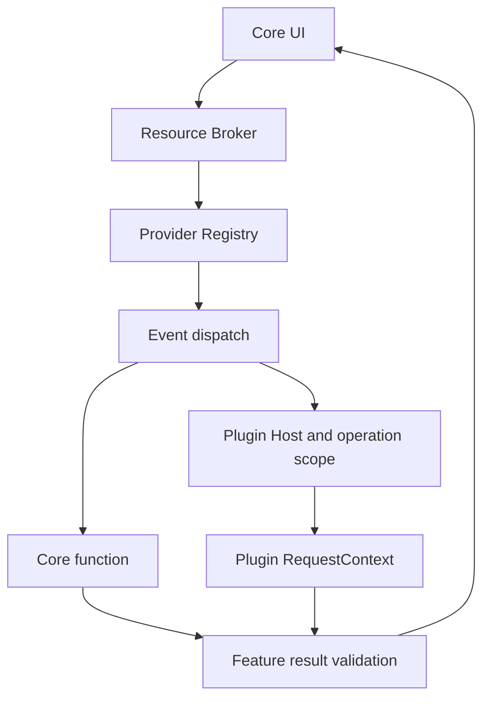

# Unified event requests and provider dispatch

Core resource events use the JSON-RPC method as the event name. The one request envelope is:

```json
{
  "target": {
    "ref": { "mountId": "local", "nodeId": "opaque" },
    "metadata": { "name": "song.mp3", "kind": "file", "size": 4194304 }
  },
  "selection": [],
  "options": {}
}
```

`target` can be null. `selection` contains operation-selected resources. Metadata is optional and projected using the receiving plugin's metadata permission. `options` contains feature-specific parameters. RequestContext exposes `target()`, `selection()` and `params()` (business options for standard events; unchanged parameters for custom methods). `metadata(&ResourceRef)` requests metadata through the existing host broker. `files().open_ref(&ResourceRef)` returns the normal streaming Read/Seek adapter.

The envelope applies to `info.resolve`, `preview.open`, `decorations.resolve`, `contextMenu.resolve`, `contextMenu.execute`, `toolbar.invoke`, `search.query`, and `connection.open`. Custom backend and VFS methods retain their own protocols. Network-domain configuration remains host-injected runtime data.

## Dispatch



`plugins/resource_broker.rs` prepares resource identity and metadata once for Info. `plugins/events.rs` owns the shared Info/Preview provider registry, deterministic priority ordering, exception isolation, response size bounds and dispatch boundary. Built-ins run in-process; plugins use the existing PluginHost timeout and process lifecycle. Info validates bounded sections/rows before collecting any provider output. Preview validates package-confined HTML, text bounds and allowed kinds. Feature renderers remain independent.

Info no longer defines InfoContext, ResourceDescriptor, ResourceContext, ScopedRead, InfoResponse or InfoSectionView. Core and SDK use one shared ResourceRef. Core retains InfoSection/InfoRow as the final UI model. Preview retains its distinct result format.

## Authorization and lifetime

Reference-to-path mappings live in the Core operation Scope, never in a global read-token registry. Knowing or forging a ResourceRef grants nothing: lookup must succeed in the calling operation's scope, followed by the ordinary metadata/read/write permission and filesystem confinement checks. Another operation cannot resolve the same ref. Tasks inherit the captured scope; a preview UI session recreates the exact selected scope and rebinds its issued ref after checking plugin ownership and expiry.

Context-menu resolution is metadata-only even if the plugin has a read grant. Content reads, writes and subprocess execution are rejected in that scope; a later confirmed action starts a separate operation. Removing a metadata field does not grant file access. Bulk file contents still use the existing streaming/shared-memory transport.

## SDK example

```rust
let reference: sdk::ResourceRef = serde_json::from_value(
    ctx.target().and_then(|target| target.get("ref"))
        .ok_or_else(|| RpcError::invalid_params("missing target"))?.clone()
).map_err(|error| RpcError::invalid_params(error.to_string()))?;
let reader = ctx.files().open_ref(&reference)
    .map_err(|error| RpcError::internal(error.to_string()))?;
```

The checksum provider uses this route without requiring a projected filename. Metadata-only remote Info can be rendered from an existing Entry without downloading file contents; media/content providers still require materialization. Other feature-specific options and result validators continue to live in their feature modules.
