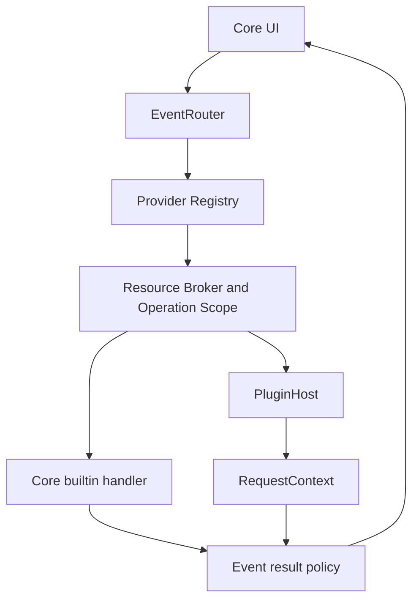

# 统一 Provider 调用架构

所有 Core 系统事件由 `plugins/events.rs` 的 `EventRouter` 协调：统一 Registry 匹配、Builtin/Plugin 执行、逐 Provider 校验和事件结果策略。功能模块只提供内置处理函数、具体结果校验及组合规则。自定义插件 RPC 保留在原有授权桥接中，不参与系统事件广播。



## 统一请求

JSON-RPC 的 method 标识事件。唯一资源集合是 `targets`，不再同时使用 target 与 selection。

```json
{
  "sessionId": "opaque-session",
  "targets": [
    {
      "ref": { "mountId": "local", "nodeId": "opaque-resource" },
      "metadata": { "name": "song.mp3", "kind": "file", "size": 4194304, "mime": "audio/mpeg" }
    }
  ]
}
```

各事件独有参数（查询词、菜单项 ID、连接配置等）与 targets 并列，使用 `ctx.params()` 获取；`ctx.targets()` 提供统一目标集合，`ctx.metadata(ref)` 只访问本次已投影的属性。

读取目标使用 `ctx.files().open_ref(&target.reference)`。名称是展示信息，不是读取能力。`ScopedRead`、`read.resourceId` 和全局读取令牌注册表已删除。Core 与 SDK 共用 ResourceRef、ResourceContext、ResourceMetadata、EventContext 以及 InfoSection/InfoRow、PreviewView 的定义；没有 InfoContext、PreviewContext、InfoSectionView 或 InfoResponse 转换链。

## 资源与授权

`plugins/resource_context.rs` 解析本地、Connection、VFS 的元数据。本地属性只取一次，目录装饰复用传入的列表属性；远程 stat 不下载文件。内容 Provider 按需调用 materialize，同一操作内的快照共享一次内容准备结果。缓存位置只存在于 Core。

`EventRouter::resource_scope` 为每个 Provider 建立独立 Scope；`prepare` 在 Host 边界统一执行元数据裁剪和引用绑定。文件、网络与命令 Broker 在每次反向 IPC 时再次检查许可。其他 Provider/操作知道相同引用也不能获得访问权。

菜单根解析和懒加载子菜单都使用 metadata-only Scope，不能读取文件、修改文件、创建本地 VFS 视图或执行命令。只有有效会话中确实出现过的 action 才能执行，并为已确认目标重新创建操作范围。菜单会话限期、一次执行、总项数与深度限制保留。预览 iframe 的后续自定义请求从预览会话恢复相同目标，并按当前批准权限重建 Scope。

## 事件结果策略

| 事件                       | 策略                                                                                                                          |
| -------------------------- | ----------------------------------------------------------------------------------------------------------------------------- |
| Info                       | 按优先级合并所有合法 Sections；Core 补充来源和插件命名空间；失败独立显示错误 Section                                          |
| Decorations                | 合并可见资源的装饰、去重徽标；高优先级覆盖冲突字段；限制字段、颜色和 package 图标来源                                         |
| ContextMenu                | Core 匹配并汇集各 Provider 的独立菜单会话；UI 只调用一次；子菜单按需向同一会话解析                                            |
| Preview                    | 首选 Provider 在前，其余按优先级或用户允许顺序尝试；调用失败、校验失败或 unsupported 继续下一个；最终使用不读取内容的内置兜底 |
| Search                     | Core 合并本地遍历和插件结果；逐源校验、限定搜索根目录/挂载、规范化路径去重、限量及取消；UI 不再另发插件搜索                   |
| Toolbar / Connection / VFS | 指定 Provider 独占；不广播给其他连接或挂载；保留 Connection NavigationTarget 与 VFS 专用结果校验                              |
| beforeOpen hooks           | 按优先级尝试到第一个合法 handled=true；失败不会阻止后续 Provider                                                              |

Provider 执行具有异常隔离与 4 MiB 结果上限。PluginHost 继续负责 RPC 超时、进程、任务取消和句柄清理。Info/菜单/搜索/预览分别拥有自己的字段和大小规则；不会将所有功能强行转换成同一个响应 DTO。

`extensions.preview.loading` 是纯展示层声明：Core 在 `preview.open` 前解析包内加载页并交给预览 UI，不参与 Provider 匹配、优先级、Scope 或结果校验。加载页解析失败或未声明时，预览继续走原有流程。

真实预览 iframe 在加载页下方预加载；插件完成首次数据渲染后调用 `preview.ready`，Core 才移除加载页。加载页本身没有预览 Session，只能读取展示上下文和主题。Core 另设 30 秒兜底，插件未实现 `preview.ready` 时仍会显示预览。

## 代码入口

- `plugins/events.rs`：Registry、EventRouter、公共验证入口、独占调用、Scope/targets 准备。
- `plugins/resource_context.rs`：资源快照、远程 stat 与按需 materialize。
- `plugins/info.rs`、`plugins/preview.rs`、`plugins/decorations/dynamic.rs`、`plugins/search.rs`：事件处理和结果规则。
- `desktop/plugins.rs`：Tauri 适配、菜单会话和 UI 资源处理，不在前端遍历 Provider。
- `core/search.rs`：已有遍历与取消逻辑，以 Builtin 搜索来源接入统一结果策略。
