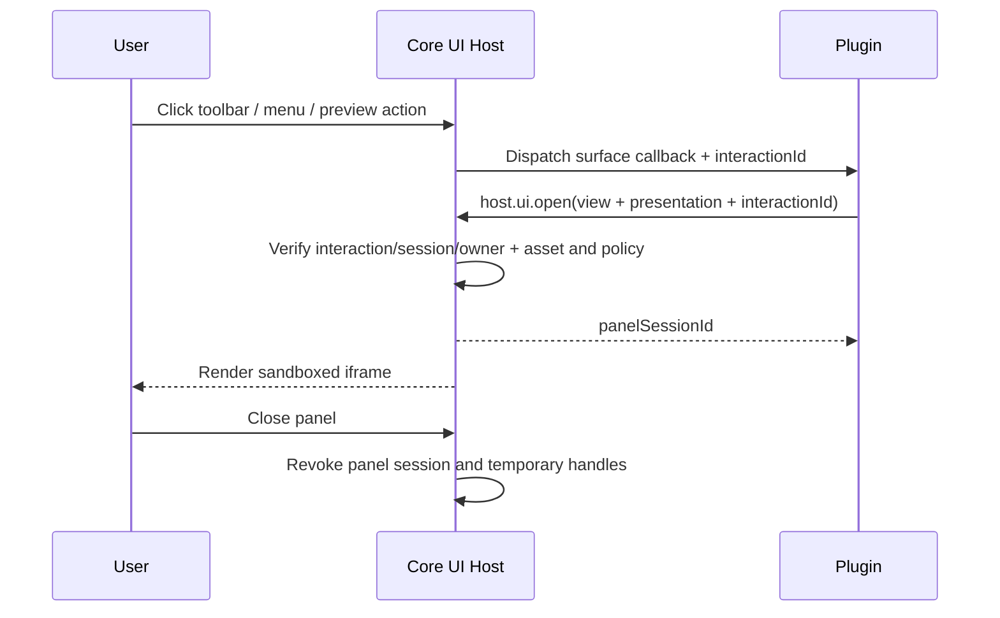

# 09 · 运行时 UI Panel 协议（所有 Surface 通用）

> **目标设计，尚未落地**。Panel 是 Core 管理的**运行时 UI 实例**，不是 Manifest 扩展点，也不是需要预先声明的 `resources.panels[]`。只要插件在被用户触发的 UI Surface 会话中运行，就可按该会话规则请求创建 Panel。实现时需更新 Core、Native SDK、UI Bridge 和所有官方插件。

## 1. 设计结论

- Manifest **没有** `panels`、`panelId`、`defaultSize` 等静态 Panel 注册项。插件需要哪个页面、内容、标题、默认尺寸和展示方式，均在**运行时 IPC**里选择；不要求开发者提前列出面板。
- Toolbar、ContextMenus、Preview、Info、Search、Connections、Decorations、Settings 和 Themes 都是 Core 定义的 UI Surface。其中并非每种自动刷新事件都可以直接打开 Panel：必须有用户交互来源（如点击工具栏按钮、右键具体菜单项、打开预览、点击搜索结果/Info 操作、连接 + /侧栏项目、设置页上的操作）。**注册 Surface 意味着可以收到用户真实触发的事件；插件仍需按需申请文件资源，不能在事件中直接收到 metadata。该 Surface 隐含相应交互流程中的 UI 请求能力**，无需额外的 `panel` 权限。
- Core 对全部 UI Surface 使用同一个 PanelHost / PanelSession / UI Bridge，控制标题栏、尺寸限制、焦点、生命周期和沙箱。一个界面可由多个 PanelSession 打开，打开哪些内容由插件选择。不同 Surface 只是给 PanelSession 提供不同的授权上下文与展示目标。
- 仅提供功能的 `providers.vfs[]/hooks[]` 没有独立“后台弹窗权限”；如果某个功能由用户在 UI 中实际触发，才通过这次 UI 会话请求展示 Panel。定时 Hook / 后台同步 / 菜单 resolve / Decoration 刷新不得自动弹窗。
- Panel 的创建**不等于**文件访问授权。插件使用文件、网络、进程、秘密时仍需对应 manifest permission、用户批准和精确 OperationScope。

## 2. 建议 Manifest

```json
{
  "schemaVersion": 2,
  "id":"org.example.archive",
  "name":"Archive",
  "version":"1.0.0",
  "permissions":{
    "files":{"metadata":{"enabled":true},"read":{"enabled":true}}
  },
  "surfaces":{
    "contextMenus":true,
    "toolbar":[{"id":"tools","title":"归档工具","command":"archive.open"}],
    "preview":[{"id":"archive-preview","extensions":["zip"],"priority":60}],
    "info":[{"id":"details","extensions":["zip"],"command":"archive.info"}]
  }
}
```

没有 `resources.panels`、`panelId`、`panel` 权限字段，也没有 `contextMenus.when/children`。`files` 文件摘要表依然覆盖安装包内真实 UI 文件，**校验文件不等于提前注册 Panel**。

## 3. 统一运行时 PanelSpec

Core 提供 `host.ui.open`（目标 Native SDK 高层接口：`ctx.ui().open_panel(spec)`）。Plugin 在用户触发的 UI 操作会话中调用此方法：

```json
{
  "jsonrpc":"2.0",
  "id":1004,
  "method":"host.ui.open",
  "params":{
    "interactionId":"core-issued-interaction",
    "view":{"source":"package","entry":"ui/advanced.html"},
    "presentation":{
      "title":"高级压缩设置",
      "placement":"dialog",
      "preferredSize":{"width":540,"height":420}
    }
  }
}
```

`PanelSpec.view` 的主要形式：

| 形式 | 含义 | 约束 |
|---|---|---|
| `{"source":"package","entry":"ui/name.html"}` | 运行时选择**包内**页面，无须 Manifest 注册 | Core 校验路径不能逃逸包根、文件存在、安装时摘要校验覆盖相关资产，禁止跨插件/绝对路径 |
| `{"source":"html","html":"..."}` | Native 插件运行时返回要显示的 HTML 内容 | 可选能力；Core 限额、隔离 iframe、严格 CSP 和 UI Bridge 保护，禁止注入宿主 DOM / 原生 API；不能自动从远程地址载入脚本 |
 
使用 `html` 不代表可提供无限大的 IPC 字符串；对超出帧大小或内容大小的 UI，插件仍应使用包内 `entry` 及 UI Bridge 获取数据。两种形式都以 `sandbox=allow-scripts` 的 opaque-origin iframe 运行（不允许 `allow-same-origin`），插件只能通过白名单 MessagePort UI Bridge 通信。宿主可限定 CSP、资源请求和可用展示位置；远程 URL 不允许直接成为 Panel 来源。

`presentation` 仅为布局请求；Core 限制 placement、最小/最大尺寸、屏幕边界、焦点与堆叠数。支持的 `placement` 由引发交互的 Surface 决定：例如 Preview 的宿主预览区域、工具栏操作的弹出对话框、Info 显式详情操作的对话框。插件不能伪造系统模态权限提示或占用宿主顶级 DOM。

## 4. 各 Surface 如何创建 Panel

| 用户操作/Surface | Runtime 流程 | Panel 打开限制 |
|---|---|---|
| Toolbar 点击 | Core 触发已注册 `command` → Plugin 调用 `host.ui.open` | 使用这次按钮点击的 interactionId |
| ContextMenu 右键 | `contextMenu.resolve` 仅回传扁平菜单项；点击后 `contextMenu.execute` 可调用 `host.ui.open` | **查询 resolve 阶段绝不自动创建 Panel**；返回的菜单项无需 `type:panel` 或 `panelId` |
| Preview 打开 | Core 匹配 PreviewProvider，插件在 `preview.open` 中返回 PreviewView/发起带视图的 PanelSession | 目标插槽由 Core 固定为当前 Preview Host；不弹另一个任意窗口 |
| Info 展示 | `info.resolve` 只返回 `sections[]`，宿主直接渲染 | 只有用户再点击该 Provider 的显式操作时，才允许调用 `host.ui.open` |
| Search 查询 | `search.query` 只返回目录内结果 | 只有用户点击搜索结果或明确的搜索扩展操作时才能请求 Panel |
| Connection 管理 | Connection 仅注册 + 与侧边栏项；点击调用 `connection.create/open`，插件通过本次响应决定导航到登录 Panel、设置或自有 VFS mount | Panel 从当前连接/账号交互派生，不扩到其他连接 |
| Decorations / Settings / Themes | 自动刷新/纯计算返回数据，不得弹窗；用户明确点选其配置或操作按钮后才能请求 Panel | 不能把每次渲染、主题切换通知当作无限弹窗许可 |

面板关闭、窗口导航、插件被禁用或卸载时，Core 撤销 PanelSession 与其子级 UI 操作权限。任务若需跨 UI 关闭继续，必须显式转移到独立 TaskScope。

## 5. 统一返回/事件与 IPC 示例

菜单项简化成 `action|submenu|separator`。其类型不再决定是否一定打开 Panel：

```json
{"items":[
  {"id":"archive.zip","type":"action","title":"压缩为 ZIP"},
  {"id":"archive.advanced","type":"action","title":"高级压缩…"}
]}
```

点击 `archive.advanced` 后 Core 发送 `contextMenu.execute({menuSessionId,itemId})`；插件调用 `host.ui.open({interactionId,view,presentation})`；Core 检查调用进程、当前交互、同一插件、已安装 UI 内容和 UI 安全策略，最后创建 iframe 与 UI Bridge。其他 Surface 可使用相同 `host.ui.open`，区别仅在何种用户动作可产生有效 interactionId。



## 6. 验收条件

- `surfaces.contextMenus`、toolbar、preview、info、search、connections 不需要静态 `panels` 或 `panelId` 即可通过实际用户交互打开插件 UI。
- 菜单 resolve、搜索查询、Info 聚合、Decoration 刷新、后台任务不能自动显示 Panel；必须点击/显式查看，并且 interactionId 不能伪造或跨请求复用。
- 每次插件可选择不同的包内 HTML 页面或限额 HTML 文档；无法从任意磁盘/远程 URL 加载 UI。
- 内置 Preview/Info 的多个独立模块仍经相同 Surface Registry/Host 调度，内置使用进程内渲染器，插件使用隔离 iframe；统一面板协议不能迫使 Core 内置组件运行插件进程。
- 大文件、网络、媒体属性探测只通过对应受控数据 Broker；PanelSession 无隐式全盘/目录授权。
- SDK、Manifest、IPC、官方插件和 Core UI 渲染器端到端测试契约一致；不保留旧 `panelId`/静态 Panel Registry 分支。
