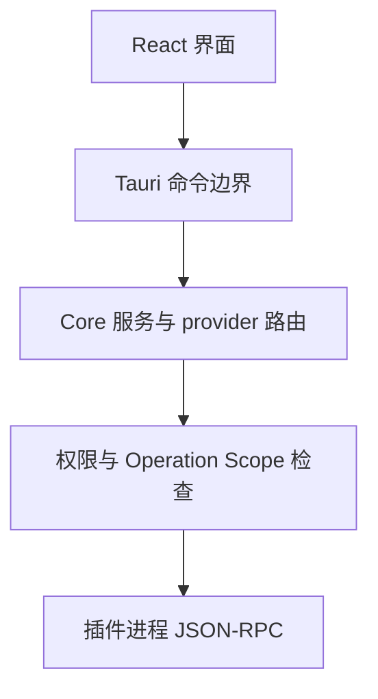

# 系统架构

本页说明一次浏览或插件操作会经过哪些层。架构是按职责拆分的模块；大多数 Rust crate 与模块都运行在 Fiex Core 进程内，并不是单独的后台服务。

## 一次插件请求的路径

1. React 前端维护标签页、当前面板、选择和可见状态。
2. 需要操作系统或文件能力时，前端通过类型化 Tauri command 请求后端。
3. Tauri 命令把数据转换为 Core 内部请求，Core 按资源位置选择本地 provider、内置 VFS provider 或插件 provider。
4. 对插件调用，Core 校验插件是否声明该 provider，并检查用户授权、当前 Operation Scope 和具体 ResourceRef。
5. Core 经 JSON-RPC IPC 与插件进程通信，验证返回数据后再更新 UI。

本地操作可能在 Core 进程内直接调用 provider，不经过插件 IPC。插件无权绕过 Core 的 resource broker 直接访问用户路径。

## 仓库职责

- **Core (`fiex`)**：桌面应用、系统适配、内置文件位置、通用文件操作、插件宿主、授权、provider 路由和文档站。
- **SDK (`fiex-sdk`)**：Core 与插件共享的 DTO/trait、Rust runtime、UI bridge 类型和协议参考。
- **官方插件 (`fiex-official-plugins`)**：具体服务、连接器和工具实现。插件是可选安装项，不是 Core 内置模块。

Core 仓库用 `sdk/` git submodule 固定所使用的 SDK commit。Core 的实际协议版本和 SDK 版本需从 [代码基线](/reference/source-baseline)读取。

## Core 的 Rust 工作区

Core 的 `src-tauri/Cargo.toml` 工作区分为主应用、foundation、platform 和 built-ins：

| 分层        | 代表 crate                                                                                                                                                       | 职责                                                     |
| ----------- | ---------------------------------------------------------------------------------------------------------------------------------------------------------------- | -------------------------------------------------------- |
| Foundation  | `fiex-fs`、`fiex-resource`、`fiex-runtime`、`fiex-storage`、`fiex-scope-policy`                                                                                  | 文件/provider 基础类型、资源身份、运行时、存储和授权策略 |
| Platform    | `fiex-platform`                                                                                                                                                  | 文件对话框、平台标识和系统服务适配                       |
| Built-ins   | `fiex-local-fs`、`fiex-search`、`fiex-info`、`fiex-preview`、`fiex-trash`、`fiex-applications`、`fiex-recent`、`fiex-decorations`、`fiex-actions`、`fiex-usb-fs` | 内置文件系统和浏览器能力                                 |
| Application | `src-tauri/src` 主 crate                                                                                                                                         | Tauri 命令、Core 组合、插件宿主和应用生命周期            |

crate 是编译和依赖边界，不自动代表一个单独进程。跨仓库的插件业务不能只因“复用方便”就放进 Core workspace。

## 前端目录边界

| 路径                    | 主要职责                                                |
| ----------------------- | ------------------------------------------------------- |
| `src/components`        | 浏览器、设置、菜单、对话框与插件 UI 容器                |
| `src/hooks`             | 导航、列表刷新、缓存与文件操作交互                      |
| `src/lib`               | 纯数据转换、验证、快捷键、缓存和前端 API 封装           |
| `src-tauri/src/desktop` | Tauri command、窗口管理和应用调度                       |
| `src-tauri/src/core`    | 本地文件系统、搜索、传输、卷、终端和应用内核心服务      |
| `src-tauri/src/plugins` | manifest、安装、插件生命周期、IPC、provider、资源和安全 |
| `src-tauri/crates`      | 可复用的 Rust foundation/platform/built-in crates       |

## Provider 与 VFS

Core 和插件共享 provider contract。Provider 注册只说明“插件可以响应什么功能”；不授予文件、网络或命令权限。对 VFS 来说，Core 拥有挂载身份和 Fiex URI，插件只返回文件项和操作结果。每个 VFS 实例在运行时通过 `vfs.discover` 报告当前资源支持的 operation，再由 Core 结合权限和作用域决定是否允许。

Core 的本地搜索、Recent、Applications、Trash 和插件连接都可以由 provider 统一接入浏览器，但它们各自的实现和可用操作不同。

## 前端缓存与刷新

目录打开时，UI 可以先显示缓存列表，再并行请求当前 provider 的目录内容和装饰信息。每次异步更新带 revision/完成状态；较旧的结果不会覆盖新导航的结果。缓存用于更快显示界面，不是文件系统事实来源；Core/provider 返回的新状态会覆盖不一致的缓存视图。

浏览目录的 cache-first 更新、传输 preflight 和内置位置能力边界见[目录缓存、搜索与传输预检](/developer/architecture/navigation-cache-preflight)。列表、装饰和错误的跨层约束见[缓存、诊断与错误合同](/developer/architecture/runtime-contracts)。内置菜单与装饰的 provider 合同见[内置菜单与文件装饰](/developer/architecture/builtin-providers)。

远程连接的离线目录、文件缓存、pin 与 revision 冲突处理见[远程文件缓存与同步](/developer/architecture/remote-cache-sync)。

## 深入阅读

- [IPC 协议参考](/developer/ipc)
- [插件开发手册](/developer/plugin-development)
- [软件需求与测试追溯](/developer/requirements)
- [插件权限与安全边界](/reference/security)
- [格式、构建与 CI](/developer/quality-ci)
