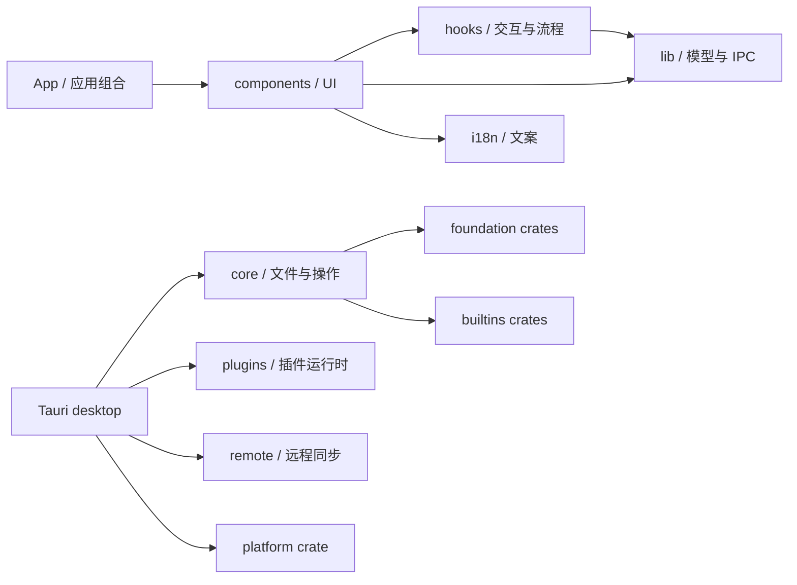

# Fiex 代码库重构基线

> 快照日期：2026-11-12
> 审查基线：Core PR #180 head `5e23a8e596a6d93c314cf54adc397766992fbf00`，SDK PR #36 head `4ee25923f09ced83ca29146f22091172a31ff929`。本页保留 2026-11-12 的原始规模统计，并在阶段记录中逐步补充后续工作。
> 用途：记录本轮分阶段重构的起点，避免目录迁移后失去可比较的测试、尺寸与 CI 基线。

## 当前结构与依赖方向

前端已有可复用的业务分区，但主要按代码种类分布。Explorer 的视图在 `components/browser`，导航、列表、监听等状态 hooks 归属 `features/explorer/hooks`，纯展示与列表模型归属 `features/explorer/model`。文件操作及菜单也横跨组件、hooks 与 lib。Rust 则已有 foundation、builtins、platform crates；Tauri 主 crate 仍组合 desktop、core、plugins、remote 和 infrastructure。

图中前端箭头表示当前主要源码归属与调用关系的概览，不表示允许任意跨层引用。后续迁移的依赖规则是：UI 经 feature service 和 typed IPC 进入宿主；Rust 桌面入口只适配输入输出，业务用例依赖稳定的 domain/foundation 接口，平台与 Provider 实现留在适配层。

本轮先建立 `src/features/explorer/model`，将只用于文件列表展示的文件名格式化逻辑及其测试放在同一 feature。此次迁移保持函数签名和行为不变，删除旧 `src/lib` 入口，不留兼容转发。

## 规模与测试现状

下表的源码数按当前仓库树统计，测试文件数包含相邻的 Vitest、Rust test 模块和 Playwright specs；它反映测试分布，不等价于行为覆盖率。

| 区域                                  |                                                                             当前基线 | 已知维护问题                                                                                                  |
| ------------------------------------- | -----------------------------------------------------------------------------------: | ------------------------------------------------------------------------------------------------------------- |
| `src/`                                |                                            271 个 TypeScript/TSX 文件；42 个测试文件 | 组件、hooks、lib 按技术种类拆分；基线时严格边界检查只覆盖 IPC JSON 基础解析器，本 PR 加入 Explorer 文件名模型 |
| `e2e/`                                |                                                           10 个 Playwright spec 文件 | fixture 能验证 UI 状态和命令副作用，但不能代替真实 Finder、Windows Shell 或 Linux 桌面行为                    |
| `src-tauri/src` 与 `src-tauri/crates` | 主 crate 有 385 个 Rust 文件、38 个测试文件；crates 有 83 个 Rust 文件、9 个测试文件 | 主 crate 仍承载多项编排；部分高风险场景缺少故障注入或真实平台验证                                             |
| `sdk/rust`                            |                                                        79 个 Rust 文件、3 个测试文件 | SDK 是独立 submodule；协议变化要先对齐 Core 和官方插件                                                        |
| 大文件门禁                            |                                   `scripts/file-size-baseline.json` 有 44 项历史例外 | 检查会阻止记录文件继续变大；目标是分功能逐项删除，不重置额度                                                  |

现有 E2E 已包含新建文件后默认选中、零选择时的新建菜单、多选废纸篓彻底删除、子菜单切换和视口边缘约束、双面板状态等回归。本 PR 再补充工具栏排序只影响活动目录的双面板交互测试。后续新增测试应针对未覆盖的状态或失败路径，不重复增加只断言 toast/快照的用例。需求与已知缺口继续以[软件需求与测试追溯](/developer/requirements)为事实来源。

## CI 与验证基线

PR #91 head 的最近一次完整 `Core tests, IPC and release` workflow 于 2026-11-11 成功，观测耗时约 19 分 35 秒。现有 workflow 包含：

- Scope Policy 的 Kani 证明、覆盖率门槛与变异测试；
- 前端格式、lint、边界类型、文件尺寸、Tauri 契约、i18n、Vitest 与构建；
- Playwright 浏览器 UI 测试；
- Linux、macOS、Windows 桌面构建与 Rust 检查；
- 发布前原生依赖审计与安装包流程。

本轮不得删除或放宽这些 job。前端全源覆盖率由 `npm run test:coverage` 采集，Rust workspace library unit tests 由 `cargo llvm-cov` 采集，两者均与提交库中的初始基线比较并发布 CI artifact；目前只报告、不设通过门槛。关键用户操作的跨平台性能门槛仍需等待三平台样本校准；Scope Policy 现有覆盖率门槛保持不变。

## 分阶段实施记录

| 阶段                          | 状态                                                         | 交付                                                                                                                                                                                                                                                                                                                                                                                                                                                                                                                                                                                                                                                                                                                                                                                                                                                                                                                                                                                                                                                                                                                                                                                                                                                                                                                                                                                                                                                                                                                                                                                                                                                                                                                                                                                                                                                                                                                                                                                                                                                                                                                                                                                               |
| ----------------------------- | ------------------------------------------------------------ | -------------------------------------------------------------------------------------------------------------------------------------------------------------------------------------------------------------------------------------------------------------------------------------------------------------------------------------------------------------------------------------------------------------------------------------------------------------------------------------------------------------------------------------------------------------------------------------------------------------------------------------------------------------------------------------------------------------------------------------------------------------------------------------------------------------------------------------------------------------------------------------------------------------------------------------------------------------------------------------------------------------------------------------------------------------------------------------------------------------------------------------------------------------------------------------------------------------------------------------------------------------------------------------------------------------------------------------------------------------------------------------------------------------------------------------------------------------------------------------------------------------------------------------------------------------------------------------------------------------------------------------------------------------------------------------------------------------------------------------------------------------------------------------------------------------------------------------------------------------------------------------------------------------------------------------------------------------------------------------------------------------------------------------------------------------------------------------------------------------------------------------------------------------------------------------------------- |
| P0-01 基线                    | PR #92                                                       | 锁定 Core/SDK 基线、记录现有目录/测试/大文件/CI 现状，并将审计页加入唯一 VitePress 文档站点                                                                                                                                                                                                                                                                                                                                                                                                                                                                                                                                                                                                                                                                                                                                                                                                                                                                                                                                                                                                                                                                                                                                                                                                                                                                                                                                                                                                                                                                                                                                                                                                                                                                                                                                                                                                                                                                                                                                                                                                                                                                                                        |
| Explorer feature 起步         | PR #92                                                       | 迁移 `formatDisplayFileName` 与相邻测试到 `src/features/explorer/model`，更新唯一调用方                                                                                                                                                                                                                                                                                                                                                                                                                                                                                                                                                                                                                                                                                                                                                                                                                                                                                                                                                                                                                                                                                                                                                                                                                                                                                                                                                                                                                                                                                                                                                                                                                                                                                                                                                                                                                                                                                                                                                                                                                                                                                                            |
| P0-02 保护网                  | PR #181                                                      | PR #92 补双面板排序 UI 回归；PR #93 增加 Trash“放回原处”端到端回归；PR #94 增加过期目录响应竞态 E2E；PR #96 补插件重新握手后能力索引替换测试；PR #103 补源变化回滚、PR #106 补嵌套目录 Provider 写入故障后的回滚；PR #154 增加 Windows Shell AppsFolder/应用标识原生 smoke 与 Linux USB raw access 权限保护测试；macOS Finder Trash 测试已接入三平台矩阵；PR #181 增加系统外部 Finder Trash 元数据恢复到磁盘的集成测试、Windows AppsFolder Notepad 实际打开文件与 Command Prompt 指定目录启动测试，以及 Linux loopback block device 的授权/已挂载拒绝测试；物理 USB 热插拔未纳入托管 CI                                                                                                                                                                                                                                                                                                                                                                                                                                                                                                                                                                                                                                                                                                                                                                                                                                                                                                                                                                                                                                                                                                                                                                                                                                                                                                                                                                                                                                                                                                                                                                                                            |
| P4-01 大文件例外清理          | PR #96、#107、#113–#117、#153、#156–#180                     | PR #96 将 ProviderRegistry 单测拆分到同目录测试模块；PR #107 将 FileSystem Provider 集成测试按 views、transfers、resources 分组；PR #113 按 provider 拆分 Native VFS handlers；PR #114 独立目录快照内存 LRU 缓存；PR #115 将操作队列单测迁至同目录；PR #116 按 router、scope、validation 拆分事件测试；PR #117 将远程缓存单测移到同目录；PR #153 将 aria2 下载配置、引擎执行和流生命周期拆到相邻模块；PR #156 将 RPC 请求/响应摘要生成从日志存储模块拆分；PR #157 将虚拟目录搜索快照协调从引擎路由模块拆分；PR #158 将远程连接权限校验与网络域投影拆到权限模块；PR #159 将离线缓存目录回退及错误分类拆到子模块；PR #160 将连接菜单 action 执行编排拆到独立模块；PR #161 将 Tauri 启动配置与窗口生命周期处理拆出组合入口；PR #162 将菜单预检和并行可用性检查从 Provider 注册模块拆出；PR #163 将装饰缓存快照比较与增量复用拆到独立模块；PR #164 将状态中心筛选规则和筛选菜单拆到 activity 子模块并增加筛选回归测试；PR #165 将会话级右键菜单资源快照缓存拆到专用模块并测试缓存键校验；PR #166 将插件包内预览资源路径校验与读取拆分，并覆盖相对路径、安全路径和无效字段；PR #167 将系统应用身份和名称注册逻辑从应用目录缓存编排中拆分并补充名称清理测试；PR #168 将 Applications URI 编码、规范化与节点解析从状态存储入口移到 uri 模块；PR #169 将音频、MP4 与 Matroska 元数据解析拆到子模块并补时长格式测试；PR #170 将插件 Provider 文件流读写桥接拆到独立模块；PR #171 将进程标准输出的 JSON-RPC 帧读取与响应路由拆到独立模块；PR #172 将预览对话框状态呈现、内容分支和底栏拆到相邻组件并增加布局模型测试；PR #173 将文件选择器目录生命周期、筛选排序模型与选择操作拆到专用模块并补模型测试；PR #174 将工具栏顺序补全和拖动样式计算提取到纯模型并补测试；PR #175 将连接挂载与已打开 tab 的识别规则提取并补覆盖；PR #176 将侧栏重排的移动、落点、间隙和位移规则提取并补纯模型测试，位置图标渲染移到相邻组件；PR #177 将插件面板桥接操作分派及尺寸、隐藏状态策略拆到独立模块并补策略测试；PR #178 将应用控制器的文件、连接、打开、工作区和快捷键 action 组合移到专用 hook；PR #179 将路径、文件元数据和排序/分组模型从公共 files 入口拆到同目录模块，公共导出保持不变；PR #180 配套 SDK PR #36 将 12 个 Rust/UI SDK 超限文件拆为专用模块，并将所有 SDK 源文件降至 300 行以内；基线已清空，剩余 0 项 |
| P2-01 Explorer feature        | PR #98–#102、#104–#105、#108                                 | 将导航、列表生命周期 hooks、目录专属列宽偏好、流式搜索、目录视图、列表比较/缓存及列表网格布局/拖拽模型迁移到 Explorer feature；共享偏好合同与 IPC 归一化留在 lib                                                                                                                                                                                                                                                                                                                                                                                                                                                                                                                                                                                                                                                                                                                                                                                                                                                                                                                                                                                                                                                                                                                                                                                                                                                                                                                                                                                                                                                                                                                                                                                                                                                                                                                                                                                                                                                                                                                                                                                                                                   |
| P2-02 文件操作策略            | PR #110、#118、#155、#182                                    | 将副本能力判断和移动路径过滤提取到 Explorer model；PR #118 将批量重命名的两阶段执行与失败回滚迁入 Explorer operation，并覆盖交换重命名和回滚；PR #155 修复永久删除失败时仍清空选择状态的问题，并增加成功/失败回归用例。PR #182 将单项重命名的 capability gate 与 IPC 执行收敛到 Explorer operation，并覆盖权限拒绝、成功返回与失败结果；hook 保留对话框、选择、错误展示、重命名输入与目录刷新等 UI 状态                                                                                                                                                                                                                                                                                                                                                                                                                                                                                                                                                                                                                                                                                                                                                                                                                                                                                                                                                                                                                                                                                                                                                                                                                                                                                                                                                                                                                                                                                                                                                                                                                                                                                                                                                                                            |
| P2-03 文件操作归属            | PR #111、#238–#241；应用组合继续收窄                         | 操作策略、执行模型、合同和测试统一归入 `features/file-operations`；feature hook 组合创建、回收、恢复、传输、单项/批量重命名。串行 runner 将 IPC、活动状态、权限反馈和目录刷新作为注入服务；批量重命名状态、提交与刷新由 feature 管理并有单测。应用层 hook 绑定 Tauri、文件选择器及状态中心；feature hooks/services 纳入严格类型边界。应用壳与 native environment 仍逐步收窄其控制器输入。                                                                                                                                                                                                                                                                                                                                                                                                                                                                                                                                                                                                                                                                                                                                                                                                                                                                                                                                                                                                                                                                                                                                                                                                                                                                                                                                                                                                                                                                                                                                                                                                                                                                                                                                                                                                          |
| P2-04 菜单策略                | PR #112                                                      | 将 Core 菜单 IPC 类型移到共享 lib，将“更多”菜单计划和空菜单可见性规则及其测试迁入 Explorer model；菜单呈现与 action 执行仍留在组件适配层                                                                                                                                                                                                                                                                                                                                                                                                                                                                                                                                                                                                                                                                                                                                                                                                                                                                                                                                                                                                                                                                                                                                                                                                                                                                                                                                                                                                                                                                                                                                                                                                                                                                                                                                                                                                                                                                                                                                                                                                                                                           |
| P3-01 Rust FS/Operations      | PR #186–#188、#195、#198、#202–#203、#205–#206、#212（分批） | 将 OperationResult、Conflict、Resolution、Undo 和取消检查下沉至共享 core/operation_types；复制暂存归入 core/transfers，路径工具归入 core/fs/path_utils；PR #187/#188 拆分 ResourceBroker；PR #195 覆盖 preflight 缓存瞬时故障、单飞重试和变更失效；PR #198 通过 ResourceBroker、ProviderRegistry、Applications VFS 与 availability cache 的真实调用链验证拒绝缓存、Provider 状态变化后的失效和重新允许。PR #202 为 IpcVfsProvider 增加可注入 transport，覆盖断连透传、恢复和畸形响应；PR #203 增加真实 Core/Host/SDK mock VFS 的跨进程打开与重启恢复 smoke；Provider list 故意使插件进程退出，Core 返回失败后自动重启，并由后续 list/stat 请求恢复。PR #205 为 Core provider 写入流增加仅测试启用的定点故障注入；在首个目标已提交后令嵌套目标写入失败，验证先前目标回滚、源内容及原目标内容保持不变。PR #206 验证回滚失效后目录缓存 revision 递增并拒绝旧列表回填；PR #212 让独立进程执行回滚失败，再由后续进程重新打开恢复清单和原始备份。真实第三方远端 Provider 的端到端回滚仍需服务账号环境验证。                                                                                                                                                                                                                                                                                                                                                                                                                                                                                                                                                                                                                                                                                                                                                                                                                                                                                                                                                                                                                                                                                                                                                                                              |
| P3-02 Rust Plugin Host/Remote | PR #189–#190、#192、#194、#196、#203、#210（分批）           | #189 收紧 JSON-RPC 回复版本、数字 ID 与 result/error envelope；#190 覆盖远端上传分块和 abort；#192 注入 provider 边界验证断网 stat/refresh 时缓存字节与 revision baseline 不变、双端修改进入 conflict，并补 metadata 原子写入/读回验证；#194 通过 SDK mock fixture 验证插件子进程意外退出后当前 RPC 失败、后续 ping 重启并重新握手；#196 修复自启动注册表就绪竞态；#203 新增两个独立 Core 进程间的 VFS view 持久化/恢复 smoke，并在真实 VFS list 中杀死 SDK 插件进程，验证故障返回和下一次 Provider 请求自动重启恢复；平台 CI 结果待新 PR 工作流运行。#210 通过残留暂存文件模拟元数据替换前的进程中断，验证最后已提交基线可恢复；真实第三方远端服务和物理断电验证仍未覆盖。                                                                                                                                                                                                                                                                                                                                                                                                                                                                                                                                                                                                                                                                                                                                                                                                                                                                                                                                                                                                                                                                                                                                                                                                                                                                                                                                                                                                                                                                                                                        |
| P1-01 架构边界                | PR #97                                                       | 新增 AST 导入检查，禁止 feature 层依赖 components/hooks；进入前端 CI；Vitest 覆盖允许和拒绝方向                                                                                                                                                                                                                                                                                                                                                                                                                                                                                                                                                                                                                                                                                                                                                                                                                                                                                                                                                                                                                                                                                                                                                                                                                                                                                                                                                                                                                                                                                                                                                                                                                                                                                                                                                                                                                                                                                                                                                                                                                                                                                                    |
| P1-02 Info IPC                | PR #95                                                       | Info 合同由 IPC 层定义并由 UI 消费，严格类型检查覆盖 Info 解码器，回归测试拒绝把枚举值编码为数组                                                                                                                                                                                                                                                                                                                                                                                                                                                                                                                                                                                                                                                                                                                                                                                                                                                                                                                                                                                                                                                                                                                                                                                                                                                                                                                                                                                                                                                                                                                                                                                                                                                                                                                                                                                                                                                                                                                                                                                                                                                                                                   |
| P1-03 搜索 IPC                | PR #109                                                      | `search_files` 命令结果改为 `void`，参数和结果通过 typed command map 约束；搜索批次继续由 Channel 独立传输并经 `parseSearchBatch` 校验                                                                                                                                                                                                                                                                                                                                                                                                                                                                                                                                                                                                                                                                                                                                                                                                                                                                                                                                                                                                                                                                                                                                                                                                                                                                                                                                                                                                                                                                                                                                                                                                                                                                                                                                                                                                                                                                                                                                                                                                                                                             |
| P1-04 Core 菜单执行 IPC       | PR #119                                                      | 为 Core 菜单执行结果增加运行时 decoder，限定 command 和字段形状，移除组件适配器中的双重类型断言；插件自定义 JSON 仍走通用结果路径                                                                                                                                                                                                                                                                                                                                                                                                                                                                                                                                                                                                                                                                                                                                                                                                                                                                                                                                                                                                                                                                                                                                                                                                                                                                                                                                                                                                                                                                                                                                                                                                                                                                                                                                                                                                                                                                                                                                                                                                                                                                  |
| P1-05 连接菜单执行 IPC        | PR #120                                                      | 将连接菜单 DTO 移到共享 lib，为 edit/close Core action 增加严格 decoder 和目标连接 ID 校验；插件自定义结果保留通用路径                                                                                                                                                                                                                                                                                                                                                                                                                                                                                                                                                                                                                                                                                                                                                                                                                                                                                                                                                                                                                                                                                                                                                                                                                                                                                                                                                                                                                                                                                                                                                                                                                                                                                                                                                                                                                                                                                                                                                                                                                                                                             |
| P1-06 菜单解析 IPC            | PR #121                                                      | Core 与插件菜单结果逐字段解码为共享 DTO；校验菜单字段、快捷键及 activity，并拒绝未知字段，移除双重类型断言                                                                                                                                                                                                                                                                                                                                                                                                                                                                                                                                                                                                                                                                                                                                                                                                                                                                                                                                                                                                                                                                                                                                                                                                                                                                                                                                                                                                                                                                                                                                                                                                                                                                                                                                                                                                                                                                                                                                                                                                                                                                                         |
| P1-07 延迟菜单项 IPC          | PR #122                                                      | 根菜单与懒加载子菜单共用 Core/插件菜单项 decoder；移除 UI 中重复的 Core 解码与插件根菜单二次过滤，子菜单仍可引用前一页定义的 parent                                                                                                                                                                                                                                                                                                                                                                                                                                                                                                                                                                                                                                                                                                                                                                                                                                                                                                                                                                                                                                                                                                                                                                                                                                                                                                                                                                                                                                                                                                                                                                                                                                                                                                                                                                                                                                                                                                                                                                                                                                                                |
| P1-08 子菜单结果类型          | PR #123                                                      | 在 Tauri IPC 返回边界校验懒加载子菜单 envelope 与通用菜单项字段，并将结果从 `JsonValue[]` 改为共享子菜单 DTO                                                                                                                                                                                                                                                                                                                                                                                                                                                                                                                                                                                                                                                                                                                                                                                                                                                                                                                                                                                                                                                                                                                                                                                                                                                                                                                                                                                                                                                                                                                                                                                                                                                                                                                                                                                                                                                                                                                                                                                                                                                                                       |
| P1-09 装饰数据 IPC            | PR #124                                                      | 将文件装饰解码改为显式构造 DTO，递归校验 badge、style、field target、来源列表与 Core 原生 badge，并归一化 nullable 可选字段                                                                                                                                                                                                                                                                                                                                                                                                                                                                                                                                                                                                                                                                                                                                                                                                                                                                                                                                                                                                                                                                                                                                                                                                                                                                                                                                                                                                                                                                                                                                                                                                                                                                                                                                                                                                                                                                                                                                                                                                                                                                        |
| P1-10 Info 结果 IPC           | PR #125                                                      | 将 Info open 与 field-delta 结果改为逐层构造 DTO；校验 envelope、section、field 和 update 的字段，并拒绝未识别键                                                                                                                                                                                                                                                                                                                                                                                                                                                                                                                                                                                                                                                                                                                                                                                                                                                                                                                                                                                                                                                                                                                                                                                                                                                                                                                                                                                                                                                                                                                                                                                                                                                                                                                                                                                                                                                                                                                                                                                                                                                                                   |
| P1-11 主题 IPC                | PR #126                                                      | 将插件主题结果逐字段构造 Theme DTO，验证主题模式、令牌映射与可选暗色变体，并拒绝未识别主题字段                                                                                                                                                                                                                                                                                                                                                                                                                                                                                                                                                                                                                                                                                                                                                                                                                                                                                                                                                                                                                                                                                                                                                                                                                                                                                                                                                                                                                                                                                                                                                                                                                                                                                                                                                                                                                                                                                                                                                                                                                                                                                                     |
| P1-12 预览 IPC                | PR #127                                                      | 将候选列表和解析预览结果逐字段解码；按 kind 校验视图必需字段、可选元数据、媒体类型和数字范围                                                                                                                                                                                                                                                                                                                                                                                                                                                                                                                                                                                                                                                                                                                                                                                                                                                                                                                                                                                                                                                                                                                                                                                                                                                                                                                                                                                                                                                                                                                                                                                                                                                                                                                                                                                                                                                                                                                                                                                                                                                                                                       |
| P1-13 提供程序设置 IPC        | PR #128                                                      | 为 provider catalog/preferences 逐项构造 DTO，校验 envelope、entry 和 preference 列表并拒绝未知键                                                                                                                                                                                                                                                                                                                                                                                                                                                                                                                                                                                                                                                                                                                                                                                                                                                                                                                                                                                                                                                                                                                                                                                                                                                                                                                                                                                                                                                                                                                                                                                                                                                                                                                                                                                                                                                                                                                                                                                                                                                                                                  |
| P1-14 远程配置 IPC            | PR #129                                                      | 将远程连接配置逐字段解码为标量设置 DTO，校验 nullable 标识和配置字段，并拒绝未识别键                                                                                                                                                                                                                                                                                                                                                                                                                                                                                                                                                                                                                                                                                                                                                                                                                                                                                                                                                                                                                                                                                                                                                                                                                                                                                                                                                                                                                                                                                                                                                                                                                                                                                                                                                                                                                                                                                                                                                                                                                                                                                                               |
| P1-15 安装预览 IPC            | PR #130                                                      | 为远程与本地插件安装预览构造独立 DTO，验证全部必需字段、author 和 nullable 可选字段，并归一化本地预览字段                                                                                                                                                                                                                                                                                                                                                                                                                                                                                                                                                                                                                                                                                                                                                                                                                                                                                                                                                                                                                                                                                                                                                                                                                                                                                                                                                                                                                                                                                                                                                                                                                                                                                                                                                                                                                                                                                                                                                                                                                                                                                          |
| P1-16 文件条目 IPC            | PR #131                                                      | 根据 Rust `Entry`/`Tag` 序列化合同显式构造文件条目 DTO，校验无符号数值、标签颜色、缓存标志、操作列表及 sync 状态，并拒绝未知字段                                                                                                                                                                                                                                                                                                                                                                                                                                                                                                                                                                                                                                                                                                                                                                                                                                                                                                                                                                                                                                                                                                                                                                                                                                                                                                                                                                                                                                                                                                                                                                                                                                                                                                                                                                                                                                                                                                                                                                                                                                                                   |
| P1-17 操作结果 IPC            | PR #132                                                      | 显式解码文件操作结果及嵌套传输冲突和两侧文件版本，校验计数、字段集合与无符号元数据                                                                                                                                                                                                                                                                                                                                                                                                                                                                                                                                                                                                                                                                                                                                                                                                                                                                                                                                                                                                                                                                                                                                                                                                                                                                                                                                                                                                                                                                                                                                                                                                                                                                                                                                                                                                                                                                                                                                                                                                                                                                                                                 |
| P1-18 磁盘位置 IPC            | PR #133                                                      | 将卷位置结果和缓存位置列表构造为逐字段 DTO，校验非负整数容量、布尔状态与完整字段集合，并拒绝未知键                                                                                                                                                                                                                                                                                                                                                                                                                                                                                                                                                                                                                                                                                                                                                                                                                                                                                                                                                                                                                                                                                                                                                                                                                                                                                                                                                                                                                                                                                                                                                                                                                                                                                                                                                                                                                                                                                                                                                                                                                                                                                                 |
| P1-19 目录列表 IPC            | PR #134                                                      | 按 Rust `Listing` 合同逐字段构造结果，强制 `virtualVolume` 与基础字段，并验证默认视图枚举和未知键                                                                                                                                                                                                                                                                                                                                                                                                                                                                                                                                                                                                                                                                                                                                                                                                                                                                                                                                                                                                                                                                                                                                                                                                                                                                                                                                                                                                                                                                                                                                                                                                                                                                                                                                                                                                                                                                                                                                                                                                                                                                                                  |
| P1-20 搜索批次 IPC            | PR #135                                                      | 按 Rust `SearchBatch` 合同验证必需计数、完成状态和快照标记；对 warning/engine 等可选字段严格拒绝错误类型与未知键                                                                                                                                                                                                                                                                                                                                                                                                                                                                                                                                                                                                                                                                                                                                                                                                                                                                                                                                                                                                                                                                                                                                                                                                                                                                                                                                                                                                                                                                                                                                                                                                                                                                                                                                                                                                                                                                                                                                                                                                                                                                                   |
| P1-21 连接导航 IPC            | PR #136                                                      | 按 VFS/pluginView 联合类型严格校验字段集合、必需状态与 nullable 标题，并归一化 Rust 的 null tabTitle                                                                                                                                                                                                                                                                                                                                                                                                                                                                                                                                                                                                                                                                                                                                                                                                                                                                                                                                                                                                                                                                                                                                                                                                                                                                                                                                                                                                                                                                                                                                                                                                                                                                                                                                                                                                                                                                                                                                                                                                                                                                                               |
| P1-22 状态读取 IPC            | PR #137                                                      | 为 `state_get` 各 namespace/key 提供精确重载，去除分支内类型断言，严格校验 picker sort 并让 preferences 正确表达可缺省的 null                                                                                                                                                                                                                                                                                                                                                                                                                                                                                                                                                                                                                                                                                                                                                                                                                                                                                                                                                                                                                                                                                                                                                                                                                                                                                                                                                                                                                                                                                                                                                                                                                                                                                                                                                                                                                                                                                                                                                                                                                                                                      |
| P1-23 Info 枚举解码           | PR #138                                                      | 将 Info field 状态、计算模式及 section 来源改为类型守卫；解码成功后直接构造联合类型 DTO，并测试未知字符串值和数组值均被拒绝                                                                                                                                                                                                                                                                                                                                                                                                                                                                                                                                                                                                                                                                                                                                                                                                                                                                                                                                                                                                                                                                                                                                                                                                                                                                                                                                                                                                                                                                                                                                                                                                                                                                                                                                                                                                                                                                                                                                                                                                                                                                        |
| P1-24 状态读取参数 IPC        | PR #139                                                      | 在动态结果分派前逐项验证 `state_get` 的 namespace/key 参数，并拒绝未知组合及额外字段，移除分派器向状态参数 DTO 的类型断言                                                                                                                                                                                                                                                                                                                                                                                                                                                                                                                                                                                                                                                                                                                                                                                                                                                                                                                                                                                                                                                                                                                                                                                                                                                                                                                                                                                                                                                                                                                                                                                                                                                                                                                                                                                                                                                                                                                                                                                                                                                                          |
| P1-25 简单命令结果 IPC        | PR #140                                                      | 为返回 `void`、字符串、可空字符串、布尔值或计数的 Tauri 命令添加命令级结果校验；拒绝不匹配的 JSON 类型、负数、小数及超出安全整数范围的计数                                                                                                                                                                                                                                                                                                                                                                                                                                                                                                                                                                                                                                                                                                                                                                                                                                                                                                                                                                                                                                                                                                                                                                                                                                                                                                                                                                                                                                                                                                                                                                                                                                                                                                                                                                                                                                                                                                                                                                                                                                                         |
| P1-26 简单集合结果 IPC        | PR #141                                                      | 严格解码字符串列表和插件状态 tuple 列表，逐项验证值类型与 tuple 长度，并拒绝格式错误的集合响应                                                                                                                                                                                                                                                                                                                                                                                                                                                                                                                                                                                                                                                                                                                                                                                                                                                                                                                                                                                                                                                                                                                                                                                                                                                                                                                                                                                                                                                                                                                                                                                                                                                                                                                                                                                                                                                                                                                                                                                                                                                                                                     |
| P1-27 运行时目录 IPC          | PR #142                                                      | 逐项构造 IDE、终端和 Shell 探测结果 DTO，要求 ID/名称非空、字段完整且无多余键；Shell 还必须提供非空路径                                                                                                                                                                                                                                                                                                                                                                                                                                                                                                                                                                                                                                                                                                                                                                                                                                                                                                                                                                                                                                                                                                                                                                                                                                                                                                                                                                                                                                                                                                                                                                                                                                                                                                                                                                                                                                                                                                                                                                                                                                                                                            |
| P1-28 远程连接结果 IPC        | PR #143                                                      | 按 Rust `ConnectionInfo` DTO 校验远程连接列表、保存结果和会话更新结果；将 saved/autostart/canRead/canWrite 更新为必需布尔字段，并拒绝缺失字段和未知键                                                                                                                                                                                                                                                                                                                                                                                                                                                                                                                                                                                                                                                                                                                                                                                                                                                                                                                                                                                                                                                                                                                                                                                                                                                                                                                                                                                                                                                                                                                                                                                                                                                                                                                                                                                                                                                                                                                                                                                                                                              |
| P1-29 错误事件 IPC            | PR #144                                                      | 按 Rust `AppError` 的九个 camelCase 字段构造错误事件 DTO，校验时间/ID/次数整数范围、nullable operation 和必需状态，并同步补全前端类型映射                                                                                                                                                                                                                                                                                                                                                                                                                                                                                                                                                                                                                                                                                                                                                                                                                                                                                                                                                                                                                                                                                                                                                                                                                                                                                                                                                                                                                                                                                                                                                                                                                                                                                                                                                                                                                                                                                                                                                                                                                                                          |
| P1-30 插件日志页 IPC          | PR #145                                                      | 校验 Rust `LogPage` 的 entries/cursor/hasMore 和完整 `LogRecord` 字段，包含 nullable operationId/durationMs 与可省略 detail，并将共享日志 DTO 移入 lib 类型层                                                                                                                                                                                                                                                                                                                                                                                                                                                                                                                                                                                                                                                                                                                                                                                                                                                                                                                                                                                                                                                                                                                                                                                                                                                                                                                                                                                                                                                                                                                                                                                                                                                                                                                                                                                                                                                                                                                                                                                                                                      |
| P1-31 插件市场 IPC            | PR #146                                                      | 严格校验市场条目的 Rust 序列化字段、作者 nullable DTO、权限/域名/命令字符串列表及 JSON extensions；移除 Rust 未提供的市场 icon 类型假设                                                                                                                                                                                                                                                                                                                                                                                                                                                                                                                                                                                                                                                                                                                                                                                                                                                                                                                                                                                                                                                                                                                                                                                                                                                                                                                                                                                                                                                                                                                                                                                                                                                                                                                                                                                                                                                                                                                                                                                                                                                            |
| P1 IPC 合同覆盖               | PR #95–#149；持续 CI 门禁                                    | `check:tauri-contracts` 从 `generate_handler!` 与 Rust 命令标注提取 handler 集，逐项对比参数名、`TauriCommandArgs`、`TauriCommandResults` 与运行时 decoder。当前覆盖 140 个 handler；新增命令必须同步合同和 decoder。不存在未分配到稳定验收项的通用 P1 backlog。                                                                                                                                                                                                                                                                                                                                                                                                                                                                                                                                                                                                                                                                                                                                                                                                                                                                                                                                                                                                                                                                                                                                                                                                                                                                                                                                                                                                                                                                                                                                                                                                                                                                                                                                                                                                                                                                                                                                   |

**P1-32 已安装插件目录 IPC（PR #147）：** 按 Rust `PluginInfo` 校验完整权限状态、能力列表、schema 版本、超时范围及字段集合；验证 nullable author/icon/extensions，并将 description 改为必需字段。

**P1-33 系统代理 IPC（PR #148）：** 将 `system_proxy_info` 改为共享 DTO，校验 Rust 代理来源枚举、字段集合和 enabled/proxy 的一致状态。

**P1-34 最近位置导航 IPC（PR #149）：** 为 Rust `RecentNavigationTarget` 建立共享结果 DTO，校验非空 parent/target 及精确字段集合。

**P1-35 内部拖放 IPC（PR #150）：** 将 `DropPlan.references` 从 `unknown[]` 收窄为 SDK `ResourceRef[]`，并校验路径/引用数量一致、路径非空和引用结构。

**P1-36 平台及搜索目录 IPC（PR #151）：** 按受支持 OS 联合类型校验 `platform`，并将 `search_providers` 从通用 JSON 列表收窄为 Rust 搜索引擎 DTO，验证 priority、builtin 和模式枚举。

**P1-37 Provider 动作结果 IPC（PR #152）：** 将 `toolbar.invoke` 的空 Rust DTO 映射为 `void` 并验证空对象；按 Rust `HookResult` 拒绝 `plugin_before_open` 的额外字段。

每个后续阶段都应更新该快照的基线引用或新增日期版本，连同受影响模块的测试和需求追溯一起审查。

### 架构依赖门禁补强

本轮将 P1-01 扩展到完整 `src/` 导入图：运行时循环依赖一律失败；类型级循环采用显式基线，新增循环组件或把新模块卷入既有循环都会失败。当前基线仍含一组历史类型循环，源于 IPC DTO、共享模型与组件类型耦合，后续应通过迁移共享类型继续缩小，不能把它描述为零循环。Rust workspace 增加 crate 层次与 DAG 检查，在每个 Desktop matrix target 执行；检查基于 `cargo metadata --no-deps`，覆盖整个 workspace。 P3-01 将共享操作 DTO、取消检查和撤销合同从 operations 门面下沉至 core/operation_types，将复制暂存实现归入 core/transfers，并把共享路径规则放入 core/fs/path_utils；新增 Rust 源码门禁，禁止 core/fs 与 core/transfers 的非测试模块依赖 core/operations。

### IPC-CORE-01 Tauri command 契约漂移门禁

`check:tauri-contracts` 对照 `generate_handler!` 注册项、桌面模块中全部 `#[tauri::command]` 函数、`TauriCommandArgs` / `TauriCommandResults` 和运行时结果 decoder。它检查 Rust 参数经过 Tauri camelCase 映射后的字段名，排除注入的 AppHandle、Window、WebviewWindow 和 State；命令映射或 decoder 缺项会让 CI 失败。命令结果不再有通用 JSON 兜底，动态 JSON 命令必须显式列入 decoder。Open With picker DTO 已移到共享 lib，并按 Rust 的 camelCase 字段及 nullable `iconSource` 严格解析。Node 单测覆盖嵌套 Rust 参数解析和注释过滤；Vitest 覆盖有效响应、未知字段、非法字段及未知命令拒绝。

### P3-01 Rust FS/Operations 模块边界

P3-01 PR #186–#188 已完成共享操作合同、传输暂存与路径工具分离，并将 ResourceBroker 拆入 broker、reads/search、writes/mutations 模块。既有测试覆盖取消、源变化、Provider 写入失败回滚与 preflight 拒绝；PR #195 覆盖缓存瞬时失败重试、单飞等待者恢复和变更通知失效；PR #198 验证 registered Applications VFS 与 availability cache 调用链。PR #202 为 IpcVfsProvider 增加可注入 transport，验证断连透传、后续调用恢复与畸形响应拒绝；PR #203 增加跨进程 Core/Host/SDK mock VFS 集成 smoke，恢复持久化 view 并经真实 JSON-RPC Provider list/stat，并在 list 请求中终止插件进程、验证下一请求重启后恢复。PR #205 在 provider 写入流边界确定性注入失败，验证先前已提交目标按逆序回滚，且源文件和被替换的原目标保持不变；后续回归覆盖回滚失败时保留被覆盖文件的恢复备份、目录缓存 revision 推进和旧列表写入拒绝。
P3-02 PR #189–#192、#194、#196 分批加强 Host/RPC 与远端 reconcile：非法 JSON-RPC reply、超时和断连会失败关闭；上传仅在所有分块确认后 commit，未完成 lease 会 abort；可注入测试覆盖离线 stat、远程刷新失败时缓存字节与基线保持不变，以及双端修改进入 conflict。Core CI 的 plugin_smoke 已验证子进程退出后 RPC 失败和重新握手；PR #196 覆盖自启动注册表就绪顺序；PR #203 新增独立 Core 进程恢复持久化 VFS view，并在真实 Provider list 导致插件进程退出后验证错误透传和后续请求自动重启恢复；平台 CI 结果尚待本 PR 工作流运行。PR #210 已通过残留暂存文件模拟元数据原子替换前的进程中断，并验证旧基线可恢复；真实第三方服务和物理断电仍需单独验证。
P4-02 严格类型边界现覆盖 Explorer 文件名、文件夹视图、菜单、列宽、传输策略、目录 diff、快照缓存、流式搜索、重命名策略和连接恢复模型，以及虚拟路径解析和共享列宽偏好；PR #196 将连接侧栏模型与自启动恢复 readiness 纳入 `tsconfig.boundary.json`。PR #199 将单项重命名 API 调用改为 hook 注入，并把单项/批量重命名、操作结果与操作合同加入严格边界。PR #200 将新建、回收/彻底删除和复原操作的 API、文件选择器及权限错误呈现改为 hook 注入，并把 create/recycle/restore 加入严格边界；新增模板文件创建、能力拒绝及恢复服务注入测试。PR #201 将复制/移动/冲突解决中的 Provider 调用和权限错误处理改为 hook 注入，并把 transfer orchestration 纳入严格边界；该检查还发现并修复了冲突状态可选 activityId 的严格类型问题。起始路径决策已抽为纯模型并纳入 `tsconfig.boundary.json`（PR #207）；位置列表刷新协调和起始目录请求的取消竞态已拆分并补测（PR #208）；搜索的 pane 请求代次与串行取消队列已拆为严格边界模型（PR #209）；本地目录 watcher 的注册、事件防抖和异步 teardown 已拆为严格边界模型（PR #211）；`Up` 父目录异步查询的过期响应与错误保护已拆分并补测（PR #213）；目录流快照对账已抽为纯模型并覆盖可见列表复用与 metadata 更新（PR #214）；PR #215 将 revision 忽略、装饰补丁、目录路径纠正、挂起目标选择和 Recent 回退决策抽入纯模型，并加入严格边界与浏览器级追溯；PR #216 将快照 UI adapter 的流、呈现和错误文案依赖改为注入，并把该 hook 纳入严格类型边界；PR #217 将标签顺序、活动标签索引和每个标签的浏览历史重排抽成纯状态转换并补边界测试；PR #218 将目录历史追加、前进/后退 cursor 决策抽成严格边界模型；PR #219 将框选矩形、相交判定、拖动阈值和 additive 选择合并抽成严格边界模型，并补浏览器流程；完整 Explorer 面板和其余异步 UI 编排仍待处理。PR #197 增加 10,000 项 Playwright 流程的一次预热、每个平台 20 轮重复采样和 nearest-rank p95 artifact，并接入 Linux、macOS、Windows runner；在三平台样本收齐并校准之前，性能通过阈值仍未定义。

**P4-02 PR #220：** 标签页打开、切换、关闭和关闭最后标签后的起始位置恢复现由 `navigationTabs` 纯状态转换统一决定；`useNavigation` 只应用结果到 React 状态。模型测试覆盖历史快照、活动标签调整、无效索引与输入不可变性，UI-NAV-03 追溯已更新。完整 Explorer 面板的异步编排与宽泛 hook 组合仍未完成。

**P4-02 PR #221：** 将 `useNavigation` 的搜索模式存储和父目录解析移至组合层注入的 `NavigationServices`，并把 hook 本身纳入严格类型边界。`noUncheckedIndexedAccess` 找到了初始标签路径的可选索引问题并已显式兜底；浏览器状态、系统路径解析及存储读写仍由现有组合层实现。

**P4-02 PR #222：** 将流式搜索 hook 的搜索启动、取消和本地化提示改为由 `useListing` 组合层注入；去掉 hook 对通用 IPC、i18n 及完整 Navigation hook 类型的依赖，并将其加入严格类型边界。搜索代次与取消顺序继续由已测试的 `searchLifecycle` 模型管理，SEARCH-01 与 ARCH-01 追溯同步更新。

**P4-02 PR #223：** 将位置刷新、启动路径解析和“上次目录”存储改为由组合层注入，位置 hook 仅负责生命周期和异步取消；用窄化的导航接口替代完整 Navigation hook 类型，并纳入严格类型边界。适配器移入 `features/explorer/services/listingAdapters.ts`，使 300 行门禁继续保持零例外；UI-NAV-03 与 ARCH-01 追溯同步更新。

**P4-02 PR #224：** 将装饰查询、Locale、呈现缓存和图标通知作为服务注入 `useEntryDecorations`，并把该 hook 纳入严格类型边界；Core 的装饰请求字段映射留在组合适配层。补齐 effect 的请求代次清理与 key 依赖，消除该 hook 的 React Hooks lint 警告。完整 `useListing` 组合 hook 仍未纳入 strict boundary，因为它的 API 依赖会卷入 E2E fixture、Terminal 和设置界面中大量未迁移的严格类型错误。

**P4-02 PR #225：** 将整个 `useListing` 面板流程加入严格类型边界。IPC、Tauri 事件、路径判断、刷新和错误文案统一由 `useExplorer` 组合层注入；列表 hook 只协调子 hook、React 状态和模型。现有服务适配器仍集中在 `features/explorer/services/listingAdapters.ts`，新增 `useListing.ts` 边界检查后仍满足 300 行门禁。ARCH-01 追溯已更新。

**P4-02 PR #226：** 将导航和列表适配器从 `useExplorer` 移到应用/面板组合层；`useExplorer` 只接收 `ExplorerServices` 并连接两个已严格检查的子 hook。新增 `useExplorer.ts` 到 strict boundary，至此 Explorer 导航、搜索、位置、装饰、列表与面板组合 hook 全部受 `exactOptionalPropertyTypes` 和 `noUncheckedIndexedAccess` 检查。应用控制器仍作为最外层系统组合入口，不纳入 Explorer feature 边界。

**P4-02 PR #227：** 将工作区标签保存、有效上次目录记录和 native VFS view 延迟保留从 `useAppController` 移入独立的会话持久化 hook；Recent 路径决策、保留载荷以及 native 延迟任务的调度/取消成为可测纯边界模型并纳入 strict boundary，UI-NAV-09 与 ARCH-01 追溯已更新。AppController 的宽泛返回对象及批量动作组合仍待后续按消费者边界逐步收窄。

**P2-01 后续 PR #228：** `ExplorerTabs` 改用标签栏所需的窄 props 合同，`App` 显式传递字段，不再将整个 `AppController` 扩散到标签组件。并修复 App 错误回报 effect 与菜单关闭 effect 的 Hooks 依赖告警。其余宽泛 `...app` 消费者将按组件边界继续迁移。

**P2-01 后续 PR #229：** 标签栏、路径栏与状态栏改用各自所需的窄 props 合同；`App` 到三个 UI 区域的字段转换集中在 app-shell binding adapter，组件与测试不再依赖 `AppController` 全量类型。现有标签拖动、双面板状态与状态栏按钮回归用例继续覆盖可见行为。

**P2-01 后续 PR #230：** Explorer 工具栏及其视图、固定插件工具和 IDE/终端选择控件不再依赖 `AppController` 类型；App shell adapter 只传递工具栏需要的动作和状态。刷新指示器的 950ms 状态与定时器清理已独立封装，工具栏保持在 300 行门禁内。

**P2-01 后续 PR #231：** `ExplorerDialogs` 用 UI 所需的显式状态/动作合同替代 `Pick<AppController, ...>`，由 app-shell adapter 传递 dialog、preview、Info、tag、connection 和 settings 状态；`App` 不再将完整控制器扩散给弹窗聚合器。具体文件操作行为仍由独立 hook 与已有 operation tests 管理。

**P2-01 后续 PR #232：** 文件右键菜单及其执行/项目构建合同改为显式依赖 Explorer、操作与菜单 DTO 类型，不再从应用控制器反推 props；`App` 仅经 app-shell adapter 传递所需字段。Core/插件菜单现有浏览器回归仍负责验证点击后文件状态与菜单行为。

**P2-02 文件选择器（PR #233–#235，分批）：** PR #233 将过滤、扩展名约束、排序、分组和跨平台路径工具迁入 `features/file-picker/model`；PR #234 将模式约束的选择、确认、保存替换策略提取为纯模型，并补充单元与 E2E 回归；PR #235 将目录/偏好生命周期、选择操作和会话状态迁入 feature hooks/services，由组件侧 session adapter 注入 IPC、错误上报、目录加载、文件操作和选择器完成回调。模型、选择和偏好服务及会话 hooks 已纳入 `tsconfig.boundary.json` 严格检查；需求追溯新增 UI-PICKER-02。三个 PR 为开放堆叠 PR，平台 CI 与合并结果待后续处理。

**P2-02 预览会话（PR #236）：** 将 Provider 排序与身份识别、用户偏好解析、候选发现和预览打开生命周期迁入 `features/preview`；组件侧 adapter 注入 IPC、缓存、资源 URL、会话 ID 与错误处理。`ResolvedPreview` DTO 移至共享协议模块，切断 IPC validator 对 UI 组件目录的反向依赖；纯模型和偏好读取测试纳入严格类型边界。既有浏览器 E2E 继续覆盖键盘快速预览、代码高亮和 PDF 内容。

**P2-02 菜单垂直切片（PR #237）：** 将 Core/插件菜单会话 hook、执行流程及菜单纯模型迁入 `features/context-menu`；React renderer 留在组件目录，通过 session/execution adapters 注入 IPC、进度、刷新、剪贴板和错误处理。提取菜单目标选择与请求身份模型并纳入严格类型边界，增加 action session/空 action/失败反馈单测，删除未使用的旧菜单行组件和遗留类型；现有菜单 E2E 与 Core provider 契约继续验证真实副作用。

**P2-02 文件选择/确认模型：** 已由 PR #234 交付：可确认条件、单/多选转换与 openFile/openFiles/openDirectory/saveFile 结果决策移入严格类型纯模型；文件模式只选目录时禁用“打开”，并有模式矩阵单测和按钮禁用 E2E。

**P2-03 文件操作归属（PR #238–#241）：** PR #238 明确 `features/file-operations` 的模块所有权并收紧 hook 对 feature 服务的组合方式；PR #239 将应用操作编排收敛到独立 hook；PR #240 让 preflight cache 测试使用独立夹具；PR #241 将批量重命名的多选状态、提交、清理和目录刷新迁入 feature service，并补齐成功/失败路径测试。应用壳仍是唯一允许连接多个 UI 区域的根组合层，接下来的拆分收窄其消费者输入。

**P0 覆盖率基线（PR #242–#243）：** 前端 V8 覆盖率和 Rust workspace library unit-test 覆盖率均以提交库内基线作趋势比较，并发布 JSON/artifact；当前仅观测，不新增阈值。前端基线为 103 个测试文件、507 个测试，语句/行 24.10%、函数 56.37%、分支 79.01%；Rust 覆盖 376 个源码文件，行 55.31%、函数 50.09%、region 52.29%。Rust 范围排除 doctest、bin、integration tests 与 SDK submodule；跨平台性能 p95 仍需三平台样本校准。

**P4-02 应用组合边界（PR #244）：** `appShellBindings` 每个转换函数只接收其目标 UI 的字段集合；`useAppEnvironment` 通过窄合同获取自启动连接状态、导航、窗口偏好和插件市场动作，不再接收完整 `AppController`。应用环境 hook 依赖较多原生和 UI 模块，保持在常规 TypeScript 检查中；纯自启动 readiness 的状态矩阵继续由相邻单测覆盖。

**双面板选择模型（PR #245）：** 将左右面板选择路径的并集去重，以及所选条目的跨面板对账迁入 `features/explorer/model/paneSelection.ts` 纯模型；保留单面板结果与引用行为，并以右侧较新条目覆盖重复路径，纳入严格类型边界和 OPS-SEL-01 需求追溯。

**P4-02 列表刷新信号（PR #246）：** 将远端同步订阅、目录变更事件路由、本地目录 watcher 与 Applications 更新订阅从 `useListing` 收敛至 `useListingRefreshSignals`；watcher 条件、远端挂载路径匹配和 query/list 刷新目标提取成纯策略并纳入严格边界与 `UI-VIEW-05`/`REL-01` 需求追溯。

**P2-03 单项原位重命名（PR #247）：** 将 `useListing` 中开始、取消和提交重命名的状态编排迁入 `features/file-operations/hooks/useInlineRename`；列表 hook 只传递当前目录、条目状态与导航 setter。新增严格边界检查和开始、取消、能力拒绝、Provider 失败及成功刷新测试，`OPS-RENAME-01`/`ARCH-01` 追溯同步更新。

**P2-01 共享连接状态（PR #248）：** 将连接列表从每个 Explorer pane 的 `useListing` 状态迁至应用级 `features/connections/hooks/useConnections`，左右面板共享一次加载结果；连接刷新、加载失败与完成状态由独立服务处理。Core IPC adapter 留在 feature 服务层，连接状态 hook 纳入严格边界，`CONN-01`/`ARCH-01` 测试追溯同步更新。

**P2-01 侧边栏窄化 Explorer 合同（PR #249）：** 侧边栏及其 Places、Favorites、Tags、Connections、Devices 子组件只接收自己使用的 Explorer 字段；`App` 显式构造侧边栏合同，不再扩散活动面板的完整 Explorer 对象。导航与连接展示行为保持现有 E2E 覆盖。

**Explorer 列表选择模型：** 单选、多选、范围选取、全选和方向键/Home/End 导航规则已从文件视图事件处理器移入纯模型；失效范围锚点会回退为当前项目，避免筛选或导航后选中错误区间。新增模型测试并将其纳入严格类型边界，`OPS-SEL-01` 追溯已更新。

**Explorer 面板视图偏好：** 将 `App` 中双面板展示偏好的解析、目录级持久化和工具栏排序路由迁入 `features/explorer/services/paneViewPreferences`；UI shell 只组合当前左右面板输入并转发更新。保留改变共享默认视图前保存另一面板目录视图的行为；新增服务级回归测试并纳入严格类型边界。

**Explorer 文件视图组件归属：** 将列表、图标、画廊和列视图及其行、拖拽、装饰徽标组件从 `components/browser` 整体迁入 `features/explorer/components`，并删除旧目录入口。将多 feature 共用的 FileIcon 放入 `shared/ui`；App 与次面板直接引用 Explorer 组件，列表视图从 sorting 专用模块导入规则。更新装饰徽标需求追溯及架构文档路径。

**Explorer 路径与状态栏归属：** 将地址栏、面包屑、路径工具栏、Explorer 状态栏和对应测试从 `components/explorer` 迁入 `features/explorer/components`。通用 `Button` primitive 从 `components/ui` 迁入 `shared/ui` 并更新全部调用方；不保留旧路径 re-export。同步补充路径栏和虚拟文件系统终端按钮的需求追溯。

**应用壳与标签栏边界：** 将 Explorer tabs renderer 迁入 `features/explorer/components`，通过 `windowControls` 注入原生窗口控件，不让 feature 依赖 Tauri；`WindowControls`、多域弹窗组合器和各区域 props adapter 迁入 `app/layout`。`App` 改用新归属路径，无旧目录转发文件。

**菜单旧入口清理：** 删除 `components/explorer/FileContextMenu.tsx` 的单行兼容转发，`App` 直接从菜单 renderer 所在目录引用实现。

**菜单 UI host 适配层归属：** 将 Core/plugin 菜单 renderer、Open With picker 和 IPC/进度适配器从 `components/explorer/context-menu` 移入 `app/layout/context-menu`。菜单模型、session hook 与执行规则仍由 `features/context-menu` 管理；App 直接引用 shell renderer，`components/explorer` 旧目录已清空。

**应用组合根归属：** 将根级 `src/App.tsx` 移入 `src/app/App.tsx`，由 `main.tsx` 从新的 app shell 路径启动；`src/components/explorer` 旧业务目录已完全移除。

**Explorer 工具栏归属：** 将跨 Explorer、插件、活动中心和系统控件的 toolbar composition 与子组件移入 `app/layout/toolbar`，作为应用壳组合层；纯顺序与拖动几何规则及测试移入 `features/explorer/model` 并加入严格类型边界。`App` 和壳层 adapter 只使用新路径。
