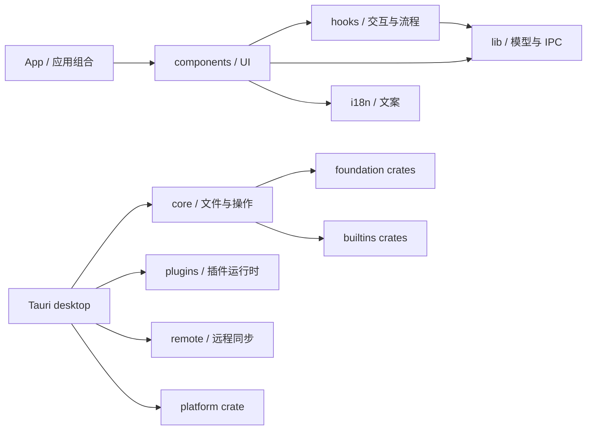

# Fiex 代码库重构基线

> 快照日期：2026-11-12
> 审查基线：Core PR #91 head `c1054455ddecb55bb5805d16879c0116559abc60`，SDK `7df42e185f90d6a04bede82a9cfef0be866e15c2`。PR #91 在建立快照时仍 open，且其 CI 已通过。
> 用途：记录本轮分阶段重构的起点，避免目录迁移后失去可比较的测试、尺寸与 CI 基线。

## 当前结构与依赖方向

前端已有可复用的业务分区，但主要按代码种类分布。Explorer 的视图在 `components/browser`，导航、列表、监听等状态 hooks 归属 `features/explorer/hooks`，纯展示与列表模型归属 `features/explorer/model`。文件操作及菜单也横跨组件、hooks 与 lib。Rust 则已有 foundation、builtins、platform crates；Tauri 主 crate 仍组合 desktop、core、plugins、remote 和 infrastructure。

图中前端箭头表示当前主要源码归属与调用关系的概览，不表示允许任意跨层引用。后续迁移的依赖规则是：UI 经 feature service 和 typed IPC 进入宿主；Rust 桌面入口只适配输入输出，业务用例依赖稳定的 domain/foundation 接口，平台与 Provider 实现留在适配层。

本轮先建立 `src/features/explorer/model`，将只用于文件列表展示的文件名格式化逻辑及其测试放在同一 feature。此次迁移保持函数签名和行为不变，删除旧 `src/lib` 入口，不留兼容转发。

## 规模与测试现状

下表的源码数按当前仓库树统计，测试文件数包含相邻的 Vitest、Rust test 模块和 Playwright specs；它反映测试分布，不等价于行为覆盖率。

| 区域                                  |                                                                             当前基线 | 已知维护问题                                                                                                  |
| ------------------------------------- | -----------------------------------------------------------------------------------: | ------------------------------------------------------------------------------------------------------------- |
| `src/`                                |                                            271 个 TypeScript/TSX 文件；42 个测试文件 | 组件、hooks、lib 按技术种类拆分；基线时严格边界检查只覆盖 IPC JSON 基础解析器，本 PR 加入 Explorer 文件名模型 |
| `e2e/`                                |                                                           10 个 Playwright spec 文件 | fixture 能验证 UI 状态和命令副作用，但不能代替真实 Finder、Windows Shell 或 Linux 桌面行为                    |
| `src-tauri/src` 与 `src-tauri/crates` | 主 crate 有 385 个 Rust 文件、38 个测试文件；crates 有 83 个 Rust 文件、9 个测试文件 | 主 crate 仍承载多项编排；部分高风险场景缺少故障注入或真实平台验证                                             |
| `sdk/rust`                            |                                                        79 个 Rust 文件、3 个测试文件 | SDK 是独立 submodule；协议变化要先对齐 Core 和官方插件                                                        |
| 大文件门禁                            |                                   `scripts/file-size-baseline.json` 有 44 项历史例外 | 检查会阻止记录文件继续变大；目标是分功能逐项删除，不重置额度                                                  |

现有 E2E 已包含新建文件后默认选中、零选择时的新建菜单、多选废纸篓彻底删除、子菜单切换和视口边缘约束、双面板状态等回归。本 PR 再补充工具栏排序只影响活动目录的双面板交互测试。后续新增测试应针对未覆盖的状态或失败路径，不重复增加只断言 toast/快照的用例。需求与已知缺口继续以[软件需求与测试追溯](/developer/requirements)为事实来源。

## CI 与验证基线

PR #91 head 的最近一次完整 `Core tests, IPC and release` workflow 于 2026-11-11 成功，观测耗时约 19 分 35 秒。现有 workflow 包含：

- Scope Policy 的 Kani 证明、覆盖率门槛与变异测试；
- 前端格式、lint、边界类型、文件尺寸、Tauri 契约、i18n、Vitest 与构建；
- Playwright 浏览器 UI 测试；
- Linux、macOS、Windows 桌面构建与 Rust 检查；
- 发布前原生依赖审计与安装包流程。

本轮不得删除或放宽这些 job。全仓覆盖率和关键用户操作的稳定性能门槛目前尚未形成统一基线；后续以先采集、再逐步设差异门槛的方式处理，不能将未测量的覆盖率写成已达标。

## 分阶段实施记录

| 阶段                   | 状态                         | 交付                                                                                                                                                                                                                                                       |
| ---------------------- | ---------------------------- | ---------------------------------------------------------------------------------------------------------------------------------------------------------------------------------------------------------------------------------------------------------- |
| P0-01 基线             | PR #92                       | 锁定 Core/SDK 基线、记录现有目录/测试/大文件/CI 现状，并将审计页加入唯一 VitePress 文档站点                                                                                                                                                                |
| Explorer feature 起步  | PR #92                       | 迁移 `formatDisplayFileName` 与相邻测试到 `src/features/explorer/model`，更新唯一调用方                                                                                                                                                                    |
| P0-02 保护网           | 进行中                       | PR #92 补双面板排序 UI 回归；PR #93 增加 Trash“放回原处”端到端回归；PR #94 增加过期目录响应竞态 E2E；PR #96 补插件重新握手后能力索引替换测试；PR #103 补源变化回滚、PR #106 补嵌套目录 Provider 写入故障后的回滚；仍需覆盖平台原生场景                     |
| P4-01 大文件例外清理   | PR #96、#107、#113–#116 | PR #96 将 ProviderRegistry 单测拆分到同目录测试模块；PR #107 将 FileSystem Provider 集成测试按 views、transfers、resources 分组；PR #113 按 provider 拆分 Native VFS handlers；PR #114 独立目录快照内存 LRU 缓存；PR #115 将操作队列单测迁至同目录；PR #116 按 router、scope、validation 拆分事件测试。当前剩余 38 项 |
| P2-01 Explorer feature | PR #98–#102、#104–#105、#108 | 将导航、列表生命周期 hooks、目录专属列宽偏好、流式搜索、目录视图、列表比较/缓存及列表网格布局/拖拽模型迁移到 Explorer feature；共享偏好合同与 IPC 归一化留在 lib                                                                                           |
| P2-02 文件操作策略     | PR #110                      | 将副本能力判断和移动路径过滤提取到 Explorer model 并迁移对应单测；完整文件操作编排仍由 hook 适配层负责，后续继续收敛操作与菜单边界                                                                                                                         |
| P2-03 文件操作归属     | PR #111                      | 将新建、删除/回收、恢复、传输和结果处理移到 `features/explorer/operations`；由 hook 组合层注入 Explorer 状态、运行器与进度服务，feature 不再反向依赖 hooks                                                                                                 |
| P2-04 菜单策略         | PR #112                      | 将 Core 菜单 IPC 类型移到共享 lib，将“更多”菜单计划和空菜单可见性规则及其测试迁入 Explorer model；菜单呈现与 action 执行仍留在组件适配层                                                                                                                   |
| P1-01 架构边界         | PR #97                       | 新增 AST 导入检查，禁止 feature 层依赖 components/hooks；进入前端 CI；Vitest 覆盖允许和拒绝方向                                                                                                                                                            |
| P1-02 Info IPC         | PR #95                       | Info 合同由 IPC 层定义并由 UI 消费，严格类型检查覆盖 Info 解码器，回归测试拒绝把枚举值编码为数组                                                                                                                                                           |
| P1-03 搜索 IPC         | PR #109                      | `search_files` 命令结果改为 `void`，参数和结果通过 typed command map 约束；搜索批次继续由 Channel 独立传输并经 `parseSearchBatch` 校验                                                                                                                     |
| P1 其余及之后          | 后续小 PR                    | 继续扩展 typed IPC 和模块边界，再逐个迁移 Explorer 操作、菜单和 Rust use cases                                                                                                                                                                             |

每个后续阶段都应更新该快照的基线引用或新增日期版本，连同受影响模块的测试和需求追溯一起审查。
