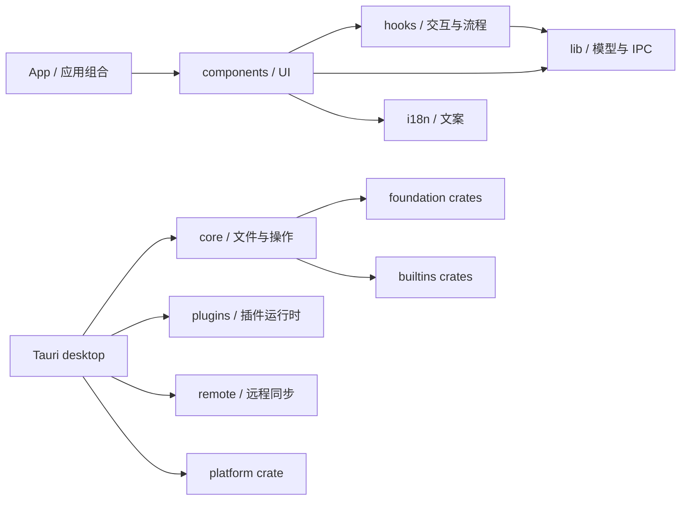

Warning: truncated output (original token count: 25291)
Total output lines: 113

# Fiex 代码库重构基线

> 快照日期：2026-11-12
> 审查基线：Core PR #179 head `8e7b332c8f6b7111573d283db1bef4b65795f876`，SDK PR #36 head `4ee25923f09ced83ca29146f22091172a31ff929`。本页保留 2026-11-12 的原始规模统计，并在阶段记录中逐步补充后续工作。
> 用途：记录本轮分阶段重构的起点，避免目录迁移后失去可比较的测试、尺寸与 CI 基线。

## 当前结构与依赖方向

前端已有可复用的业务分区，但主要按代码种类分布。Explorer 的视图在 `components/browser`，导航、列表、监听等状态 hooks 归属 `features/explorer/hooks`，纯展示与列表模型归属 `features/explorer/model`。文件操作及菜单也横跨组件、hooks 与 lib。Rust 则已有 foundation、builtins、platform crates；Tauri 主 crate 仍组合 desktop、core、plugins、remote 和 infrastructure。

图中前端箭头表示当前主要源码归属与调用关系的概览，不表示允许任意跨层引用。后续迁移的依赖规则是：UI 经 feature service 和 typed IPC 进入宿主；Rust 桌面入口只适配输入输出，业务用例依赖稳定的 domain/foundation 接口，平台与 Provider 实现留在适配层。

本轮先建立 `src/features/explorer/model`，将只用于文件列表展示的文件名格式化逻辑及其测试放在同一 feature。此次迁移保持函数签名和行为不变，删除旧 `src/lib` 入口，不留兼容转发。

## 规模与测试现状

下表的源码数按当前仓库树统计，测试文件数包含相邻的 Vitest、Rust test 模块和 Playwright specs；它反映测试分布，不等价于行为覆盖率。

| 区域                                  |                                                                             当前基线 | 已知维护问题                                                                                                  |
| ------------------------------------- | -----------------------------------------------------------------------------------: | ------------------------------------------------------------------------------------------------------------- |
| `src/`                                |                                            271 个 TypeScript/TSX 文件；42 个测试文件 | 组件、hooks、lib 按技术种类拆分；基线时严格边界检查只覆盖 IPC JSON 基础解析器，本 PR 加入 Explorer 文件名模型 |
| `e2e/`                                |                                                           10 个 Playwright spec 文件 | fixture 能验证 UI 状态和命令副作用，但不能代替真实 Finder、Windows Shell 或 Linux 桌面行为                    |
| `src-tauri/src` 与 `src-tauri/crates` | 主 crate 有 385 个 Rust 文件、38 个测试文件；crates 有 83 个 Rust 文件、9 个测试文件 | 主 crate 仍承载多项编排；部分高风险场景缺少故障注入或真实平台验证                                             |
| `sdk/rust`                            |                                                        79 个 Rust 文件、3 个测试文件 | SDK 是独立 submodule；协议变化要先对齐 Core 和官方插件                                                        |
| 大文件门禁                            |                                   `scripts/file-size-baseline.json` 有 44 项历史例外 | 检查会阻止记录文件继续变大；目标是分功能逐项删除，不重置额度                                                  |

现有 E2E 已包含新建文件后默认选中、零选择时的新建菜单、多选废纸篓彻底删除、子菜单切换和视口边缘约束、双面板状态等回归。本 PR 再补充工具栏排序只影响活动目录的双面板交互测试。后续新增测试应针对未覆盖的状态或失败路径，不重复增加只断言 toast/快照的用例。需求与已知缺口继续以[软件需求与测试追溯](/developer/requirements)为事实来源。

## CI 与验证基线

PR #91 head 的最近一次完整 `Core tests, IPC and release` workflow 于 2026-11-11 成功，观测耗时约 19 分 35 秒。现有 workflow 包含：

- Scope Policy 的 Kani 证明、覆盖率门槛与变异测试；
- 前端格式、lint、边界类型、文件尺寸、Tauri 契约、i18n、Vitest 与构建；
- Playwright 浏览器 UI 测试；
- Linux、macOS、Windows 桌面构建与 Rust 检查；
- 发布前原生依赖审计与安装包流程。

本轮不得删除或放宽这些 job。全仓覆盖率和关键用户操作的稳定性能门槛目前尚未形成统一基线；后续以先采集、再逐步设差异门槛的方式处理，不能将未测量的覆盖率写成已达标。

## 分阶段实施记录

| 阶段                    | 状态                                     | 交付                                                                                                                                                                                                                                                                                                                                                                                                                                                                                                                                                                                                                                                                                                                                                                                                                                                                                                                                                                                                                                                                                                                                                                                                                                                                                                                                                                                                                                                                                                                                                                                                                                                                                                                                                                                                                                                                                                                                                                                                                                                                                                                                                                                               |
| ----------------------- | ---------------------------------------- | -------------------------------------------------------------------------------------------------------------------------------------------------------------------------------------------------------------------------------------------------------------------------------------------------------------------------------------------------------------------------------------------------------------------------------------------------------------------------------------------------------------------------------------------------------------------------------------------------------------------------------------------------------------------------------------------------------------------------------------------------------------------------------------------------------------------------------------------------------------------------------------------------------------------------------------------------------------------------------------------------------------------------------------------------------------------------------------------------------------------------------------------------------------------------------------------------------------------------------------------------------------------------------------------------------------------------------------------------------------------------------------------------------------------------------------------------------------------------------------------------------------------------------------------------------------------------------------------------------------------------------------------------------------------------------------------------------------------------------------------------------------------------------------------------------------------------------------------------------------------------------------------------------------------------------------------------------------------------------------------------------------------------------------------------------------------------------------------------------------------------------------------------------------------------------------------------- |
| P0-01 基线              | PR #92                                   | 锁定 Core/SDK 基线、记录现有目录/测试/大文件/CI 现状，并将审计页加入唯一 VitePress 文档站点                                                                                                                                                                                                                                                                                                                                                                                                                                                                                                                                                                                                                                                                                                                                                                                                                                                                                                                                                                                                                                                                                                                                                                                                                                                                                                                                                                                                                                                                                                                                                                                                                                                                                                                                                                                                                                                                                                                                                                                                                                                                                                        |
| Explorer feature 起步   | PR #92                                   | 迁移 `formatDisplayFileName` 与相邻测试到 `src/features/explorer/model`，更新唯一调用方                                                                                                                                                                                                                                                                                                                                                                                                                                                                                                                                                                                                                                                                                                                                                                                                                                                                                                                                                                                                                                                                                                                                                                                                                                                                                                                                                                                                                                                                                                                                                                                                                                                                                                                                                                                                                                                                                                                                                                                                                                                                                                            |
| P0-02 保护网            | 进行中                                   | PR #92 补双面板排序 UI 回归；PR #93 增加 Trash“放回原处”端到端回归；PR #94 增加过期目录响应竞态 E2E；PR #96 补插件重新握手后能力索引替换测试；PR #103 补源变化回滚、PR #106 补嵌套目录 Provider 写入故障后的回滚；PR #154 增加 Windows Shell AppsFolder/应用标识原生 smoke 与 Linux USB raw access 权限保护测试；macOS Finder Trash 测试已接入三平台矩阵；仍需覆盖系统外部删除文件恢复、Windows Open With/终端实际启动及真实设备挂载权限场景                                                                                                                                                                                                                                                                                                                                                                                                                                                                                                                                                                                                                                                                                                                                                                                                                                                                                                                                                                                                                                                                                                                                                                                                                                                                                                                                                                                                                                                                                                                                                                                                                                                                                                                                                       |
| P4-01 大文件例外清理    | PR #96、#107、#113–#117、#153、#156–#180 | PR #96 将 ProviderRegistry 单测拆分到同目录测试模块；PR #107 将 FileSystem Provider 集成测试按 views、transfers、resources 分组；PR #113 按 provider 拆分 Native VFS handlers；PR #114 独立目录快照内存 LRU 缓存；PR #115 将操作队列单测迁至同目录；PR #116 按 router、scope、validation 拆分事件测试；PR #117 将远程缓存单测移到同目录；PR #153 将 aria2 下载配置、引擎执行和流生命周期拆到相邻模块；PR #156 将 RPC 请求/响应摘要生成从日志存储模块拆分；PR #157 将虚拟目录搜索快照协调从引擎路由模块拆分；PR #158 将远程连接权限校验与网络域投影拆到权限模块；PR #159 将离线缓存目录回退及错误分类拆到子模块；PR #160 将连接菜单 action 执行编排拆到独立模块；PR #161 将 Tauri 启动配置与窗口生命周期处理拆出组合入口；PR #162 将菜单预检和并行可用性检查从 Provider 注册模块拆出；PR #163 将装饰缓存快照比较与增量复用拆到独立模块；PR #164 将状态中心筛选规则和筛选菜单拆到 activity 子模块并增加筛选回归测试；PR #165 将会话级右键菜单资源快照缓存拆到专用模块并测试缓存键校验；PR #166 将插件包内预览资源路径校验与读取拆分，并覆盖相对路径、安全路径和无效字段；PR #167 将系统应用身份和名称注册逻辑从应用目录缓存编排中拆分并补充名称清理测试；PR #168 将 Applications URI 编码、规范化与节点解析从状态存储入口移到 uri 模块；PR #169 将音频、MP4 与 Matroska 元数据解析拆到子模块并补时长格式测试；PR #170 将插件 Provider 文件流读写桥接拆到独立模块；PR #171 将进程标准输出的 JSON-RPC 帧读取与响应路由拆到独立模块；PR #172 将预览对话框状态呈现、内容分支和底栏拆到相邻组件并增加布局模型测试；PR #173 将文件选择器目录生命周期、筛选排序模型与选择操作拆到专用模块并补模型测试；PR #174 将工具栏顺序补全和拖动样式计算提取到纯模型并补测试；PR #175 将连接挂载与已打开 tab 的识别规则提取并补覆盖；PR #176 将侧栏重排的移动、落点、间隙和位移规则提取并补纯模型测试，位置图标渲染移到相邻组件；PR #177 将插件面板桥接操作分派及尺寸、隐藏状态策略拆到独立模块并补策略测试；PR #178 将应用控制器的文件、连接、打开、工作区和快捷键 action 组合移到专用 hook；PR #179 将路径、文件元数据和排序/分组模型从公共 files 入口拆到同目录模块，公共导出保持不变；PR #180 配套 SDK PR #36 将 12 个 Rust/UI SDK 超限文件拆为专用模块，并将所有 SDK 源文件降至 300 行以内；基线已清空，剩余 0 项 |
| P2-01 Explorer feature  | PR #98–#102、#104–#105、#108             | 将导航、列表生命周期 hooks、目录专属列宽偏好、流式搜索、目录视图、列表比较/缓存及列表网格布局/拖拽模型迁移到 Explorer feature；共享偏好合同与 IPC 归一化留在 lib                                                                                                                                                                                                                                                                                                                                                                                                                                                                                                                                                                                                                                                                                                                                                                                                                                                                                                                                                                                                                                                                                                                                                                                                                                                                                                                                                                                                                                                                                                                                                                                                                                                                                                                                                                                                                                                                                                                                                                                                                                   |
| P2-02 文件操作策略      | PR #110、#118、#155                      | 将副本能力判断和移动路径过滤提取到 Explorer model；PR #118 将批量重命名的两阶段执行与失败回滚迁入 Explorer operation，并覆盖交换重命名和回滚；PR #155 修复永久删除失败时仍清空选择状态的问题，并增加成功/失败回归用例。hook 保留对话框、选中项和刷新等 UI 副作用，其他操作边界仍需继续收敛                                                                                                                                                                                                                                                                                                                                                                                                                                                                                                                                                                                                                                                                                                                                                                                                                                                                                                                                                                                                                                                                                                                                                                                                                                                                                                                                                                                                                                                                                                                                                                                                                                                                                                                                                                                                                                                                                                         |
| P2-03 文件操作归属  …13291 tokens truncated…                                                                                                                                                                                                                                                                                                                                            |
| P1-23 Info 枚举解码     | PR #138                                  | 将 Info field 状态、计算模式及 section 来源改为类型守卫；解码成功后直接构造联合类型 DTO，并测试未知字符串值和数组值均被拒绝                                                                                                                                                                                                                                                                                                                                                                                                                                                                                                                                                                                                                                                                                                                                                                                                                                                                                                                                                                                                                                                                                                                                                                                                                                                                                                                                                                                                                                                                                                                                                                                                                                                                                                                                                                                                                                                                                                                                                                                                                                                                        |
| P1-24 状态读取参数 IPC  | PR #139                                  | 在动态结果分派前逐项验证 `state_get` 的 namespace/key 参数，并拒绝未知组合及额外字段，移除分派器向状态参数 DTO 的类型断言                                                                                                                                                                                                                                                                                                                                                                                                                                                                                                                                                                                                                                                                                                                                                                                                                                                                                                                                                                                                                                                                                                                                                                                                                                                                                                                                                                                                                                                                                                                                                                                                                                                                                                                                                                                                                                                                                                                                                                                                                                                                          |
| P1-25 简单命令结果 IPC  | PR #140                                  | 为返回 `void`、字符串、可空字符串、布尔值或计数的 Tauri 命令添加命令级结果校验；拒绝不匹配的 JSON 类型、负数、小数及超出安全整数范围的计数                                                                                                                                                                                                                                                                                                                                                                                                                                                                                                                                                                                                                                                                                                                                                                                                                                                                                                                                                                                                                                                                                                                                                                                                                                                                                                                                                                                                                                                                                                                                                                                                                                                                                                                                                                                                                                                                                                                                                                                                                                                         |
| P1-26 简单集合结果 IPC  | PR #141                                  | 严格解码字符串列表和插件状态 tuple 列表，逐项验证值类型与 tuple 长度，并拒绝格式错误的集合响应                                                                                                                                                                                                                                                                                                                                                                                                                                                                                                                                                                                                                                                                                                                                                                                                                                                                                                                                                                                                                                                                                                                                                                                                                                                                                                                                                                                                                                                                                                                                                                                                                                                                                                                                                                                                                                                                                                                                                                                                                                                                                                     |
| P1-27 运行时目录 IPC    | PR #142                                  | 逐项构造 IDE、终端和 Shell 探测结果 DTO，要求 ID/名称非空、字段完整且无多余键；Shell 还必须提供非空路径                                                                                                                                                                                                                                                                                                                                                                                                                                                                                                                                                                                                                                                                                                                                                                                                                                                                                                                                                                                                                                                                                                                                                                                                                                                                                                                                                                                                                                                                                                                                                                                                                                                                                                                                                                                                                                                                                                                                                                                                                                                                                            |
| P1-28 远程连接结果 IPC  | PR #143                                  | 按 Rust `ConnectionInfo` DTO 校验远程连接列表、保存结果和会话更新结果；将 saved/autostart/canRead/canWrite 更新为必需布尔字段，并拒绝缺失字段和未知键                                                                                                                                                                                                                                                                                                                                                                                                                                                                                                                                                                                                                                                                                                                                                                                                                                                                                                                                                                                                                                                                                                                                                                                                                                                                                                                                                                                                                                                                                                                                                                                                                                                                                                                                                                                                                                                                                                                                                                                                                                              |
| P1-29 错误事件 IPC      | PR #144                                  | 按 Rust `AppError` 的九个 camelCase 字段构造错误事件 DTO，校验时间/ID/次数整数范围、nullable operation 和必需状态，并同步补全前端类型映射                                                                                                                                                                                                                                                                                                                                                                                                                                                                                                                                                                                                                                                                                                                                                                                                                                                                                                                                                                                                                                                                                                                                                                                                                                                                                                                                                                                                                                                                                                                                                                                                                                                                                                                                                                                                                                                                                                                                                                                                                                                          |
| P1-30 插件日志页 IPC    | PR #145                                  | 校验 Rust `LogPage` 的 entries/cursor/hasMore 和完整 `LogRecord` 字段，包含 nullable operationId/durationMs 与可省略 detail，并将共享日志 DTO 移入 lib 类型层                                                                                                                                                                                                                                                                                                                                                                                                                                                                                                                                                                                                                                                                                                                                                                                                                                                                                                                                                                                                                                                                                                                                                                                                                                                                                                                                                                                                                                                                                                                                                                                                                                                                                                                                                                                                                                                                                                                                                                                                                                      |
| P1-31 插件市场 IPC      | PR #146                                  | 严格校验市场条目的 Rust 序列化字段、作者 nullable DTO、权限/域名/命令字符串列表及 JSON extensions；移除 Rust 未提供的市场 icon 类型假设                                                                                                                                                                                                                                                                                                                                                                                                                                                                                                                                                                                                                                                                                                                                                                                                                                                                                                                                                                                                                                                                                                                                                                                                                                                                                                                                                                                                                                                                                                                                                                                                                                                                                                                                                                                                                                                                                                                                                                                                                                                            |
| P1 其余及之后           | 后续小 PR                                | 继续扩展 typed IPC 和模块边界，再逐个迁移 Explorer 操作、菜单和 Rust use cases                                                                                                                                                                                                                                                                                                                                                                                                                                                                                                                                                                                                                                                                                                                                                                                                                                                                                                                                                                                                                                                                                                                                                                                                                                                                                                                                                                                                                                                                                                                                                                                                                                                                                                                                                                                                                                                                                                                                                                                                                                                                                                                     |

**P1-32 已安装插件目录 IPC（PR #147）：** 按 Rust `PluginInfo` 校验完整权限状态、能力列表、schema 版本、超时范围及字段集合；验证 nullable author/icon/extensions，并将 description 改为必需字段。

**P1-33 系统代理 IPC（PR #148）：** 将 `system_proxy_info` 改为共享 DTO，校验 Rust 代理来源枚举、字段集合和 enabled/proxy 的一致状态。

**P1-34 最近位置导航 IPC（PR #149）：** 为 Rust `RecentNavigationTarget` 建立共享结果 DTO，校验非空 parent/target 及精确字段集合。

**P1-35 内部拖放 IPC（PR #150）：** 将 `DropPlan.references` 从 `unknown[]` 收窄为 SDK `ResourceRef[]`，并校验路径/引用数量一致、路径非空和引用结构。

**P1-36 平台及搜索目录 IPC（PR #151）：** 按受支持 OS 联合类型校验 `platform`，并将 `search_providers` 从通用 JSON 列表收窄为 Rust 搜索引擎 DTO，验证 priority、builtin 和模式枚举。

**P1-37 Provider 动作结果 IPC（PR #152）：** 将 `toolbar.invoke` 的空 Rust DTO 映射为 `void` 并验证空对象；按 Rust `HookResult` 拒绝 `plugin_before_open` 的额外字段。

每个后续阶段都应更新该快照的基线引用或新增日期版本，连同受影响模块的测试和需求追溯一起审查。
