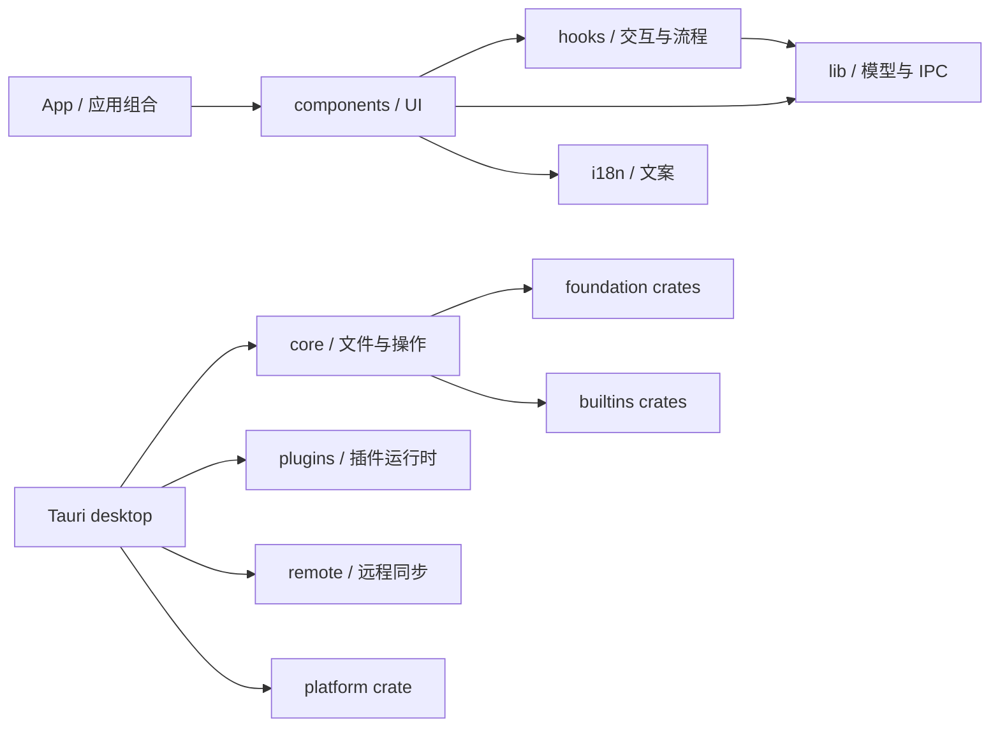

# Fiex 代码库重构基线

> 快照日期：2026-11-12
> 审查基线：Core PR #180 head `5e23a8e596a6d93c314cf54adc397766992fbf00`，SDK PR #36 head `4ee25923f09ced83ca29146f22091172a31ff929`。本页保留 2026-11-12 的原始规模统计，并在阶段记录中逐步补充后续工作。
> 用途：记录本轮分阶段重构的起点，避免目录迁移后失去可比较的测试、尺寸与 CI 基线。

## 当前结构与依赖方向

前端已有可复用的业务分区，但主要按代码种类分布。Explorer 的视图在 `components/browser`，导航、列表、监听等状态 hooks 归属 `features/explorer/hooks`，纯展示与列表模型归属 `features/explorer/model`。文件操作及菜单也横跨组件、hooks 与 lib。Rust 则已有 foundation、builtins、platform crates；Tauri 主 crate 仍组合 desktop、core、plugins、remote 和 infrastructure。

图中前端箭头表示当前主要源码归属与调用关系的概览，不表示允许任意跨层引用。后续迁移的依赖规则是：UI 经 feature service 和 typed IPC 进入宿主；Rust 桌面入口只适配输入输出，业务用例依赖稳定的 domain/foundation 接口，平台与 Provider 实现留在适配层。

本轮先建立 `src/features/explorer/model`，将只用于文件列表展示的文件名格式化逻辑及其测试放在同一 feature。此次迁移保持函数签名和行为不变，删除旧 `src/lib` 入口，不留兼容转发。

## 规模与测试现状

下表的源码数按当前仓库树统计，测试文件数包含相邻的 Vitest、Rust test 模块和 Playwright specs；它反映测试分布，不等价于行为覆盖率。

| 区域                                  |                                                                             当前基线 | 已知维护问题                                                                                                  |
| ------------------------------------- | -----------------------------------------------------------------------------------: | ------------------------------------------------------------------------------------------------------------- |
| `src/`                                |                                            271 个 TypeScript/TSX 文件；42 个测试文件 | 组件、hooks、lib 按技术种类拆分；基线时严格边界检查只覆盖 IPC JSON 基础解析器，本 PR 加入 Explorer 文件名模型 |
| `e2e/`                                |                                                           10 个 Playwright spec 文件 | fixture 能验证 UI 状态和命令副作用，但不能代替真实 Finder、Windows Shell 或 Linux 桌面行为                    |
| `src-tauri/src` 与 `src-tauri/crates` | 主 crate 有 385 个 Rust 文件、38 个测试文件；crates 有 83 个 Rust 文件、9 个测试文件 | 主 crate 仍承载多项编排；部分高风险场景缺少故障注入或真实平台验证                                             |
| `sdk/rust`                            |                                                        79 个 Rust 文件、3 个测试文件 | SDK 是独立 submodule；协议变化要先对齐 Core 和官方插件                                                        |
| 大文件门禁                            |                                   `scripts/file-size-baseline.json` 有 44 项历史例外 | 检查会阻止记录文件继续变大；目标是分功能逐项删除，不重置额度                                                  |

现有 E2E 已包含新建文件后默认选中、零选择时的新建菜单、多选废纸篓彻底删除、子菜单切换和视口边缘约束、双面板状态等回归。本 PR 再补充工具栏排序只影响活动目录的双面板交互测试。后续新增测试应针对未覆盖的状态或失败路径，不重复增加只断言 toast/快照的用例。需求与已知缺口继续以[软件需求与测试追溯](/developer/requirements)为事实来源。

## CI 与验证基线

PR #91 head 的最近一次完整 `Core tests, IPC and release` workflow 于 2026-11-11 成功，观测耗时约 19 分 35 秒。现有 workflow 包含：

- Scope Policy 的 Kani 证明、覆盖率门槛与变异测试；
- 前端格式、lint、边界类型、文件尺寸、Tauri 契约、i18n、Vitest 与构建；
- Playwright 浏览器 UI 测试；
- Linux、macOS、Windows 桌面构建与 Rust 检查；
- 发布前原生依赖审计与安装包流程。

本轮不得删除或放宽这些 job。全仓覆盖率和关键用户操作的稳定性能门槛目前尚未形成统一基线；后续以先采集、再逐步设差异门槛的方式处理，不能将未测量的覆盖率写成已达标。

## 分阶段实施记录

| 阶段                          | 状态                                     | 交付                                                                                                                                                                                                                                                                                                                                                                                                                                                                                                                                                                                                                                                                                                                                                                                                                                                                                                                                                                                                                                                                                                                                                                                                                                                                                                                                                                                                                                                                                                                                                                                                                                                                                                                                                                                                                                                                                                                                                                                                                                                                                                                                                                                               |
| ----------------------------- | ---------------------------------------- | -------------------------------------------------------------------------------------------------------------------------------------------------------------------------------------------------------------------------------------------------------------------------------------------------------------------------------------------------------------------------------------------------------------------------------------------------------------------------------------------------------------------------------------------------------------------------------------------------------------------------------------------------------------------------------------------------------------------------------------------------------------------------------------------------------------------------------------------------------------------------------------------------------------------------------------------------------------------------------------------------------------------------------------------------------------------------------------------------------------------------------------------------------------------------------------------------------------------------------------------------------------------------------------------------------------------------------------------------------------------------------------------------------------------------------------------------------------------------------------------------------------------------------------------------------------------------------------------------------------------------------------------------------------------------------------------------------------------------------------------------------------------------------------------------------------------------------------------------------------------------------------------------------------------------------------------------------------------------------------------------------------------------------------------------------------------------------------------------------------------------------------------------------------------------------------------------- |
| P0-01 基线                    | PR #92                                   | 锁定 Core/SDK 基线、记录现有目录/测试/大文件/CI 现状，并将审计页加入唯一 VitePress 文档站点                                                                                                                                                                                                                                                                                                                                                                                                                                                                                                                                                                                                                                                                                                                                                                                                                                                                                                                                                                                                                                                                                                                                                                                                                                                                                                                                                                                                                                                                                                                                                                                                                                                                                                                                                                                                                                                                                                                                                                                                                                                                                                        |
| Explorer feature 起步         | PR #92                                   | 迁移 `formatDisplayFileName` 与相邻测试到 `src/features/explorer/model`，更新唯一调用方                                                                                                                                                                                                                                                                                                                                                                                                                                                                                                                                                                                                                                                                                                                                                                                                                                                                                                                                                                                                                                                                                                                                                                                                                                                                                                                                                                                                                                                                                                                                                                                                                                                                                                                                                                                                                                                                                                                                                                                                                                                                                                            |
| P0-02 保护网                  | PR #181                                  | PR #92 补双面板排序 UI 回归；PR #93 增加 Trash“放回原处”端到端回归；PR #94 增加过期目录响应竞态 E2E；PR #96 补插件重新握手后能力索引替换测试；PR #103 补源变化回滚、PR #106 补嵌套目录 Provider 写入故障后的回滚；PR #154 增加 Windows Shell AppsFolder/应用标识原生 smoke 与 Linux USB raw access 权限保护测试；macOS Finder Trash 测试已接入三平台矩阵；PR #181 增加系统外部 Finder Trash 元数据恢复到磁盘的集成测试、Windows AppsFolder Notepad 实际打开文件与 Command Prompt 指定目录启动测试，以及 Linux loopback block device 的授权/已挂载拒绝测试；物理 USB 热插拔未纳入托管 CI                                                                                                                                                                                                                                                                                                                                                                                                                                                                                                                                                                                                                                                                                                                                                                                                                                                                                                                                                                                                                                                                                                                                                                                                                                                                                                                                                                                                                                                                                                                                                                                                            |
| P4-01 大文件例外清理          | PR #96、#107、#113–#117、#153、#156–#180 | PR #96 将 ProviderRegistry 单测拆分到同目录测试模块；PR #107 将 FileSystem Provider 集成测试按 views、transfers、resources 分组；PR #113 按 provider 拆分 Native VFS handlers；PR #114 独立目录快照内存 LRU 缓存；PR #115 将操作队列单测迁至同目录；PR #116 按 router、scope、validation 拆分事件测试；PR #117 将远程缓存单测移到同目录；PR #153 将 aria2 下载配置、引擎执行和流生命周期拆到相邻模块；PR #156 将 RPC 请求/响应摘要生成从日志存储模块拆分；PR #157 将虚拟目录搜索快照协调从引擎路由模块拆分；PR #158 将远程连接权限校验与网络域投影拆到权限模块；PR #159 将离线缓存目录回退及错误分类拆到子模块；PR #160 将连接菜单 action 执行编排拆到独立模块；PR #161 将 Tauri 启动配置与窗口生命周期处理拆出组合入口；PR #162 将菜单预检和并行可用性检查从 Provider 注册模块拆出；PR #163 将装饰缓存快照比较与增量复用拆到独立模块；PR #164 将状态中心筛选规则和筛选菜单拆到 activity 子模块并增加筛选回归测试；PR #165 将会话级右键菜单资源快照缓存拆到专用模块并测试缓存键校验；PR #166 将插件包内预览资源路径校验与读取拆分，并覆盖相对路径、安全路径和无效字段；PR #167 将系统应用身份和名称注册逻辑从应用目录缓存编排中拆分并补充名称清理测试；PR #168 将 Applications URI 编码、规范化与节点解析从状态存储入口移到 uri 模块；PR #169 将音频、MP4 与 Matroska 元数据解析拆到子模块并补时长格式测试；PR #170 将插件 Provider 文件流读写桥接拆到独立模块；PR #171 将进程标准输出的 JSON-RPC 帧读取与响应路由拆到独立模块；PR #172 将预览对话框状态呈现、内容分支和底栏拆到相邻组件并增加布局模型测试；PR #173 将文件选择器目录生命周期、筛选排序模型与选择操作拆到专用模块并补模型测试；PR #174 将工具栏顺序补全和拖动样式计算提取到纯模型并补测试；PR #175 将连接挂载与已打开 tab 的识别规则提取并补覆盖；PR #176 将侧栏重排的移动、落点、间隙和位移规则提取并补纯模型测试，位置图标渲染移到相邻组件；PR #177 将插件面板桥接操作分派及尺寸、隐藏状态策略拆到独立模块并补策略测试；PR #178 将应用控制器的文件、连接、打开、工作区和快捷键 action 组合移到专用 hook；PR #179 将路径、文件元数据和排序/分组模型从公共 files 入口拆到同目录模块，公共导出保持不变；PR #180 配套 SDK PR #36 将 12 个 Rust/UI SDK 超限文件拆为专用模块，并将所有 SDK 源文件降至 300 行以内；基线已清空，剩余 0 项 |
| P2-01 Explorer feature        | PR #98–#102、#104–#105、#108             | 将导航、列表生命周期 hooks、目录专属列宽偏好、流式搜索、目录视图、列表比较/缓存及列表网格布局/拖拽模型迁移到 Explorer feature；共享偏好合同与 IPC 归一化留在 lib                                                                                                                                                                                                                                                                                                                                                                                                                                                                                                                                                                                                                                                                                                                                                                                                                                                                                                                                                                                                                                                                                                                                                                                                                                                                                                                                                                                                                                                                                                                                                                                                                                                                                                                                                                                                                                                                                                                                                                                                                                   |
| P2-02 文件操作策略            | PR #110、#118、#155、#182                | 将副本能力判断和移动路径过滤提取到 Explorer model；PR #118 将批量重命名的两阶段执行与失败回滚迁入 Explorer operation，并覆盖交换重命名和回滚；PR #155 修复永久删除失败时仍清空选择状态的问题，并增加成功/失败回归用例。PR #182 将单项重命名的 capability gate 与 IPC 执行收敛到 Explorer operation，并覆盖权限拒绝、成功返回与失败结果；hook 保留对话框、选择、错误展示、重命名输入与目录刷新等 UI 状态                                                                                                                                                                                                                                                                                                                                                                                                                                                                                                                                                                                                                                                                                                                                                                                                                                                                                                                                                                                                                                                                                                                                                                                                                                                                                                                                                                                                                                                                                                                                                                                                                                                                                                                                                                                            |
| P2-03 文件操作归属            | PR #111                                  | 将新建、删除/回收、恢复、传输和结果处理移到 `features/explorer/operations`；由 hook 组合层注入 Explorer 状态、运行器与进度服务，feature 不再反向依赖 hooks                                                                                                                                                                                                                                                                                                                                                                                                                                                                                                                                                                                                                                                                                                                                                                                                                                                                                                                                                                                                                                                                                                                                                                                                                                                                                                                                                                                                                                                                                                                                                                                                                                                                                                                                                                                                                                                                                                                                                                                                                                         |
| P2-04 菜单策略                | PR #112                                  | 将 Core 菜单 IPC 类型移到共享 lib，将“更多”菜单计划和空菜单可见性规则及其测试迁入 Explorer model；菜单呈现与 action 执行仍留在组件适配层                                                                                                                                                                                                                                                                                                                                                                                                                                                                                                                                                                                                                                                                                                                                                                                                                                                                                                                                                                                                                                                                                                                                                                                                                                                                                                                                                                                                                                                                                                                                                                                                                                                                                                                                                                                                                                                                                                                                                                                                                                                           |
| P3-01 Rust FS/Operations      | PR #186–#188                             | 将 OperationResult、Conflict、Resolution、Undo 和取消检查下沉至共享 core/operation_types；复制暂存归入 core/transfers，路径工具归入 core/fs/path_utils；core/fs 与 transfers 不再反向依赖 operations。PR #187 将 ResourceBroker 移入 core/fs/broker.rs，并使 core/fs/mod.rs 回归模块装配与导出；PR #188 再将 Broker 的读取/搜索与写入/变更方法分入独立子模块；Provider/cache/preflight/通知跨边界的故障注入和事务恢复测试仍需后续完成。                                                                                                                                                                                                                                                                                                                                                                                                                                                                                                                                                                                                                                                                                                                                                                                                                                                                                                                                                                                                                                                                                                                                                                                                                                                                                                                                                                                                                                                                                                                                                                                                                                                                                                                                                            |
| P3-02 Rust Plugin Host/Remote | PR #189–#190、#192（分批）               | #189 收紧 JSON-RPC 回复版本、数字 ID 与 result/error envelope；#190 覆盖远端上传分块和 abort；#192 注入 provider 边界验证断网 stat/refresh 时缓存字节与 revision baseline 不变、双端修改进入 conflict，并补 metadata 原子写入/读回验证。真实应用重启、连接/session 恢复及 Host 进程故障集成仍待补。                                                                                                                                                                                                                                                                                                                                                                                                                                                                                                                                                                                                                                                                                                                                                                                                                                                                                                                                                                                                                                                                                                                                                                                                                                                                                                                                                                                                                                                                                                                                                                                                                                                                                                                                                                                                                                                                                                |
| P1-01 架构边界                | PR #97                                   | 新增 AST 导入检查，禁止 feature 层依赖 components/hooks；进入前端 CI；Vitest 覆盖允许和拒绝方向                                                                                                                                                                                                                                                                                                                                                                                                                                                                                                                                                                                                                                                                                                                                                                                                                                                                                                                                                                                                                                                                                                                                                                                                                                                                                                                                                                                                                                                                                                                                                                                                                                                                                                                                                                                                                                                                                                                                                                                                                                                                                                    |
| P1-02 Info IPC                | PR #95                                   | Info 合同由 IPC 层定义并由 UI 消费，严格类型检查覆盖 Info 解码器，回归测试拒绝把枚举值编码为数组                                                                                                                                                                                                                                                                                                                                                                                                                                                                                                                                                                                                                                                                                                                                                                                                                                                                                                                                                                                                                                                                                                                                                                                                                                                                                                                                                                                                                                                                                                                                                                                                                                                                                                                                                                                                                                                                                                                                                                                                                                                                                                   |
| P1-03 搜索 IPC                | PR #109                                  | `search_files` 命令结果改为 `void`，参数和结果通过 typed command map 约束；搜索批次继续由 Channel 独立传输并经 `parseSearchBatch` 校验                                                                                                                                                                                                                                                                                                                                                                                                                                                                                                                                                                                                                                                                                                                                                                                                                                                                                                                                                                                                                                                                                                                                                                                                                                                                                                                                                                                                                                                                                                                                                                                                                                                                                                                                                                                                                                                                                                                                                                                                                                                             |
| P1-04 Core 菜单执行 IPC       | PR #119                                  | 为 Core 菜单执行结果增加运行时 decoder，限定 command 和字段形状，移除组件适配器中的双重类型断言；插件自定义 JSON 仍走通用结果路径                                                                                                                                                                                                                                                                                                                                                                                                                                                                                                                                                                                                                                                                                                                                                                                                                                                                                                                                                                                                                                                                                                                                                                                                                                                                                                                                                                                                                                                                                                                                                                                                                                                                                                                                                                                                                                                                                                                                                                                                                                                                  |
| P1-05 连接菜单执行 IPC        | PR #120                                  | 将连接菜单 DTO 移到共享 lib，为 edit/close Core action 增加严格 decoder 和目标连接 ID 校验；插件自定义结果保留通用路径                                                                                                                                                                                                                                                                                                                                                                                                                                                                                                                                                                                                                                                                                                                                                                                                                                                                                                                                                                                                                                                                                                                                                                                                                                                                                                                                                                                                                                                                                                                                                                                                                                                                                                                                                                                                                                                                                                                                                                                                                                                                             |
| P1-06 菜单解析 IPC            | PR #121                                  | Core 与插件菜单结果逐字段解码为共享 DTO；校验菜单字段、快捷键及 activity，并拒绝未知字段，移除双重类型断言                                                                                                                                                                                                                                                                                                                                                                                                                                                                                                                                                                                                                                                                                                                                                                                                                                                                                                                                                                                                                                                                                                                                                                                                                                                                                                                                                                                                                                                                                                                                                                                                                                                                                                                                                                                                                                                                                                                                                                                                                                                                                         |
| P1-07 延迟菜单项 IPC          | PR #122                                  | 根菜单与懒加载子菜单共用 Core/插件菜单项 decoder；移除 UI 中重复的 Core 解码与插件根菜单二次过滤，子菜单仍可引用前一页定义的 parent                                                                                                                                                                                                                                                                                                                                                                                                                                                                                                                                                                                                                                                                                                                                                                                                                                                                                                                                                                                                                                                                                                                                                                                                                                                                                                                                                                                                                                                                                                                                                                                                                                                                                                                                                                                                                                                                                                                                                                                                                                                                |
| P1-08 子菜单结果类型          | PR #123                                  | 在 Tauri IPC 返回边界校验懒加载子菜单 envelope 与通用菜单项字段，并将结果从 `JsonValue[]` 改为共享子菜单 DTO                                                                                                                                                                                                                                                                                                                                                                                                                                                                                                                                                                                                                                                                                                                                                                                                                                                                                                                                                                                                                                                                                                                                                                                                                                                                                                                                                                                                                                                                                                                                                                                                                                                                                                                                                                                                                                                                                                                                                                                                                                                                                       |
| P1-09 装饰数据 IPC            | PR #124                                  | 将文件装饰解码改为显式构造 DTO，递归校验 badge、style、field target、来源列表与 Core 原生 badge，并归一化 nullable 可选字段                                                                                                                                                                                                                                                                                                                                                                                                                                                                                                                                                                                                                                                                                                                                                                                                                                                                                                                                                                                                                                                                                                                                                                                                                                                                                                                                                                                                                                                                                                                                                                                                                                                                                                                                                                                                                                                                                                                                                                                                                                                                        |
| P1-10 Info 结果 IPC           | PR #125                                  | 将 Info open 与 field-delta 结果改为逐层构造 DTO；校验 envelope、section、field 和 update 的字段，并拒绝未识别键                                                                                                                                                                                                                                                                                                                                                                                                                                                                                                                                                                                                                                                                                                                                                                                                                                                                                                                                                                                                                                                                                                                                                                                                                                                                                                                                                                                                                                                                                                                                                                                                                                                                                                                                                                                                                                                                                                                                                                                                                                                                                   |
| P1-11 主题 IPC                | PR #126                                  | 将插件主题结果逐字段构造 Theme DTO，验证主题模式、令牌映射与可选暗色变体，并拒绝未识别主题字段                                                                                                                                                                                                                                                                                                                                                                                                                                                                                                                                                                                                                                                                                                                                                                                                                                                                                                                                                                                                                                                                                                                                                                                                                                                                                                                                                                                                                                                                                                                                                                                                                                                                                                                                                                                                                                                                                                                                                                                                                                                                                                     |
| P1-12 预览 IPC                | PR #127                                  | 将候选列表和解析预览结果逐字段解码；按 kind 校验视图必需字段、可选元数据、媒体类型和数字范围                                                                                                                                                                                                                                                                                                                                                                                                                                                                                                                                                                                                                                                                                                                                                                                                                                                                                                                                                                                                                                                                                                                                                                                                                                                                                                                                                                                                                                                                                                                                                                                                                                                                                                                                                                                                                                                                                                                                                                                                                                                                                                       |
| P1-13 提供程序设置 IPC        | PR #128                                  | 为 provider catalog/preferences 逐项构造 DTO，校验 envelope、entry 和 preference 列表并拒绝未知键                                                                                                                                                                                                                                                                                                                                                                                                                                                                                                                                                                                                                                                                                                                                                                                                                                                                                                                                                                                                                                                                                                                                                                                                                                                                                                                                                                                                                                                                                                                                                                                                                                                                                                                                                                                                                                                                                                                                                                                                                                                                                                  |
| P1-14 远程配置 IPC            | PR #129                                  | 将远程连接配置逐字段解码为标量设置 DTO，校验 nullable 标识和配置字段，并拒绝未识别键                                                                                                                                                                                                                                                                                                                                                                                                                                                                                                                                                                                                                                                                                                                                                                                                                                                                                                                                                                                                                                                                                                                                                                                                                                                                                                                                                                                                                                                                                                                                                                                                                                                                                                                                                                                                                                                                                                                                                                                                                                                                                                               |
| P1-15 安装预览 IPC            | PR #130                                  | 为远程与本地插件安装预览构造独立 DTO，验证全部必需字段、author 和 nullable 可选字段，并归一化本地预览字段                                                                                                                                                                                                                                                                                                                                                                                                                                                                                                                                                                                                                                                                                                                                                                                                                                                                                                                                                                                                                                                                                                                                                                                                                                                                                                                                                                                                                                                                                                                                                                                                                                                                                                                                                                                                                                                                                                                                                                                                                                                                                          |
| P1-16 文件条目 IPC            | PR #131                                  | 根据 Rust `Entry`/`Tag` 序列化合同显式构造文件条目 DTO，校验无符号数值、标签颜色、缓存标志、操作列表及 sync 状态，并拒绝未知字段                                                                                                                                                                                                                                                                                                                                                                                                                                                                                                                                                                                                                                                                                                                                                                                                                                                                                                                                                                                                                                                                                                                                                                                                                                                                                                                                                                                                                                                                                                                                                                                                                                                                                                                                                                                                                                                                                                                                                                                                                                                                   |
| P1-17 操作结果 IPC            | PR #132                                  | 显式解码文件操作结果及嵌套传输冲突和两侧文件版本，校验计数、字段集合与无符号元数据                                                                                                                                                                                                                                                                                                                                                                                                                                                                                                                                                                                                                                                                                                                                                                                                                                                                                                                                                                                                                                                                                                                                                                                                                                                                                                                                                                                                                                                                                                                                                                                                                                                                                                                                                                                                                                                                                                                                                                                                                                                                                                                 |
| P1-18 磁盘位置 IPC            | PR #133                                  | 将卷位置结果和缓存位置列表构造为逐字段 DTO，校验非负整数容量、布尔状态与完整字段集合，并拒绝未知键                                                                                                                                                                                                                                                                                                                                                                                                                                                                                                                                                                                                                                                                                                                                                                                                                                                                                                                                                                                                                                                                                                                                                                                                                                                                                                                                                                                                                                                                                                                                                                                                                                                                                                                                                                                                                                                                                                                                                                                                                                                                                                 |
| P1-19 目录列表 IPC            | PR #134                                  | 按 Rust `Listing` 合同逐字段构造结果，强制 `virtualVolume` 与基础字段，并验证默认视图枚举和未知键                                                                                                                                                                                                                                                                                                                                                                                                                                                                                                                                                                                                                                                                                                                                                                                                                                                                                                                                                                                                                                                                                                                                                                                                                                                                                                                                                                                                                                                                                                                                                                                                                                                                                                                                                                                                                                                                                                                                                                                                                                                                                                  |
| P1-20 搜索批次 IPC            | PR #135                                  | 按 Rust `SearchBatch` 合同验证必需计数、完成状态和快照标记；对 warning/engine 等可选字段严格拒绝错误类型与未知键                                                                                                                                                                                                                                                                                                                                                                                                                                                                                                                                                                                                                                                                                                                                                                                                                                                                                                                                                                                                                                                                                                                                                                                                                                                                                                                                                                                                                                                                                                                                                                                                                                                                                                                                                                                                                                                                                                                                                                                                                                                                                   |
| P1-21 连接导航 IPC            | PR #136                                  | 按 VFS/pluginView 联合类型严格校验字段集合、必需状态与 nullable 标题，并归一化 Rust 的 null tabTitle                                                                                                                                                                                                                                                                                                                                                                                                                                                                                                                                                                                                                                                                                                                                                                                                                                                                                                                                                                                                                                                                                                                                                                                                                                                                                                                                                                                                                                                                                                                                                                                                                                                                                                                                                                                                                                                                                                                                                                                                                                                                                               |
| P1-22 状态读取 IPC            | PR #137                                  | 为 `state_get` 各 namespace/key 提供精确重载，去除分支内类型断言，严格校验 picker sort 并让 preferences 正确表达可缺省的 null                                                                                                                                                                                                                                                                                                                                                                                                                                                                                                                                                                                                                                                                                                                                                                                                                                                                                                                                                                                                                                                                                                                                                                                                                                                                                                                                                                                                                                                                                                                                                                                                                                                                                                                                                                                                                                                                                                                                                                                                                                                                      |
| P1-23 Info 枚举解码           | PR #138                                  | 将 Info field 状态、计算模式及 section 来源改为类型守卫；解码成功后直接构造联合类型 DTO，并测试未知字符串值和数组值均被拒绝                                                                                                                                                                                                                                                                                                                                                                                                                                                                                                                                                                                                                                                                                                                                                                                                                                                                                                                                                                                                                                                                                                                                                                                                                                                                                                                                                                                                                                                                                                                                                                                                                                                                                                                                                                                                                                                                                                                                                                                                                                                                        |
| P1-24 状态读取参数 IPC        | PR #139                                  | 在动态结果分派前逐项验证 `state_get` 的 namespace/key 参数，并拒绝未知组合及额外字段，移除分派器向状态参数 DTO 的类型断言                                                                                                                                                                                                                                                                                                                                                                                                                                                                                                                                                                                                                                                                                                                                                                                                                                                                                                                                                                                                                                                                                                                                                                                                                                                                                                                                                                                                                                                                                                                                                                                                                                                                                                                                                                                                                                                                                                                                                                                                                                                                          |
| P1-25 简单命令结果 IPC        | PR #140                                  | 为返回 `void`、字符串、可空字符串、布尔值或计数的 Tauri 命令添加命令级结果校验；拒绝不匹配的 JSON 类型、负数、小数及超出安全整数范围的计数                                                                                                                                                                                                                                                                                                                                                                                                                                                                                                                                                                                                                                                                                                                                                                                                                                                                                                                                                                                                                                                                                                                                                                                                                                                                                                                                                                                                                                                                                                                                                                                                                                                                                                                                                                                                                                                                                                                                                                                                                                                         |
| P1-26 简单集合结果 IPC        | PR #141                                  | 严格解码字符串列表和插件状态 tuple 列表，逐项验证值类型与 tuple 长度，并拒绝格式错误的集合响应                                                                                                                                                                                                                                                                                                                                                                                                                                                                                                                                                                                                                                                                                                                                                                                                                                                                                                                                                                                                                                                                                                                                                                                                                                                                                                                                                                                                                                                                                                                                                                                                                                                                                                                                                                                                                                                                                                                                                                                                                                                                                                     |
| P1-27 运行时目录 IPC          | PR #142                                  | 逐项构造 IDE、终端和 Shell 探测结果 DTO，要求 ID/名称非空、字段完整且无多余键；Shell 还必须提供非空路径                                                                                                                                                                                                                                                                                                                                                                                                                                                                                                                                                                                                                                                                                                                                                                                                                                                                                                                                                                                                                                                                                                                                                                                                                                                                                                                                                                                                                                                                                                                                                                                                                                                                                                                                                                                                                                                                                                                                                                                                                                                                                            |
| P1-28 远程连接结果 IPC        | PR #143                                  | 按 Rust `ConnectionInfo` DTO 校验远程连接列表、保存结果和会话更新结果；将 saved/autostart/canRead/canWrite 更新为必需布尔字段，并拒绝缺失字段和未知键                                                                                                                                                                                                                                                                                                                                                                                                                                                                                                                                                                                                                                                                                                                                                                                                                                                                                                                                                                                                                                                                                                                                                                                                                                                                                                                                                                                                                                                                                                                                                                                                                                                                                                                                                                                                                                                                                                                                                                                                                                              |
| P1-29 错误事件 IPC            | PR #144                                  | 按 Rust `AppError` 的九个 camelCase 字段构造错误事件 DTO，校验时间/ID/次数整数范围、nullable operation 和必需状态，并同步补全前端类型映射                                                                                                                                                                                                                                                                                                                                                                                                                                                                                                                                                                                                                                                                                                                                                                                                                                                                                                                                                                                                                                                                                                                                                                                                                                                                                                                                                                                                                                                                                                                                                                                                                                                                                                                                                                                                                                                                                                                                                                                                                                                          |
| P1-30 插件日志页 IPC          | PR #145                                  | 校验 Rust `LogPage` 的 entries/cursor/hasMore 和完整 `LogRecord` 字段，包含 nullable operationId/durationMs 与可省略 detail，并将共享日志 DTO 移入 lib 类型层                                                                                                                                                                                                                                                                                                                                                                                                                                                                                                                                                                                                                                                                                                                                                                                                                                                                                                                                                                                                                                                                                                                                                                                                                                                                                                                                                                                                                                                                                                                                                                                                                                                                                                                                                                                                                                                                                                                                                                                                                                      |
| P1-31 插件市场 IPC            | PR #146                                  | 严格校验市场条目的 Rust 序列化字段、作者 nullable DTO、权限/域名/命令字符串列表及 JSON extensions；移除 Rust 未提供的市场 icon 类型假设                                                                                                                                                                                                                                                                                                                                                                                                                                                                                                                                                                                                                                                                                                                                                                                                                                                                                                                                                                                                                                                                                                                                                                                                                                                                                                                                                                                                                                                                                                                                                                                                                                                                                                                                                                                                                                                                                                                                                                                                                                                            |
| P1 其余及之后                 | 后续小 PR                                | 继续扩展 typed IPC 和模块边界，再逐个迁移 Explorer 操作、菜单和 Rust use cases                                                                                                                                                                                                                                                                                                                                                                                                                                                                                                                                                                                                                                                                                                                                                                                                                                                                                                                                                                                                                                                                                                                                                                                                                                                                                                                                                                                                                                                                                                                                                                                                                                                                                                                                                                                                                                                                                                                                                                                                                                                                                                                     |

**P1-32 已安装插件目录 IPC（PR #147）：** 按 Rust `PluginInfo` 校验完整权限状态、能力列表、schema 版本、超时范围及字段集合；验证 nullable author/icon/extensions，并将 description 改为必需字段。

**P1-33 系统代理 IPC（PR #148）：** 将 `system_proxy_info` 改为共享 DTO，校验 Rust 代理来源枚举、字段集合和 enabled/proxy 的一致状态。

**P1-34 最近位置导航 IPC（PR #149）：** 为 Rust `RecentNavigationTarget` 建立共享结果 DTO，校验非空 parent/target 及精确字段集合。

**P1-35 内部拖放 IPC（PR #150）：** 将 `DropPlan.references` 从 `unknown[]` 收窄为 SDK `ResourceRef[]`，并校验路径/引用数量一致、路径非空和引用结构。

**P1-36 平台及搜索目录 IPC（PR #151）：** 按受支持 OS 联合类型校验 `platform`，并将 `search_providers` 从通用 JSON 列表收窄为 Rust 搜索引擎 DTO，验证 priority、builtin 和模式枚举。

**P1-37 Provider 动作结果 IPC（PR #152）：** 将 `toolbar.invoke` 的空 Rust DTO 映射为 `void` 并验证空对象；按 Rust `HookResult` 拒绝 `plugin_before_open` 的额外字段。

每个后续阶段都应更新该快照的基线引用或新增日期版本，连同受影响模块的测试和需求追溯一起审查。

### 架构依赖门禁补强

本轮将 P1-01 扩展到完整 `src/` 导入图：运行时循环依赖一律失败；类型级循环采用显式基线，新增循环组件或把新模块卷入既有循环都会失败。当前基线仍含一组历史类型循环，源于 IPC DTO、共享模型与组件类型耦合，后续应通过迁移共享类型继续缩小，不能把它描述为零循环。Rust workspace 增加 crate 层次与 DAG 检查，在每个 Desktop matrix target 执行；检查基于 `cargo metadata --no-deps`，覆盖整个 workspace。 P3-01 将共享操作 DTO、取消检查和撤销合同从 operations 门面下沉至 core/operation_types，将复制暂存实现归入 core/transfers，并把共享路径规则放入 core/fs/path_utils；新增 Rust 源码门禁，禁止 core/fs 与 core/transfers 的非测试模块依赖 core/operations。

### P3-01 Rust FS/Operations 模块边界

P3-01 PR #186–#188 已完成共享操作合同、传输暂存与路径工具的分离，并将 ResourceBroker 从 `core/fs/mod.rs` 移至 `core/fs/broker.rs`，随后把读取/搜索和写入/变更服务拆入子模块。既有传输测试覆盖取消、源变化、Provider 写入失败回滚与 preflight 拒绝；Provider/cache/preflight/通知边界的可注入故障和事务恢复测试仍需补齐，因此阶段整体仍在进行。
P3-02 PR #189–#192、#194 分批加强 Host/RPC 与远端 reconcile：非法 JSON-RPC reply、超时和断连会失败关闭；上传仅在所有分块被确认后 commit，未完成 lease 会 abort；可注入 reconcile 测试覆盖离线 stat、远程刷新失败时本地缓存字节与基线保持不变，以及本地/远端同时变化时标记冲突。metadata 类型与原子读写集中于相邻的 `remote/sync/metadata.rs`，使 `sync.rs` 保持在 300 行以内；临时文件测试验证原子保存后重新读取仍保留 revision baseline。Core CI 的 `plugin_smoke` 现在通过 SDK mock fixture（PR #37）主动结束子进程，验证当前 RPC 失败且下一次 ping 会重新启动并握手；应用重启后的 session/连接恢复仍未覆盖。
P4-02 严格类型边界现覆盖 Explorer 文件名、文件夹视图、菜单、列宽、传输策略、目录 diff、快照缓存、流式搜索和重命名能力策略纯模型，以及虚拟路径解析和共享列宽偏好；`tsconfig.boundary.json` 对这些模块开启 `noUncheckedIndexedAccess` 与 `exactOptionalPropertyTypes`。扩展到面板和操作 orchestration 会触发多个既有 UI/hooks/E2E fixture 诊断，因此这些依赖层仍需分批处理。10,000 项 Playwright 流程记录目录加载、视图切换与 End 导航的原始运行耗时；目前还没有跨平台重复样本与通过阈值，不能声称跨平台 p95 已达标。
