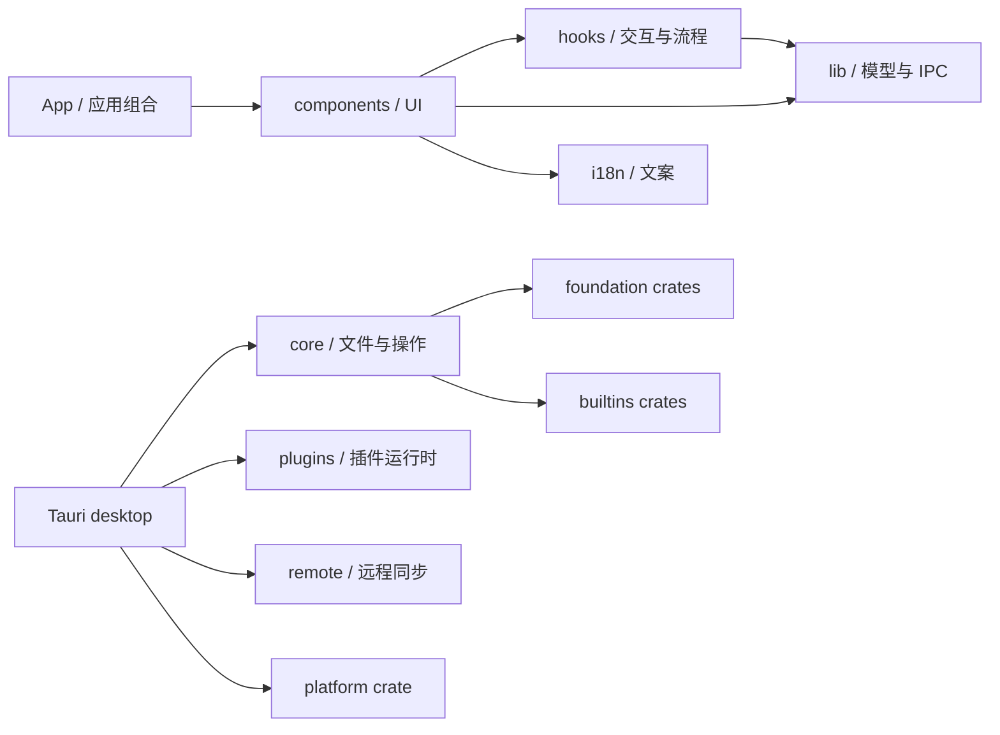

# Fiex 代码库重构基线

> 快照日期：2026-11-12
> 审查基线：Core PR #180 head `5e23a8e596a6d93c314cf54adc397766992fbf00`，SDK PR #36 head `4ee25923f09ced83ca29146f22091172a31ff929`。本页保留 2026-11-12 的原始规模统计，并在阶段记录中逐步补充后续工作。
> 用途：记录本轮分阶段重构的起点，避免目录迁移后失去可比较的测试、尺寸与 CI 基线。

## 当前结构与依赖方向

前端已有可复用的业务分区，但主要按代码种类分布。Explorer 的视图在 `components/browser`，导航、列表、监听等状态 hooks 归属 `features/explorer/hooks`，纯展示与列表模型归属 `features/explorer/model`。文件操作及菜单也横跨组件、hooks 与 lib。Rust 则已有 foundation、builtins、platform crates；Tauri 主 crate 仍组合 desktop、core、plugins、remote 和 infrastructure。

图中前端箭头表示当前主要源码归属与调用关系的概览，不表示允许任意跨层引用。后续迁移的依赖规则是：UI 经 feature service 和 typed IPC 进入宿主；Rust 桌面入口只适配输入输出，业务用例依赖稳定的 domain/foundation 接口，平台与 Provider 实现留在适配层。

本轮先建立 `src/features/explorer/model`，将只用于文件列表展示的文件名格式化逻辑及其测试放在同一 feature。此次迁移保持函数签名和行为不变，删除旧 `src/lib` 入口，不留兼容转发。

## 规模与测试现状

下表的源码数按当前仓库树统计，测试文件数包含相邻的 Vitest、Rust test 模块和 Playwright specs；它反映测试分布，不等价于行为覆盖率。

| 区域                                  |                                                                             当前基线 | 已知维护问题                                                                                                  |
| ------------------------------------- | -----------------------------------------------------------------------------------: | ------------------------------------------------------------------------------------------------------------- |
| `src/`                                |                                            271 个 TypeScript/TSX 文件；42 个测试文件 | 组件、hooks、lib 按技术种类拆分；基线时严格边界检查只覆盖 IPC JSON 基础解析器，本 PR 加入 Explorer 文件名模型 |
| `e2e/`                                |                                                           10 个 Playwright spec 文件 | fixture 能验证 UI 状态和命令副作用，但不能代替真实 Finder、Windows Shell 或 Linux 桌面行为                    |
| `src-tauri/src` 与 `src-tauri/crates` | 主 crate 有 385 个 Rust 文件、38 个测试文件；crates 有 83 个 Rust 文件、9 个测试文件 | 主 crate 仍承载多项编排；部分高风险场景缺少故障注入或真实平台验证                                             |
| `sdk/rust`                            |                                                        79 个 Rust 文件、3 个测试文件 | SDK 是独立 submodule；协议变化要先对齐 Core 和官方插件                                                        |
| 大文件门禁                            |                                   `scripts/file-size-baseline.json` 有 44 项历史例外 | 检查会阻止记录文件继续变大；目标是分功能逐项删除，不重置额度                                                  |

现有 E2E 已包含新建文件后默认选中、零选择时的新建菜单、多选废纸篓彻底删除、子菜单切换和视口边缘约束、双面板状态等回归。本 PR 再补充工具栏排序只影响活动目录的双面板交互测试。后续新增测试应针对未覆盖的状态或失败路径，不重复增加只断言 toast/快照的用例。需求与已知缺口继续以[软件需求与测试追溯](/developer/requirements)为事实来源。

## CI 与验证基线

PR #91 head 的最近一次完整 `Core tests, IPC and release` workflow 于 2026-11-11 成功，观测耗时约 19 分 35 秒。现有 workflow 包含：

- Scope Policy 的 Kani 证明、覆盖率门槛与变异测试；
- 前端格式、lint、边界类型、文件尺寸、Tauri 契约、i18n、Vitest 与构建；
- Playwright 浏览器 UI 测试；
- Linux、macOS、Windows 桌面构建与 Rust 检查；
- 发布前原生依赖审计与安装包流程。

本轮不得删除或放宽这些 job。前端全源覆盖率由 `npm run test:coverage` 采集，Rust workspace library unit tests 由 `cargo llvm-cov` 采集，两者均与提交库中的初始基线比较并发布 CI artifact；目前只报告、不设通过门槛。关键用户操作的跨平台性能门槛仍需等待三平台样本校准；Scope Policy 现有覆盖率门槛保持不变。

## 分阶段实施记录

| 阶段                          | 状态                                                         | 交付                                                                                                                                                                                                                                                                                                                                                                                                                                                                                                                                                                                                                                                                                                                                                                                                                                                                                                                                                                                                                                                                                                                                                                                                                                                                                                                                                                                                                                                                                                                                                                                                                                                                                                                                                                                                                                                                                                                                                                                                                                                                                                                                                                                               |
| ----------------------------- | ------------------------------------------------------------ | -------------------------------------------------------------------------------------------------------------------------------------------------------------------------------------------------------------------------------------------------------------------------------------------------------------------------------------------------------------------------------------------------------------------------------------------------------------------------------------------------------------------------------------------------------------------------------------------------------------------------------------------------------------------------------------------------------------------------------------------------------------------------------------------------------------------------------------------------------------------------------------------------------------------------------------------------------------------------------------------------------------------------------------------------------------------------------------------------------------------------------------------------------------------------------------------------------------------------------------------------------------------------------------------------------------------------------------------------------------------------------------------------------------------------------------------------------------------------------------------------------------------------------------------------------------------------------------------------------------------------------------------------------------------------------------------------------------------------------------------------------------------------------------------------------------------------------------------------------------------------------------------------------------------------------------------------------------------------------------------------------------------------------------------------------------------------------------------------------------------------------------------------------------------------------------------------- |
| P0-01 基线                    | PR #92                                                       | 锁定 Core/SDK 基线、记录现有目录/测试/大文件/CI 现状，并将审计页加入唯一 VitePress 文档站点                                                                                                                                                                                                                                                                                                                                                                                                                                                                                                                                                                                                                                                                                                                                                                                                                                                                                                                                                                                                                                                                                                                                                                                                                                                                                                                                                                                                                                                                                                                                                                                                                                                                                                                                                                                                                                                                                                                                                                                                                                                                                                        |
| Explorer feature 起步         | PR #92                                                       | 迁移 `formatDisplayFileName` 与相邻测试到 `src/features/explorer/model`，更新唯一调用方                                                                                                                                                                                                                                                                                                                                                                                                                                                                                                                                                                                                                                                                                                                                                                                                                                                                                                                                                                                                                                                                                                                                                                                                                                                                                                                                                                                                                                                                                                                                                                                                                                                                                                                                                                                                                                                                                                                                                                                                                                                                                                            |
| P0-02 保护网                  | PR #181                                                      | PR #92 补双面板排序 UI 回归；PR #93 增加 Trash“放回原处”端到端回归；PR #94 增加过期目录响应竞态 E2E；PR #96 补插件重新握手后能力索引替换测试；PR #103 补源变化回滚、PR #106 补嵌套目录 Provider 写入故障后的回滚；PR #154 增加 Windows Shell AppsFolder/应用标识原生 smoke 与 Linux USB raw access 权限保护测试；macOS Finder Trash 测试已接入三平台矩阵；PR #181 增加系统外部 Finder Trash 元数据恢复到磁盘的集成测试、Windows AppsFolder Notepad 实际打开文件与 Command Prompt 指定目录启动测试，以及 Linux loopback block device 的授权/已挂载拒绝测试；物理 USB 热插拔未纳入托管 CI                                                                                                                                                                                                                                                                                                                                                                                                                                                                                                                                                                                                                                                                                                                                                                                                                                                                                                                                                                                                                                                                                                                                                                                                                                                                                                                                                                                                                                                                                                                                                                                                            |
| P4-01 大文件例外清理          | PR #96、#107、#113–#117、#153、#156–#180                     | PR #96 将 ProviderRegistry 单测拆分到同目录测试模块；PR #107 将 FileSystem Provider 集成测试按 views、transfers、resources 分组；PR #113 按 provider 拆分 Native VFS handlers；PR #114 独立目录快照内存 LRU 缓存；PR #115 将操作队列单测迁至同目录；PR #116 按 router、scope、validation 拆分事件测试；PR #117 将远程缓存单测移到同目录；PR #153 将 aria2 下载配置、引擎执行和流生命周期拆到相邻模块；PR #156 将 RPC 请求/响应摘要生成从日志存储模块拆分；PR #157 将虚拟目录搜索快照协调从引擎路由模块拆分；PR #158 将远程连接权限校验与网络域投影拆到权限模块；PR #159 将离线缓存目录回退及错误分类拆到子模块；PR #160 将连接菜单 action 执行编排拆到独立模块；PR #161 将 Tauri 启动配置与窗口生命周期处理拆出组合入口；PR #162 将菜单预检和并行可用性检查从 Provider 注册模块拆出；PR #163 将装饰缓存快照比较与增量复用拆到独立模块；PR #164 将状态中心筛选规则和筛选菜单拆到 activity 子模块并增加筛选回归测试；PR #165 将会话级右键菜单资源快照缓存拆到专用模块并测试缓存键校验；PR #166 将插件包内预览资源路径校验与读取拆分，并覆盖相对路径、安全路径和无效字段；PR #167 将系统应用身份和名称注册逻辑从应用目录缓存编排中拆分并补充名称清理测试；PR #168 将 Applications URI 编码、规范化与节点解析从状态存储入口移到 uri 模块；PR #169 将音频、MP4 与 Matroska 元数据解析拆到子模块并补时长格式测试；PR #170 将插件 Provider 文件流读写桥接拆到独立模块；PR #171 将进程标准输出的 JSON-RPC 帧读取与响应路由拆到独立模块；PR #172 将预览对话框状态呈现、内容分支和底栏拆到相邻组件并增加布局模型测试；PR #173 将文件选择器目录生命周期、筛选排序模型与选择操作拆到专用模块并补模型测试；PR #174 将工具栏顺序补全和拖动样式计算提取到纯模型并补测试；PR #175 将连接挂载与已打开 tab 的识别规则提取并补覆盖；PR #176 将侧栏重排的移动、落点、间隙和位移规则提取并补纯模型测试，位置图标渲染移到相邻组件；PR #177 将插件面板桥接操作分派及尺寸、隐藏状态策略拆到独立模块并补策略测试；PR #178 将应用控制器的文件、连接、打开、工作区和快捷键 action 组合移到专用 hook；PR #179 将路径、文件元数据和排序/分组模型从公共 files 入口拆到同目录模块，公共导出保持不变；PR #180 配套 SDK PR #36 将 12 个 Rust/UI SDK 超限文件拆为专用模块，并将所有 SDK 源文件降至 300 行以内；基线已清空，剩余 0 项 |
| P2-01 Explorer feature        | PR #98–#102、#104–#105、#108                                 | 将导航、列表生命周期 hooks、目录专属列宽偏好、流式搜索、目录视图、列表比较/缓存及列表网格布局/拖拽模型迁移到 Explorer feature；共享偏好合同与 IPC 归一化留在 lib                                                                                                                                                                                                                                                                                                                                                                                                                                                                                                                                                                                                                                                                                                                                                                                                                                                                                                                                                                                                                                                                                                                                                                                                                                                                                                                                                                                                                                                                                                                                                                                                                                                                                                                                                                                                                                                                                                                                                                                                                                   |
| P2-02 文件操作策略            | PR #110、#118、#155、#182                                    | 将副本能力判断和移动路径过滤提取到 Explorer model；PR #118 将批量重命名的两阶段执行与失败回滚迁入 Explorer operation，并覆盖交换重命名和回滚；PR #155 修复永久删除失败时仍清空选择状态的问题，并增加成功/失败回归用例。PR #182 将单项重命名的 capability gate 与 IPC 执行收敛到 Explorer operation，并覆盖权限拒绝、成功返回与失败结果；hook 保留对话框、选择、错误展示、重命名输入与目录刷新等 UI 状态                                                                                                                                                                                                                                                                                                                                                                                                                                                                                                                                                                                                                                                                                                                                                                                                                                                                                                                                                                                                                                                                                                                                                                                                                                                                                                                                                                                                                                                                                                                                                                                                                                                                                                                                                                                            |
| P2-03 文件操作归属            | PR #111、#238–#241；应用组合继续收窄                         | 操作策略、执行模型、合同和测试统一归入 `features/file-operations`；feature hook 组合创建、回收、恢复、传输、单项/批量重命名。串行 runner 将 IPC、活动状态、权限反馈和目录刷新作为注入服务；批量重命名状态、提交与刷新由 feature 管理并有单测。应用层 hook 绑定 Tauri、文件选择器及状态中心；feature hooks/services 纳入严格类型边界。应用壳与 native environment 仍逐步收窄其控制器输入。                                                                                                                                                                                                                                                                                                                                                                                                                                                                                                                                                                                                                                                                                                                                                                                                                                                                                                                                                                                                                                                                                                                                                                                                                                                                                                                                                                                                                                                                                                                                                                                                                                                                                                                                                                                                          |
| P2-04 菜单策略                | PR #112                                                      | 将 Core 菜单 IPC 类型移到共享 lib，将“更多”菜单计划和空菜单可见性规则及其测试迁入 Explorer model；菜单呈现与 action 执行仍留在组件适配层                                                                                                                                                                                                                                                                                                                                                                                                                                                                                                                                                                                                                                                                                                                                                                                                                                                                                                                                                                                                                                                                                                                                                                                                                                                                                                                                                                                                                                                                                                                                                                                                                                                                                                                                                                                                                                                                                                                                                                                                                                                           |
| P3-01 Rust FS/Operations      | PR #186–#188、#195、#198、#202–#203、#205–#206、#212（分批） | 将 OperationResult、Conflict、Resolution、Undo 和取消检查下沉至共享 core/operation_types；复制暂存归入 core/transfers，路径工具归入 core/fs/path_utils；PR #187/#188 拆分 ResourceBroker；PR #195 覆盖 preflight 缓存瞬时故障、单飞重试和变更失效；PR #198 通过 ResourceBroker、ProviderRegistry、Applications VFS 与 availability cache 的真实调用链验证拒绝缓存、Provider 状态变化后的失效和重新允许。PR #202 为 IpcVfsProvider 增加可注入 transport，覆盖断连透传、恢复和畸形响应；PR #203 增加真实 Core/Host/SDK mock VFS 的跨进程打开与重启恢复 smoke；Provider list 故意使插件进程退出，Core 返回失败后自动重启，并由后续 list/stat 请求恢复。PR #205 为 Core provider 写入流增加仅测试启用的定点故障注入；在首个目标已提交后令嵌套目标写入失败，验证先前目标回滚、源内容及原目标内容保持不变。PR #206 验证回滚失效后目录缓存 revision 递增并拒绝旧列表回填；PR #212 让独立进程执行回滚失败，再由后续进程重新打开恢复清单和原始备份。真实第三方远端 Provider 的端到端回滚仍需服务账号环境验证。                                                                                                                                                                                                                                                                                                                                                                                                                                                                                                                                                                                                                                                                                                                                                                                                                                                                                                                                                                                                                                                                                                                                                                                              |
| P3-02 Rust Plugin Host/Remote | PR #189–#190、#192、#194、#196、#203、#210（分批）           | #189 收紧 JSON-RPC 回复版本、数字 ID 与 result/error envelope；#190 覆盖远端上传分块和 abort；#192 注入 provider 边界验证断网 stat/refresh 时缓存字节与 revision baseline 不变、双端修改进入 conflict，并补 metadata 原子写入/读回验证；#194 通过 SDK mock fixture 验证插件子进程意外退出后当前 RPC 失败、后续 ping 重启并重新握手；#196 修复自启动注册表就绪竞态；#203 新增两个独立 Core 进程间的 VFS view 持久化/恢复 smoke，并在真实 VFS list 中杀死 SDK 插件进程，验证故障返回和下一次 Provider 请求自动重启恢复；平台 CI 结果待新 PR 工作流运行。#210 通过残留暂存文件模拟元数据替换前的进程中断，验证最后已提交基线可恢复；真实第三方远端服务和物理断电验证仍未覆盖。                                                                                                                                                                                                                                                                                                                                                                                                                                                                                                                                                                                                                                                                                                                                                                                                                                                                                                                                                                                                                                                                                                                                                                                                                                                                                                                                                                                                                                                                                                                        |
| P1-01 架构边界                | PR #97                                                       | 新增 AST 导入检查，禁止 feature 层依赖 components/hooks；进入前端 CI；Vitest 覆盖允许和拒绝方向                                                                                                                                                                                                                                                                                                                                                                                                                                                                                                                                                                                                                                                                                                                                                                                                                                                                                                                                                                                                                                                                                                                                                                                                                                                                                                                                                                                                                                                                                                                                                                                                                                                                                                                                                                                                                                                                                                                                                                                                                                                                                                    |
| P1-02 Info IPC                | PR #95                                                       | Info 合同由 IPC 层定义并由 UI 消费，严格类型检查覆盖 Info 解码器，回归测试拒绝把枚举值编码为数组                                                                                                                                                                                                                                                                                                                                                                                                                                                                                                                                                                                                                                                                                                                                                                                                                                                                                                                                                                                                                                                                                                                                                                                                                                                                                                                                                                                                                                                                                                                                                                                                                                                                                                                                                                                                                                                                                                                                                                                                                                                                                                   |
| P1-03 搜索 IPC                | PR #109                                                      | `search_files` 命令结果改为 `void`，参数和结果通过 typed command map 约束；搜索批次继续由 Channel 独立传输并经 `parseSearchBatch` 校验                                                                                                                                                                                                                                                                                                                                                                                                                                                                                                                                                                                                                                                                                                                                                                                                                                                                                                                                                                                                                                                                                                                                                                                                                                                                                                                                                                                                                                                                                                                                                                                                                                                                                                                                                                                                                                                                                                                                                                                                                                                             |
| P1-04 Core 菜单执行 IPC       | PR #119                                                      | 为 Core 菜单执行结果增加运行时 decoder，限定 command 和字段形状，移除组件适配器中的双重类型断言；插件自定义 JSON 仍走通用结果路径                                                                                                                                                                                                                                                                                                                                                                                                                                                                                                                                                                                                                                                                                                                                                                                                                                                                                                                                                                                                                                                                                                                                                                                                                                                                                                                                                                                                                                                                                                                                                                                                                                                                                                                                                                                                                                                                                                                                                                                                                                                                  |
| P1-05 连接菜单执行 IPC        | PR #120                                                      | 将连接菜单 DTO 移到共享 lib，为 edit/close Core action 增加严格 decoder 和目标连接 ID 校验；插件自定义结果保留通用路径                                                                                                                                                                                                                                                                                                                                                                                                                                                                                                                                                                                                                                                                                                                                                                                                                                                                                                                                                                                                                                                                                                                                                                                                                                                                                                                                                                                                                                                                                                                                                                                                                                                                                                                          #]yۿm�G����ƭyԻ�')
  },
  get 'files.rename'() {
    return t('重命名文件')
  },
  get network() {
    return t('网络访问')
  },
  get commands() {
    return t('执行外部命令')
  },
  get hooks() {
    return t('打开前钩子')
  },
}
export const permissionHints: Record<string, string> = {
  get metadata() {
    return t('读取本次授权范围内文件和文件夹的名称、大小、类型等属性；不读取内容或枚举目录。')
  },
  get 'folders.read'() {
    return t('列出本次授权范围内的文件夹。')
  },
  get 'folders.create'() {
    return t('在当前目录及子目录创建文件或文件夹。')
  },
  get 'folders.delete'() {
    return t('删除当前目录内的文件或文件夹，包括其内容。')
  },
  get 'folders.rename'() {
    return t('重命名或移动当前目录内的目录项。')
  },
  get 'files.read'() {
    return t('读取当前目录及子目录内的文件内容。')
  },
  get 'files.write'() {
    return t('修改文件内容；通过暂存和提交保存，发生冲突时停止。')
  },
  get 'files.create'() {
    return t('在本次授权范围内创建不存在的文件。')
  },
  get 'files.delete'() {
    return t('删除本次授权范围内的文件。')
  },
  get 'files.rename'() {
    return t('重命名本次授权范围内的文件。')
  },
  get network() {
    return t('通过宿主访问单独授权的网络目标，插件自身不能直接联网。')
  },
  get commands() {
    return t(commandRisk)
  },
  get hooks() {
    return t(
      '在打开文件前接管操作（例如把压缩包直接解压到当前目录）。高优先级先执行，钩子可以选择放行或消费这次打开。',
    )
  },
}
/** Everything the manifest declares and requests: the default selection of the
 * grouped consent sheet. Activation only ever narrows this set. */
export function activationConsent(plugin: PluginInfo): ActivationConsent {
  return {
    permissions: [...new Set(plugin.declaredPermissions || [])].sort(),
    networkAll: Boolean(plugin.requestedNetworkAll),
    domains: [...new Set(plugin.requestedNetworkDomains || [])].sort(),
    commands: [...new Set(plugin.requestedCommands || [])].sort(),
  }
}

const activationSections = [
  {
    id: 'files',
    get title() {
      return t('访问文件')
    },
    get hint() {
      return t('读取或修改授权目录中的文件内容与基础属性。')
    },
  },
  {
    id: 'folders',
    get title() {
      return t('访问文件夹')
    },
    get hint() {
      return t('列出、创建、重命名或删除授权目录中的文件夹。')
    },
  },
  {
    id: 'network',
    get title() {
      return t('网络与域名')
    },
    get hint() {
      return t('插件只能通过宿主访问下面单独勾选的目标，自身不能直接联网。')
    },
  },
  {
    id: 'commands',
    get title() {
      return t('外部命令')
    },
    get hint() {
      return t('命令由宿主代理执行，插件进程不能直接启动程序。')
    },
  },
  {
    id: 'other',
    get title() {
      return t('其他能力')
    },
    get hint() {
      return t('不属于以上分组的宿主能力。')
    },
  },
] as const

type ActivationSectionId = (typeof activationSections)[number]['id']

const permissionOrder = [
  'metadata',
  'folders.read',
  'folders.create',
  'folders.delete',
  'folders.rename',
  'files.read',
  'files.write',
  'files.create',
  'files.delete',
  'files.rename',
  'network',
  'commands',
  'hooks',
]
const rank = (value: string) => {
  const index = permissionOrder.indexOf(value)
  return index === -1 ? permissionOrder.length : index
}

/** Files and folders are reviewed separately; metadata covers both, so it is
 * reviewed with files. Network targets stay with the network capability and
 * commands with the command capability. */
function permissionSection(permission: string): ActivationSectionId {
  if (permission === 'network') return 'network'
  if (permission === 'commands') return 'commands'
  if (permission === 'metadata' || permission.startsWith('files.')) return 'files'
  if (permission.startsWith('folders.')) return 'folders'
  return 'other'
}

interface ActivationPermission {
  id: string
  label: string
  hint?: string
}

interface ActivationCommand {
  name: string
  missing: boolean
}

export interface ActivationGroup {
  id: ActivationSectionId
  title: string
  hint: string
  permissions: ActivationPermission[]
  /** Exact hosts requested by the manifest; only network has these. */
  domains: string[]
  /** Exact executable names requested by the manifest. */
  commands: ActivationCommand[]
  /** The manifest asked for unrestricted network access. */
  networkAll: boolean
}

/**
 * Build the grouped review model for one plugin. Every declared permission,
 * requested domain and command becomes its own row, and the groups follow a
 * fixed order so the review is predictable.
 */
export function activationGroups(plugin: PluginInfo): ActivationGroup[] {
  const consent = activationConsent(plugin)
  const groups: ActivationGroup[] = activationSections.map((section) => ({
    ...section,
    permissions: [],
    domains: [],
    commands: [],
    networkAll: false,
  }))
  for (const permission of [...consent.permissions].sort((a, b) => rank(a) - rank(b))) {
    const group = groups.find((entry) => entry.id === permissionSection(permission))
    group?.permissions.push({
      id: permission,
      label: permissionLabels[permission] || permission,
      hint: permissionHints[permission],
    })
  }
  const network = groups.find((entry) => entry.id === 'network')
  if (network) {
    network.domains = consent.domains
    network.networkAll = consent.networkAll
  }
  const commands = groups.find((entry) => entry.id === 'commands')
  if (commands) {
    commands.commands = consent.commands.map((name) => ({
      name,
      missing: Boolean(plugin.missingCommands?.includes(name)),
    }))
  }
  return groups.filter(
    (group) =>
      group.permissions.length > 0 ||
      group.domains.length > 0 ||
      group.commands.length > 0 ||
      group.networkAll,
  )
}
